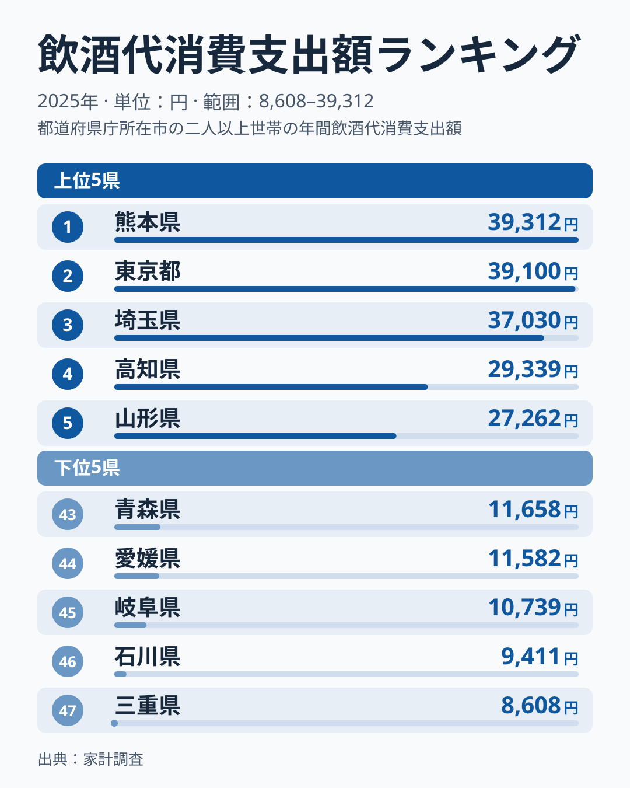
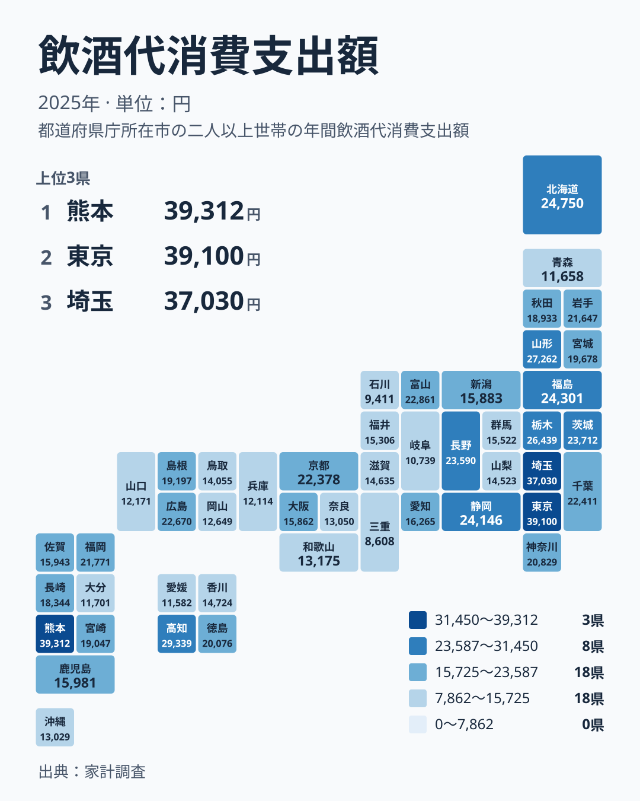

飲酒への支出には、土地ごとの暮らしぶりが表れるように見えます。2025年の家計調査で飲酒代への支出を見ると、1位は熊本県の39,312円、2位は東京都の39,100円でした。両者はほぼ並んでおり、順位の差ほどの開きがあるとは言えません。3位は埼玉県の37,030円で、最下位の三重県は8,608円にとどまります。この記事では、飲酒代への支出が最も多い都市はどこかという問いを入り口に、都道府県ごとの差を食文化や産地のイメージとあわせて見ていきます。

## 上位と下位の顔ぶれ

まず、上位5県と下位5県を図で確認します。

<source-link href="/ranking/drinking-out-consumption-expenditure">飲酒代への支出ランキングをもっと見る</source-link>

上位は、1位の熊本県が39,312円、2位の東京都が39,100円、3位の埼玉県が37,030円です。ここまでは3万円台後半で肩を並べています。4位の高知県は29,339円、5位の山形県は27,262円で、3位の埼玉県との間にははっきりした段差があります。上位は3県のまとまりと、その後ろに続く県という二段の構図です。

下位に目を移すと、47位の三重県が8,608円、46位の石川県が9,411円、45位の岐阜県が10,739円です。44位の愛媛県は11,582円、43位の青森県は11,658円となっています。最大の熊本県と最小の三重県を比べると、約4.6倍の開きがあります。同じ国の中で、飲酒代への支出がここまで違うことは注目に値します。

> [!NOTE]
> 家計調査の「飲酒代」は、費目としての酒類への支出を指します。外で飲んだ分と家庭で飲んだ分がどう含まれるのか、内訳はここで使うデータからは読み取れません。そのため「外飲みの金額」と決めつけず、あくまで飲酒にかかる支出として読んでください。調査は県庁所在地などの世帯を対象としており、県全体の平均とは限りません。

## 熊本・高知・山形に見る酒との距離

熊本県は球磨焼酎の産地として知られ、地元の酒が身近な土地というイメージがあります。1位という結果はそのイメージと重なりますが、産地であることが支出の多さの理由だと示す材料は、今回のデータにはありません。仮説として、地元の酒に親しむ習慣が背景にある可能性はあります。

高知県は4位で29,339円と高く、宴席を囲む文化が語られる土地です。山形県は5位で27,262円で、米どころで日本酒の蔵も多い県です。ただし、これらも「そうした風土が数字に表れているのかもしれない」という見立ての域を出ません。

産地と並べて見ると、酒の名産地が必ずしも上位に来ないことも分かります。たとえば新潟県は日本酒で知られますが、28位の15,883円です。福井県は31位で15,306円、秋田県は23位で18,933円です。作る土地と飲む土地は別の話として考えるのが適切です。

[熊本県のデータ](/areas/43000)では、他の指標も確認できます。食や暮らしの数字と合わせて見ると、県の特徴がより立体的になります。

## 大都市圏の飲酒代と暮らし方

東京都は2位の39,100円、埼玉県は3位の37,030円で、首都圏の都県が上位に並びます。仮説としては、職場帰りに飲む機会や店の選択肢の多さが関わっている可能性がありますが、今回のデータだけで確かめることはできません。[東京都のデータ](/areas/13000)には、人口や産業など別の角度の指標もそろっています。

ところが、同じ大都市でも大阪府は29位の15,862円、愛知県は25位の16,265円です。兵庫県は41位で12,114円と低めです。大都市だから高いという単純な図式は成り立ちません。東京都と埼玉県が際立って高いことのほうが、むしろ特徴的です。

> [!WARNING]
> 家計調査は標本調査で、県ごとのサンプル数は限られます。少数の世帯の動きが平均を左右することがあり、順位の小さな差は誤差の範囲かもしれません。熊本県と東京都のようにほぼ並ぶ1位と2位は、順位を逆に読んでも不思議ではない差として扱うべきです。

## 地図で見る地方ごとのばらつき

地理的な広がりを、タイルマップで確かめます。

地図で目を引くのは、高い県が一つの地方に固まらず、各地に散らばっていることです。そこで、地方ごとに域内の最高と最低を見てみます。

北海道・東北は、最高が山形県の27,262円、最低が青森県の11,658円です。北海道は7位の24,750円、福島県は8位の24,301円で、域内の幅は広めです。関東は東京都の39,100円に対し、最も低い群馬県でも15,522円で、全体に水準が高い地方です。

中部は、静岡県の24,146円から石川県の9,411円までの幅があり、隣り合う県でも水準が大きく異なります。近畿は三重県を除くと、最高が京都府の22,378円、最低が兵庫県の12,114円で、域内のばらつきは比較的小さめです。三重県は47位の8,608円で、全国でも最も低い位置にあります。

中国は広島県の22,670円と山口県の12,171円、四国は高知県の29,339円と愛媛県の11,582円が両端です。九州・沖縄は熊本県の39,312円から大分県の11,701円まで、全国で最も大きな幅が見られます。九州だから高いとまとめることはできません。

> [!TIP]
> 順位だけでなく金額の段差を見ると読み違いを避けられます。3位の埼玉県37,030円から4位の高知県29,339円までは大きく落ちますが、4位から10位の茨城県23,712円までは段階的に下がります。順位が一つ違っても差が小さい区間と、段差の大きい区間を見分けることが要点です。

## 四国の対比と産地のイメージ

四国では、高知県が4位で29,339円と突出しています。徳島県は19位の20,076円、香川県は32位の14,724円、愛媛県は44位の11,582円です。同じ四国でも、高知県と愛媛県では大きな差があります。

隣り合う地域で気候や食文化が近いと思われても、金額の水準はそろいません。地方単位で語るより、県ごとの違いを見るほうが実態に近いと言えます。

また、日本酒のイメージが強い新潟県や秋田県は中位にとどまります。一方、東京都や埼玉県のように産地と呼びにくい地域が上位に入っています。飲酒代の多寡は産地との結びつきだけでは説明しにくく、暮らし方や飲む場面の違いが関わる可能性もありますが、今回のデータから断定はできません。

[同じカテゴリの統計一覧](/category/economy)では、家計に関わる他の指標も見られます。飲酒代とあわせて外食や食料の支出と照らし合わせると、消費の特徴がさらに見えてきます。

## データについて

この記事で扱う飲酒代消費支出額は、家計調査の2025年の値で、単位は円です。以下の点を押さえて読むと、数字の意味をつかみやすくなります。

- 中位の県は、数百円から千円台の違いで順位が入れ替わります
- 上位と下位の大きな対比を中心に捉えるのが安全です
- 熊本県の39,312円と三重県の8,608円のような両端の比較は、誤差よりも差のほうがはるかに大きい例です

## まとめ

2025年の飲酒代は、熊本県が39,312円、東京都が39,100円、埼玉県が37,030円と、上位3県が3万円台後半で並びました。下位は三重県の8,608円、石川県の9,411円、岐阜県の10,739円です。酒の産地が必ずしも上位に来ない一方、首都圏の都県が高く、地方内のばらつきも大きいことが分かります。自分の県の順位を確かめ、隣県との違いにも目を向けてみてください。
