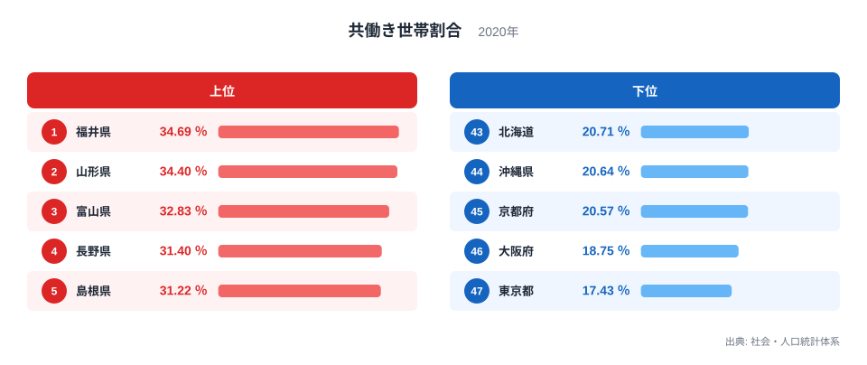
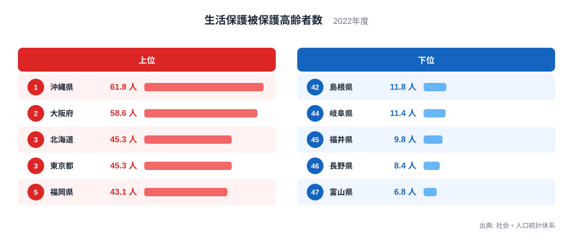
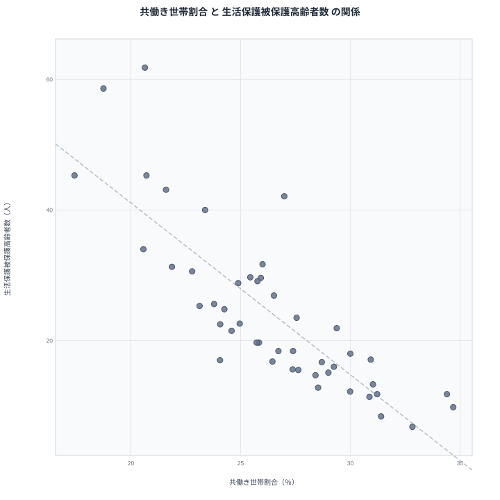

共働き世帯が多い県ほど、生活保護を受ける高齢者が少ない。都道府県のデータを並べると、そう読める強い関係が現れます。しかし、共働きが高齢者の暮らしを直接支えているのでしょうか。それとも、別の何かが両方の数字を同時に動かしているのでしょうか。

この記事では、共働き世帯割合と生活保護被保護高齢者数の関係を、47 都道府県の実データで確かめます。数字の並びから見える相関と、その背後にありそうな真因を分けて考えます。

## 共働き世帯割合の上位と下位

まず、共働き世帯割合から見ていきます。2020年の数字です。

<source-link href="/ranking/dual-income-household-ratio">共働き世帯割合ランキングをもっと見る</source-link>

1位は福井県で34.69％です。2位は山形県で34.4％、3位は富山県で32.83％、4位は長野県で31.4％、5位は島根県で31.22％と続きます。上位には中部の県と、東北や中国の県が混ざっています。福井県の詳しい数字は[福井県のデータ](/areas/18000)で、山形県の数字は[山形県のデータ](/areas/06000)で確認できます。

一方、下位には大都市圏が並びます。47位は東京都で17.43％、46位は大阪府で18.75％、45位は京都府で20.57％です。44位は沖縄県で20.64％、43位は北海道で20.71％となっています。1位の福井県と47位の東京都を比べると、34.69％と17.43％で、2倍ほどの開きがあります。

注目したいのは、下位に大都市だけでなく北海道と沖縄県も入っていることです。共働きの少なさは、単純な「都会らしさ」だけでは説明しきれません。

> [!NOTE]
> 共働き世帯割合は、世帯のうち夫婦ともに就業している世帯の割合です。ここでの値は2020年のもので、働き方の変化が続く中では今とずれている可能性があります。単身世帯や高齢夫婦のみの世帯が多い県では、この割合が低く出やすい点にも注意してください。

## 生活保護を受ける高齢者の上位と下位

次に、生活保護被保護高齢者数のランキングです。2022年の数字で、単位は人です。

1位は沖縄県で61.8人です。2位は大阪府で58.6人、3位は北海道で45.3人、4位は東京都で45.3人、5位は福岡県で43.1人です。大都市圏と、北海道や沖縄県、九州の県が上位に並んでいます。全体の一覧は[生活保護被保護高齢者数ランキング](/ranking/elderly-on-public-assistance-per-1000-65plus)で見られます。

反対に、少ない側は47位が富山県で6.8人です。46位は長野県で8.4人、45位は福井県で9.8人、44位は岐阜県で11.4人、43位は島根県で11.8人です。1位の沖縄県と47位の富山県の比は、61.8人と6.8人で、9倍ほどの差になります。

先ほどの共働きの上位と、ここでの少ない側には重なる県が目立ちます。福井県、長野県、富山県、島根県は、どちらも共働きが多く、生活保護の高齢者が少ない側にいます。逆に東京都、大阪府、北海道、沖縄県は、共働きが少なく、生活保護の高齢者が多い側です。

> [!WARNING]
> この数字は都道府県ごとの平均的な水準を示すだけで、一人ひとりの事情は映しません。また、生活保護の受給は、制度の運用や申請のしやすさ、地域の住宅事情にも左右されます。数が多いことは、必ずしも困窮の深さそのものを意味しません。

## 散布図で見る関係の強さ

2つの指標を1枚の図に重ねると、関係がはっきりします。

ピアソンの相関係数は-0.82です。計算に使ったのは47都道府県です。共働き世帯割合が高い県ほど、生活保護被保護高齢者数が少ない傾向がはっきり出ています。符号がマイナスなので、一方が高いと他方は低い逆相関です。

ただし、この数字は「2つが同じ方向に並んで動く傾向」を表すにすぎません。共働きが増えれば生活保護の高齢者が減る、という因果の大きさを示す値ではありません。また、相関係数から「何割を説明できる」と読むこともできません。

散布図の右下には福井県、山形県、富山県、長野県のような県が集まります。左上には東京都、大阪府、北海道、沖縄県が位置します。この配置が、相関を生み出している主な部分です。

> [!TIP]
> 散布図を読むときは、傾きだけでなく「どの県が両端にいるか」を見てください。端に位置する少数の県が、相関を大きく左右していることがあります。気になる県は、各県のページで個別の順位を確かめるのが近道です。

## 見かけの相関と、考えられる真因

では、なぜこの逆相関が生まれるのでしょうか。共働きが高齢者の生活保護を直接減らしている、と結論づけるのは早すぎます。共働きが多いことと、高齢者が生活保護を受けにくいことは、別の土台から同時に生まれている可能性があります。

考えられる第一の要因は、仕事と地域の暮らし方です。共働きが多い県では、女性も含めて働き続ける土地柄があり、安定した働き口が多いのかもしれません。長く働いた人は、年金などの収入が厚くなりやすいと考えられます。そうなれば、高齢になってから生活保護に頼る人は少なくなります。

第二の要因は、家族の形です。共働きが多い県には、三世代で同居し、家族が互いに支え合う地域が含まれると言われます。同居する家族がいれば、高齢者の暮らしは家計の中で支えられ、生活保護に至りにくい面があるでしょう。ただし、これはこの記事のデータから確かめたことではなく、あくまで仮説です。

第三の要因は、大都市の特徴です。東京都や大阪府は、単身世帯が多く、住宅費も高い傾向にあります。共働き世帯割合が低く、同時に高齢者の生活保護が多いのは、この都市の構造が両方を押し上げているからかもしれません。共働きの少なさが生活保護を生んでいるのではなく、都市という共通の背景が2つを同時に動かしている、という見方です。

つまり、-0.82という強い相関があっても、共働きを増やせば生活保護の高齢者が減るとは言えません。相関は因果ではありません。両方に影響する第三の要因、たとえば雇用の質、家族の形、住宅事情が真因である可能性を考える必要があります。

## 例外から読む、相関のほころび

相関が強くても、すべての県が一つの線に乗るわけではありません。例外を見ると、単純な説明の限界が分かります。

沖縄県は、共働き世帯割合が20.64％で44位です。生活保護被保護高齢者数は61.8人で1位です。この組み合わせは相関どおりで、共働きが少なく、生活保護が多い側に入ります。一方、北海道は共働きが20.71％で43位、生活保護が45.3人で3位です。こちらも同じ方向ですが、大都市ではなく、産業構造や地域事情が違います。

逆に、共働きが少なめでも生活保護が少ない県があります。たとえば愛知県は共働きが25.84％で27位、生活保護が19.7人で25位です。中位同士に収まっています。また、埼玉県は共働きが24.26％で34位ですが、生活保護は24.8人で19位です。共働きの順位が低くても、生活保護が極端に多いわけではありません。

反対に、青森県は共働きが26.99％で21位と中位ですが、生活保護は42.1人で6位です。共働きがそれほど少なくないのに、生活保護の高齢者が多い県もあるのです。共働きの水準だけでは、高齢者の生活保護を説明しきれないことが分かります。

こうした例外は、共働き以外の要因が働いている証拠です。地域の産業、年金の受給水準、高齢者の暮らし方、制度の運用など、複数の要因が重なって結果が決まります。

## データについて

共働き世帯割合は、社会・人口統計体系の指標で、年は2020年です。単位は％です。生活保護被保護高齢者数も同じ社会・人口統計体系の指標で、年は2022年、単位は人です。

2つの指標は調査年が異なります。2020年の共働きの姿と、2022年の生活保護の状況を重ねているため、時点のずれがある点は念頭に置いてください。また、生活保護被保護高齢者数の値は小数を含む人数として示されており、人口規模をそろえた形で比べられています。

散布図の相関係数は、47都道府県の2つの値からピアソンの方法で求めた-0.82です。この値は関係の向きと強さの目安であり、原因と結果を示すものではありません。同じ分野の他の指標は、[同じカテゴリの統計一覧](/category/population)から探せます。

## まとめ

共働き世帯割合が高い県ほど、生活保護被保護高齢者数は少ない傾向にあります。相関係数は-0.82で、47都道府県の全体を通して強い逆相関です。福井県、山形県、富山県、長野県が共働きの多い側に、東京都、大阪府、北海道、沖縄県が少ない側にいます。

ただし、これは相関であって、因果ではありません。雇用の安定、家族の形、都市の住宅事情といった背景が、2つの数字を同時に動かしている可能性があります。共働きという一つの数字だけで高齢者の暮らしを語らず、地域の背景を合わせて読むことが大切です。
