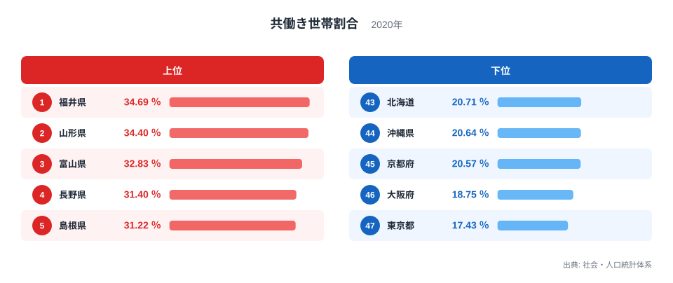
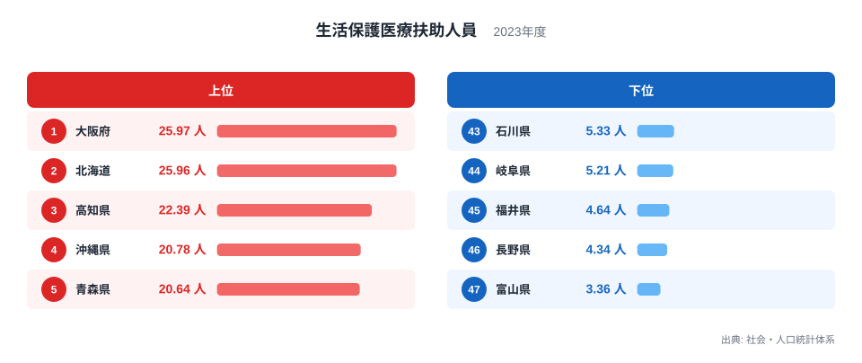
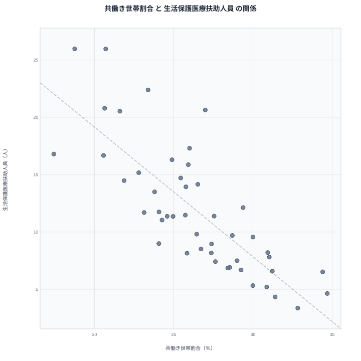

共働き世帯割合が高い県では、生活保護の医療扶助を受ける人が少ない。2つの統計を並べると、そんな傾向がはっきり見えてきます。ただし、これは「共働きが増えれば医療扶助が減る」という意味ではありません。この記事では、47都道府県のデータから見かけの相関を確認し、そこから先は何が言えて何が言えないのかを整理します。

## 共働き世帯割合が高いのはどの県か

まず共働き世帯割合のランキングです。2020年のデータで最も高いのは福井県の34.69％で、2位は山形県の34.4％、3位は富山県の32.83％です。4位は長野県の31.4％、5位は島根県の31.22％と続きます。

<source-link href="/ranking/dual-income-household-ratio">共働き世帯割合ランキングをもっと見る</source-link>

上位5県を地方でまとめると、中部が福井県、富山県、長野県の3県で、北海道・東北が山形県、中国が島根県です。中部の県が過半を占めますが、東北や中国にも広がっています。[福井県のデータ](/areas/18000)や[山形県のデータ](/areas/06000)を開くと、他の統計でもこの傾向が重なるかを確かめられます。

下位は逆の顔ぶれです。最も低いのは東京都の17.43％で、46位は大阪府の18.75％、45位は京都府の20.57％です。44位は沖縄県の20.64％、43位は北海道の20.71％でした。下位5県は、関東が東京都、近畿が大阪府と京都府、九州・沖縄が沖縄県、北海道・東北が北海道という並びで、地方の偏りはあまりありません。むしろ大都市を抱える都府県と、北海道・沖縄県という、事情の異なる地域が同じ下位に並んでいる点が目を引きます。

> [!NOTE]
> 共働き世帯割合は、社会・人口統計体系にある2020年の値です。分母は世帯全体なので、単身世帯や高齢のみの世帯が多い県では、夫婦の就業状況にかかわらず割合が低く出やすくなります。「働く人が少ない県」という意味ではありません。

## 医療扶助を受ける人が多いのはどの県か

次にもう一方の指標です。[生活保護医療扶助人員ランキング](/ranking/public-assistance-medical-beneficiaries-per-1000)で最も多いのは、2023年の大阪府で25.97人です。2位は北海道の25.96人で、1位とはわずか0.01人の差です。3位は高知県の22.39人、4位は沖縄県の20.78人、5位は青森県の20.64人でした。

最も少ないのは富山県の3.36人です。46位は長野県の4.34人、45位は福井県の4.64人、44位は岐阜県の5.21人、43位は石川県の5.33人でした。この下位5県は、すべて中部に属します。共働き世帯割合の上位に中部の県が多かったことと、ここで重なります。

2つのランキングを重ねると、順位がほぼ逆向きに並ぶ県がはっきり見つかります。福井県は共働き1位で医療扶助は45位、富山県は共働き3位で医療扶助は47位、長野県は共働き4位で医療扶助は46位です。反対に大阪府は共働き46位で医療扶助1位、北海道は共働き43位で医療扶助2位、沖縄県は共働き44位で医療扶助4位です。

一方で、きれいに逆向きにならない県もあります。山形県は共働き2位ですが、医療扶助は42位の6.53人で、福井県や富山県ほど下位の端には寄っていません。青森県は共働き21位の26.99％と中位なのに、医療扶助は5位の20.64人です。共働き世帯割合だけでは説明しきれない県が混じっていることが、ここから読み取れます。

> [!WARNING]
> 医療扶助人員は2023年、共働き世帯割合は2020年の値で、年が3年ずれています。また、表示は「人」ですが、25.97人のように小数を含むため、実数の人数ではなく、人口に応じて換算した値とみられます。基準となる人口は本記事のデータでは確認できないので、人数そのものとして読まないでください。

## 散布図で見る2つの関係

2つの指標を1枚にまとめた散布図です。47都道府県のピアソンの相関係数は-0.79でした。共働き世帯割合が高い県ほど、医療扶助人員が少ない傾向がはっきり出ています。

点は左上から右下へ流れるように並びます。左上には、共働き世帯割合が低く医療扶助人員が多い大阪府や北海道、沖縄県が位置します。右下には、共働き世帯割合が高く医療扶助人員が少ない福井県、富山県、長野県が位置します。

ただし、-0.79という値は、点の並びがどれだけ一方向に揃っているかを表すだけです。共働きが医療扶助を減らす効果の大きさや、一方で他方を説明できる割合を示すものではありません。また、都道府県単位の関係なので、個々の世帯や個人にそのまま当てはめることもできません。

> [!TIP]
> 散布図では、まず青森県に注目してください。共働き世帯割合は21位と中位ですが、医療扶助人員は5位で、同じ共働き水準の県と比べても高い側にいます。逆に山形県は共働き2位なのに医療扶助が42位にとどまります。この2県は、共働き世帯割合以外の事情が効いている可能性を示す手がかりです。

## 見かけの相関と真因を分ける

では、なぜこのような相関が出るのでしょうか。共働きが直接、医療扶助を減らしていると決めつける根拠は、この記事のデータにはありません。第三の要因が両方に影響しているという見方もあります。

背景として語られやすいのは、次のようなものです。ただし、いずれもこの記事のデータでは確かめていません。

- 高齢化や単身世帯の多さが両方に関わっているという見方があります。単身の高齢者が多い地域では共働き世帯割合が低くなり、医療の必要も高くなりやすいという筋書きです。
- 地域の雇用の状況が関わっているという見方もあります。働く場の多さが、共働きのしやすさと生活の安定の両方に響くという筋書きです。
- 家族の形、たとえば三世代同居の多さが関係するという見方もあります。ただし、これを裏付ける数値は本記事にありません。

こうした仮説の当否は、別の統計を重ねて検証する必要があります。今回の2指標だけでは、どれが正しいかを選ぶことはできません。相関は因果ではないという点を、改めて確認しておきます。

県ごとの違いにも目を向けておきます。北海道は共働き世帯割合が43位の20.71％で、医療扶助人員は2位の25.96人です。沖縄県は44位の20.64％で、医療扶助人員は4位の20.78人です。この2県は散布図の左上に位置しますが、気候も産業も異なる地域です。同じ位置に並んでいても、理由が同じとは限りません。

## データについて

共働き世帯割合は2020年、生活保護医療扶助人員は2023年の値で、いずれも社会・人口統計体系を出典とします。相関係数は、47都道府県の値から計算したピアソンの相関係数です。調査年のずれや、指標の定義の違いがあるため、結果は目安として読んでください。

## まとめ

共働き世帯割合が高い福井県や山形県では、医療扶助人員が少なめです。共働き世帯割合が低い大阪府や北海道、沖縄県では、医療扶助人員が上位に入っています。相関係数は-0.79で、強い負の関係がありました。

ただし、青森県や山形県のように、この傾向から外れる県もあります。共働きが原因で医療扶助が減るという意味ではなく、高齢化、雇用、家族の形といった背景が両方に影響している可能性があるだけです。数字を見るときは、相関と因果を分けて考えることが大切です。同じ分野の指標を広く見たいときは、[同じカテゴリの統計一覧](/category/population)もご覧ください。
