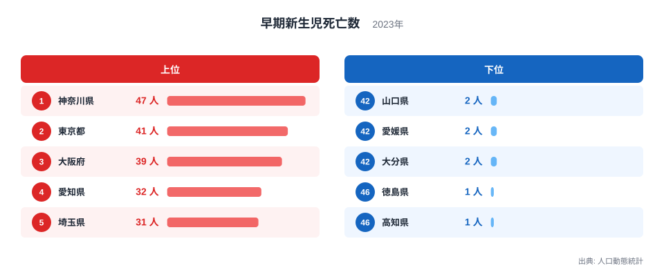
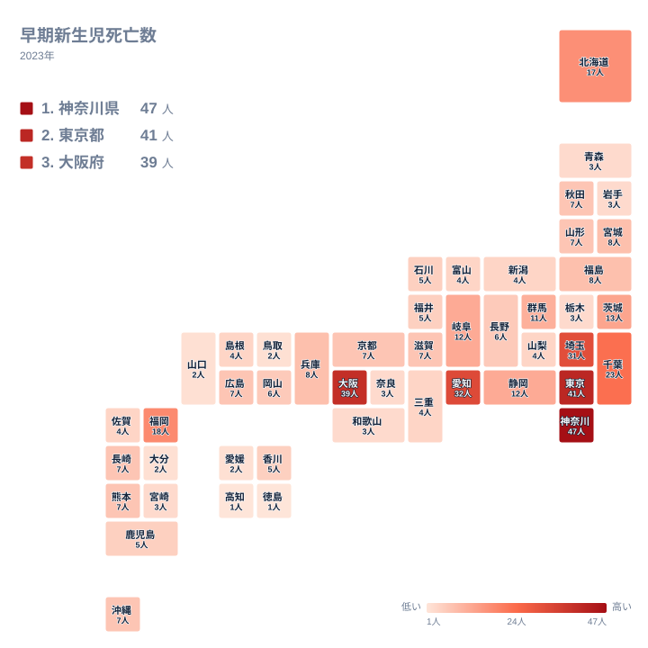

## 早期新生児死亡数が最も多い県は神奈川県

生まれて間もない赤ちゃんの命に関わる統計の一つが、早期新生児死亡数です。生後一週間未満に亡くなった赤ちゃんの人数を数えたもので、人口動態統計で毎年公表されています。

2023年の結果では、最も多かったのは神奈川県の47人でした。2位は東京都の41人、3位は大阪府の39人、4位は愛知県の32人、5位は埼玉県の31人と続きます。上位に並ぶのは、いずれも大都市圏を含む都府県です。

一方、最も少なかったのは徳島県と高知県の1人ずつで、46位の同順位です。最多の神奈川県の47人は、最少の1人の47倍にあたります。ただし、これは人数の比較であり、そのまま「危険な県」「安全な県」を意味するわけではありません。この記事では、2023年の実データから、上位と下位の顔ぶれと、同じ地方の中でのばらつきを整理します。

> [!NOTE]
> 早期新生児死亡とは、生後一週間未満の死亡を指します。この記事の数値は出生数で割った率ではなく、亡くなった人数そのものです。人口動態統計では、都道府県別の数がどの住所地や発生地をもとに計上されているかが集計の定義で決まっています。搬送先の病院がある県で数えられるのか、母親の住所のある県で数えられるのかによって、解釈が変わります。

## 上位5県と下位5県を並べて見る

<source-link href="/ranking/early-neonatal-deaths">早期新生児死亡数ランキングをもっと見る</source-link>

図で目を引くのは、上位5県の中でも差の幅が小さいことです。1位から5位までは47人から31人の範囲に収まり、首都圏の神奈川県、東京都、埼玉県と、近畿の大阪府、中部の愛知県が顔を並べます。千葉県も23人で6位に入ります。どの県も、全国の中で人の集まる大都市圏に位置しています。

下位側は、まったく違う分布の形をしています。全47件のうち、1人から3人にとどまる県は、青森県、岩手県、栃木県、奈良県、和歌山県、宮崎県、鳥取県、山口県、愛媛県、大分県、徳島県、高知県の12県にのぼります。数の少ない側に多くの県が密集し、上位に向かって急に数が伸びる、すそ野の広い分布です。

この形から読み取れるのは、全国の数字が一部の県に大きく偏っているということです。人数が多い県は、出生数の多さが背景にある可能性がありますが、この記事で使える実データには出生数が含まれていないため、断定はできません。

> [!WARNING]
> 下位の県は1人から3人という極めて小さな数です。たとえば1人の徳島県と高知県は、1人増えるだけで数が2倍になり、順位も大きく入れ替わります。早期新生児死亡のように件数の少ない統計では、1年分の順位の動きは偶然の揺れが大きく、県の傾向とは言い切れません。

## 人数が多い県は大都市圏に集まる

上位の県が多い背景として、まず考えられるのは、生まれる赤ちゃんの数の違いです。神奈川県の47人と東京都の41人は、首都圏に人口が集まっていることと関係している可能性があります。ただし、出生数の実データは手元にないため、ここでは仮説にとどめます。

もう一つの仮説は、重い病状の赤ちゃんを受け入れる医療機関が大都市圏に集まっている可能性です。もしそうであれば、他県から搬送された赤ちゃんが、搬送先の県の数に入ることもあり得ます。ただ、これを確かめるには、母親の住所地で数えているのか、亡くなった場所で数えているのかを、元の統計資料で確認する必要があります。

産業構造や歴史の面からの説明は、この記事の実データだけでは裏付けられません。大都市圏に人が集まってきた経緯が数字に影響している可能性はありますが、どの程度かは分からないため、ここでは断定しません。実データから確実に言えるのは、上位の顔ぶれが大都市圏の都府県に偏っているという事実です。

> [!TIP]
> 順位表を読むときは、同じ人数の県が同順位になることに注意してください。この統計では7人の県が、秋田県、山形県、滋賀県、京都府、広島県、長崎県、熊本県、沖縄県の8県あり、いずれも同じ16位です。1人の差で順位が大きく動くので、順位より人数の分布に注目すると読み違えを防げます。

## 地理分布で見る地方ごとの偏り

タイルマップで見ると、濃い色は関東から中部、近畿の一部に集まっています。関東は7県のうち6県が二桁で、神奈川県が47人、東京都が41人、埼玉県が31人です。ここに千葉県の23人、茨城県の13人、群馬県の11人が続きます。唯一の例外は栃木県の3人です。

二桁の県が関東に固まって見えるのは、この地方に一定の規模の県が連続しているためと読めます。一方で、同じ関東でも栃木県だけは3人にとどまり、地方の中でも濃淡が分かれます。

中部では愛知県が32人で4位、岐阜県と静岡県が12人で並びます。しかし、新潟県、富山県、山梨県は4人、石川県と福井県は5人、長野県は6人と、数が一気に減ります。同じ中部でも、愛知県と他の県との間には大きな開きがあります。

近畿では大阪府の39人が突出しています。兵庫県は8人、京都府と滋賀県は7人、三重県は4人、奈良県と和歌山県は3人です。大阪府だけが飛び抜けていて、残りの県は比較的小さな数字で横並びです。

北海道・東北では、北海道が17人で最も多く、宮城県と福島県が8人、秋田県と山形県が7人です。青森県と岩手県は3人にとどまります。九州・沖縄では福岡県が18人で、全国の7位に位置します。これは北海道の17人より多く、九州・沖縄の中では突出しています。長崎県、熊本県、沖縄県は7人、鹿児島県は5人です。

## 下位の県に見られる人数の小ささ

下位の県は、四国、中国、九州のほか、東北や近畿にも広がっています。徳島県と高知県の1人、愛媛県の2人は四国です。山口県と鳥取県の2人は中国、大分県の2人は九州にあたります。

四国のなかでは、香川県だけが5人で、他の3県より多い点が目立ちます。中国でも岡山県が6人、広島県が7人と、山口県や鳥取県より多くなっています。地方内での差は、必ずしも地理的な距離だけでは説明できません。

下位の県に共通する背景として、人口規模が小さいことが関係している可能性はあります。しかし、この記事で使える実データには人口や出生数が含まれていません。そのため、なぜ少ないのかについて、人口流出や医療機関の状況などを根拠をもって語ることはできません。下位の数字が小さいことは、それ自体が良し悪しを示すものではなく、年ごとの偶然の揺れも含んでいると考えるのが妥当です。

## データについて

この記事で使ったのは、人口動態統計による2023年の早期新生児死亡数です。単位は人で、47都道府県すべての値を使っています。早期新生児死亡数は、生後一週間未満に亡くなった赤ちゃんの数を指す統計名です。

同じ人数の県が複数あるため、同値は同順位として扱われ、次の順位は飛びます。たとえば7人の県は8県あり、いずれも同じ順位に並びます。順位の違いが、必ずしも実質的な差を表すとは限りません。

詳しく調べたい場合は、[同じカテゴリの統計一覧](/category/socialsecurity)から、出生や死亡に関わる他の指標を確認できます。地域ごとの詳細は、[神奈川県のデータ](/areas/14000)や[東京都のデータ](/areas/13000)のページで見られます。

## まとめ

2023年の早期新生児死亡数は、神奈川県が47人で最も多く、東京都の41人、大阪府の39人が続きました。最も少なかったのは徳島県と高知県の1人です。上位は大都市圏の都府県に偏り、下位は1人から3人の小さな数に多くの県が集まる分布でした。

同じ地方の中でも、関東の栃木県のように、周辺と大きく異なる県があります。中部や近畿でも、愛知県や大阪府だけが突出し、他の県は小さな数にとどまります。地方ごとにひとまとめにして語ることはできません。

数字を読むときは、人数と率を分けて考えることが大切です。この記事の人数は、実態を知るための入口にすぎません。県ごとの背景を語るには、出生数あたりの率や複数年の推移を合わせて確かめる必要があります。
