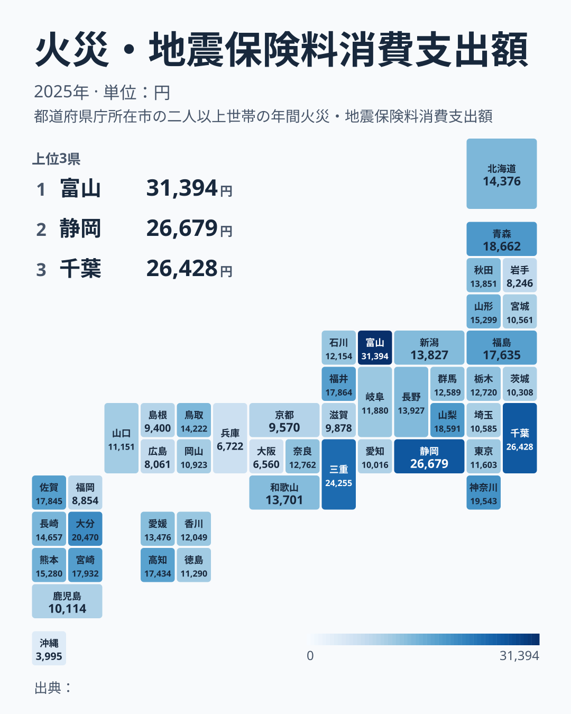
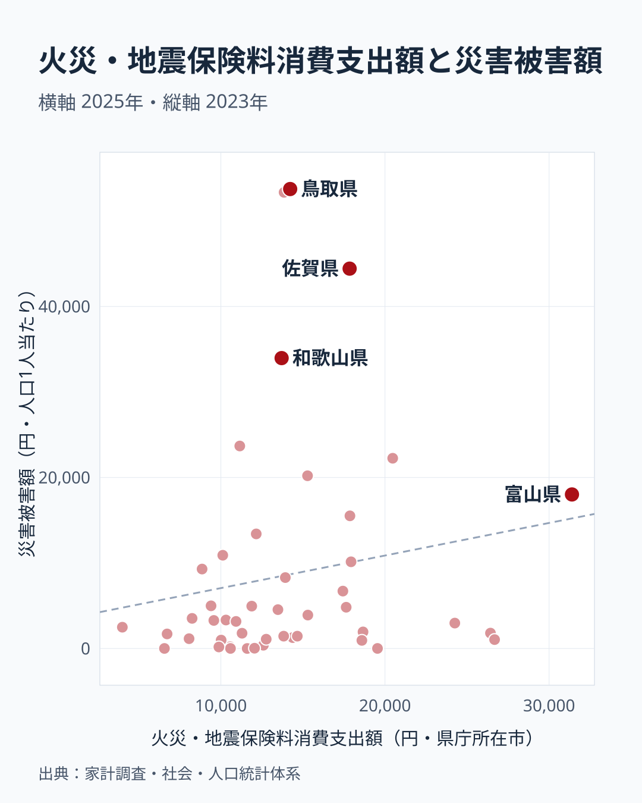
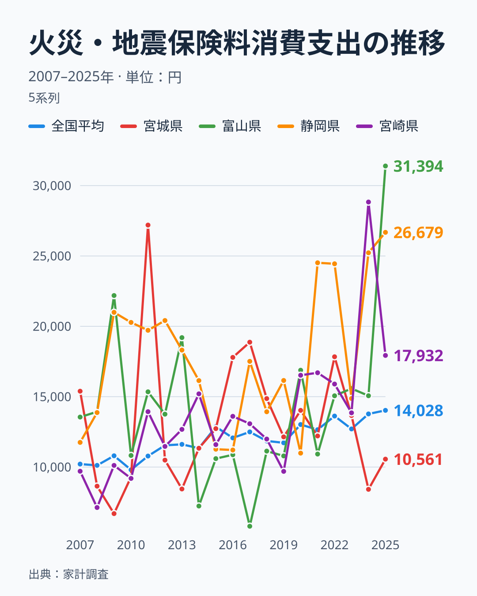

2026年5月15日、宮城県沖でマグニチュード6.3の地震が発生し、三陸沖のスロースリップ加速が報じられました。家計調査（2025年）を見ると、**宮城県の火災・地震保険料消費支出は全国35位**（10,561円）で、全国平均14,028円の約75%にとどまります。東日本大震災の被災地が、地震保険にあまりお金を払っていない――そう見えますが、前年の2024年は44位、2023年は15位と、順位は年ごとに大きく動いています。宮城の保険料は、本当に低いのでしょうか。

47都道府県の保険料と災害被害額を重ねると、「リスクの認知」と「実際の被害」が大きくずれている地図が浮かび上がります。

## 地震保険料ランキング――富山・静岡・千葉が上位

<ad-slot></ad-slot>

<data-source url="https://www.e-stat.go.jp/dbview?sid=0003348239" label="e-Stat 家計調査"></data-source>

1位は**[富山県](/areas/16000)の31,394円**。続いて静岡・千葉・三重・大分の順です。静岡・三重・大分は**南海トラフ地震の想定被害地域**、千葉は**首都直下地震の想定被害地域**と重なりますが、この重なりが地震リスクの認識の高さによるものかどうかは、このデータだけでは確かめられません（因果は未検証です）。1位の富山は前年（2024年）は16位の15,068円で、1年で約2.1倍に跳ね上がっており、地震リスクの認識の高さだけで説明できるとは限りません。

最下位は**沖縄県の3,995円**。46位の大阪、45位の兵庫、44位の広島、43位の岩手と続きます。1位と最下位の差は約7.9倍です。

<source-link href="/ranking/fire-earthquake-insurance-consumption-expenditure">火災・地震保険料消費支出ランキング</source-link>

> [!NOTE]
> 火災・地震保険料は二人以上の世帯1世帯当たり年間消費支出額。家計調査（品目別）の2025年データに基づきます。県別の値は県庁所在市の世帯の平均です。火災保険と地震保険の合計で、火災保険単独の契約も含まれます。

## 宮城は35位――低めだが、順位は毎年大きく揺れる

東日本大震災から15年。最大の被災県である宮城が、2025年の地震保険料で35位にとどまる事実は、「被災経験が保険料を押し上げる」という直観に反するように見えます。

ところが宮城の順位は安定していません。2022年は7位（17,838円）、2023年は15位（13,663円）、2024年は44位（8,415円）、2025年は35位（10,561円）と、2022年から2024年の2年で37位下がり、その後やや戻しています。震災の2011年は27,196円で全国1位、全国平均（10,781円）の約2.5倍です。2007〜2025年の19年のうち、宮城が全国平均を下回ったのは10年で、「常に低い県」とは言えません。

家計調査の県別の値は県庁所在市に住む限られた調査世帯の平均なので、単年では保険の更新時期や長期契約の一括払いなど、少数の世帯の事情で大きくぶれます。**[仮説]** 2011年の急増は、被災後の再加入や契約見直しの一括払いが重なった可能性があります。検証するには、保険料の支払い方法別（年払い・長期一括）のデータが必要です。

2025年だけを見れば宮城は平均を下回っていますが、これを「被災地は地震保険に消極的」という構造の証拠として読むのは早計です。

## 被害額と保険料のミスマッチ

それでは、保険料が高い県は本当に被害が大きいのでしょうか。1人当たり災害被害額（2023年）と重ねると、明確な不一致が見えます。

<data-source url="https://www.e-stat.go.jp/dbview?sid=0000010211" label="e-Stat 社会・人口統計体系"></data-source>

**1人当たり災害被害額では[鳥取県](/areas/31000)が53,734円でトップ**。秋田県は53,345円と続きます。一方、これらの県の火災・地震保険料消費はそれぞれ**18位・20位**で、被害額の大きさほど上位ではありません。鳥取県は2023年に台風7号で甚大な被害を受けましたが、平時の火災・地震保険料は全国平均（14,028円）を少し上回る程度です。

被害額が大きい県としては和歌山県も33,962円ですが、保険料は22位の13,701円で全国平均を下回ります。被害が大きかった県ほど保険料が高い、という関係は読み取れません。散布図の相関係数は0.16（47点）で、ほぼ無関係に近い水準です。

**[東京都](/areas/13000)は保険料が30位**で、全国平均を下回ります。ここでは首都圏を東京・埼玉・千葉・神奈川の1都3県と定義すると、千葉は3位、神奈川は6位、埼玉は34位、東京は30位と割れており、「首都圏は保険料が高く実被害は少ない」と一括りにはできません。

> [!NOTE]
> 災害被害額は2023年の社会・人口統計体系（K 安全）に基づく1人当たり値です。人口の少ない県では1回の災害でも1人当たりの値が大きく跳ねやすく、単年の値が県の被害の大きさを継続的に表すとは限りません。

## 上位は毎年入れ替わる――前年首位の宮崎は9位へ

上位5県の金額と想定地域との重なりは前の節で見たとおりで、5県はいずれも全国平均（14,028円）を上回っています。注目したいのは、その顔ぶれが固定されていない点です。

前年の1位は宮崎県でしたが、2025年は9位の17,932円で、首位から大きく順位を下げました。新潟県も2025年は21位の13,827円で、前年より順位を下げています。

**[仮説]** 家計調査の県別の値は、県庁所在市の限られた調査世帯の平均なので、少数の高額契約が値を押し上げる年があります。上位・下位の入れ替わりの多くは、地震リスクの認識が1年で変わったのではなく、この標本のぶれで説明できる可能性があります。検証するには、同じ県の複数年平均を比べる必要があります。

## 時系列――3.11後に何が変わったか

<data-source url="https://www.e-stat.go.jp/dbview?sid=0003348239" label="e-Stat 家計調査"></data-source>

全国平均で見ると、2007年の10,209円から2025年の14,028円へ上がっています。2010年の9,804円を底に、2019年の11,724円、2020年の13,023円、2024年の13,773円、2025年の14,028円と、2010年代以降は水準を切り上げてきました。2011年の東日本大震災後は、2010年9,804円から2011年10,781円へ全国で増加が見られます。2020年は2019年の11,724円から13,023円へ上がりましたが、**[仮説]** 在宅時間の増加による住まいの見直しが背景にある可能性があり、このデータだけでは確認できません。

県の折れ線を見ると、宮城県の2011年（27,196円）の突出が目立ちます。ただし宮城は2012年には10,493円に戻り、2016年は17,795円、2017年は18,872円と再び上がるなど、一定の傾向はありません。富山県は2009年に22,190円、2017年は5,793円、2025年は31,394円で1位と、さらに振れ幅が大きい県です。**[仮説]** この大きな振れも、前の節で触れた少数世帯の高額契約や一括払いといった標本のぶれが重なった結果である可能性があり、このデータだけでは確認できません。

**単年の順位から「この県は支出が多い」「この県は少ない」と読むのは危険**です。複数年で見ても全国平均を上回り続ける県だけが、保険料の地理に構造がある県と言えそうです。

## まとめ

47都道府県の火災・地震保険料消費支出を整理します。

1位は富山31,394円、最下位は沖縄3,995円で約7.9倍差。**被災地・宮城は35位**（前年は44位）です。2007〜2025年の19年のうち全国平均を下回ったのは10年で、2011年には27,196円と高い年もありました。題への答えは、**宮城の火災・地震保険料は、低いとも高いとも言い切れない**、です。被災経験が直接保険料の順位を決めているとは言えません。

**保険料の高い県と災害被害額の大きい県も一致しません**。被害額トップの鳥取は保険料18位、秋田は20位にとどまり、相関係数は0.16です。さらに、前年首位だった宮崎が9位になるなど、単年の順位は大きく入れ替わります。

宮城沖でM6.3が起きた2026年5月、火災・地震保険料の地図を改めて眺めると、「想定被害」と「火災・地震保険料の支出」にずれが見えてきます。ただし、これは火災保険を含む指標であり、地震への備えそのものを示すとは断定できません。家計調査の県別の値は単年のぶれが大きいため、自分の住む県の順位は一つの目安として、複数年の推移とあわせて確認しておくことには意味があります。

あわせて見る: [災害被害額ランキング](/ranking/disaster-damage-amount-per-person)

<site-link category="landweather"></site-link>
