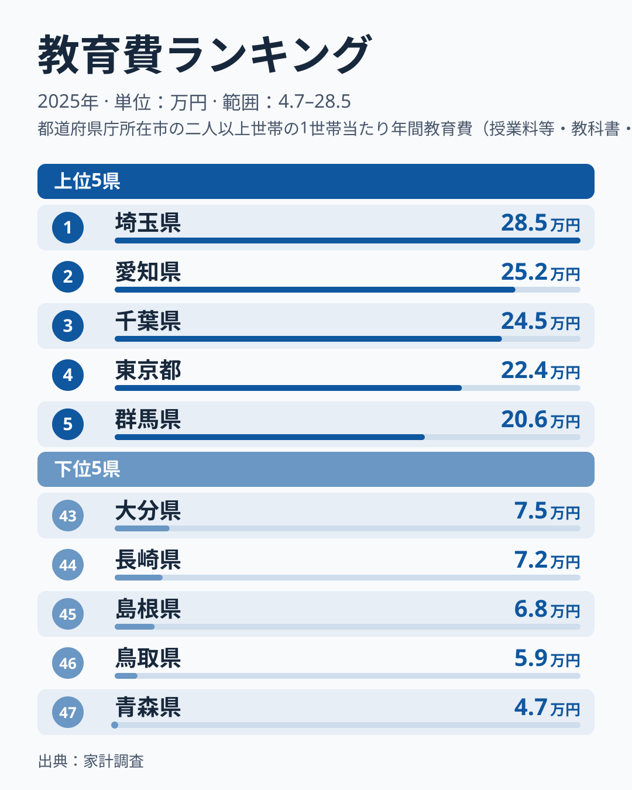
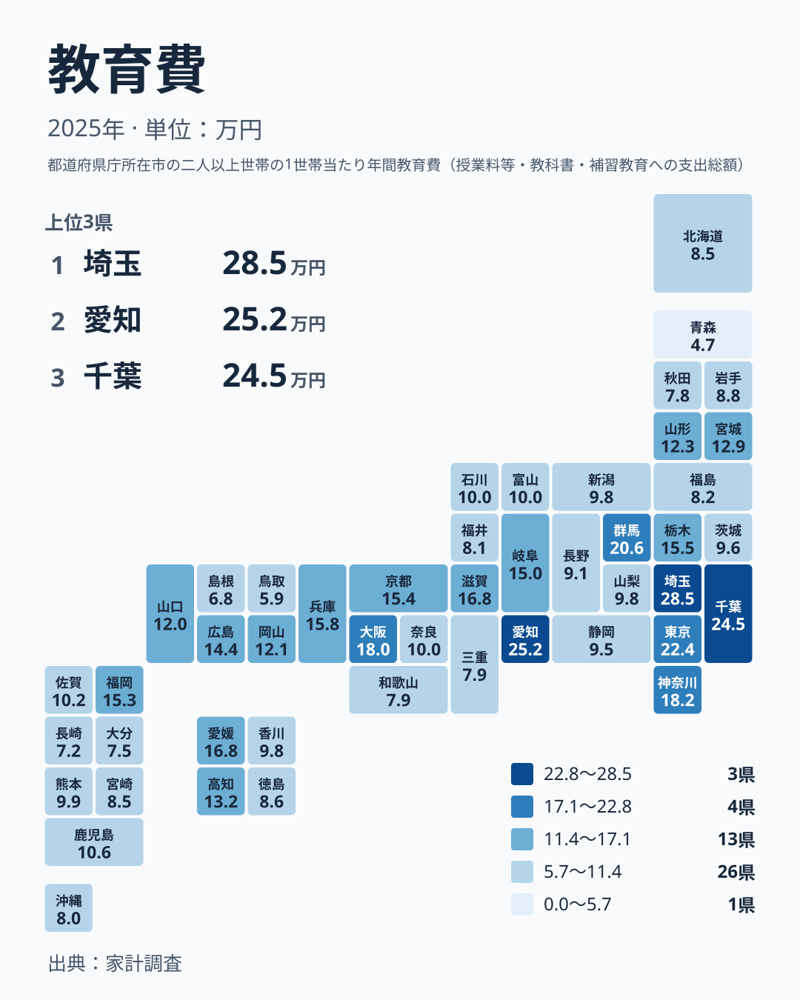

## 教育費で首位に立つのは埼玉県

子どもの教育にいくらかけるかは、家庭ごとの事情で決まるように見えます。ところが県ごとに平均を並べると、はっきりした地域差が現れます。2025年の家計調査で教育費が最も多かったのは埼玉県で、284,952円でした。

2位は愛知県の251,713円、3位は千葉県の244,845円です。4位は東京都の224,399円、5位は群馬県の205,504円でした。

首位が東京都ではないことに注目してください。東京都は4位で、埼玉県、愛知県、千葉県の後ろに回っています。教育費は「都会ほど高い」という単純な図式では片づけられない指標です。

一方、最も少なかったのは青森県の47,220円です。46位は鳥取県の58,828円、45位は島根県の67,574円でした。

首位の埼玉県と最下位の青森県の金額を比べると、284,952円と47,220円で、同じ国の中でこれだけの開きがあります。この記事では、順位の分布から読み取れることと、読み取れないことを分けて整理します。

> [!NOTE]
> 家計調査の教育費は、世帯が教育のために支出した金額を集計した指標です。子どもがいない世帯も平均に含まれる可能性があるため、「子ども1人あたりの金額」と読むことはできません。どの費目が含まれるかなど細かな定義は、調査の公表資料で確認してください。

## 上位と下位をランキングで確かめる

まず上位と下位の顔ぶれを図で確認します。

<source-link href="/ranking/education-expenditure-total">教育費ランキングをもっと見る</source-link>

上位5県は、埼玉県、愛知県、千葉県、東京都、群馬県です。このうち愛知県は中部、ほかの4つは関東に属します。下位5県は、青森県、鳥取県、島根県、長崎県、大分県で、関東の県は含まれません。

上位の中でも金額は一様ではありません。首位の埼玉県は284,952円、5位の群馬県は205,504円で、上位5県の中だけでも開きがあります。ただし下位に目を移すと、47位の青森県は47,220円と、群馬県に比べてはるかに小さな金額です。

この図から言えるのは、上位と下位のあいだに大きな段差があるということまでです。この指標だけでは、家計に占める教育費の割合や収入との関係は分からないため、負担の重さまでは判断できません。数字の大小は、そのまま「苦しさ」や「熱心さ」を表すものではない点に注意してください。

## 地方の中での差を見る

地方ごとに順位の幅を見ると、同じ地方でも一様でないことが分かります。

関東は、埼玉県が1位、千葉県が3位、東京都が4位と上位に集まる一方、茨城県は30位の95,667円です。同じ地方の中で、最大で1位と30位の開きがあります。

近畿では、大阪府が7位の179,944円、和歌山県が41位の78,598円です。地方内の差は、近畿でも大きく表れています。

中部では、愛知県が2位の251,713円で、静岡県は31位、長野県は32位、福井県は38位です。愛知県の高さが、そのまま隣り合う県に広がっているわけではありません。

北海道・東北では、宮城県が17位の128,707円で最も高く、青森県が47位の47,220円で最も低くなっています。

地方という単位でひとまとめにすると、こうした県ごとの違いが隠れてしまいます。自分の住む県の位置を知るには、地方の傾向よりも県単体の順位と金額を見るほうが確実です。

## 分布を地図で眺める

全体の広がりを地図で確かめます。

地図では、関東から中部、近畿にかけて金額の多い県が集まって見えます。埼玉県、千葉県、東京都、愛知県、大阪府、滋賀県といった県が上位に入っています。

ただし、この帯の外にも上位の県があります。四国の愛媛県は9位で168,066円と、兵庫県の10位158,301円より上です。九州では福岡県が13位の153,318円、中国では広島県が15位の144,366円でした。これらは、上位の県が大都市圏の外にも点在していることを示す事実です。

反対に、青森県、秋田県、鳥取県、島根県、長崎県、大分県のように、金額が小さい県は東北北部や山陰、九州の一部に見られます。ただし、これらの県を「教育にお金をかけない地域」と呼ぶことはできません。金額が小さいことと、教育の機会が乏しいことは別の話だからです。

> [!WARNING]
> 家計調査は標本調査で、県ごとに調べる世帯の数は限られます。教育費は、入学や進学の年に一部の世帯へ大きな支出が偏りやすい項目です。そのため、少数の世帯の動きで県の平均が変わる可能性があります。順位が1つや2つ違うだけで、優劣があると読むのは避けてください。

## 背景として考えられること

なぜ埼玉県が首位になったのか、このデータだけでは答えを出せません。渡されているのは県ごとの金額と順位で、世帯構成も支出の内訳も含まれていないからです。そのうえで、背景として考えられる仮説を挙げます。いずれも、このデータから確かめられたことではありません。

1つ目は、子どもがいる世帯の多さです。平均には子どものいない世帯も含まれるとすれば、子育て世帯の割合が数字に影響している可能性があります。

2つ目は、進学の形です。自宅から通える進学先の多さや、県外へ出る進学の多さが、県の金額に影響しているかもしれません。県外進学の費用がどの県の数字に表れるかは、このデータからは分かりません。

3つ目は、塾や習い事など学校外の支出です。都市圏ほどこうした選択肢が多い可能性はありますが、内訳を見ていないため、どの程度効いているのかは分かりません。

埼玉県が愛知県、千葉県、東京都より高い理由についても、これらの仮説のどれが当てはまるのかを、この記事のデータで示すことはできません。確かなのは、金額と順位に差があるという事実だけです。

## 暮らしにどう響くのか

生活者にとっての意味を考えます。上位の埼玉県、愛知県、千葉県に住む子育て世帯が、教育費を前提に家計を組む場面は多いかもしれません。ただし、平均はあくまで平均です。首位の埼玉県の284,952円を、自分の世帯の目安としてそのまま使うことはできません。

一方、青森県や鳥取県、島根県のように金額が小さい県でも、家計の負担が軽いとは限りません。この指標は家計に占める割合も収入も扱っていないため、負担の重さは判断できません。県外へ進学する場合の費用が別にかかることもありえます。

転勤や移住を考える人は、県の平均を住まい選びの参考にする場合でも、子どもの人数や進路の希望、通学圏にある学校の種類とあわせて考えてください。自治体の就学支援や奨学金の制度も、実際の負担に関わります。

家計を見直すときは、県の平均と比べるより、自分の世帯の子どもの年齢と進路から必要額を積み上げるほうが、実情に合った計画になります。

経済分野のほかの統計は、[同じカテゴリの統計一覧](/category/economy)から確認できます。首位の[埼玉県のデータ](/areas/11000)と、2位の[愛知県のデータ](/areas/23000)も、あわせて見ると位置づけをつかみやすくなります。

> [!TIP]
> この指標では、金額差が上位に集中しています。1位の埼玉県284,952円から5位の群馬県205,504円までは大きく下がりますが、6位の神奈川県182,008円から10位の兵庫県158,301円までは差が小さくなります。6位以下の順位の違いは金額にするとわずかな場合があるため、順位だけでなく金額もあわせて見てください。

## データについて

この記事の数値は、家計調査の教育費(2025年、単位は円)を使っています。県ごとの順位は金額の多い順です。

教育費は、収入や世帯構成、進学の経路など、このデータに含まれない要因が重なって決まると考えられます。順位を見て一喜一憂するよりも、自分の暮らしと照らし合わせるための物差しとして使うのが、この統計の妥当な読み方です。
