年収によって、子どもへの教育投資の中身と成果は10年でどう変わったのでしょうか。家計調査の年収五分位でわかるのは「中身」までで、「成果」は同じ統計からは読めません。中身について先に答えると、教育費（1世帯あたりの年間支出）は2013〜17年の5年平均と2021〜25年の5年平均で、上位2割の第Ⅴ階級が32.1万円から36.1万円へ12%増え、下位2割の第Ⅰ階級が2.4万円から1.8万円へ24%減りました。第Ⅴ階級は第Ⅰ階級の13.6倍から20.0倍になり、全世帯の平均は13.4万円から13.8万円へ3%の増加です。下位2階級の減少の大部分は幼児教育費用の減少です。第Ⅱ階級は教育費が10,005円減り、幼児教育費用の減少（10,701円）だけで、教育費の減少額を上回ります。

ただし、この差の広がりをそのまま「所得による教育投資の格差の拡大」と読むことはできません。第Ⅰ階級と第Ⅱ階級では世帯主の平均年齢が上がり、18歳未満の世帯員数が減っています。補習教育費を18歳未満の世帯員1人あたりに直すと、第Ⅴ階級と第Ⅰ階級の倍率は世帯あたりの22.5倍から45.9倍に対し、6.5倍から6.8倍でほとんど動いていません。補習教育の差の拡大は、1人あたりの補習教育費の差よりも、世帯あたりの子どもの数の差が広がったことで説明できる部分が大きいのです。教育費全体では、第Ⅴ階級の増加の大部分が18歳以上の子どもにかかる私立大学の授業料で、18歳未満の人数では説明できません。また、18歳未満の人数で割るだけでは、世帯主の年齢や世帯人員の違いはそろいません。成果にあたる進学率は階級別に取れないため、全国の値を最後に参考として示します。

> [!NOTE]
> 使うのは総務省統計局「家計調査（家計収支編）」の「年間収入五分位階級別」で、全国の二人以上の世帯です。金額は1世帯あたりの年間支出で、子どもがいない世帯も含めた平均です。名目の値なので、物価の上昇は調整していません。年によって標本の入れ替わりでぶれるため、2013〜17年と2021〜25年の5年平均で比べます。階級は世帯の年間収入で5等分した区分で、世帯主の年齢と世帯人員は階級ごとに大きく異なります。

## 教育費は10年でどう動いたか

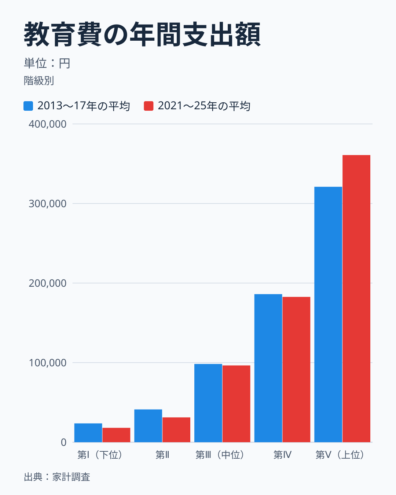

2013〜17年の5年平均は、第Ⅰ階級が23,619円、第Ⅱ階級が41,202円、第Ⅲ階級が98,324円、第Ⅳ階級が186,075円、第Ⅴ階級が321,036円でした。2021〜25年は順に18,051円、31,197円、96,513円、182,605円、360,860円です。変化率は第Ⅰ階級と第Ⅱ階級がどちらも24%の減少、第Ⅲ階級と第Ⅳ階級が2%の減少、第Ⅴ階級が12%の増加です。真ん中の2つの階級はほとんど動かず、増えたのは最上位の階級だけ、減ったのは最下位の2つの階級だけです。

第Ⅴ階級を第Ⅰ階級で割った倍率は、13.6倍から20.0倍へ上がりました。全世帯の平均は134,051円から137,845円で3%の増加にとどまるので、平均だけを見ると変化は小さく見えます。平均の裏で、階級の間の差が広がっていました。

この比較に5年平均を使う理由は、階級ごとの標本が小さく、単年の値がぶれるためです。第Ⅴ階級は2011年の291,443円から2024年の383,953円まで、年によって9万円ほど動きます。平均する窓を変えても、第Ⅴ階級の増加と第Ⅰ・第Ⅱ階級の減少という向きは変わりません。ただし大きさは窓によって動きます。2011〜15年と2021〜25年を比べると、第Ⅰ階級と第Ⅱ階級は37%減、第Ⅴ階級は20%増です。2012〜16年と2020〜24年では、第Ⅰ階級が32%減、第Ⅱ階級が31%減、第Ⅴ階級が14%増でした。第Ⅲ階級は2%から12%、第Ⅳ階級は2%から8%の減少で、窓によって幅があります。本文の24%減と12%増は、3つの窓のうち最も控えめな値です。

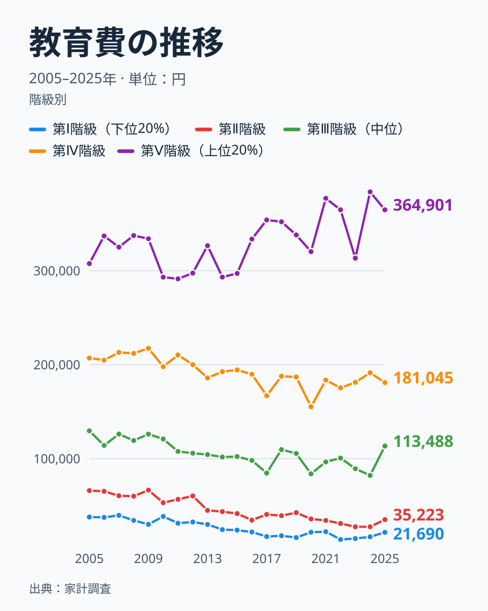

2005年からの推移で見ると、下位の階級の減少はこの10年に始まったことではありません。単年の値はぶれるので、2005〜09年の5年平均と2021〜25年の5年平均を比べると、第Ⅰ階級は36,020円から18,051円へ50%減、第Ⅱ階級は63,786円から31,197円へ51%減でした。第Ⅲ階級は123,154円から96,513円へ22%減、第Ⅳ階級は210,980円から182,605円へ13%減と、緩やかな減少です。第Ⅴ階級だけが328,319円から360,860円へ10%増えています。図でも、第Ⅴ階級の線が上向くのは2020年代に入ってからです。第Ⅴ階級の水準が上がったのは2020年から2022年にかけてで、2020年の320,433円から2022年の364,892円へ上がり、2024年は383,953円でした。ただし2023年は313,430円と、年によって大きく動きます。

## 教育費の中身は何で構成されているか

教育費は、授業料等、補習教育、教科書・学習参考教材の3つに分かれます。次の図は、第Ⅰ階級、第Ⅲ階級、第Ⅴ階級の教育費を、この3つの割合で比べたものです。

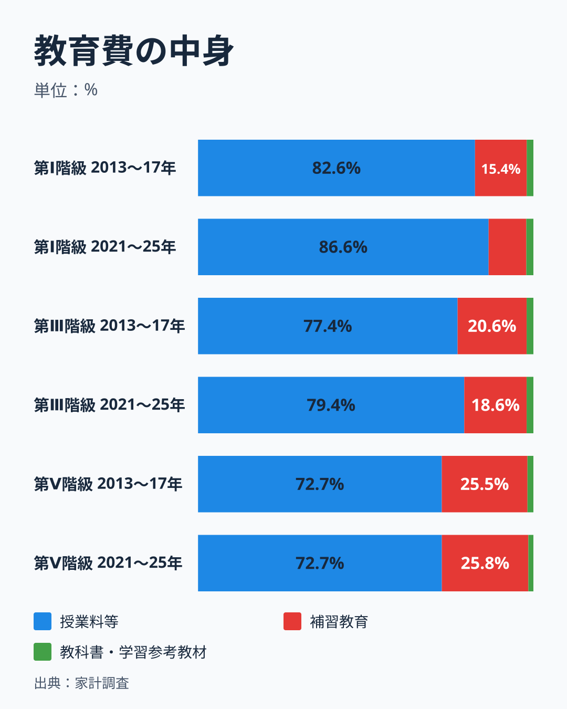

どの階級でも、教育費の大半は授業料等です。2013〜17年の第Ⅴ階級は授業料等が72.7%、補習教育が25.5%でした。2021〜25年も72.7%と25.8%で、中身はほとんど変わっていません。第Ⅲ階級は77.4%と20.6%から、79.4%と18.6%になり、補習教育の割合が2ポイント下がりました。第Ⅰ階級は授業料等が82.6%から86.6%へ上がり、補習教育は15.4%から11.2%へ下がっています。

低い階級ほど授業料等の割合が高く、補習教育の割合が低い形は、塾や予備校が高い階級に偏っていることと整合します。ただし、後の節で見るように、子どもの数の違いでも説明できます。補習教育の1世帯あたり支出は、2013〜17年に第Ⅰ階級が3,641円、第Ⅴ階級が82,003円で、22.5倍の差がありました。2021〜25年は第Ⅰ階級が2,029円、第Ⅴ階級が93,101円で、差は45.9倍に広がっています。第Ⅰ階級は44%減り、第Ⅴ階級は14%増えました。第Ⅱ階級は6,862円から5,860円で15%、第Ⅲ階級は20,233円から17,955円で11%、第Ⅳ階級は46,132円から40,662円で12%の減少です。全世帯の平均は31,774円から31,921円でほとんど変わっていません。補習教育は、教育費全体より階級による差が大きく、しかも差が広がった項目です。

## 授業料等の中で動いたもの

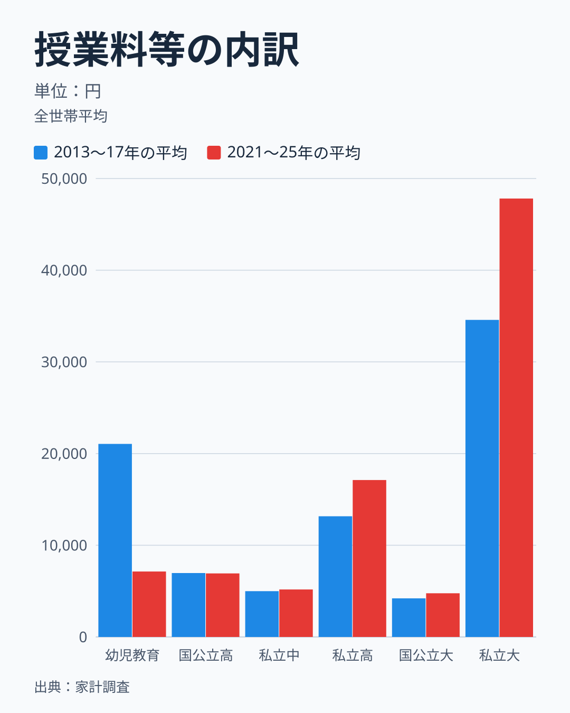

授業料等の内訳を、全世帯の平均で見ます。大きく増えたのは私立大学で、34,578円から47,815円へ38%増えました。私立高校は13,161円から17,112円へ30%、国公立大学は4,209円から4,765円へ13%増えています。国公立高校は6,972円から6,927円でほとんど変わりません。私立中学校は4,996円から5,176円で、4%の増加です。一方、幼児教育費用は21,054円から7,136円へ66%減りました。

幼児教育費用がこれだけ減った理由は、年ごとの推移で確かめられます。

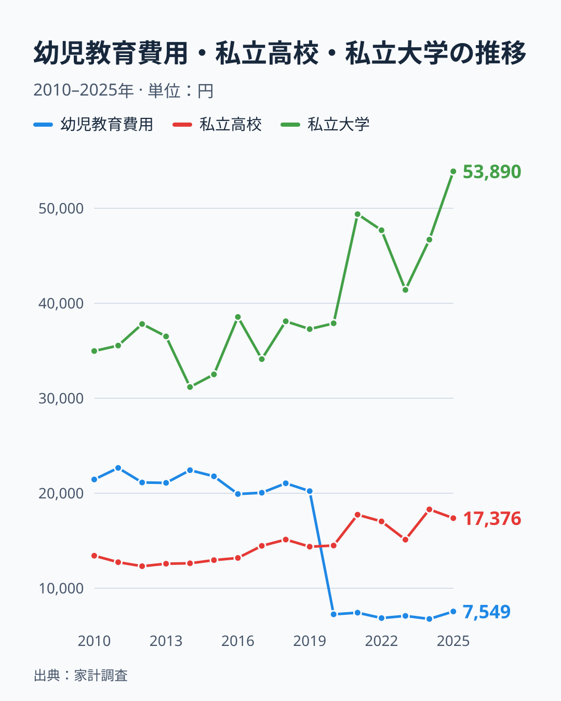

幼児教育費用は2019年の20,225円から2020年の7,252円へ、1年で3分の1強まで下がりました。2021年以降も7,000円前後で、2025年は7,549円です。2019年10月から、3歳から5歳の幼稚園・保育所・認定こども園などの利用料が無償化されました（こども家庭庁「幼児教育・保育の無償化」）。年平均の下落が2019年ではなく2020年に出ているので、月別の値で時期を確かめます。

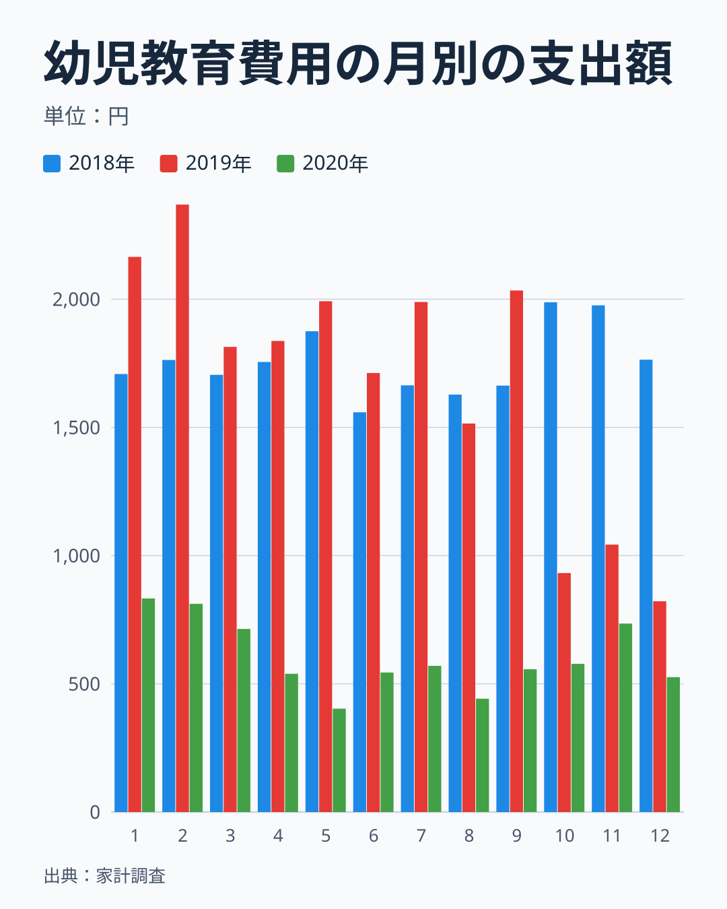

2019年は1月から9月まで1,515円から2,369円（平均1,936円）で、2018年の同じ月（1,559円から1,875円、平均1,702円）よりやや高い水準でした。9月の2,034円から10月は932円へ1か月で半分以下に下がり、11月は1,043円、12月は822円です。2020年は1月が833円、2月が812円で2019年10月以降と同じ水準でしたが、3月以降は403円から735円（平均561円）と、もう一段下がっています。2021年は年7,424円で、月平均は約620円です。減少の大部分は2019年10月の段差で、残りが2020年春の段差です。2019年の年平均の下落が2018年に対して823円にとどまったのは、下がった月が3か月分だけだったためです。2019年の10月から12月は、2018年の同じ月より合計で約2,900円低く、1月から9月は約2,100円高かったので、年の合計の差は縮まりました。

競合する説明も確かめておきます。家計調査の収支項目分類は2020年1月分から改定されていますが、総務省統計局の「家計調査 2020年収支項目分類改定」（2020年1月分から適用、2026年11月9日に確認）の一覧には、幼児教育費用に関わる項目は含まれていません。新型コロナウイルス感染症の影響は2020年春以降なので、2019年10月の下落は説明できません。月別の大きな下落は、無償化の開始月と一致します。一方、2020年3月以降の2段目の下落は、新型コロナウイルス感染症の影響が始まった時期と重なります。この統計では、2段目が感染症によるものか、無償化の効果が遅れて出たものかを分けられません。[仮説] 2020年以降も残る月に400円から800円ほどの幼児教育費用は、無償化の対象外の費用や0〜2歳の費用です。検証は、子どもの年齢別に集計した表で、3歳から5歳の子がいる世帯の幼児教育費用が2020年以降ほぼゼロに近いかを見ることでできます。ほぼゼロなら支持し、月に数百円以上残るなら棄却します。家計調査にこの区分の表があるかは確認できていないので、表がなければ、2026年分の年次表が公表された後に、2020年以降の水準が保たれているかを確認して代わりとします。

私立大学は2020年の37,891円から2021年の49,383円へ上がり、2025年は53,890円です。私立高校も2020年の14,496円から2021年の17,743円になりました。私立大学については、2020年度に、住民税非課税世帯などを対象にした授業料の減免と給付型奨学金の制度（高等教育の修学支援新制度）が始まりました（文部科学省）。私立高校は別の制度の対象で、この制度の対象外です。この統計では、制度の対象になる世帯だけを取り出すことはできません。授業料等の増加が値上がりによるのか、私立の学校に通う子どもがいる世帯が増えたのか、階級の標本の入れ替わりによる年ごとのぶれなのか、2020年の新型コロナウイルス感染症の影響による学費の扱いの違いなのかも、この統計では分けられません。私立大学は2020年から2021年に約3割増えたあと、2023年に41,411円へ下がり、2025年に53,890円へ上がるなど、年ごとの振れも大きい品目です。

県庁所在市別の二人以上の世帯の私立大学消費支出額は、ランキングで見られます。

<source-link href="/ranking/private-university-consumption-expenditure">私立大学の授業料等の支出額ランキングを見る</source-link>

## 増減額を中身別に分ける

教育費の増減を、品目ごとの増減額に分けてみます。

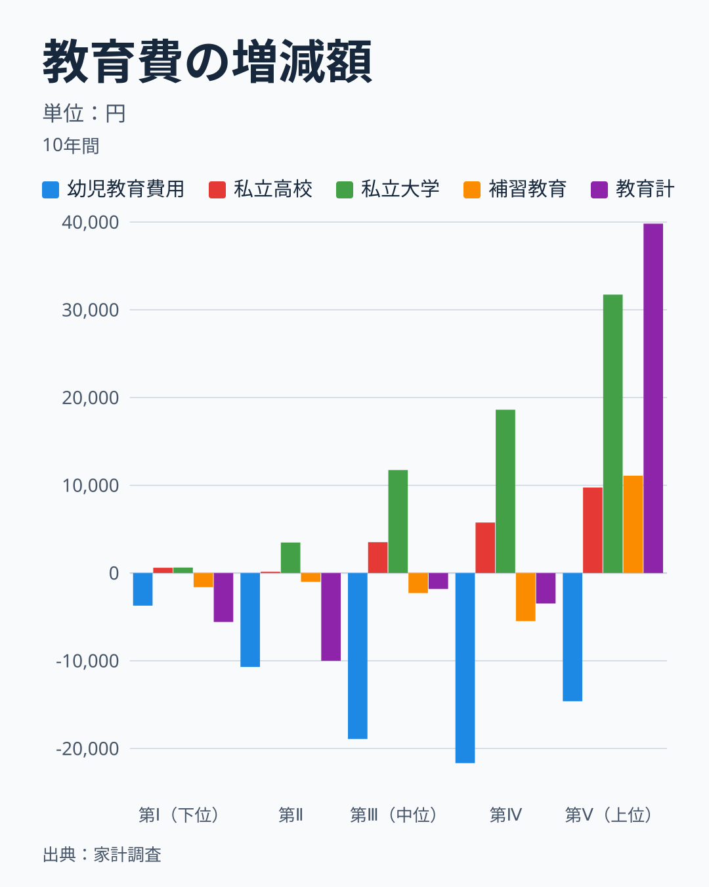

幼児教育費用は、すべての階級で減りました。2013〜17年から2021〜25年にかけて、第Ⅰ階級が3,712円、第Ⅱ階級が10,701円、第Ⅲ階級が18,905円、第Ⅳ階級が21,663円、第Ⅴ階級が14,610円の減少です。減少額が最も大きいのは第Ⅳ階級で、幼児教育費用の水準そのものが33,490円と最も高かった階級です。第Ⅱ階級では、教育費の合計が10,005円減ったのに対し、幼児教育費用の減少だけで10,701円になるため、幼児教育費用を除けば教育費はわずかに増えています。第Ⅰ階級は教育費が5,568円減り、そのうち幼児教育費用が3,712円、補習教育が1,612円でした。

上位の階級では、増える側の項目が大きく働いています。第Ⅴ階級は私立大学が31,731円、補習教育が11,097円、私立高校が9,743円それぞれ増え、幼児教育費用の14,610円の減少を差し引いても、教育費の合計は39,824円の増加です。第Ⅲ階級と第Ⅳ階級は、私立大学がそれぞれ11,735円と18,611円、私立高校が3,514円と5,752円増えた一方、幼児教育費用が18,905円と21,663円、補習教育が2,278円と5,471円減りました。ここに挙げた4項目とそのほかの品目を合わせると、教育費の合計はほとんど動きませんでした。第Ⅲ階級と第Ⅳ階級の教育費が動いていないように見えたのは、増える項目と減る項目が打ち消し合った結果です。

ここから、冒頭の問いへの答えを言い直せます。教育費の合計の動きは階級によって違いますが、中身をみると、下位の階級では幼児教育費用の減少が、上位の階級では私立大学と補習教育の増加が、それぞれ全体の動きを決めています。幼児教育費用の減少は、無償化の開始月と時期が一致しています。無償化が主因だとすれば、世帯が教育にかけるお金を減らしたこととは意味が違います。第Ⅰ階級と第Ⅱ階級の教育費の24%の減少を、そのまま教育投資の縮小と読むのは早計です。

## 補習教育の差は本当に広がったのか

補習教育の差が22.5倍から45.9倍へ広がったことは、第Ⅰ階級と第Ⅱ階級の世帯の中身が変わったことの影響を受けている可能性があります。世帯の中身を確かめるため、18歳未満の世帯員数を階級ごとに見ます。

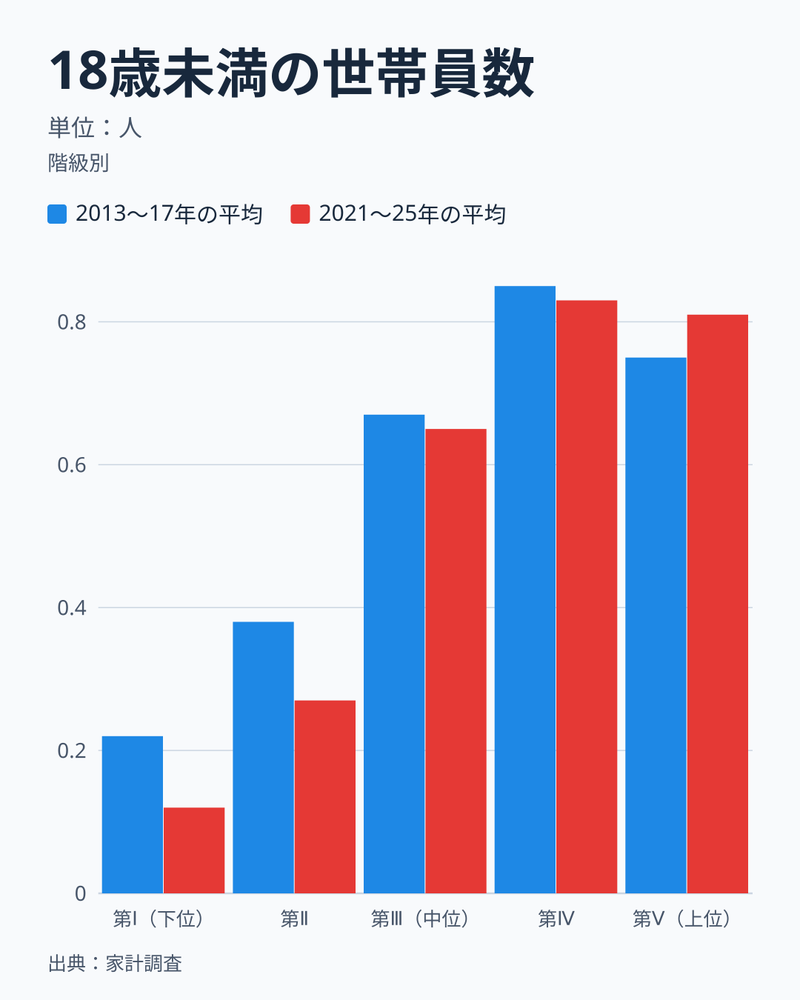

18歳未満の世帯員数は、2013〜17年の第Ⅰ階級が0.22人でした。2021〜25年は0.12人まで減り、半分近くになりました。第Ⅱ階級は0.38人から0.27人、第Ⅲ階級は0.67人から0.65人、第Ⅳ階級は0.85人から0.83人でほとんど動いていません。第Ⅴ階級は0.75人から0.81人へ増えました。教育費が減った第Ⅰ階級と第Ⅱ階級では子どもの数も減り、教育費が増えた第Ⅴ階級では子どもの数も増えています。

世帯主の年齢も、同じ方向に動いています。

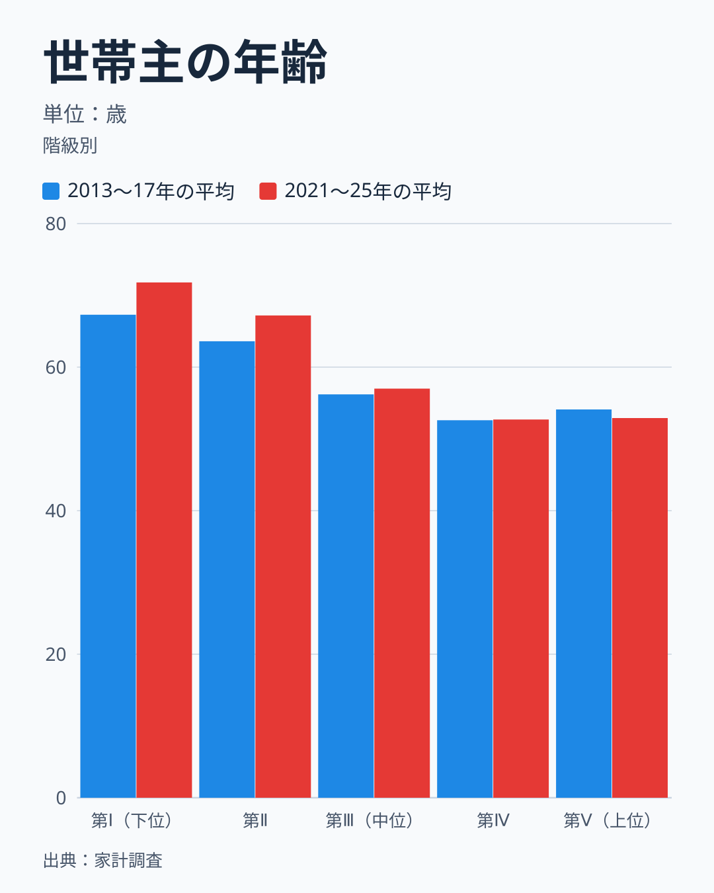

第Ⅰ階級の世帯主の平均年齢は67.3歳から71.8歳へ、第Ⅱ階級は63.6歳から67.2歳へ上がりました。第Ⅲ階級は56.2歳から57.0歳で、第Ⅳ階級は52.6歳から52.7歳、第Ⅴ階級は54.1歳から52.9歳でほとんど変わっていません。下位の2つの階級は、子育てを終えた高齢の世帯の比重が増した可能性があります。ここまでで、教育費の階級間の差が広がったことと、世帯の中身が変わったことは、同じ時期に起きています。

> [!WARNING]
> 18歳未満の世帯員数は、大学生の子どもを含みません。私立大学の授業料などは、18歳以上の子どもについてかかる費用です。そのため、教育費の全体を18歳未満の人数で割ることはしません。補習教育は18歳未満の子どもが中心で、割り算の目安として使えますが、予備校に通う18歳以上の浪人生の費用は含みます。

そこで、補習教育費を18歳未満の世帯員数で割った値を比べます。

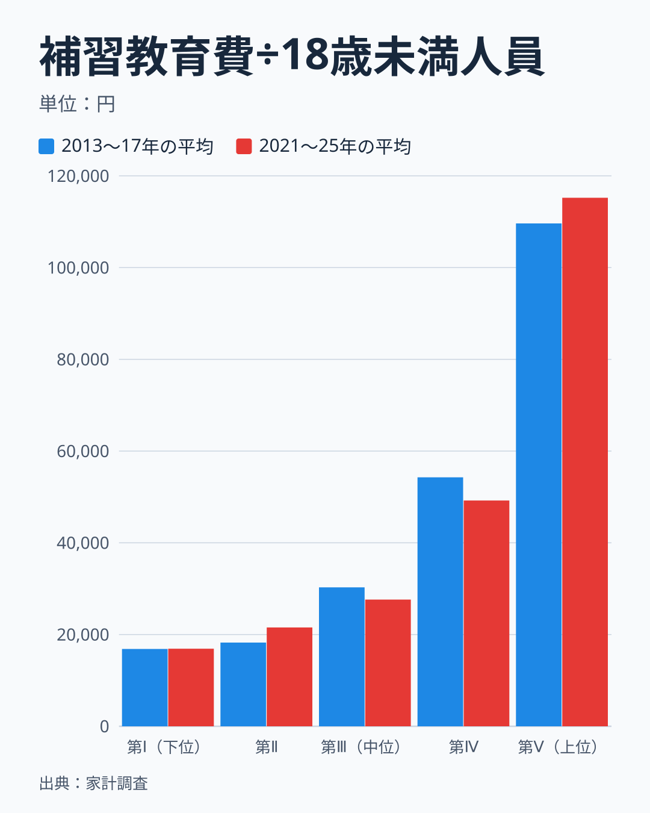

18歳未満の世帯員1人あたりの補習教育費は、2013〜17年に第Ⅰ階級が16,856円、第Ⅱ階級が18,251円、第Ⅲ階級が30,290円、第Ⅳ階級が54,273円、第Ⅴ階級が109,630円でした。2021〜25年は順に16,907円、21,544円、27,623円、49,227円、115,224円です。第Ⅰ階級はほぼ同じで、第Ⅱ階級は18%増え、第Ⅲ階級は9%、第Ⅳ階級は9%減り、第Ⅴ階級は5%増えました。第Ⅴ階級を第Ⅰ階級で割ると、6.5倍から6.8倍で、世帯あたりの22.5倍から45.9倍という広がり方とは大きく違います。

世帯あたりの倍率は、子ども1人あたりの倍率と、18歳未満の世帯員数の倍率をかけ合わせたものです。2013〜17年は6.5倍に3.4倍をかけて約22倍、2021〜25年は6.8倍に6.8倍をかけて約46倍でした。広がったのは、後ろの18歳未満の世帯員数の倍率です。子ども1人あたりで見ると、第Ⅴ階級は第Ⅰ階級の約7倍で、この差は10年前とほとんど変わっていません。この差が支出する意思によるのか能力によるのかは、この統計では分けられません。なお、この割り算は、子どもの数が少ない階級の値が不安定になりやすいこと、1世帯の中の子どもの年齢の違いを考慮していないことに注意が必要です。

県庁所在市別の高校補習教育・予備校消費支出額は、ランキングで見られます。

<source-link href="/ranking/high-school-tutoring-consumption-expenditure">高校補習教育・予備校の支出額ランキングを見る</source-link>

教育費の地域差を見る記事は、[公立小学校の教育費は県で1.7倍違う](/blog/education-cost-per-child)と[塾代は最下位級でも京都の進学率はトップ級](/blog/tutoring-cost-university-advancement-gap)にあります。年収五分位別に教育費の絶対額を比べた記事は[教育費だけ格差が桁違いなのはなぜ?](/blog/income-quintile-education)です。この記事は、その答えが10年でどう動いたかを問うています。

## 成果は階級別に読めるのか

家計調査には、進学率や学力のような成果の項目はありません。そのため、年収階級ごとの教育投資の成果は、この統計では測れません。全国の値を参考として示します。

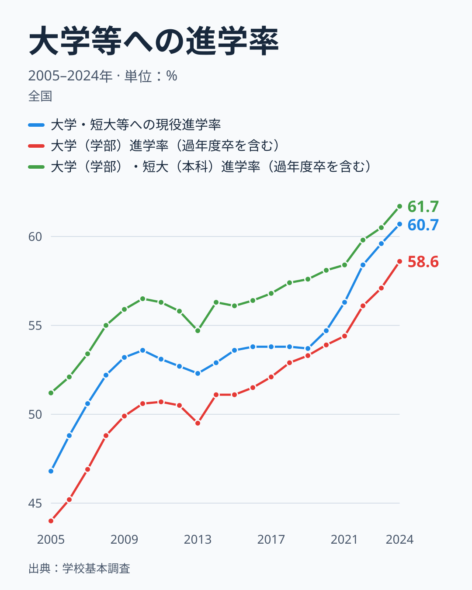

全国の大学・短大等への現役進学率は、2015年（平成27年度）の53.6%から2024年（令和6年度）の60.7%へ、7.1ポイント上がりました。期間は、家計調査の5年平均の中心である2015年と2023年とは少しずれます。過年度卒を含む大学（学部）進学率は51.1%から58.6%へ、7.5ポイントの上昇です。過年度卒を含む大学（学部）・短大（本科）進学率は56.1%から61.7%でした。どの定義でも、10年で5〜8ポイント上がっています。値は、文部科学省が2025年12月に特別支援学校の扱いを改めて再計算した後の値です。

この全国の値は、階級別の教育費の増減とは結びつけられません。第Ⅴ階級の教育費が12%増えて、第Ⅰ階級と第Ⅱ階級が24%減った10年に、全国の進学率は上がりました。しかし、進学率は階級別に公表されておらず、全国の上昇が第Ⅴ階級の寄与なのか下位の階級を含めた広がりなのかは、この数字から判断できません。進学率の定義による違いは[進学率トップは東京・京都｜なぜ都市部ほど高いのか](/blog/high-school-advancement-rate)や[進学率だけでは分からない、堅実な県はどこ](/blog/advancement-plus-employment-rate-prefecture)で県別に見られます。

## データについて

使った表は、家計調査の品目分類（2025年改定）の年間収入五分位階級別・金額の年次表（二人以上の世帯）、同じ品目分類の月別・金額の表（幼児教育費用の全国値）、用途分類の年間収入五分位階級別の表（18歳未満人員・世帯主年齢）で、いずれもe-Statで公開されています。2025年1月に品目分類が改定されましたが、教育に関する19品目の2013〜2024年の値は、改定前の表と同じ値であることを1,368セルすべてで確かめました。20年の比較で使った2005〜2012年の値は、同じ照合をしていません。こども家庭庁と文部科学省の制度の説明は、2026年11月9日に確認しました。表の値は、階級ごとの平均の名目値で、各年の値をそのまま使い、5年平均は単純平均です。物価の変化は調整していません。

この記事が答えられるのは「年収階級別の教育費の中身と変化」までです。成果は答えられません。階級の差を収入だけの効果と書くことはできません。世帯主の年齢、世帯人員、18歳未満の世帯員数、大学生の子どもの有無が、階級ごとに違うためです。1世帯あたりの平均には、教育費がゼロの世帯が多く含まれます。幼児教育費用の減少を無償化によるものと断定せず、検証が必要な仮説として扱ったのも同じ理由です。全国の進学率は文部科学省「学校基本調査」の公表値で、年収階級別の値ではありません。家計調査の調査ハブは[家計調査のページ](/survey/kakei-chousa)、教育カテゴリは[教育・スポーツのデータ](/category/educationsports)から見られます。

## まとめ

- 教育費は、2013〜17年から2021〜25年にかけて、第Ⅴ階級が12%増の36.1万円、第Ⅰ階級と第Ⅱ階級が24%減でした。第Ⅴ階級は第Ⅰ階級の13.6倍から20.0倍になりました。
- 中身は授業料等が7割強から8割台、補習教育が1割から2.6割で、階級による違いが大きい項目は補習教育です。
- 授業料等では、私立大学が38%増え、私立高校が30%増えました。幼児教育費用は66%減り、月別の下落は2019年10月の無償化の開始月と一致します。第Ⅱ階級では、幼児教育費用の減少額が教育費の減少額を上回ります。
- 18歳未満の世帯員数は第Ⅰ階級で0.22人から0.12人へ半分近くまで減りました。補習教育費を18歳未満の世帯員1人あたりに直すと、第Ⅴ階級は第Ⅰ階級の6.5倍から6.8倍で、世帯あたりの22.5倍から45.9倍ほどは広がっていません。
- 成果にあたる進学率は階級別に読めません。全国の大学・短大等への現役進学率は10年で53.6%から60.7%へ上がりました。
