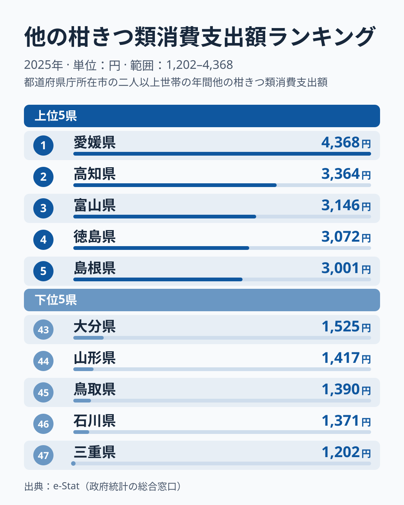
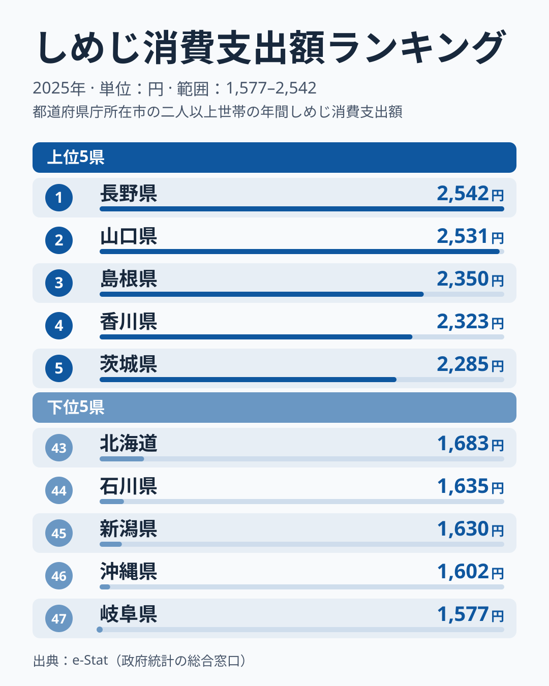
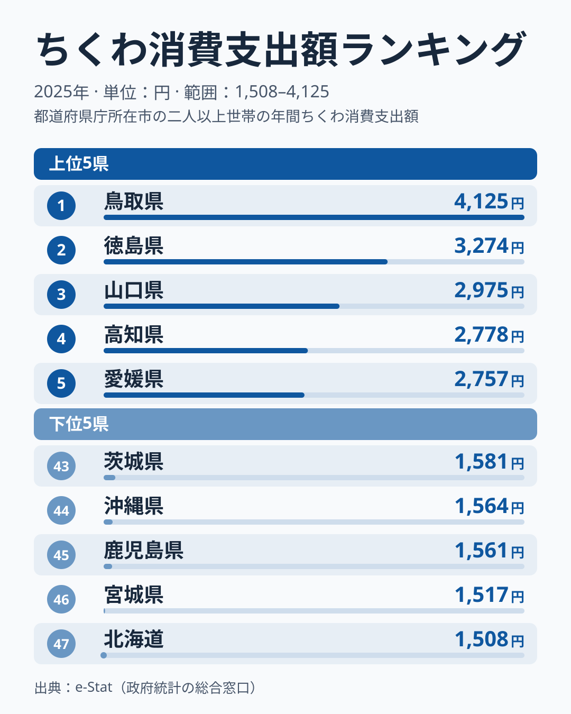
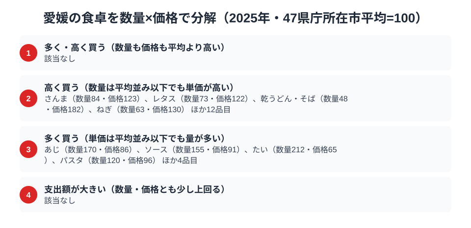

愛媛県といえば、真っ先に思い浮かぶのが「みかん」でしょう。実際、総務省の家計調査（品目別）2025年データを見ると、愛媛県庁所在市（松山市）の二人以上世帯は「他の柑きつ類」（みかんを除く柑橘類）に年間4,368円を支出しており、これは47都道府県で堂々の全国1位です。

ですが、愛媛の食卓を柑橘だけで語ってしまうと見落とすものがあります。家計調査の品目を愛媛の視点で並べ直すと、ちくわが全国5位と、柑橘とはまったく異なる練り物の分野でも上位に顔を出しています。一方で、きのこのしめじは全国33位と、順位は中位より下です。なぜ愛媛は柑橘とちくわで高い支出額を記録し、しめじでは目立たないのでしょうか。この記事では3つの品目から、愛媛の家計と食文化を読み解きます。理由はデータだけでは確かめられないため、推測にとどまる部分は [仮説] と明記します。

> [!NOTE]
> 本記事の数値は総務省統計局「家計調査（品目別）」2025年、都道府県庁所在市（愛媛県は松山市）の二人以上世帯における年間支出額です。世帯の購入額を集計した統計であり、県全体の値ではなく、県内の生産量や消費量そのものを示すものでもありません。

## 柑きつ類 — 全国1位4,368円、最下位三重の3.6倍

<source-link href="/ranking/other-citrus-consumption-expenditure">他の柑きつ類消費支出額ランキングをもっと見る</source-link>

愛媛県は他の柑きつ類消費支出額で4,368円と全国1位です。注目したいのは2位との差です。2位は高知県で3,364円と、愛媛との差は1,004円あります。3位の富山県は3,146円、4位の徳島県は3,072円で、2位以下は数百円刻みで連なっており、1位だけが抜けた形です。最下位は三重県の1,202円で、愛媛の3.6倍の開きがあります。

四国では、愛媛県が1位、高知県が2位、徳島県が4位と、3県が上位に入っています。一方、同じ四国の香川県は34位（1,894円）で、四国全体が高いわけではありません。

愛媛県はいよかん・甘平・紅まどんな・せとかなど、温州みかん以外の柑橘品種を数多く生産する産地として知られています。[仮説] 「他の柑きつ類」という分類にはこうした多品種の柑橘が含まれ、地元での購入機会の多さが家計支出に反映されている可能性があります。高知県・徳島県が上位に入る背景にも、柑橘栽培が盛んな地域であることが関わっているかもしれませんが、生産量の指標を使っていないため、ここでは断定できません。また、家計調査の市別の値は単年のぶれが大きいため、2位以下の順位は年ごとに入れ替わる可能性があります。

## しめじ — 全国33位1,889円、突出した品目ではない

<source-link href="/ranking/shimeji-consumption-expenditure">しめじ消費支出額ランキングをもっと見る</source-link>

しめじ消費支出額では、愛媛県は1,889円で全国33位でした。1位は[長野県](/blog/nagano-food-culture)で2,542円、2位は山口県で2,531円です。1位と2位の差は11円しかなく、上位は接戦です。最下位は岐阜県で1,577円で、1位と最下位の差は1.6倍にとどまります。柑橘のように大きな差がつく品目ではなく、愛媛の1,889円も、1位からは653円下という位置です。

過去の年との比較は本記事では行っていません。[仮説] 家計調査の市別の値は単年のぶれが大きく、サンプルとなる世帯の購入の偏りが順位を左右している可能性があります。この点は複数年の値を並べて検証する必要があります。少なくとも、しめじの順位だけを根拠に「愛媛はきのこを多く食べる県」と結論づけることはできません。

## ちくわ — 全国5位2,757円、四国と中国の練り物

<source-link href="/ranking/chikuwa-consumption-expenditure">ちくわ消費支出額ランキングをもっと見る</source-link>

ちくわ消費支出額でも、愛媛県は2,757円で全国5位に入っています。1位は鳥取県で4,125円と、2位の[徳島県](/blog/tokushima-food-culture)の3,274円を851円上回り、ここでも1位が大きく抜けています。3位は山口県で2,975円、4位は高知県で2,778円で、愛媛はこの4県に次ぐ順位です。4位の高知県とは21円差で、ほぼ並んでいます。最下位は北海道で1,508円、1位と最下位の差は2.7倍です。

上位5県を地方で見ると、中国は鳥取県と山口県、四国は徳島県・高知県・愛媛県です。中国と四国にまたがって上位が集まっています。

[仮説] 愛媛県には、じゃこ天をはじめとする練り物（かまぼこ類）で知られる地域があり、練り物を日常的に買う習慣がちくわの支出額にも表れているのかもしれません。ただし、本記事で使える生産や流通のデータはなく、練り物文化が理由だと示せる根拠はありません。ここでは、愛媛が中国・四国の上位グループに入っているという事実の確認にとどめます。

> [!WARNING]
> 家計調査は品目ごとの個別集計のため、愛媛の名物である「じゃこ天」は独立した品目としては存在せず、統計上はちくわなど近縁の練り物区分に含まれている可能性があります。県の郷土食のすべてがこの3品目に反映されているわけではない点に注意してください。

## 愛媛の食卓を貫くもの

3品目を並べて目立つのは、順位そのものより差のつき方の違いです。柑きつ類は2位の高知県と1,004円離れており、1位だけが抜けています。ちくわは4位の高知県と21円差で、上位が接戦です。しめじは1位の長野県と653円離れた位置にあります。

柑きつ類は、愛媛が多品種の柑橘の産地であることと結びついている可能性があります。一方でちくわは、鳥取・徳島・山口・高知とともに上位グループに入っていますが、その理由をデータから示すことはできません。しめじは上位に入る材料が見当たりませんでした。他県の食文化まとめ記事と比べると、[徳島の食卓](/blog/tokushima-food-culture)ではちくわが2位、[長野の食卓](/blog/nagano-food-culture)ではしめじが1位と、それぞれの県で上位の品目が異なります。

[仮説] 瀬戸内海に面する愛媛県の立地や気候が、品目ごとの違いに関わっているのかもしれません。ただし本記事のデータでは確かめられず、他の県との比較検証が必要です。

## 愛媛県の家計・経済データをもっと見る

愛媛県の家計調査データは、食品以外の分野でも特徴的な傾向を示しています。[愛媛県の地域プロフィール](/areas/38000)では人口・産業・財政など県全体の統計をまとめて確認でき、[経済カテゴリ一覧](/category/economy)では所得・物価・消費支出など愛媛を含む47都道府県の経済指標を横断的に比較できます。

> [!TIP]
> しめじの1位は長野県の2,542円、2位は山口県の2,531円で、差はわずか11円です。家計調査の市別の値は単年のぶれが大きく、順位は年によって入れ替わる可能性があります。一方、柑橘は2位との差が1,004円あり、単年のぶれでは説明しにくい水準です。翌年の家計調査が更新されたら再チェックする価値があります。

## 数量×価格で分解する松山市の食卓

<source-link href="/ranking/other-citrus-consumption-quantity">他の柑きつ類消費量ランキングをもっと見る</source-link>

支出額の大小だけを見ていると、「たくさん食べる県」なのか「単価の高いものを買う県」なのかが区別できません。そこで松山市の品目を、47都道府県庁所在市（二人以上世帯）の平均を100とした数量と価格の指数で分解し、4つの区分で確認しました。図の区分は次の4つです。

- 「多く・高く買う」：数量も価格も平均より高い品目
- 「高く買う」：数量は平均並み以下だが、単価が高い品目
- 「多く買う」：単価は平均並み以下だが、量が多い品目
- 「支出額が大きい」：数量・価格とも平均を少し上回る品目

結果は、「多く・高く買う」と「支出額が大きい」の2区分が該当なしでした。「高く買う」は、さんま（数量84・価格123）、レタス（数量73・価格122）、乾うどん・そば（数量48・価格182）、ねぎ（数量63・価格130）など、ほか12品目を含めて16品目です。「多く買う」は、たい（数量212・価格65）、あじ（数量170・価格86）、ソース（数量155・価格91）、パスタ（数量120・価格96）など、ほか4品目を含めて8品目です。

つまり松山市の食卓では、数量と価格の両方が平均を上回る品目は見つからず、単価の高さが目立つ品目と、単価は低いが量を買う品目に分かれています。魚介では、たいやあじのように量が多く単価の低い品目が目立ちます。なお、ちくわは家計調査で消費量の統計が整備されていないため、同じ方法での分解はできません。

> [!TIP]
> この指数は、47都道府県庁所在市の単純平均を100としたものです。全国の値ではなく、人口の多い市も少ない市も同じ重みで平均しています。価格指数は支出額を購入量で割った平均単価から作られるため、乾うどん・そばの価格182のような大きな値も、同じ品物が高いのか、高価な品種や規格を選んでいるのかは区別できません。

この指数は松山市の2025年の年間データである点にも注意してください。

## まとめ

- 他の柑きつ類消費支出額は愛媛県が4,368円で全国1位。最下位は三重県の1,202円で、愛媛の3.6倍。2位の高知県は3,364円で、1,004円の差がある
- ちくわ消費支出額は愛媛県が2,757円で全国5位。1位の鳥取県は4,125円、2位の徳島県は3,274円
- しめじ消費支出額は愛媛県が1,889円で全国33位。1位の長野県は2,542円
- 柑きつ類は産地であることが、ちくわは練り物を買う習慣が背景にある可能性があるが、データだけでは確かめられない
- ちくわの上位5県は、中国の鳥取県・山口県と、四国の徳島県・高知県・愛媛県
