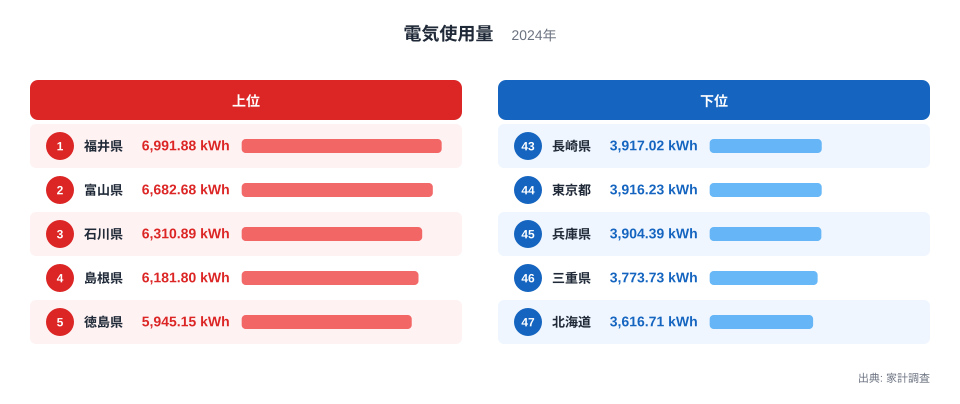
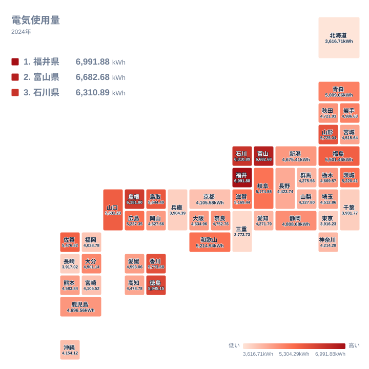

家庭で使う電気の量は、住んでいる場所によってどれほど違うのでしょうか。2024年の家計調査によると、1世帯あたりの電気使用量が最も多いのは福井県で、6,991.876kWhでした。いちばん少ない北海道は3,616.705kWhで、両者の間には大きな開きがあります。

この記事では、電気使用量の都道府県差を、順位と値の間隔に注目して整理します。電気は食べ物のように産地や郷土料理と直結するわけではありませんが、気候や暖房・調理の熱源、住まいの事情によって使い方が変わりうる品目です。ただし、そうした背景はこのデータから検証できるものではなく、あくまで読み解きの手がかりとして触れます。

## 電気使用量の上位と下位を見る

まずは上位5県と下位5県を図で確認します。

<source-link href="/ranking/electricity-consumption-quantity">電気使用量ランキングをもっと見る</source-link>

1位は福井県の6,991.876kWh、2位は富山県の6,682.68kWh、3位は石川県の6,310.888kWhです。4位は島根県の6,181.797kWh、5位は徳島県の5,945.153kWhでした。上位3県はいずれも中部の県で、残りの2県は、島根県が中国、徳島県が四国に属します。

一方、下位を見ると、47位は北海道の3,616.705kWhです。46位は三重県で3,773.732kWh、45位は兵庫県で3,904.389kWh、44位は東京都で3,916.227kWh、43位は長崎県で3,917.018kWhでした。下位には北海道、近畿、関東、九州の県が混在していて、特定の地方だけに固まっているわけではありません。

最大の福井県と最小の北海道を比べると、福井県は北海道の1.93倍にあたります。ただし、この倍率は両端の比較であり、全体がこの幅で均等に散らばっているわけではありません。中位には4,000kWh台から5,000kWh台の県が数多く並びます。

> [!NOTE]
> この統計は家計調査にもとづく1世帯あたりの年間の電気使用量で、単位はkWhです。金額ではなく使用した電力量なので、電気料金の単価の違いは含みません。また、事業所や工場で使う電気は家計の支出とは別のものである点に注意が必要です。

## 福井県・富山県・石川県が上位を占める

福井県、富山県、石川県の3県は、1位から3位までを続けて占めました。福井県と富山県の差は、6,991.876kWhと6,682.68kWhで、約309kWhです。富山県と石川県の差は、6,682.68kWhと6,310.888kWhで、約372kWhです。2つの間隔は同じではなく、2位と3位のほうが開いています。

3位の石川県から4位の島根県の6,181.797kWhまでは約129kWh、4位の島根県から5位の徳島県の5,945.153kWhまでは約237kWhです。上位5県の間隔は一方向に広がるわけでも縮まるわけでもなく、順位ごとにまちまちです。

この並びの背景として、冬の気候や住宅の広さ、暖房や給湯に電気を使う家庭の多さなどを思い浮かべる方もいるでしょう。ただし、これらは仮説にとどまります。今回の指標は電気使用量だけで、気温、住宅、世帯人数、オール電化の普及率は含まれていません。本データでは、そうした要因を検証していない点をご承知ください。

一方で、上位10県には福井県、富山県、石川県のほかに、山形県、島根県、徳島県、香川県、鳥取県、山口県、福島県が入っています。上位10県を見ても、特定の地方に強く偏っているとまでは言えません。福井県の詳しい数値は [福井県のデータ](/areas/18000) で、富山県については [富山県のデータ](/areas/16000) で確認できます。

> [!TIP]
> 順位が1つ違うときの値の差は、場所によって異なります。1位の福井県と2位の富山県の間は約309kWh、2位と3位の間は約372kWhも離れています。一方、下位の43位長崎県は3,917.018kWh、44位東京都は3,916.227kWhで、値はほとんど変わりません。順位の違いだけで差の大きさを判断せず、実際の値を見比べるのが安全です。

## 地理分布で見る全国の傾向

次に、全国の分布をタイルマップで確認します。

地図を眺めると、色の濃い県が一か所に固まっているというより、地方ごとに濃淡が入り混じっている様子がうかがえます。同じ地方の中でも、順位が大きく離れる例が目立ちます。

東北では、山形県が7位で5,725.035kWhなのに対し、宮城県は30位で4,515.636kWhです。九州・沖縄でも、佐賀県は11位で5,476.816kWhですが、福岡県は41位で4,038.776kWhと、大きな差があります。近畿では和歌山県が14位、兵庫県が45位で、同じ地方でも大きく違います。

つまり、地方という大きなくくりで電気使用量を説明するのは難しいことがわかります。県ごとの事情の違いが、地方内の差に表れていると考えられますが、その中身は本データからは読み取れません。

## 大都市圏は低めの県が多い

東京都は3,916.227kWhで44位、大阪府は4,634.958kWhで26位、愛知県は4,271.793kWhで36位でした。神奈川県は37位、千葉県は42位と、関東の都市部では低めの順位が目立ちます。一方で、大阪府は中位、茨城県は13位の5,220.41kWhと高めで、都市部だから一律に低いとは言えません。

都市部では集合住宅が多く、世帯の人数が少ないために使用量が小さくなる、という見方はよく語られます。ただし、これも仮説であり、本データでは住宅の種類や世帯人数を確認していません。順位の傾向から「低めの県が多い」と言える程度にとどめて受け止めてください。

> [!WARNING]
> 家計調査は標本調査で、調査した世帯の数も限られます。県全体の実態を完全に表すわけではないため、順位が近い県同士の差は誤差の範囲かもしれません。細かな順位の違いを強く解釈しすぎないよう注意してください。

## 北海道が最も少ない点をどう読むか

もっとも寒いイメージのある北海道が最下位というのは、意外に感じられるかもしれません。北海道は3,616.705kWhで47位でした。

北海道では暖房に灯油やガスを使う家庭が多く、そのぶん電気が少なく出ている可能性があります。ただし、これも仮説で、本データは電気使用量だけを扱っているため、灯油やガスの使用量とは比べられません。電気使用量が少ないことは、エネルギー消費全体が少ないことを意味しないという点だけは、確かな注意点です。

## データについて

この記事で使った数値は、家計調査の2024年の電気使用量です。単位はkWhで、47都道府県すべての値を使っています。記事内の倍率は、1位の福井県と47位の北海道という、実データ上の最大と最小の比だけを使いました。順位間の差は、実データの値の引き算で求めています。

電気使用量は、さまざまな要因が重なって決まると考えられるため、一つの理由だけで順位を説明することはできません。ほかの統計と合わせて確認する場合は、[同じカテゴリの統計一覧](/category/economy)も参考にしてください。

## まとめ

電気使用量が最も多いのは福井県の6,991.876kWh、最も少ないのは北海道の3,616.705kWhでした。上位には福井県、富山県、石川県の3県が並び、下位には北海道、三重県、兵庫県、東京都、長崎県が入っています。

上位5県の間隔は順位ごとにまちまちで、下位では43位から47位まで値が近い県が続きます。同じ地方の中でも順位の差が大きいため、地方単位のくくりで語るより、県ごとの値と順位の間隔を見ることが大切です。背景の説明はあくまで仮説であり、気候や住宅、熱源の違いは別の統計で確かめる必要があります。
