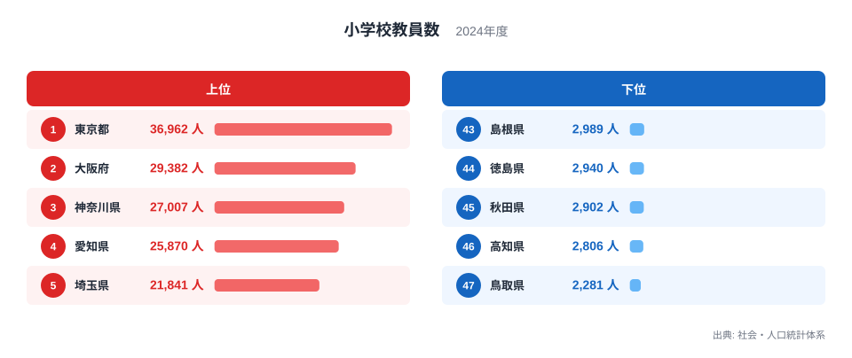
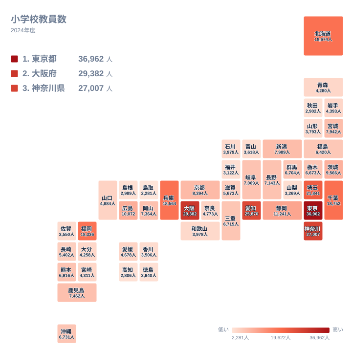

## 小学校の先生が最も多いのは東京都

2024年の小学校教員数で1位になったのは東京都で、36,962人です。2位は大阪府で29,382人、3位は神奈川県で27,007人、4位は愛知県で25,870人、5位は埼玉県で21,841人と続きます。反対に最も少ないのは47位の鳥取県で、2,281人です。46位は高知県で2,806人、45位は秋田県で2,902人です。

1位と47位の比は、実データの最大と最小で見ると東京都36,962人に対して鳥取県2,281人です。この記事では、並びの背景を地理・産業構造・歴史の面から考えます。ただし、学校数や児童数などは手元のデータにないため、背景の説明は仮説として扱います。

<source-link href="/ranking/elementary-school-teachers">小学校教員数ランキングをもっと見る</source-link>

## 上位は大都市を抱える都道府県が並ぶ

図の上位5県は、東京都、大阪府、神奈川県、愛知県、埼玉県です。6位は千葉県で18,752人、7位は北海道で18,674人、8位は兵庫県で18,564人、9位は福岡県で18,336人です。上位9位までは、すべて18,000人を超えています。

地方で見ると、東京都、神奈川県、埼玉県、千葉県は関東です。大阪府と兵庫県は近畿、愛知県は中部、北海道は北海道・東北、福岡県は九州・沖縄に入ります。上位9位が五つの地方にまたがっている点は、特定の地方だけが多いわけではないことを示しています。

人口の多い都道府県ほど、通う子どもの数も多く、教員の総数も大きくなりやすいと考えられます。ただし、この記事に載せた数値は教員数だけです。人口や児童数は示していないので、あくまで読み方の仮説です。

> [!NOTE]
> この指標は小学校に勤める教員の人数そのものです。児童1人あたりの教員数や、1校あたりの教員数ではありません。大きな県ほど大きな値が出やすい総数の統計です。

## 下位は東北・中国・四国の県が並ぶ

下位に目を向けると、43位は島根県で2,989人、44位は徳島県で2,940人、45位は秋田県で2,902人、46位は高知県で2,806人、47位は鳥取県で2,281人です。地方で分けると、島根県と鳥取県は中国、徳島県と高知県は四国、秋田県は東北です。

下位5県は三つの地方にまたがっています。そのため、特定の地方の特徴というより、規模の小さい県に共通する傾向のようにも読めます。ただし、この表の5県だけでは断定できません。

また、上位の千葉県、北海道、兵庫県、福岡県の4県は18,000人台に集まっています。下位の5県は2,000人台に収まっています。上位と下位では、水準が大きく離れています。

> [!WARNING]
> この数値は2024年時点の教員の人数で、本務者と非常勤講師をどう数えているかまでは読み取れません。同じ人数でも、勤務形態の内訳が県ごとに異なる可能性があります。順位の差をそのまま働き手の規模の差と受け取らないよう注意が必要です。

## 地理分布で見ると中位の様子がわかる

タイルマップにすると、値の大きい県は一部に偏り、多くの県は小さな値に集まっていることが見て取れます。10位の静岡県は11,241人で、9位の福岡県の18,336人から大きく下がります。10,000人を超えるのは、11位の広島県の10,072人までの11県です。

12位以下は一気に1万人を切ります。12位の茨城県は9,566人、13位の京都府は8,394人、20位の熊本県は6,916人です。つまり、中位から下位にかけては、人数が数千人台でなだらかに続く県が大半です。

同じ九州・沖縄でも幅があります。9位の福岡県は18,336人ですが、16位の鹿児島県は7,462人、20位の熊本県は6,916人、21位の沖縄県は6,731人です。一つの地方の中でも、1位と他県の差は大きいことがわかります。

> [!TIP]
> 順位が1つ違うだけでも、人数の差は場所によって異なります。上位では1位の東京都と2位の大阪府で差が大きい一方、中位では数十人から数百人の差で順位が入れ替わります。順位と人数を合わせて読むと、差の大きさがつかめます。

## なぜこの順になるのか

第一に、地理が影響している可能性があります。北海道は7位で18,674人です。広い面積に学校が点在しているため教員が多く必要になる、と考えられますが、学校数のデータは手元にないので仮説です。

第二に、産業構造が関わっているかもしれません。愛知県は4位で25,870人です。製造業などの集積が家族連れを呼び込み、児童数を押し上げた可能性がありますが、人口移動のデータはないため、断定はできません。

第三に、歴史的な人口移動です。大都市圏では住宅地の拡大が続き、人口が流出した地方では学校の再編が進んだのではないかという見方があります。これも仮説で、この数値だけでは裏付けられません。

確かに言えるのは、並びが大都市圏に偏っているという点です。[東京都のデータ](/areas/13000)と[大阪府のデータ](/areas/27000)を見ると、他の統計との関係も確かめられます。

## データについて

ここで使った値は、社会・人口統計体系の小学校教員数で、2024年の人数です。単位は人で、都道府県ごとの総数を比べています。人口や児童数で割った値ではないため、県の規模の差がそのまま数字に出ます。

教育分野の他の指標は、[同じカテゴリの統計一覧](/category/educationsports)で確認できます。児童数や学校数と並べると、教員数の背景がより具体的に読み取れます。

## まとめ

1位は東京都の36,962人、47位は鳥取県の2,281人です。上位は大都市を抱える都道府県、下位は東北・中国・四国の県が並びます。

背景には地理・産業・歴史が関わっていそうですが、手元の数値だけでは断定できません。順位とあわせて、人数の水準も見ることをおすすめします。
