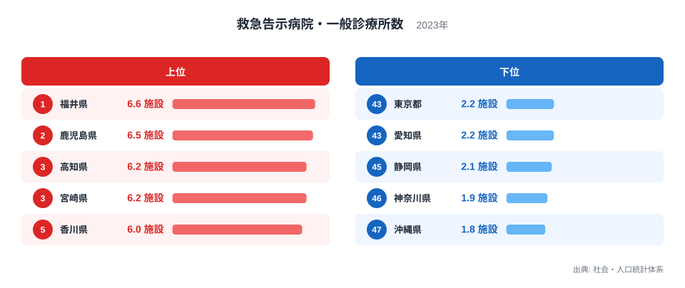
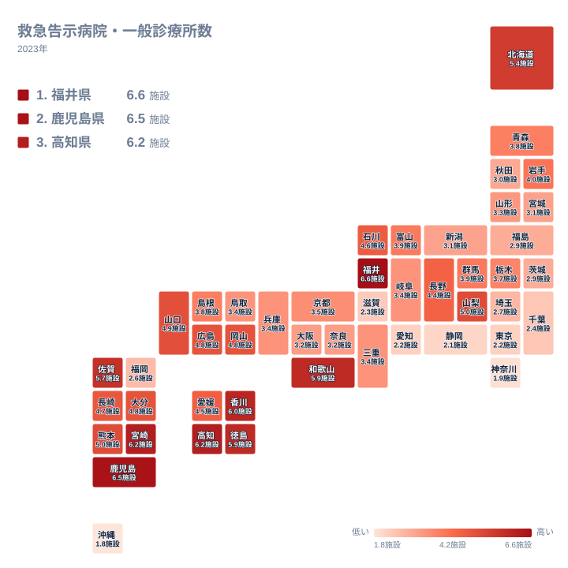

急な病気やけがのとき、近くに救急へ対応できる医療機関があるかどうかは、暮らしの安心に直結します。この記事で扱う救急告示病院・一般診療所数は、施設の実数ではなく、人口あたりに換算した施設数とみられる値です。6.6や1.8といった小さな数が並んでいるのは、そのためです。

2023年の値を都道府県で比べると、1位は福井県の6.6施設、47位は沖縄県の1.8施設でした。東京都や大阪府のような大都市圏が上位に並ぶと思われがちですが、実際の順位はそうなっていません。この記事では順位の並びから読み取れる傾向を整理し、原因を断定できない部分は仮説として明記します。

## 首位は福井県、最下位は沖縄県

まず、順位の両端を図で確認します。

<source-link href="/ranking/emergency-hospital-general-clinic-count-per-100k">救急告示病院・一般診療所数ランキングをもっと見る</source-link>

上位は、1位が福井県の6.6施設、2位が鹿児島県の6.5施設、3位が高知県の6.2施設、4位が宮崎県の6.2施設、5位が香川県の6施設です。地方で言えば、中部の福井県、九州・沖縄の鹿児島県と宮崎県、四国の高知県と香川県が並びます。東京都や大阪府の名前は上位にありません。

下位は、47位が沖縄県の1.8施設、46位が神奈川県の1.9施設、45位が静岡県の2.1施設、44位が愛知県の2.2施設、43位が東京都の2.2施設です。大都市圏を含む都県が下位に集まっていることが、図から確認できます。

この記事で使える数値は指標の値と順位だけです。人口や面積そのものの数字は手元にないため、差が生まれた原因は仮説の域を出ません。以降も、順位の傾向として言える範囲に絞って読み進めます。

> [!NOTE]
> この指標は、救急告示病院と一般診療所を合わせた値です。病院と診療所は規模も役割も大きく異なりますが、同じ1施設として数えられています。数値が高い県は小さな診療所が多いだけかもしれず、大病院が手厚い県とは限りません。

## 福井県はなぜ首位なのか

福井県の位置づけを、近隣の県と並べて見ます。同じ中部の石川県は17位で4.6施設、富山県は22位で3.9施設でした。福井県の6.6施設は、この2県をはっきり上回っています。中部で福井県に次ぐのは山梨県の5施設で、10位です。これも福井県には届きません。

近畿の京都府は26位で3.5施設、滋賀県は42位で2.3施設です。福井県は隣り合う県と比べても突出しており、地理的に近いというだけでは、この高さは説明できません。

ここで言えるのは、福井県の高さが隣県との地続きの傾向ではなく、県ごとの医療提供の形に由来している可能性がある、というところまでです。たとえば、小規模な診療所が県内に細かく行き渡っている、あるいは救急告示病院の指定が多い、といった仮説が考えられます。しかし、これを裏づける内訳は今回のデータに含まれていません。歴史や産業が関わっているかどうかも、この指標からは確かめられません。

首位の福井県と2位の鹿児島県の個別データは、次のページで確認できます。

- [福井県のデータ](/areas/18000)
- [鹿児島県のデータ](/areas/46000)

## 地理分布に見る四国・九州の厚み

次に、全国のどこで数値が高く、どこで低いのかを地図で見ます。

地図からまず読み取れるのは、高い県が四国と九州に偏っているという点です。四国は、高知県が3位、香川県が5位、徳島県が7位と、上位に連なります。九州・沖縄も、鹿児島県が2位、宮崎県が4位、佐賀県が8位と上位に入ります。熊本県の11位、大分県の15位、長崎県の16位を含め、中位以上に多くの県が収まっています。

反対に、低い県は関東と、愛知県や静岡県、神奈川県といった大都市圏の周辺に集まっています。関東では、埼玉県が39位、千葉県が41位、東京都が43位、神奈川県が46位です。ただし、群馬県は21位、栃木県は25位と、内陸ではやや高い位置にあります。

一方で、この傾向には例外も目立ちます。九州・沖縄でも福岡県は40位、沖縄県は47位で、同じ地方の中で値が大きく割れています。近畿でも、和歌山県は6位と高いのに、滋賀県は42位です。北海道は9位で、東北は岩手県の20位から福島県の37位まで、中位から下位寄りに散らばっています。

大づかみには、四国と九州で高く、関東と大都市圏で低い構図です。ただし、これは地方単位の大まかな傾向にすぎません。県ごとに事情が違うため、地方名だけで一括りにして読むのは危険です。

> [!WARNING]
> 人口あたりの指標では、人口の少ない県ほど、施設がわずかに増減しただけで値が動きやすくなります。順位の高さが、施設の実数の多さや救急体制の強さを直接示すわけではありません。実数の多い大都市圏が下位に沈むのは、この性質も影響している可能性があります。

## 人口の少ない県が高くなる仮説と、その限界

上位に地方の県が多いことから、「人口の少ない県ほど、人口あたりの施設数が高く出やすいのではないか」という見方ができます。鹿児島県や高知県のように、山間部や離島を抱える県では、救急の拠点を各地に分けて置く必要があるのかもしれません。

ただし、この説明には矛盾もあります。沖縄県は離島を多く抱えるにもかかわらず、47位で最下位です。離島が分散配置を促すという理屈だけでは、沖縄県の低さを説明できません。本島に拠点が集まっている、搬送の仕組みで補っているなど、別の事情があるのかもしれませんが、今回のデータでは確認できません。

静岡県の45位も、単純な説明を許しません。この記事が確かに言えるのは、大都市圏を含む都県が下位に並び、地方の県が上位に多いという、順位の傾向までです。人口や面積との関係は、別の統計を足して検証すべき課題です。

大都市圏が低い理由についても、「大病院に機能を集約している」「交通網が発達していて遠くの病院へも通える」といった仮説は、あくまで推測です。施設数が少ないことが、救急体制の弱さを意味するとは限りません。

> [!TIP]
> 福井県の6.6施設と鹿児島県の6.5施設は、順位こそ1位と2位ですが、差はわずかです。高い値が小規模施設の多さによるのか、救急告示病院の多さによるのかは、この指標だけでは区別できません。順位の1つ違いよりも、地方ごとの大きな傾向に注目してください。

## 中位は僅差で順位が動く

中位は、値が近い県が密集しています。中国地方のうち、山口県は12位で4.9施設、岡山県は13位で4.8施設、広島県は14位で4.8施設と、近い値で並びます。一方、同じ中国地方でも、島根県は24位で3.8施設、鳥取県は30位で3.4施設と、離れた位置にあります。地方の中でも、これだけ幅があります。

さらに、岐阜県、三重県、兵庫県、鳥取県は、27位から30位まで、いずれも3.4施設で並びます。大阪府と奈良県も、どちらも3.2施設です。このように同じ値の県が多く、わずかな差で順位が入れ替わる層です。

そのため、中位の県は、1つ順位が違うことにあまり意味がありません。順位より、上位の6施設前後や、下位の2施設前後とどれだけ離れているかを見るほうが、実態に近い読み方になります。

同じ分野の統計と合わせて見ると、地域の医療や福祉の姿がより立体的に見えてきます。関心のある方は、[同じカテゴリの統計一覧](/category/socialsecurity)もご覧ください。

## データについて

この記事で使った統計は、社会・人口統計体系の「救急告示病院・一般診療所数」で、年は2023年、単位は施設です。値が小さいことから、実数ではなく人口あたりに換算された値と判断して読んでいます。何人あたりかという換算の基準は、手元の情報では確認していません。全国47都道府県の値が公開されています。

数値は都道府県単位の集計なので、県内の市町村ごとの差は反映されません。また、救急告示病院と一般診療所を合わせた値であるため、夜間救急や高度救命に対応できる施設がどれだけあるかは、別の統計で確認する必要があります。

## まとめ

2023年の救急告示病院・一般診療所数は、福井県が6.6施設で1位、鹿児島県が6.5施設で2位、高知県と宮崎県が6.2施設で続きました。最下位は沖縄県の1.8施設で、神奈川県が1.9施設、静岡県が2.1施設と並びます。

四国と九州に高い県が集まり、関東や大都市圏に低い県が集まる傾向は確かです。しかし、福井県の突出や沖縄県の低さのように、地理や人口だけでは説明しきれない例も残ります。数値の高低をそのまま医療の優劣と受け取らず、地域の実情とあわせて読むことが大切です。
