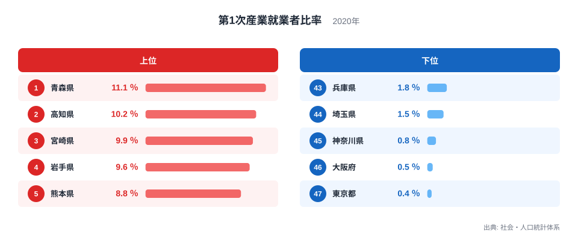
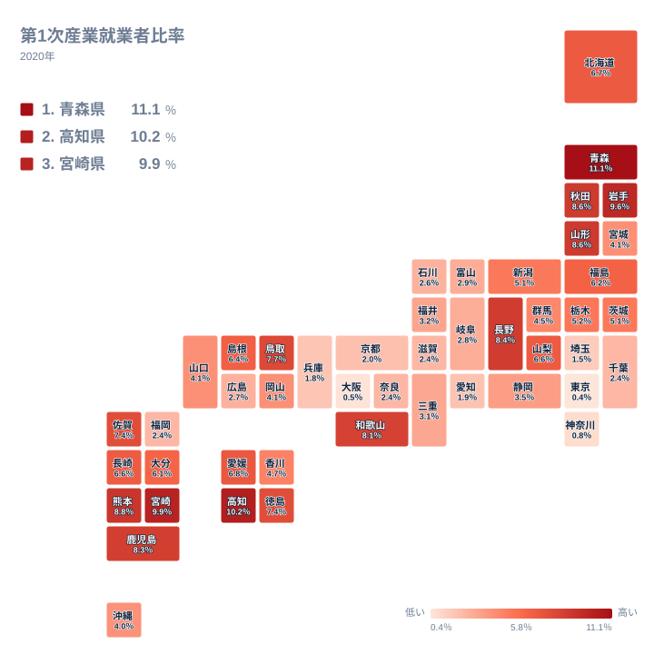

農業・林業・漁業に就いている人は、働く人全体のどれだけを占めているのでしょうか。2020年の第1次産業就業者比率で都道府県を並べると、最も高い青森県は11.1％、最も低い東京都は0.4％でした。同じ国の中で、仕事の中身がこれほど違っています。

この記事では、上位と下位がなぜその順になるのかを、地理・産業構造・歴史の面から考えます。ただし、使えるのは都道府県ごとの値と順位だけです。そのため、理由の説明は確定した事実ではなく、あくまで「そう考えると整理しやすい」という仮説として書きます。

## 上位と下位を並べてみる

まずは上位5県と下位5都府県を図で確認します。

<source-link href="/ranking/employed-people-ratio-primary">第1次産業就業者比率ランキングをもっと見る</source-link>

上位は、1位の青森県が11.1％、2位の高知県が10.2％、3位の宮崎県が9.9％、4位の岩手県が9.6％、5位の熊本県が8.8％です。この5県を地方で分けると、北海道・東北が青森県と岩手県の2県、四国が高知県の1県、九州・沖縄が宮崎県と熊本県の2県です。上位は特定の1地域に固まっているわけではなく、北海道・東北と、四国・九州にまたがっています。共通点として考えられるのは、いずれも東京都や大阪府のような巨大な都市圏から離れた位置にあることです。

下位に目を向けると、47位の東京都が0.4％、46位の大阪府が0.5％、45位の神奈川県が0.8％、44位の埼玉県が1.5％、43位の兵庫県が1.8％です。関東の3都県と近畿の2府県で、いずれも人口の多い大都市圏に含まれる地域です。こうした地域では、商業、サービス、製造など他の仕事が多く、第1次産業の割合が小さくなっていると考えられます。土地の使われ方の違いも背景にある可能性はありますが、この図だけでは確かめられません。

ここで大切なのは、これが「割合」であることです。東京都や大阪府の比率が低いことは、農業や漁業をする人がいないという意味ではありません。他の産業で働く人が多ければ、全体に占める割合は小さく出ます。逆に上位の県でも、働く人の大半は他の産業に就いています。

> [!NOTE]
> この指標は、就業者全体に占める第1次産業(農業・林業・漁業)の就業者の割合です。分母は「その県で働く人の総数」であり、農産物や水産物の生産額、農地の広さを表すものではありません。人数そのものではなく割合なので、人口の多い県ほど実数が多くても、比率は低く出ることがあります。

## 地理分布が示す「離れるほど高い」傾向

次に、都道府県全体の分布を地図で見ます。

地図を眺めると、高い値は北海道・東北と、四国・九州に目立ちます。北海道・東北では、青森県が1位、岩手県が4位、秋田県が8.6％で6位、山形県が8.6％で7位と、上位に複数の県が並びます。一方、北海道は6.7％で15位、福島県は6.2％で19位、宮城県は4.1％で26位です。同じ地方の中でも、順位にはかなりの幅があります。

九州・沖縄では、宮崎県が3位、熊本県が5位、鹿児島県が8.3％で9位、佐賀県が7.4％で13位、長崎県が6.6％で17位、大分県が6.1％で20位と、上位から中位にかけて多くの県が入っています。一方で福岡県は2.4％で40位にとどまり、沖縄県は4％で29位です。同じ地方でも、都市の大きさや産業の組み合わせの違いが順位に表れている可能性があります。

四国では、高知県が2位、徳島県が7.4％で12位、愛媛県が6.8％で14位と上位から中位に並ぶ一方、香川県は4.7％で24位です。香川県が低めである理由は、この図からは分かりません。平野や他の産業との関係が想像されますが、根拠は示せないため、ここでは「四国の中では比率がやや低い」という事実にとどめます。

中部では、長野県が8.4％で8位、山梨県が6.6％で16位と比較的高い一方、岐阜県は2.8％で34位、愛知県は1.9％で42位です。同じ中部でも、上位寄りの県と下位寄りの県が混在しています。

> [!WARNING]
> この数値は2020年の一時点の値で、年ごとの変化や就業者数の増減は分かりません。また、他の仕事を主としながら農作業をする人が、この統計でどう扱われるかは確認できません。実際の「農業との関わりの深さ」は、この数字とずれる可能性があります。

## なぜその順になるのか: 仮説として整理する

ここからは、順位の並びをどう読めるかを仮説として整理します。数値だけでは原因を断定できないため、「〜と考えられます」という範囲にとどめます。

一つ目の仮説は、大都市からの距離です。下位の5都府県は大都市圏に集まり、上位の5県はそこから離れています。人口が集まる地域では、他産業の働き口が多く、第1次産業の割合が小さくなるという傾向があると考えられます。ただし、この図は距離そのものを測ったものではありません。

二つ目の仮説は、他の産業の厚みです。愛知県が1.9％で42位、京都府が2％で41位、兵庫県が1.8％で43位であることから、都市や工業の集まる府県で比率が低くなる傾向があると読めます。一方で、岩手県や熊本県のように大都市圏から離れた県では、第1次産業の割合が相対的に高く出ています。ここでいう「他の産業の厚み」は、あくまで順位の並びから想像した読みです。

三つ目は、歴史の影響です。大都市圏が人を引き寄せ、地方との差が長い時間をかけて形づくられてきた可能性は考えられます。しかし、その具体的な経緯をこの統計から示すことはできません。歴史の話は、順位の裏付けとしてではなく、背景を考えるきっかけとして受け止めてください。

中位の動きも見ておきます。栃木県は5.2％で21位、茨城県は5.1％で22位、新潟県は5.1％で23位です。この3県は、いずれも上位ほど高くはなく、中位にとどまっています。中位の県をどう説明するかは、他の指標と合わせて見る必要があります。

> [!TIP]
> 比率の高低を読むときは、「中心になる都市があるかどうか」に注目すると整理しやすくなります。たとえば福岡県は2.4％で40位、北海道は6.7％で15位と、いずれも大きな都市を抱えながら、同じ九州や北海道・東北の県より比率が低めです。ただし、中心都市の大きさが比率を左右すると言えるのは、この例示の範囲までです。他の県にも当てはまるかは、この図だけでは確かめられません。

## 同率や僅差の順位をどう読むか

順位の近い県同士の差は、慎重に読む必要があります。たとえば6位の秋田県と7位の山形県は、どちらも8.6％です。12位の徳島県と13位の佐賀県は、どちらも7.4％です。26位の宮城県、27位の岡山県、28位の山口県は、いずれも4.1％で並んでいます。

下位でも同じことが起きています。37位の千葉県、38位の滋賀県、39位の奈良県、40位の福岡県は、いずれも2.4％です。22位の茨城県と23位の新潟県も5.1％で、表記上は同じ値です。小数第1位までの表示では差がつかないため、順位の違いに大きな意味を持たせないほうが安全です。

また、県別の個別ページで細かい状況を確認することもできます。1位の[青森県のデータ](/areas/02000)や2位の[高知県のデータ](/areas/39000)を見ると、他の指標とあわせて地域の特徴が分かります。ほかの労働・賃金の指標とあわせて見たい場合は、[同じカテゴリの統計一覧](/category/laborwage)が役立ちます。

## データについて

この記事で使った統計は、社会・人口統計体系の「第1次産業就業者比率」で、対象年は2020年、単位は％です。就業者全体に占める第1次産業の就業者の割合を示しています。記事内の数値と順位は、すべてこの統計の値に基づいています。

## まとめ: 数字が語る暮らしの違い

2020年の第1次産業就業者比率は、1位の青森県が11.1％、2位の高知県が10.2％、3位の宮崎県が9.9％で、47位の東京都は0.4％でした。上位5県は北海道・東北に2県、四国に1県、九州・沖縄に2県と、地方をまたいで並んでいます。下位は関東と近畿の大都市圏の都府県が目立ちます。

この差は、どちらが優れているかを示すものではありません。大都市からの距離や他の産業の厚みが関わっている可能性はありますが、この統計だけで原因を言い切ることはできません。この指標を入り口に、自分の暮らす県がどのような産業で支えられているのかを、他の統計とあわせて見直してみてください。
