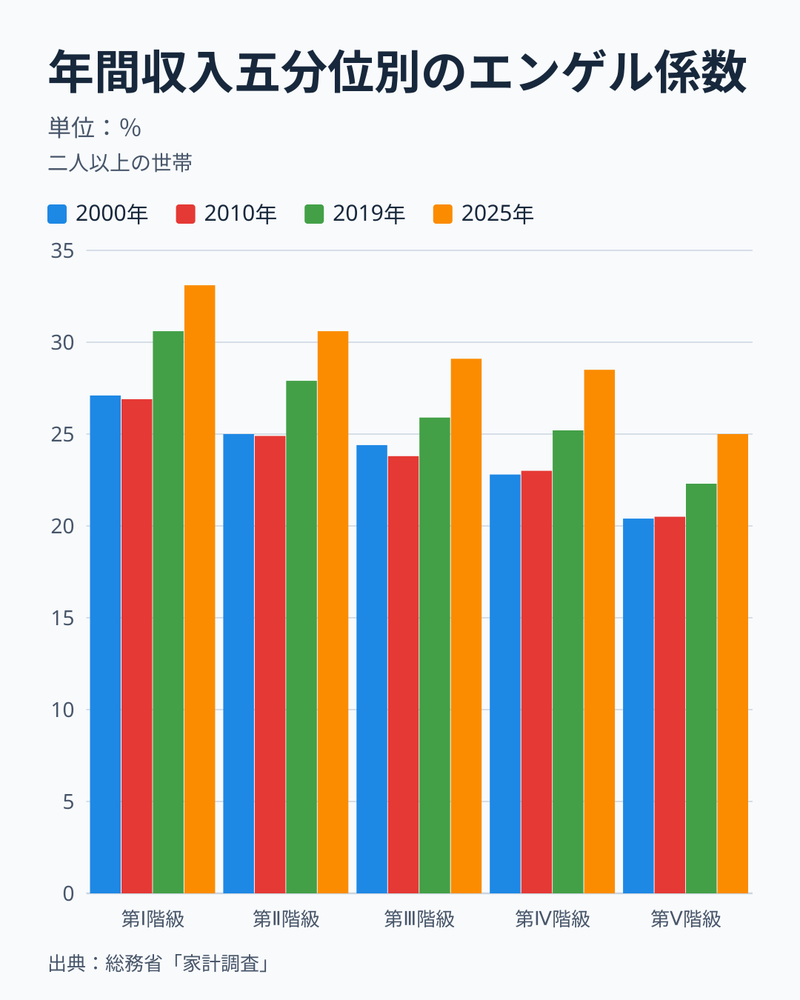
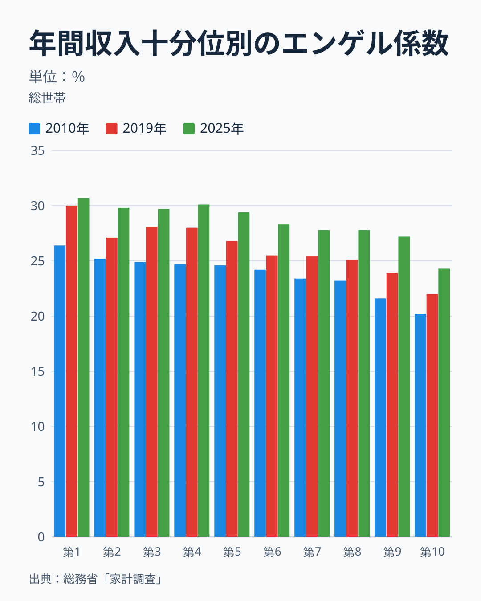
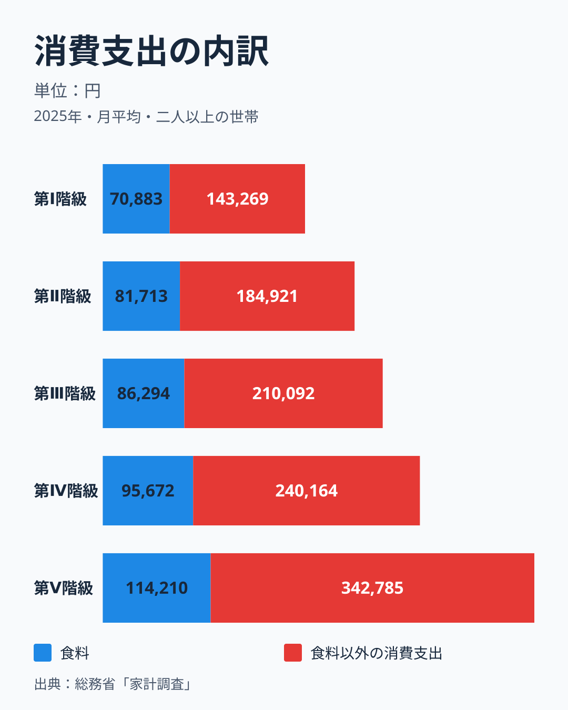
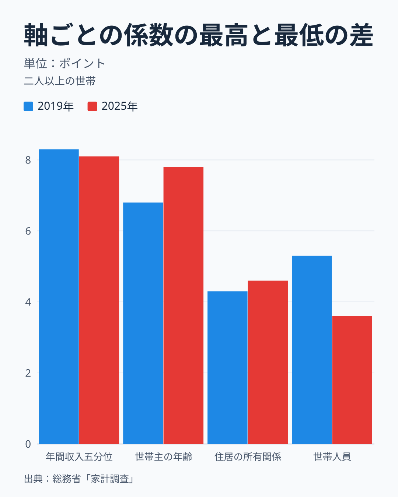
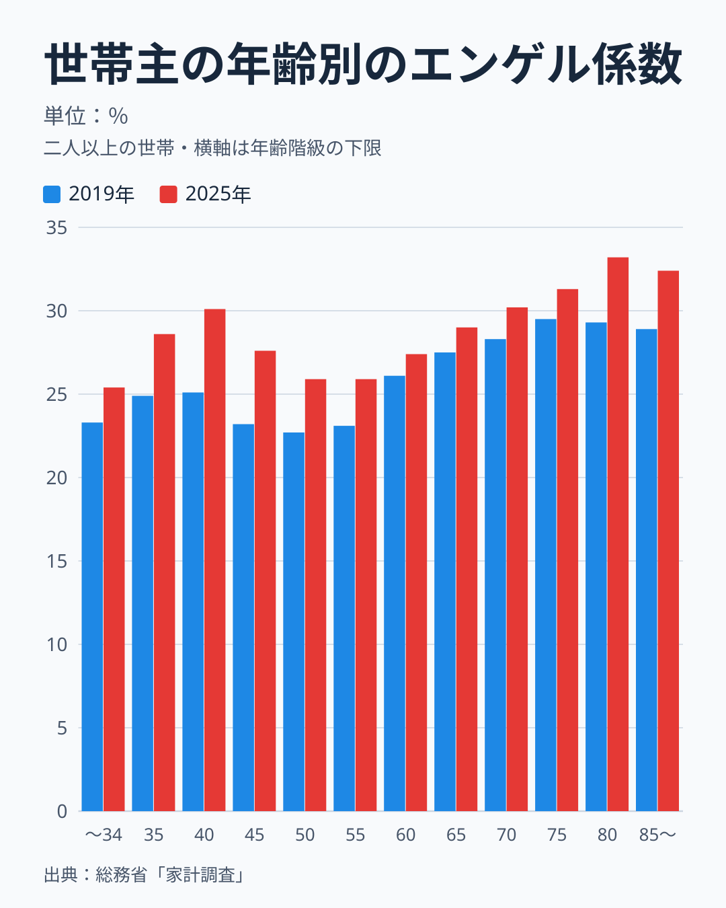
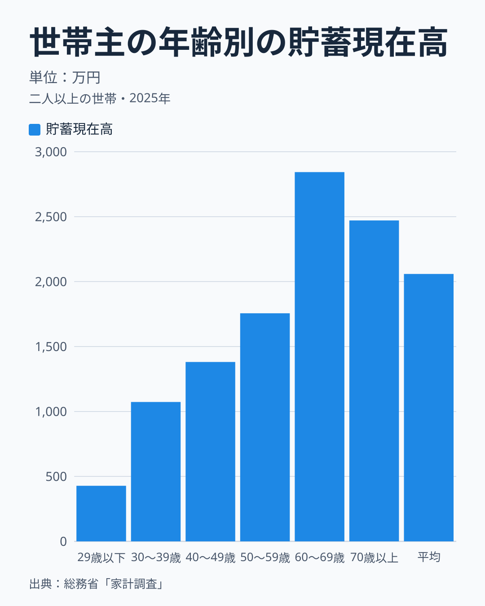
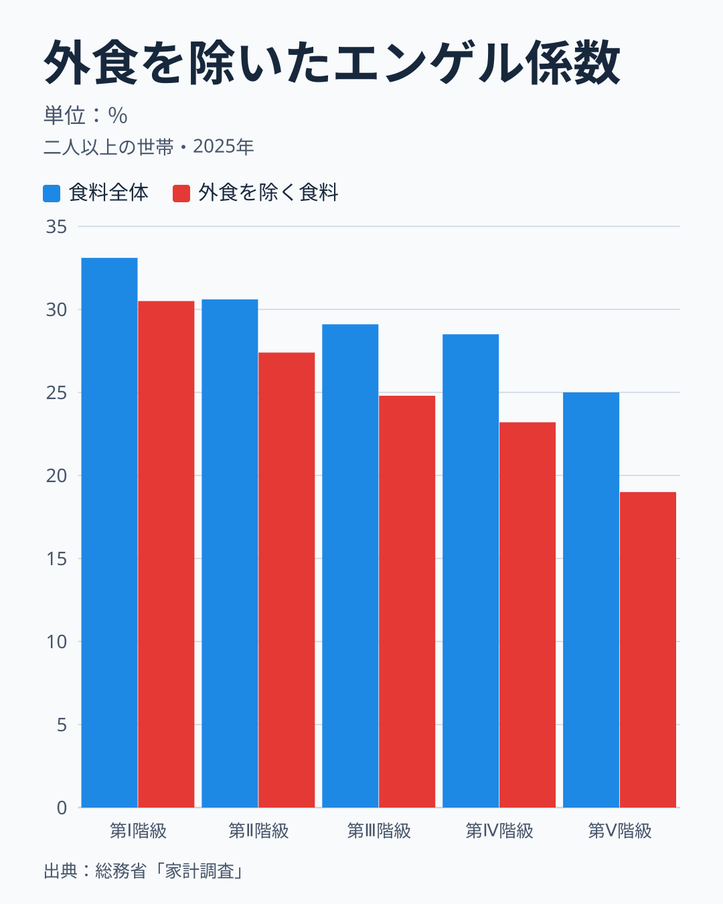

エンゲル係数が高い世帯は貧しい、と言えるでしょうか。結論は二つに分かれます。年間収入の低い世帯ほど係数が高い、という向きは、家計調査の二人以上の世帯で2000年から2025年までの26年間、一度も入れ替わりませんでした。しかし、係数が高いから貧しい、とは言えません。2025年は世帯主の年齢の軸でも係数に7.8ポイントの幅があり、40〜44歳（世帯人員が多い層）と70歳以上（消費支出が小さい層）で高く出ます。70歳以上の区分は、平均貯蓄が二人以上の世帯全体の平均を上回っています。

この記事は、総務省「家計調査」（家計収支編・二人以上の世帯・全国）の2025年を中心に、次の順で確かめます。年間収入の五分位・十分位で順序が成り立つか、その差は食費の多さか分母の違いか、年齢・住居・世帯人員の軸はどれだけ動かすか、貯蓄で見ると反例があるか、外食を除いても結論が変わらないか、の五点です。「生活水準」は直接には測れないので、年間収入、消費支出の円額、貯蓄現在高、持家率を代わりの指標として使います。「高い」は30%以上のような閾値で決めず、同じ年・同じ軸の中での順位で述べます。県や都市の話は扱わず、県別の係数と県民所得の関係は[別の記事](/blog/engel-coefficient-vs-prefectural-income)で調べています。

## 収入の低い階級ほど高い順序は、26年間入れ替わらない

年間収入の低い順に世帯を五つに分けたものが五分位です。2025年の係数は、第Ⅰ階級（年間収入が最も低い階級）が33.1%、第Ⅱ階級が30.6%、第Ⅲ階級が29.1%、第Ⅳ階級が28.5%、第Ⅴ階級（最も高い階級）が25.0%で、差は8.1ポイントです。2000年は27.1%、25.0%、24.4%、22.8%、20.4%、2010年は26.9%、24.9%、23.8%、23.0%、20.5%、2019年は30.6%、27.9%、25.9%、25.2%、22.3%でした。図の4つの年はどれも、第Ⅰ階級から第Ⅴ階級へ一貫して下がっています。図に載せていない年も同じで、2000年から2025年までの26年のすべてで、五つの階級が厳密に低い順に並びました。

> [!NOTE]
> 係数は「食料÷消費支出」で、食料には外食と調理食品を含みます。使った値は二人以上の世帯（農林漁家世帯を含む）の全国・暦年で、消費支出は1か月平均の円です。公表されている係数と、同じ表の食料÷消費支出から再計算した値は、2000〜2025年の全体平均と五分位のすべてで、最大0.05ポイントの差に収まりました。

第Ⅰ階級と第Ⅴ階級の差は、26年間で最小が6.1ポイント（2008年と2015年）、最大が8.5ポイント（2017年）でした。参考までに、全体の係数が前年から動いた幅は、最も大きい年でも1.8ポイント（2019年の25.7%から2020年の27.5%）でした。階級の差の大きさは、年ごとの全体の動きより大きい水準にあります。順序が26年のすべてで保たれたことが、特定の年の偶然ではないことの根拠です。

水準そのものは年とともに大きく動きます。2025年の第Ⅲ階級の係数（29.1%）は、2000年の第Ⅰ階級（27.1%）を2.0ポイント上回りました。第Ⅲ階級の係数は2000年の24.4%から2025年の29.1%へ上がっており、全体の係数も2019年の25.7%から2025年の28.6%へ2.9ポイント上がっています。2025年の上昇の中身は、[2025年の上昇を物価・年齢・年収で分解した記事](/blog/engel-coefficient-rise-hardship-2025)で扱っています。ここで言えるのは、「30%を超えたら高い」のような基準を置くと、同じ階級でも年によって高い・低いが入れ替わる、ということです。

> [!WARNING]
> 階級は年間収入の低い順に並べているので、棒が右下がりに見えるのは並べ方の結果です。図から読むのは「順序が入れ替わらないこと」だけで、傾きの大きさが収入の効果の強さを表すわけではありません。また、これは階級の平均どうしの比較で、同じ階級の中の個々の世帯にそのまま当てはまるものではありません。

## 十分位に細かくすると、隣り合う階級の順序は乱れる

五分位は二人以上の世帯の表です。別の分け方として、年間収入を十分位に分けた総世帯（二人以上と単身を合わせた世帯）の表があります。母集団が違うので、五分位の結果とはつなげず、向きが保たれるかどうかだけを見ます。

総世帯の十分位で、第1から第10まで厳密に低くなった年は、2007年から2025年までの19年のうち2010年の1年だけでした。2025年の係数は30.7%、29.8%、29.7%、30.1%、29.4%、28.3%、27.8%、27.8%、27.2%、24.3%で、第1から第4までの4階級は1.0ポイントの幅の中で入れ替わっています。この表の2025年の集計世帯数は、階級によって312〜1,049世帯です。五分位の1,329〜1,549世帯と比べて少なく、隣り合う階級の差が標本の揺れに埋もれやすい規模です。

それでも向きは保たれていました。第1十分位は19年のすべてで第10十分位より高く、差は最小が4.9ポイント、最大が8.0ポイントで、2025年は6.4ポイントです。2025年の下半分（第1〜第5）の単純平均は29.9%、上半分（第6〜第10）は27.1%でした。収入の低い側ほど係数が高い、という向きは、五分位でも十分位でも言えます。ただし、十分位は隣り合う階級の順位を読む根拠にはなりません。両端で読む向きの話にとどまります。

## 差は食費の少なさでなく、食料以外の支出の多さから生まれる

2025年の第Ⅰ階級は、消費支出が1か月に214,152円で、うち食料が70,883円、食料以外が143,269円です。第Ⅴ階級は消費支出が456,995円で、食料が114,210円、食料以外が342,785円でした。第Ⅴ階級の食料費は第Ⅰ階級の1.6倍、食料以外の消費支出は2.4倍で、消費支出の合計は2.1倍です。言い換えると、第Ⅰ階級の消費支出は第Ⅴ階級の46.9%、食料費は62.1%、食料以外は41.8%になります。

係数は食料÷消費支出なので、食料が増えても、食料以外がそれ以上に増えれば下がります。第Ⅴ階級の食料費は第Ⅰ階級より43,327円多いのに対し、食料以外は199,516円多く、この差が割合を下げています。高収入の世帯が食費を切り詰めているから係数が低いのではありません。第Ⅰ階級の係数が高いのも、食費が多いからではなく、消費の総額が小さく、食費がそのうち大きな割合を占めるからです。

分母の消費支出には、税・社会保険料と、消費に使われなかった分が入りません。収入の高い世帯ほど消費に使わない割合が大きいと、消費支出は収入ほど増えず、係数の差が小さく出ます。そこで、二人以上の世帯のうち勤労者世帯の表で、分母を可処分所得に変えて確かめました。2025年の食料÷可処分所得は、第Ⅰ階級が23.1%、第Ⅱ階級が20.0%、第Ⅲ階級が18.7%、第Ⅳ階級が17.1%、第Ⅴ階級が14.1%で、差は9.0ポイントです。消費支出を分母にした同じ世帯の係数は29.9%、28.8%、28.1%、26.9%、24.2%で、差は5.7ポイントでした。分母を変えても向きは同じで、差はむしろ広がります。可処分所得のうち消費に使われなかった割合を示す黒字率は、第Ⅰ階級の22.8%から第Ⅴ階級の41.4%まで上がっていて、この差が消費支出を分母にした係数の差を小さくしています。

## 収入の軸の幅が最大だが、年齢の軸にも近い幅がある

係数を動かす軸は収入だけではありません。世帯主の年齢（12区分）、住居の所有関係（持家・民営借家・公営借家・給与住宅）、世帯人員（2人から6人以上）についても、それぞれの表で係数の最高と最低の差を計算しました。2025年は、収入が8.1ポイント、年齢が7.8ポイント、住居が4.6ポイント、世帯人員が3.6ポイントです。2019年は収入が8.3ポイント、年齢が6.8ポイント、世帯人員が5.3ポイント、住居が4.3ポイントでした。収入が最も大きい軸であることは両年で同じですが、2025年は年齢との差が0.3ポイントしかありません。

区分の数や幅は軸によって違い、収入は5区分、年齢は12区分です。区分が多いほど最高と最低の差は大きく出やすいので、ここでの幅は軸の重要度の順位でも、因果の大きさでもありません。見たいのは、収入の軸だけでなく年齢の軸にも7.8ポイントという近い幅があることです。「係数が高いのは収入が低いから」と収入の軸だけで読むと、年齢の軸にある差を見落とします。

> [!WARNING]
> 2025年の第Ⅰ階級は、世帯主の平均年齢が72.8歳、世帯人員が2.30人で、第Ⅴ階級の52.8歳、3.36人とは世帯の姿が違います。収入の階級の差には、年齢と人数の違いが混ざっています。年収と年齢の交差表は使っていないので、収入の効果だけを取り出すことはできません。

## 年齢の軸には、40代前半と高齢期の二つの山がある

2025年の係数を世帯主の年齢別に見ると、34歳以下が25.4%で最も低く、35〜39歳が28.6%、40〜44歳が30.1%と上がります。45〜49歳は27.6%、50〜54歳と55〜59歳は25.9%まで下がり、60〜64歳の27.4%から80〜84歳の33.2%まで上がり続けて、85歳以上は32.4%です。2019年も同じ形で、40〜44歳が25.1%、50〜54歳が22.7%、80〜84歳が29.3%でした。

40〜44歳の山は、世帯人員の多さと重なっています。この年齢の世帯人員は3.84人で、全体の2.87人より約1人多く、食料費は100,526円と全体の89,754円を上回ります。ただし人数だけでは年齢の谷を説明できず、係数が最も低い34歳以下の世帯人員も3.28人と全体より多くなっています。世帯人員の軸でも、2人が28.2%、5人が30.8%、6人以上が31.8%と、人数の多い世帯ほど高い向きがあります。ただし幅は3.6ポイントです。

70歳以上の山は、食料費が多いために生じたものではありません。70〜74歳が30.2%、75〜79歳が31.3%、80〜84歳が33.2%、85歳以上が32.4%と、4区分すべてが全体の28.6%を上回ります。食料費は70〜74歳が87,406円、75〜79歳が83,235円、80〜84歳が79,720円、85歳以上が76,766円で、4区分とも全体の89,754円より少なく、消費支出も289,080円、265,966円、240,450円、236,684円と、全体の314,001円より小さくなっています。食料費が少なくても、消費の総額がそれ以上に小さいために係数が高く出ています。

## 係数が高くても、水準が低いとは言えない世帯がある

同じ家計調査の貯蓄・負債編で、貯蓄現在高を世帯主の年齢別に見ます。家計収支編の年齢区分（34歳以下、5歳刻み、85歳以上）と貯蓄・負債編の区分（29歳以下、10歳刻み、70歳以上）は区切りが違うので、以下は同じ区分どうしの対応ではなく、近い世代の傾向として読んでください。2025年は、29歳以下が428万円、30〜39歳が1,073万円、40〜49歳が1,381万円、50〜59歳が1,756万円、60〜69歳が2,843万円、70歳以上が2,471万円で、二人以上の世帯の平均は2,059万円です。

年齢の軸では、係数の高低と貯蓄が逆向きになります。係数が4区分とも30.2〜33.2%と高い70歳以上の区分は、平均貯蓄が全体の平均の1.2倍の2,471万円で、持家率は95.3%です。年間収入は442万円と平均の681万円より少ないので、収入で見れば低く、貯蓄で見れば高い、という物差しによって逆の姿になります。反対に、係数が最も低い34歳以下（25.4%）に近い29歳以下の区分は、平均貯蓄が428万円で全体の平均の20.8%、持家率は40.3%です。ただし29歳以下の年間収入は630万円で平均の681万円に近く、貯蓄は年齢とともに積み上がるストックでもあります。若い世代の貯蓄の少なさを水準の低さと読むのは、この記事が戒めている読み方と同じ側にあります。言えるのは、係数が低いことが、貯蓄の多さを意味していないことまでです。

40〜44歳の係数（30.1%）は全体より1.5ポイント高い一方、家計収支編の年齢別の表には年間収入の列がありません。そこで貯蓄・負債編で近い区分の40〜49歳を見ると、年間収入は871万円で、平均の681万円の1.3倍です。45〜49歳の係数は27.6%と全体を下回るので、「40代は係数が高い」とは言えませんが、収入が平均を上回る世代の中に係数の高い区分（40〜44歳）がある、ということは言えます。

なお、この節の収入・貯蓄・持家率は貯蓄・負債編、係数は家計収支編の値で、二人以上の世帯の年間収入の平均も家計収支編が669万円、貯蓄・負債編が681万円と違います。収入の軸では、貯蓄は係数と逆の向きに並びます。第Ⅰ階級の貯蓄は1,552万円で平均の75.4%、第Ⅱ階級は1,917万円、第Ⅲ階級は2,009万円、第Ⅳ階級は1,939万円、第Ⅴ階級は2,878万円で第Ⅰ階級の1.9倍です。ただし、第Ⅳ階級は第Ⅲ階級より少なく、持家率は五分位で84.3〜88.8%とほとんど変わりません。貯蓄は負債（平均675万円）を引く前の値で、持家率は住まいの質を表さないので、いずれも水準そのものではなく代わりの指標です。

## 外食を除くと、収入による差はむしろ広がる

係数が高いのは外食の多さ、つまりぜいたくの表れではないか、という見方もあります。食料に占める外食の割合を2025年の五分位で見ると、第Ⅰ階級が7.9%、第Ⅱ階級が10.5%、第Ⅲ階級が15.0%、第Ⅳ階級が18.6%、第Ⅴ階級が23.9%で、収入の高い階級ほど外食が多くなっています。外食の支出は第Ⅴ階級の27,269円が第Ⅰ階級の5,619円の4.9倍です。

外食を除いた食料÷消費支出は、第Ⅰ階級が30.5%、第Ⅱ階級が27.4%、第Ⅲ階級が24.8%、第Ⅳ階級が23.2%、第Ⅴ階級が19.0%で、差は11.5ポイントです。食料全体の差の8.1ポイントより3.4ポイント広がります。高収入の世帯の外食が係数を押し上げ、収入による差を小さく見せているのです。外食が多いのは係数の低い階級で、係数の高い階級の食費の重さは、外食以外の食料にあります。

外食には学校給食を含み、外食以外の食料にも酒類や菓子が入るので、ここでの外食以外を「必需の食費」と同じものとは言えません。それでも、高い係数を外食の選択で説明することは、2025年の五分位の表からは支持されません。

## 持ち家か借家かでも、分母の構成が係数を動かす

住居の所有関係の軸では、2025年の係数は持家が29.1%、民営借家が24.8%、公営借家が29.4%でした。民営借家の係数が低いのは、食料が少ないからだけではありません。民営借家の家賃地代は67,107円で、消費支出324,825円の20.7%を占めます。持家は441円で、消費支出の0.1%です。家賃が分母に大きく入ると、食料の割合は小さくなります。

分母から住居の支出を除いて食料を割ると、持家が30.3%、民営借家が31.3%、公営借家が33.8%となり、3区分の幅は3.5ポイントです。民営借家が持家より低いという順序は消えます。民営借家の世帯のほうが係数が低いことを、生活水準の高さと読むのは、分母の構成の違いを見落とした読み方です。家賃や住居費の負担は、係数とは別に測る必要があります。

## 言えること、言えないこと

言えるのは、次の三点です。

- 年間収入の低い階級ほど係数が高い向きは、二人以上の世帯の五分位で26年続いています。総世帯の十分位でも、勤労者世帯で分母を可処分所得に変えても、向きは変わりません。
- 階級の差は、食料以外の消費支出の差から生まれます。第Ⅴ階級の食料は第Ⅰ階級の1.6倍、食料以外は2.4倍です。
- 収入以外の軸にも係数の差があります。2025年の最高と最低の差は、収入が8.1ポイント、年齢が7.8ポイントで、近い幅です。

言えないことは、次の五点です。

- 係数が高い層が貧しい、とは言えません。係数が4区分とも高い70歳以上の区分は平均貯蓄が全体の平均を上回り、係数の高い40〜44歳に近い40〜49歳の平均年間収入は全体の平均を上回ります（区分の対応は近似です）。
- 係数が低い層が豊か、とも言えません。係数が最も低い34歳以下に近い29歳以下の区分は、平均貯蓄が全体の平均の20.8%です。
- 収入の効果だけを取り出すことはできません。収入の階級の差には、世帯主の年齢と世帯人員の違いが混ざっています。
- 個々の世帯の状態は分かりません。ここで使ったのは階級の平均で、同じ階級の中のばらつきと中央値は見ていません。
- 生活水準そのものは測っていません。年間収入、貯蓄、持家率はいずれも代わりの指標で、それぞれが映す面が違います。単身世帯は別の母集団で、この記事の結論には含めていません。

係数は、同じ年・同じ世帯区分の中で階級や世帯の型を比べる目安にはなります。しかし、その高さだけで世帯の貧しさを判定する物差しにはなりません。物価高のもとで全体の係数が上がった理由は[別の記事](/blog/engel-coefficient-rise-hardship-2025)で、家計・物価の指標は[家計・物価テーマ](/themes/consumer-prices)や[経済カテゴリ](/category/economy)でたどれます。

## まとめ

- 二人以上の世帯のエンゲル係数は、年間収入の低い階級ほど高く、2000〜2025年の26年とも五分位の順序は入れ替わりませんでした。2025年は第Ⅰ階級が33.1%、第Ⅴ階級が25.0%です。
- 差は、第Ⅴ階級の食料以外の消費支出が第Ⅰ階級の2.4倍あることから生まれ、食料は1.6倍にとどまります。可処分所得を分母にすると、差はむしろ広がります。
- 年齢の軸にも、2025年は収入の軸に近い7.8ポイントの幅があり、平均貯蓄が全体の平均を上回る70歳以上の区分や、世帯人員の多い40〜44歳で係数が高く出ます。
- 「高い係数＝低い生活水準」は、収入の軸の向きとしては言えますが、個々の世帯の貧しさの判定には使えません。

## データについて

- 総務省統計局「家計調査」家計収支編の二人以上の世帯（全国・暦年）です。エンゲル係数、食料、外食、消費支出、可処分所得は用途分類の年次表の値で、年間収入の五分位別、世帯主の年齢階級別、住居の所有関係別、世帯人員別の表を使いました。消費支出と食料は1か月平均の円です。
- 2000年以降は農林漁家世帯を含む系列です。五分位は二人以上の世帯の表、十分位は総世帯の表で、世帯の定義が違うので、つないで一つの線にはしていません。可処分所得を使った確認は、二人以上のうち勤労者世帯の五分位の表で行いました。
- 貯蓄現在高、持家率、年間収入、負債は、同じ家計調査の貯蓄・負債編（二人以上の世帯・全世帯）の2025年の値です。家計収支編の年間収入（五分位別の表の値）とは別の集計で、平均の値も一致しません。
- 軸ごとの係数の幅は、各表の係数の最高値から最低値を引いて、本記事で計算しました。年齢は34歳以下から85歳以上の12区分（重なる集計区分は除く）、住居は持家・民営借家・公営借家・給与住宅（平均と住宅ローン返済世帯は除く）、世帯人員は2人から6人以上で計算しています。
- 外食を除く係数、食料以外の消費支出、食料÷可処分所得、住居を除いた消費支出に対する食料の割合、倍率や差は、上の表の値から本記事で計算しました。計算式と入力は、データの控え（appendix-supporting-values.json）に記録しています。
- 階級の平均しか使っていないので、同じ階級の中のばらつきと中央値は確かめていません。年間収入と年齢の交差表も使っておらず、収入の効果を単独で取り出すことはできません。

いずれもe-Stat（政府統計の総合窓口）経由で取得したデータをもとにstats47が集計・可視化しています。
