2025年のエンゲル係数は、二人以上の世帯で28.6%となり、この統計表で遡れる1985年以降で最も高い値になりました。ただし、係数が高いことをそのまま「暮らしが苦しくなった証拠」と読むのは早計です。分母の消費支出が減っても、食料の値段が上がっても、世帯の構成が変わっても、数字は動くからです。

この記事では、2019年の25.7%から2025年の28.6%まで上がった2.9ポイントを、食料の値上がり、食料の中身、世帯主の年齢、年収階級、世帯の型の順に分けて確かめます。結論を先に書くと、購入量と品目の構成が2019年のままだったと仮定した試算では、食料が物価全体より値上がりした分だけで2.9ポイントの上昇を説明でき、実際の上昇幅との差は0.1ポイントにとどまります。高齢化の寄与は2019年以降ほとんどなく、上昇は年収の低い層だけでなく、すべての年収階級と勤労者世帯にも起きていました。一方で、物価の上昇を差し引くと食料への支出は6.4%、消費支出全体は6.1%目減りしており、「ゆとりが増えた」とも言えません。

## 28.6%は1985年以降で最も高い

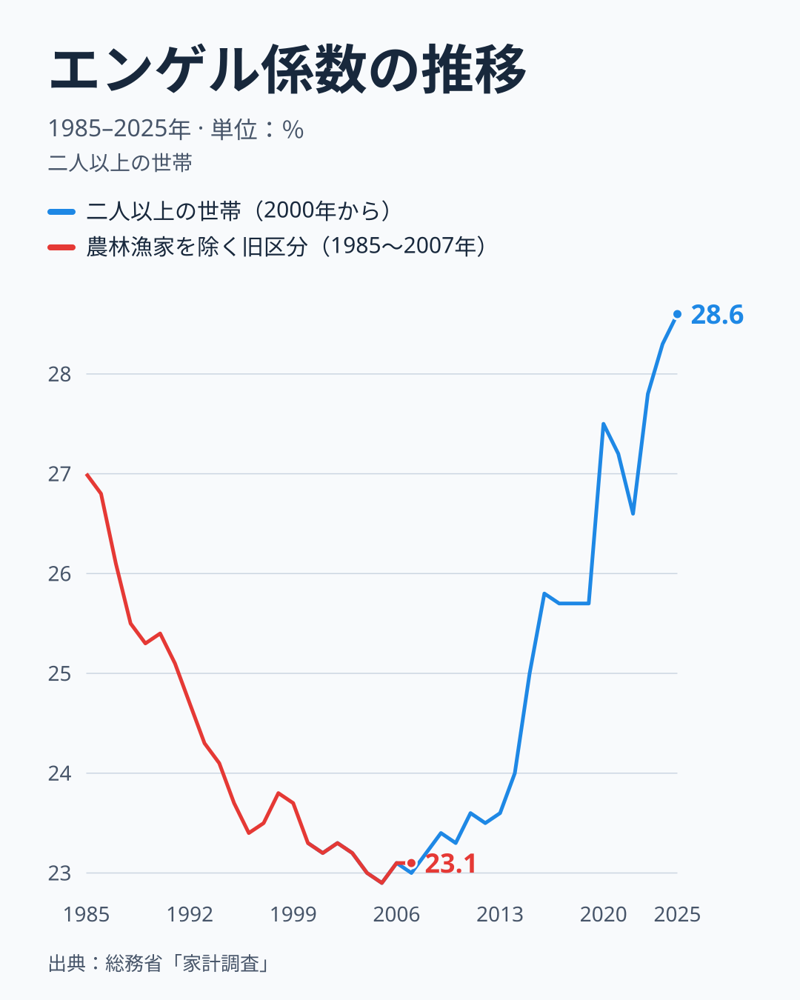

エンゲル係数は、消費支出に占める食料費の割合です。家計調査の二人以上の世帯（全国・暦年）で見ると、2000年は23.3%、2019年は25.7%でした。2020年に27.5%へ1.8ポイント跳ね上がり、2021年は27.2%、2022年は26.6%と下がったあと、2023年の27.8%、2024年の28.3%を経て、2025年は28.6%に達しました。同じ表の旧区分（農林漁家世帯を除く）では1985年が27.0%で、その後は1995年の23.7%、2005年の22.9%とおおむね下がっていたので、2025年の値は表で遡れる期間の最高です。

本記事が使った表は1985年からなので、1985年より前の値は確認しておらず、数十年ぶりの高さかどうかは判断できません。ここで言えるのは、表の範囲では最高だという点までです。

2020年の跳ね上がりは、食料が増えたからではありません。2019年から2020年にかけて食料の支出は1.6%しか増えなかった一方、消費支出が5.3%減りました。係数は割合なので、分母が縮むだけで上がります。係数の変化を見るときは、食料と消費支出のどちらが動いたのかを必ず分けて読む必要があります。

> [!NOTE]
> 係数は「食料費÷消費支出」で、食料には外食と調理食品も含まれます。本記事の値は全国の二人以上の世帯の暦年平均で、都道府県庁所在市の家計調査から作る県別のエンゲル係数とは対象も値も違います。県別の値は[エンゲル係数ランキング](/ranking/engel-coefficient)で確認できます。

<source-link href="/ranking/engel-coefficient">エンゲル係数ランキングをもっと見る</source-link>

## 食料の値上がりは物価全体のほぼ2倍だった

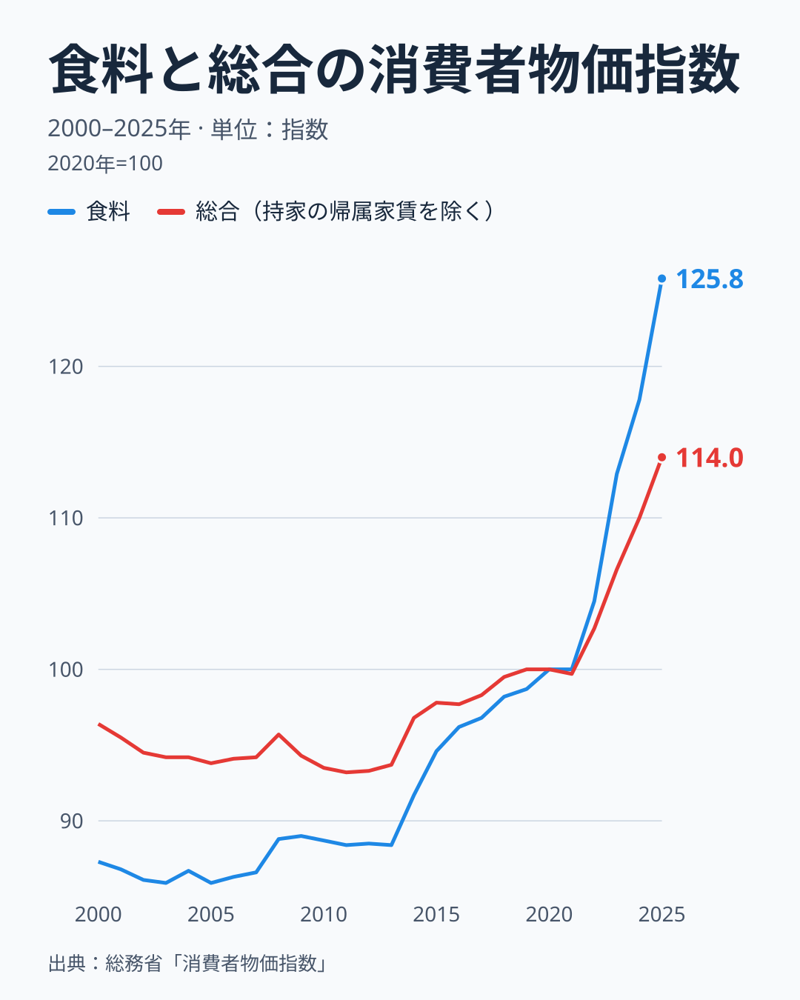

2019年から2025年にかけて、消費者物価指数の総合（持家の帰属家賃を除く）は100.0から114.0へ14.0%上がりました。持家の帰属家賃とは、持ち家に住む費用を家賃に見立てた計算上の項目で、家計調査の消費支出には含まれないため、比べるときは除いた指数のほうが近くなります。同じ期間に食料は98.7から125.8へ27.5%上がっており、上昇率は総合のほぼ2倍です。

長い目で見ると、食料の値段は2000年代から2010年代前半まで総合より低い水準にありました。2000年は食料が87.3、総合が96.4で、2013年も食料が88.4、総合が93.7です。差は2013年の5.3ポイントから2019年の1.3ポイントまで縮み、2021年に食料が100.0で総合の99.7を初めて上回りました。その後、食料は2022年に104.5、2023年に112.9、2024年に117.8と毎年大きく上がり、総合の102.7、106.6、110.0を引き離しました。食料が総合より安かった2000年から2013年は、係数が22.9%から23.6%の範囲でほぼ横ばいでした。差は2000年の9.1ポイントから2010年の4.8ポイントへすでに縮んでいましたが、係数は動かず、上がり始めたのは2014年以降です。2014年は24.0%、2019年は25.7%でした。

家計の側の数字も整合します。2019年から2025年にかけて、食料への支出は名目で19.3%増えたのに対し、消費支出は7.0%しか増えていません。消費支出が増えた月2万622円のうち、食料の増加は1万4,496円で約7割を占め、食料以外の増加は6,126円、率にして2.8%にとどまります。物価で割って実質に近づけた概算では、食料への支出は6.4%、消費支出は6.1%減りました。食料だけを切り詰めたのでも、食料だけを増やしたのでもなく、食料も消費支出全体も同じくらい目減りした中で、食料の値段だけが先に上がったために割合が上がった、という形です。

## 試算で分けると、上昇の大半は食料の値上がり

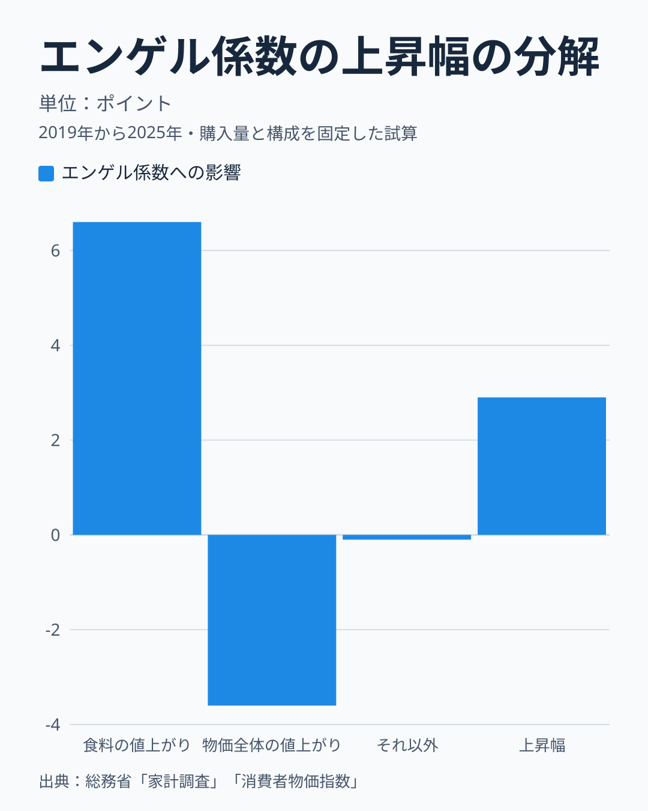

これを2.9ポイントの上昇幅に直して分けたのが上の図です。エンゲル係数の比（2025年÷2019年）の対数を、食料の物価指数の比の対数、物価全体の比の逆数の対数、その残りに分け、上昇幅に按分しています。対数で分けるのは、どの要素から先に計算するかで結果が変わらないようにするためです。

食料の値上がりは係数を6.6ポイント押し上げます。一方、物価全体の値上がりは分母の消費支出を膨らませるので、係数を3.6ポイント押し下げます。食料は総合の一部なので、この2本の棒は独立した二つの力ではなく重なっており、意味があるのは両者の差の約3.0ポイントです。実際の2.9ポイントとの差であるそれ以外は、マイナス0.1ポイントで、これは仮定の結果ではなく実際の上昇幅との差です。この残りには、買う量の変化、安い品目や銘柄への置き換え、家計調査と消費者物価指数の品目の重みの違いが混ざっていて、中身を分けることはできません。値が小さいことは、それらが打ち消し合っているか、もともと小さいことを示しますが、どちらかは区別できません。

> [!WARNING]
> この分解は「購入量と品目の構成が2019年のままだったと仮定した試算」で、因果の証明ではありません。食料の値上がりが先にあって係数が上がった、という順序を示すものでもなく、同じ期間に両方が動いたことを会計の形で分けただけです。消費者物価指数は全国の平均的な買い物かごの価格で、個々の世帯が実際に買った品目の値上がりとは重みが違います。

## 外食や調理食品の増加は上昇の一部にとどまる

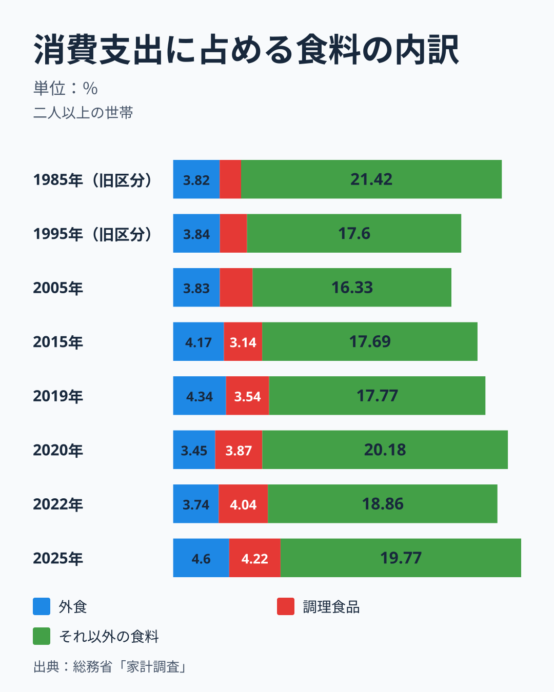

「外食や中食が増えたから係数が上がった」という見方もあります。そこで食料を、外食、調理食品（惣菜や弁当などの中食）、それ以外の食料の3つに分け、それぞれが消費支出に占める割合を並べました。2019年から2025年にかけて、外食は4.34%から4.60%へ0.26ポイント、調理食品は3.54%から4.22%へ0.68ポイント、それ以外の食料は17.77%から19.77%へ2.00ポイント上がっています。3つの合計が2.9ポイントの上昇にあたります。

増えた分の約3分の2は、外食でも調理食品でもない、食材や飲料などそれ以外の食料です。外食と調理食品を除いても係数は17.8%から19.8%へ上がるので、外食や中食へのシフトだけでは上昇を説明できません。外食と調理食品を合わせた割合は7.88%から8.82%へ上がりましたが、食料に占める割合は2019年の30.7%から2025年の30.8%までほとんど変わっていません。食料の中での置き換えは進んでおらず、外食と調理食品を含む食料全体が消費支出の中で膨らんだ、というのが実態に近い読み方です。

図の2020年は、この分け方の意味をよく示します。外食の割合は3.45%まで落ち、それ以外の食料は20.18%まで上がりました。外食の月額は2019年の1万2,726円から2020年の9,587円へ減り、外食が減った分を家での食事が埋めた形です。その後、外食は2022年の3.74%を経て、2025年には4.60%と2019年の4.34%を上回りました。月額も1万4,446円と2019年より多く、コロナ禍で縮んだ外食は戻ったと言えます。ただし、外食の物価が上がった分も含む名目の値であることに注意が必要です。

## 1985年と比べると、中身が違っていた

上の図には、1985年と1995年の旧区分（農林漁家世帯を除く）も並べてあります。2025年の28.6%は1985年の27.0%を1.6ポイント上回るだけですが、中身は大きく違います。1985年は外食が3.82%、調理食品が1.76%、それ以外の食料が21.42%でした。2025年は外食が4.60%、調理食品が4.22%、それ以外が19.77%です。外食と調理食品を合わせた割合は5.58%から8.82%へ3.2ポイント上がり、それ以外の食料は1.65ポイント下がっています。食料に占める外食と調理食品の割合で見ても、1985年の20.7%から2025年の30.8%へ約10ポイント上がっています。

1985年から2005年にかけては、それ以外の食料が21.42%から16.33%まで5ポイント下がり、係数全体も下がりました。2005年以降は逆に上がっていますが、外食と調理食品は同じ期間に2005年の6.53%から2025年の8.82%まで上がり続けました。

この比較には限界があります。1985年と1995年は旧区分、2000年以降は区分を改めた系列で、2005年はどちらの区分でも値がほぼ同じ（22.9%）ですが、1985年の値が新区分の世帯でも同じだったかは確かめられません。また、調理食品と外食の範囲が40年のあいだに調査の側で見直されている可能性があり、本記事ではその確認をしていません。

## 品目で見ると、何が値上がりし、何が減ったか

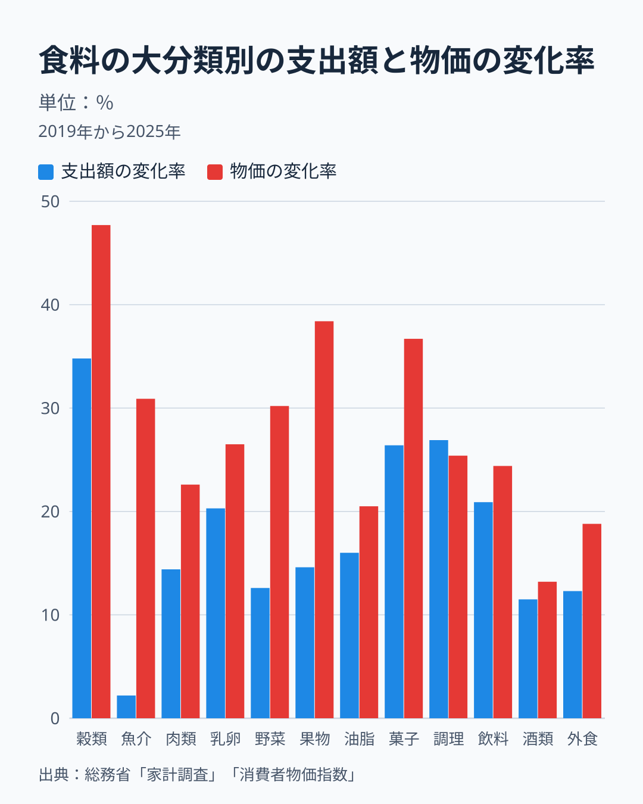

食料の中で支出が増えた内訳を、品目分類の年額で見ます。二人以上の世帯の食料の年額は2019年の96万5,536円から2025年の113万8,736円へ17.9%増えました。この表の食料は、用途分類の食料の月平均の12倍より年額で約7%大きく、理由は確認していません。変化率も用途分類の19.3%と少し違うため、以下は変化率だけを使います。

12の大分類のうち、支出額の伸びが大きいのは穀類の34.8%、調理食品の26.9%、菓子類の26.4%、飲料の20.9%、乳卵類の20.3%です。食料の年額の増加への寄与で見ると、最大は調理食品の20.0%で、穀類の15.7%、菓子類の13.3%、外食の12.6%が続きます。この4つで食料の増加の約6割を占めます。魚介類は支出が2.2%しか増えておらず、増加への寄与は1.0%でした。

図の赤い棒は、対応する消費者物価指数の変化率です。調理食品を除くすべての大分類で、支出額の伸びが物価の伸びを下回っています。穀類は物価が47.7%上がったのに支出は34.8%の増加で、物価で割った概算は8.8%減です。魚介類は物価が30.9%上がり、支出は2.2%増にとどまったので、概算でマイナス21.9%と最も大きく目減りしています。果物の概算はマイナス17.2%、野菜・海藻はマイナス13.5%でした。調理食品だけは支出が26.9%、物価が25.4%で、概算でプラス1.2%と唯一増えています。値上がりのなかで中食だけが物価以上に伸びたことは、外食や素材から調理食品へ寄せた世帯がある可能性を示しますが、これは概算で、確かめるには品目ごとの購入数量が要ります。

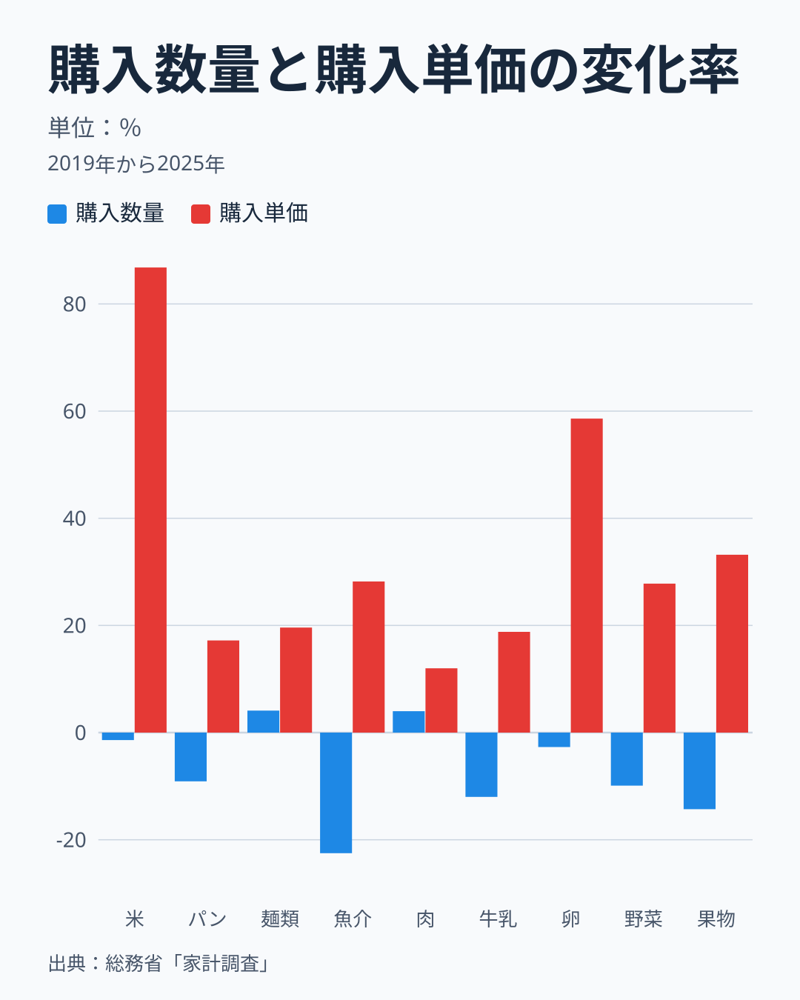

購入数量が分かる品目に絞って、支出を数量と単価に分けると別の面が見えます。購入単価は年額を年間購入数量で割った値で、単価の変化には品目の中の構成の変化も含まれます。米は購入数量が62.2kgから61.3kgへ1.4%減っただけなのに、購入単価は86.8%上がりました。卵は数量が2.7%減、単価が58.6%増です。値上がりが大きくても購入量があまり減らなかった品目は、支出額が大きく膨らみます。米と卵は、食料の中でも日々の食卓に欠かしにくい品目で、「値上がりしても量を変えにくい」と読める結果です。これは[仮説]で、需要の価格への反応を確かめるには、品目ごとの月次データを使った別の分析が要ります。

数量が大きく減ったのは、生鮮魚介のマイナス22.5%、生鮮果物のマイナス14.3%、牛乳のマイナス12.0%、生鮮野菜のマイナス9.9%、パンのマイナス9.1%です。単価は魚介が28.2%、果物が33.2%、野菜が27.8%、牛乳が18.8%、パンが17.2%上がっています。一方で、単価の上昇が12.0%にとどまった生鮮肉は購入数量が4.0%増えました。値上がりの小さい品目へ買う量が移ったという読みは生鮮肉には当てはまりますが、麺類は単価が19.6%上がったのに数量が4.1%増えており、当てはまりません。これも[仮説]の範囲を出ません。

米の動きは[米を買う量はほぼ横ばいなのに、支出が大きく増えた](/blog/rice-spending-quantity-gap-2025)で、パンは[食パン値上げ23%、需要は逆転？](/blog/white-bread-price-up-quantity-up)で、品目別の変化率の一覧は[物価高で切り捨てられた品目を扱った記事](/blog/household-spending-before-after-inflation)で詳しく扱っています。本記事は、そうした品目の動きが係数にどう結びつくかを見るための要約にとどめます。

## 世帯主の年齢で見ると、高齢化は上昇の主因ではない

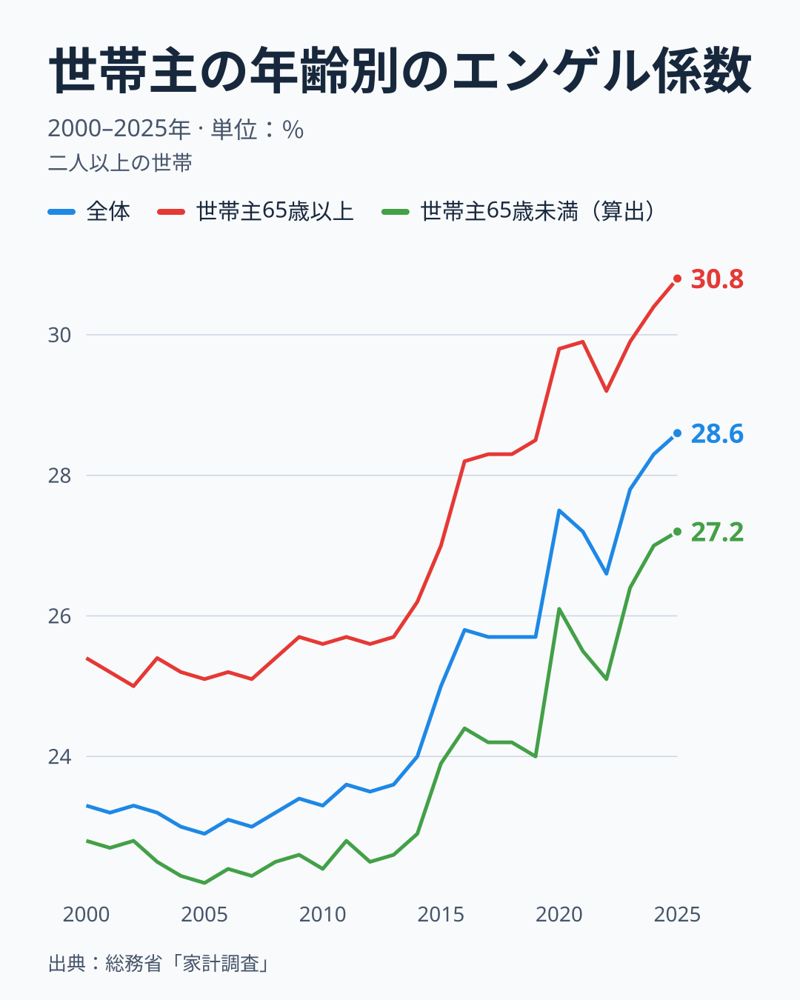

係数は世帯主が高齢なほど高い傾向があります。世帯主が65歳以上の世帯では、2000年が25.4%、2019年が28.5%、2025年が30.8%でした。世帯主が65歳未満の世帯は、全体と65歳以上の値から算出すると、それぞれ22.8%、24.0%、27.2%です。どの年も65歳以上のほうが高く、差は2025年で3.6ポイントあります。なぜ65歳以上で高いのかは、3枚目の図で金額から確かめます。

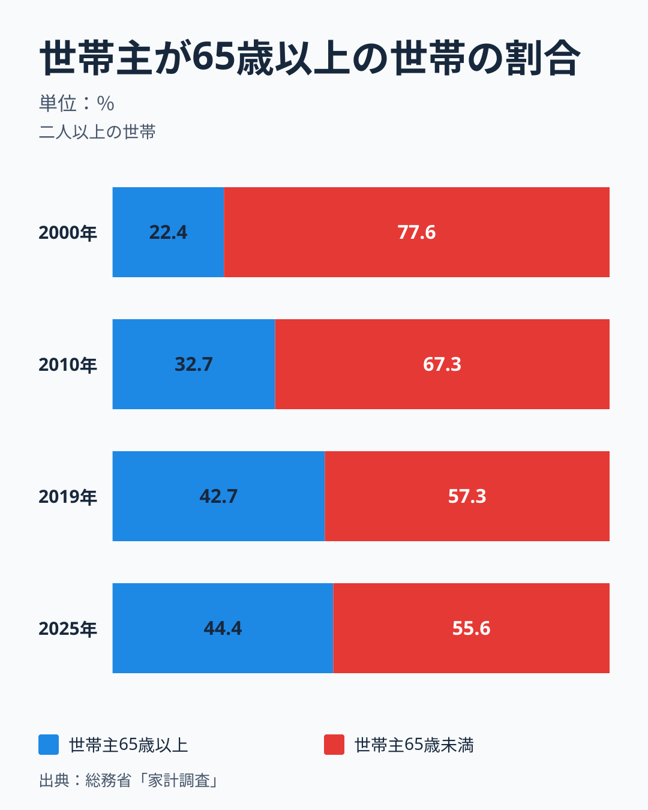

では、高齢世帯が増えたことは全体の係数をどれだけ押し上げたのでしょうか。世帯主が65歳以上の世帯の割合は、2000年の22.4%から2010年の32.7%、2019年の42.7%、2025年の44.4%へと増えました。ただし2019年以降の増え方はわずかで、2019年の年齢構成を固定したまま2025年の年齢別の値で計算し直しても係数は28.6%で、実際の値とほとんど変わりません。2019年から2025年の上昇幅は、65歳以上で2.3ポイント、65歳未満で3.2ポイントと、むしろ若い世帯のほうが大きく上がっています。

長い目で見ると、高齢化の寄与はあります。2000年の年齢構成（65歳以上22.4%）に固定して計算した2025年の係数は27.9%で、実際の28.6%との差は0.7ポイントです。2000年から2025年までの上昇幅5.3ポイントのうち、世帯主の年齢構成の変化で説明できるのは概算で1割強にとどまります。丸める前の差は0.74ポイントで、5.3ポイントに対する割合は約14%です。残りは、世帯主の年齢構成以外の要因を含む上昇で、世帯人員の減少などが混ざっている可能性がありますが、このデータだけでは分けられません。この65歳未満の値と構成別の計算は、年齢階級別の表から本記事で算出した値で、公表値そのものではありません。

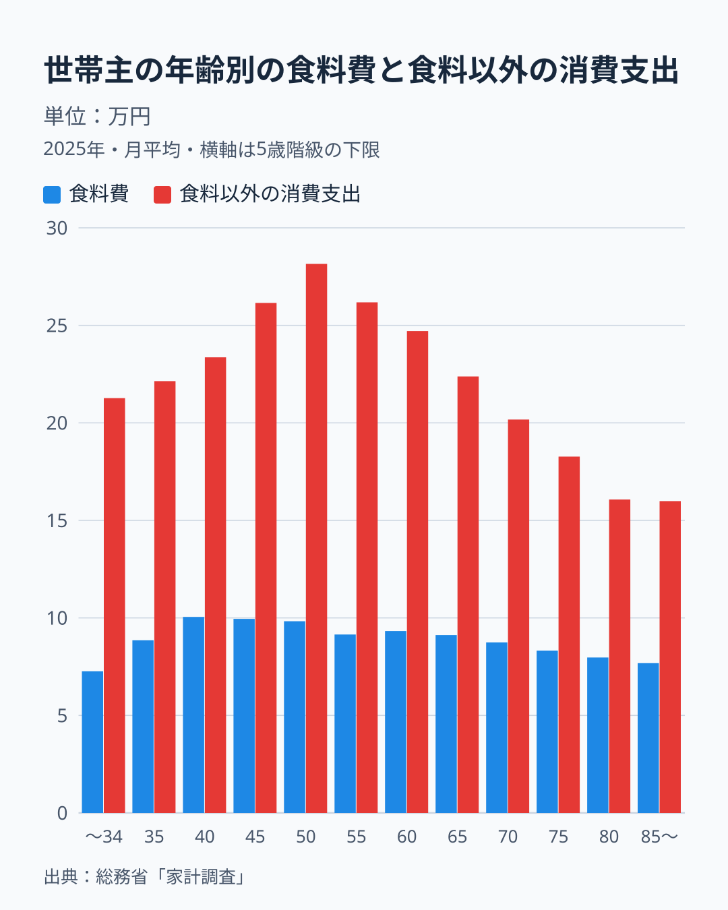

高齢の世帯の係数が高い理由を、金額の側から見ます。2025年の月平均で、食料費は世帯主が40〜44歳の世帯が10.1万円で最も多く、80〜84歳の世帯は8.0万円と、約79%の水準です。ところが食料以外の消費支出は、50〜54歳の世帯の28.2万円に対して、80〜84歳の世帯は16.1万円と、約57%まで減ります。食料費は年齢が上がっても2割ほどしか減らず、食料以外が4割以上減るので、割合としての係数が高くなります。係数の年齢別の値は、34歳以下が25.4%、40〜44歳が30.1%、50〜54歳が25.9%、80〜84歳が33.2%、85歳以上が32.4%です。

食料以外が小さくなる中身を、費目別に見ます。50〜54歳の世帯から80〜84歳の世帯への月額の差は、食料以外の消費支出で12万807円の減少です。このうち教育が3万8,544円、交通・通信が3万2,687円、その他の消費支出が2万4,286円、教養娯楽が1万1,863円、被服及び履物が7,991円減り、この5費目で減少の95.5%を占めます。一方、保健医療は1,647円増え、住居は2,424円、光熱・水道は1,183円の減少にとどまります。食料は1万8,596円の減少です。高齢世帯の係数の高さは、食費が膨らんでいるというより、教育や交通・通信などの食料以外の支出が小さいことの反映です。[仮説] 教育は子どもが学校を出れば減り、交通・通信は通勤や車の利用が減れば小さくなる費目なので、ライフステージの変化が背景にあるとみられますが、費目別の金額から言えるのはここまでで、理由は確かめていません。その他の消費支出の中身は、この表からは分かりません。家計調査の消費支出には住宅ローンの返済が含まれないため、ローンの完済は住居の金額には現れません。

食料以外の支出が小さいのが、必要が減ったためなのか、切り詰めているためなのかは、金額だけでは区別できません。若い世帯の係数が40〜44歳で30.1%まで高いのは、世帯人員が3.84人と多いことが背景にある[仮説]ですが、この表だけでは確かめられません。苦しさを直接測るには、貯蓄や負債、家賃の負担など別の指標が要ります。

## 上昇は年収の低い層に限らなかった

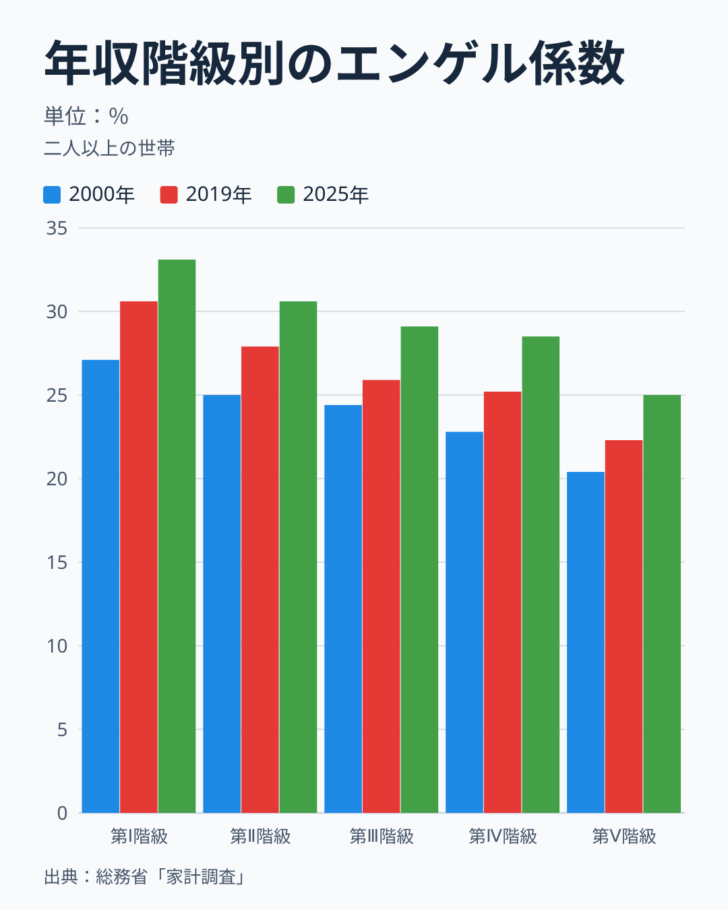

年間収入の低い順に世帯を5つに分けた五分位で見ると、2025年の係数は第Ⅰ階級（最も低い20%）が33.1%、第Ⅱ階級が30.6%、第Ⅲ階級が29.1%、第Ⅳ階級が28.5%、第Ⅴ階級（最も高い20%）が25.0%で、収入が低い階級ほど高くなっています。この並びは2000年も2019年も同じでした。

注目すべきは、2019年からの上昇幅です。第Ⅰ階級が30.6%から2.5ポイント、第Ⅱ階級が27.9%から2.7ポイント、第Ⅲ階級が25.9%から3.2ポイント、第Ⅳ階級が25.2%から3.3ポイント、第Ⅴ階級が22.3%から2.7ポイント上がっています。最も大きく上がったのは中間の第Ⅲ・第Ⅳ階級で、最も収入の低い層が突出して上がったわけではありません。低収入の世帯だけが追い込まれた、という図式はこのデータには現れていません。

金額で見ると、階級の差がどこで生じているかが分かります。2025年の第Ⅰ階級は、消費支出が21万4,152円と第Ⅴ階級の46.9%にとどまり、このうち食料費は第Ⅴ階級の62.1%、食料以外の消費支出は41.8%です。収入の低い階級は、食料以外の支出が小さくなっています。必要が減ったのか切り詰めたのかは、金額だけでは区別できません。2019年から2025年にかけての増え方は、食料費が第Ⅰ階級で20.7%、第Ⅴ階級で19.4%と階級によらずほぼ同じで、食料以外は第Ⅰ階級が7.5%、第Ⅴ階級が3.1%の増加でした。食料費の名目の伸びは階級によらずほぼ同じで、食料以外の伸びは収入の高い階級のほうが小さい、という見え方です。物価指数は全国の平均なので、階級ごとの物価の違いまでは分かりません。

> [!WARNING]
> 年収階級ごとの差を、収入だけの効果と読むのは誤りです。2025年の第Ⅰ階級は世帯主の平均年齢が72.8歳、世帯人員が2.30人で、第Ⅴ階級の52.8歳、3.36人とは世帯の姿がまるで違います。収入の低い階級には高齢の世帯が多く含まれ、年齢や人数の違いも係数に混ざっています。

一方で、収入の伸びは物価に追いついていません。二人以上の世帯の年間収入の平均は、2019年の618万円から2025年の669万円へ8.3%増えましたが、同じ期間の物価全体の上昇率14.0%には届きません。世帯主の平均年齢も59.4歳から60.7歳に上がっており、退職世帯の増加が平均を押し下げた可能性はありますが、これは本記事のデータだけでは確かめられません。

## 二人以上の世帯だけの現象か

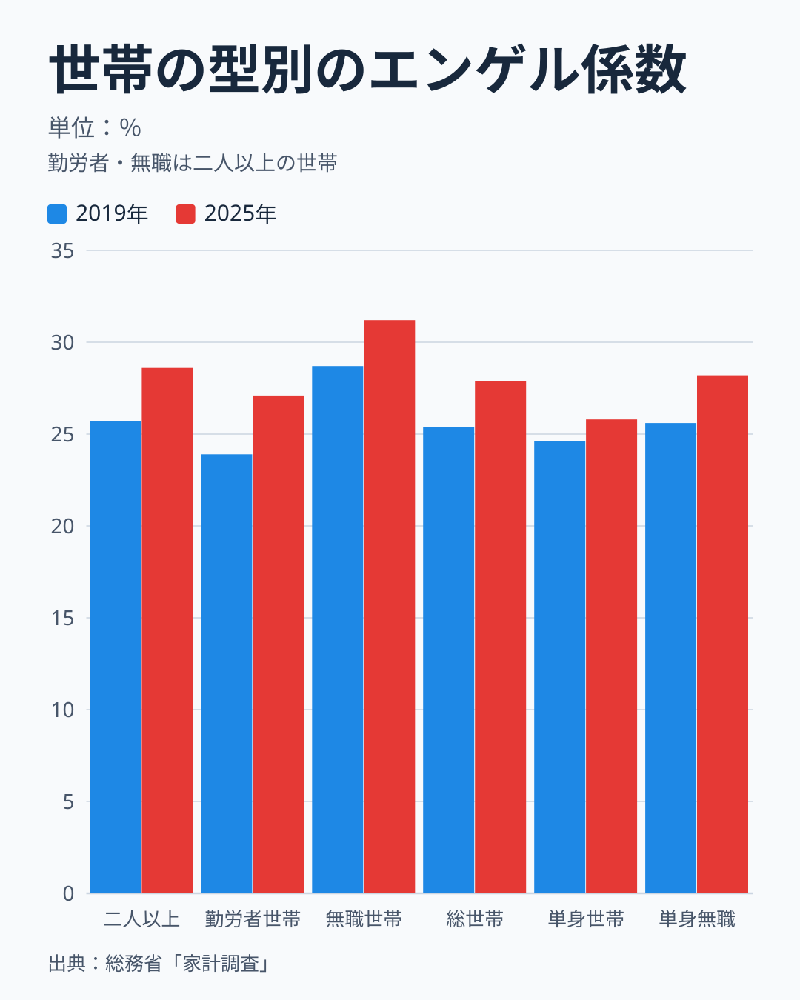

ここまでは二人以上の世帯の平均で見てきました。ほかの世帯の型でも同じことが起きたかを、2019年と2025年で比べます。二人以上の世帯は25.7%から28.6%へ2.9ポイント、そのうち勤労者世帯は23.9%から27.1%へ3.2ポイント、世帯主が60歳以上の無職世帯は28.7%から31.2%へ2.5ポイント上がりました。二人以上と単身を合わせた総世帯は25.4%から27.9%へ2.5ポイント、単身世帯は24.6%から25.8%へ1.2ポイントの上昇です。

単身世帯の上がり方は、二人以上の世帯より小さく、単身世帯のうち勤労者世帯は24.4%から23.9%へ0.5ポイント下がっています。単身世帯の食料費は10.7%増、消費支出は5.7%増で、食料費の伸びが二人以上の世帯の19.3%より小さいことが、上昇の小ささにつながっています。単身の勤労者世帯では、食料費が3.2%増、消費支出が5.4%増と、食料費のほうが伸びていません。この違いの理由は、使った表からは分かりません。単身世帯の品目構成や外食の割合の違いを見る別の表が必要です。単身の無職世帯は25.6%から28.2%へ2.6ポイント上がっており、二人以上の無職世帯とほぼ同じ幅です。

無職世帯の係数は高い水準にありますが、上昇幅は勤労者世帯より小さいという点が重要です。二人以上の世帯で、世帯主が60歳以上の無職世帯の2.5ポイントに対し、世帯主が60歳未満の勤労者世帯は3.5ポイント上がりました。高齢無職世帯の係数が高いのは水準の話で、上昇幅は、むしろ現役世代の勤労者世帯のほうが大きく、水準の高さは年齢別の図で見たものと重なります。2025年の二人以上の無職世帯は、食料費が8万2,805円で勤労者世帯（世帯主60歳未満）の88.0%ある一方、食料以外の消費支出は18万2,502円で、勤労者世帯の25万5,603円の71.4%にとどまります。係数の高さは、食費が膨らんでいるというより、食料以外の支出が小さいことと重なっています。これも苦しさか支出の構成かを区別する証拠ではありません。

つまり、単身の勤労者世帯を除くと、どの世帯の型でも係数は上がりました。上がり方は二人以上の世帯のほうが大きく、単身世帯では小さかった、というのがこの表から言えることです。この表では食料の値上がりが原因かまでは分けておらず、物価との分解は二人以上の世帯でしか行っていません。

## 苦しさの証拠と言えるか、言えないか

係数の上昇だけを根拠に「暮らしが苦しくなった」と言い切ることはできません。2020年のように分母の消費支出が縮んだだけで係数が上がる年があり、世帯主の年齢構成の変化も2000年以降では係数を0.7ポイント押し上げています。一方で、「ゆとりが増えた」と読むこともできません。値上がりを差し引いた概算では食料の支出が6.4%、消費支出が6.1%減っており、年間収入の伸びも物価に届いていないからです。苦しさの有無を判断するには、係数のほかに、実質賃金、貯蓄や負債、家賃などの固定費を合わせて見る必要があります。

本記事のデータで言えるのは、購入量と品目の構成が2019年のままだと仮定した試算では、食料が物価全体より値上がりした分が2.9ポイントの上昇をほぼ説明すること、上昇が年収階級と、単身の勤労者世帯を除く世帯の型で起きていること、高齢世帯の係数の高さが食料以外の支出の小ささと重なっていることです。言えないのは、上昇が個々の世帯の苦しさの度合いを示すかどうか、食料全体の購入量が実際にどれだけ減ったか、2025年より前の長い時間でどう動いたか、という点です。

家計の負担を地域でそろえて比べたい場合は、県別の食料費の割合を扱った[エンゲル係数と県民所得の関係を調べた記事](/blog/engel-coefficient-vs-prefectural-income)や[食料費割合ランキング](/ranking/food-expenditure-ratio-multi-person-households)から読み進められます。物価や家計の指標は[家計・物価テーマ](/themes/consumer-prices)、経済分野の指標一覧は[経済カテゴリ](/category/economy)からたどれます。

## まとめ

- 2025年のエンゲル係数は二人以上の世帯で28.6%で、2019年の25.7%から2.9ポイント上がり、表で遡れる1985年以降の最高です。
- 食料の消費者物価は2019年から27.5%上がり、総合（持家の帰属家賃を除く）の14.0%のほぼ2倍でした。購入量と品目の構成が同じだったと仮定した試算では、食料の値上がりが係数を6.6ポイント押し上げ、物価全体の値上がりが3.6ポイント押し下げ、それ以外はマイナス0.1ポイントです。
- 物価で割った概算では、食料の支出は6.4%、消費支出は6.1%減っています。
- 外食と調理食品の増加は上昇のうち約1ポイントで、残りの2.0ポイントはそれ以外の食料です。1985年と比べると、外食と調理食品の割合は5.58%から8.82%へ上がっています。
- 品目分類では、調理食品を除くすべての大分類で支出の伸びが物価の伸びを下回りました。米は購入数量が1.4%減る一方で購入単価が86.8%上がっています。
- 世帯主の高齢化は2000年以降では0.7ポイント分ありますが、2019年以降はほぼゼロです。高齢世帯の係数の高さは、食料以外の支出が小さいことと重なっています。
- 上昇はどの年収階級でも2.5〜3.3ポイントで、二人以上の勤労者世帯でも3.2ポイント、単身世帯でも1.2ポイント起きています。ただし単身の勤労者世帯は0.5ポイント下がりました。

## データについて

- 総務省統計局「家計調査」家計収支編の二人以上の世帯（全国）。エンゲル係数、消費支出、食料、外食、調理食品は用途分類の年次表（総数、年間収入五分位階級別、世帯主の年齢階級別、世帯主の職業別）の値で、すべて暦年です。年度の値は使っていません。総世帯と単身世帯は、用途分類の年次表（総数・全国）の2019年と2025年の値です。
- 品目別の支出額と購入数量は、品目分類（2025年改定）の年次表の年額と年間購入数量です。品目分類の食料は、用途分類の食料の月平均の12倍とは金額が合わないため（2019年は品目分類が96万5,536円、月平均の12倍が90万3,096円）、変化率だけを使い、水準を用途分類の値と並べていません。
- 1985年から2007年は農林漁家世帯を除く旧区分、2000年以降は区分を改めた二人以上の世帯の系列で、図ではどちらかを区別して示しています。2000年から2007年は両区分の値がほぼ同じです。
- 食料と総合の物価は総務省統計局「消費者物価指数」（2020年基準、全国、年平均）です。総合は持家の帰属家賃を除く総合を使いました。家計調査の消費支出とは品目の重みが違うので、物価で割った変化率は概算です。
- 世帯主65歳未満の係数、食料の内訳の割合、年齢構成を固定した係数、物価だけで説明した係数、上昇幅の分解、購入単価、食料以外の消費支出は、上の統計表の値から本記事で計算しました。計算式と入力はデータの控えに記録しています。
- 既存の[物価高の記事](/blog/household-spending-before-after-inflation)には2019年27.0%、2024年27.8%という値が載っていますが、本記事は家計調査の用途分類表の全国値（2019年25.7%、2024年28.3%）を使っており、一致しません。同記事の図の出典の控えは、社会・人口統計体系の食料費割合（都道府県別）を指しています。この指標の47都道府県の単純平均は2024年が27.79%で、同記事の27.8%と一致しますが、2019年は25.62%で、同記事の27.0%とは合いません。2019年の値の出どころは特定できていません。

いずれもe-Stat（政府統計の総合窓口）経由で取得したデータをもとにstats47が集計・可視化しています。
