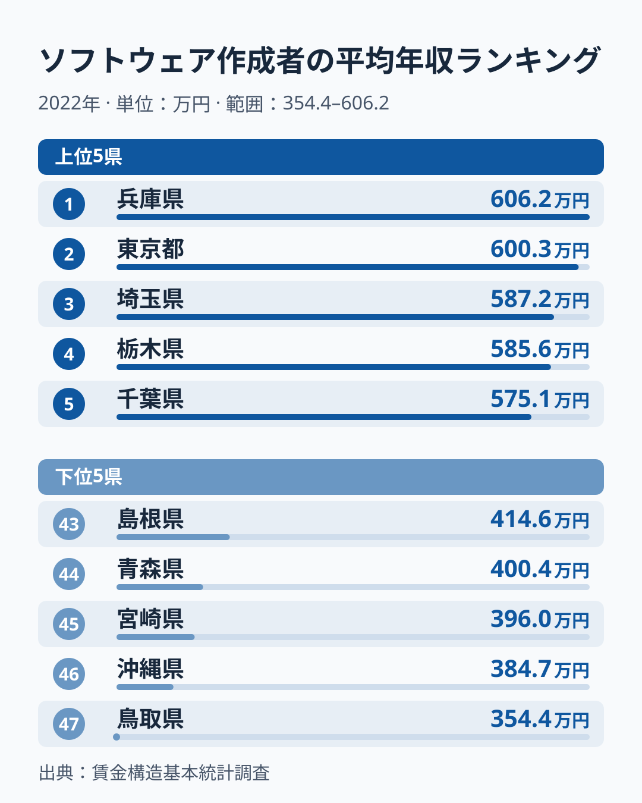
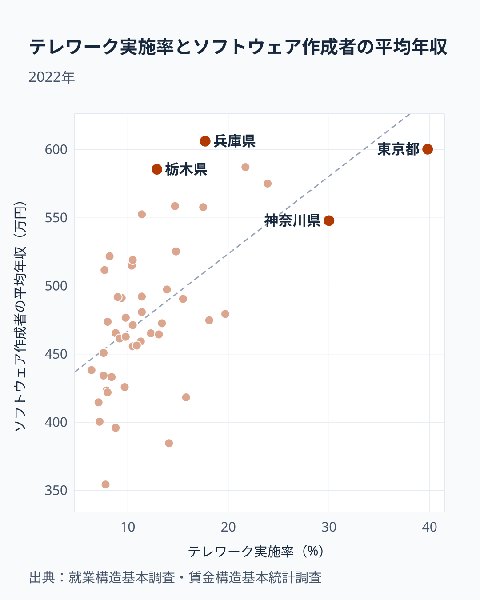

エンジニアが住む場所を考えるとき、気になるのは「この県でリモートの仕事はあるか」と「この県で働くとどれくらい稼げるか」の2つではないでしょうか。2022年のテレワーク実施率は、最も高い東京都が39.8%、最も低い秋田県が6.4%で、約6倍の開きがあります。この差がどの産業の地図と重なるのかは、[テレワーク率は東京39.8%・秋田6.4%｜なぜ同じ国で6倍も開くのか](/blog/telework-rate-tokyo-gap)で詳しく確かめています。

この記事では、エンジニアの側から同じデータを見直します。テレワーク実施率と、ソフトウェア作成者の平均年収を47都道府県で重ねると、相関係数は0.61でした。在宅で働く人が多い県ほどエンジニアの年収も高い傾向はありますが、重ならない県もはっきりあります。どの県が重なり、どの県がずれるのかを順に見ていきます。

> [!NOTE]
> テレワーク実施率は、2022年の就業構造基本調査で、有業者のうちテレワークを実施した人の割合です。エンジニアだけの値ではなく、その県で働くすべての職種を含みます。ソフトウェア作成者の平均年収は賃金構造基本統計調査 (2022年) の推計年収で、事業所から選んだ標本の推計です。

## 在宅で働ける県は首都圏に偏る

テレワーク実施率が20%を超えるのは東京・神奈川・千葉・埼玉の首都圏の4都県だけで、残りの多くの県は10%前後に集まっています。47都道府県の中央値は10.5%で、東京都の39.8%はその約3.8倍です。

この数字は、その県に住んで働く人のうち、在宅などで働いた人の割合です。全職種の平均なので、エンジニアのテレワーク率そのものではありません。県の差がどの産業の偏りと重なるかは、姉妹記事で情報通信業の事業所数と重ねて確かめています。この記事では、その先の問いとして、エンジニアの年収の地図と重なるかを見ます。

県ごとの値は[テレワーク実施率ランキング](/ranking/telework-rate)で確かめられます。次の節では、エンジニアの年収の地図を見たうえで、2つを重ねます。

## ソフトウェア作成者の年収は兵庫・東京・埼玉が上位

2022年のソフトウェア作成者の平均年収は、1位が[兵庫県](/areas/28000)の606.16万円、2位が[東京都](/areas/13000)の600.29万円、3位が埼玉県の587.19万円、4位が栃木県の585.55万円、5位が千葉県の575.14万円でした。最も低いのは鳥取県の354.37万円で、1位の兵庫県とは約250万円の差があります。下位には沖縄県の384.67万円、宮崎県の395.96万円、青森県の400.44万円、島根県の414.64万円が並びます。

上位5県のうち3県は首都圏ですが、1位は兵庫県で、4位には首都圏ではない栃木県が入っています。6位の広島県は558.59万円、8位の三重県は552.54万円です。年収の上位は、テレワーク率のように首都圏の4都県が並ぶ形にはなっていません。

ただし、この年収は県ごとの標本から推計した平均です。ソフトウェア作成者は県によって推計の労働者数が少なく、1年分の値は大きくぶれることがあります。たとえば兵庫県と東京都の差は約6万円で、この程度の差は年によって入れ替わる可能性があります。上位と下位の大きな開きに注目して読んでください。

<source-link href="/ranking/software-engineer-annual-income">ソフトウェア作成者の平均年収ランキングをもっと見る</source-link>

## 在宅で働く人が多い県ほど、エンジニアの年収も高い傾向

横軸にテレワーク実施率、縦軸にソフトウェア作成者の平均年収をとって47都道府県を並べると、右上がりの傾向が見えます。相関係数は0.61で、テレワーク率が高い県ほどエンジニアの年収も高い、正の相関です。

右上に離れているのは東京都で、テレワーク率39.8%、年収600.29万円と、両方とも全国の上位にあります。神奈川県は30.0%と年収547.92万円、千葉県は23.9%と575.14万円、埼玉県は21.7%と587.19万円で、首都圏の4都県はそろって右上の側にあります。散布図の点から東京都を除いて計算し直しても、相関はわずかに弱まるだけで右上がりの傾向は残り、東京都の1点だけが作った傾向ではありません。

反対に左下には、テレワーク率が7〜8%台で年収も400万円前後の県が集まります。青森県は7.2%と400.44万円、島根県は7.1%と414.64万円、宮崎県は8.8%と395.96万円です。在宅で働く人が少ない県では、エンジニアの年収も低めになる傾向があります。

この傾向は、エンジニアにとって「リモートの仕事が多い県と、エンジニアが稼げる県は、おおむね同じ方向にある」ことを示しています。ただし相関は因果ではありません。[仮説] 2つの値はどちらも、情報通信業や大きな企業の事業所がどれだけその県にあるかに左右されている可能性がありますが、この記事のデータでは確かめていません。

<source-link href="/ranking/telework-rate">テレワーク実施率ランキングをもっと見る</source-link>

## 重ならない県 — 奈良・沖縄と、徳島・和歌山

相関0.61は中程度の強さで、散布図には傾向から大きく外れる県もあります。エンジニアが住む県を考えるときに参考になるのは、むしろこうした県です。

1つ目は、在宅で働く人は多いのに、エンジニアの年収は低い県です。奈良県はテレワーク率が15.8%と全国の上位10県に入りますが、ソフトウェア作成者の年収は418.31万円で42位です。沖縄県も14.1%と中央値を大きく上回りますが、年収は384.67万円で46位でした。[仮説] テレワーク率は住んでいる人の値で、年収は県内の事業所の標本から推計した値なので、県外の職場へ通う人が多い県では、2つの値が別の人の姿を映している可能性があります (県外への通勤の多さは[テレワーク率の6倍の差を扱った記事](/blog/telework-rate-tokyo-gap)で流出人口比率と照らしています)。また、奈良県のソフトウェア作成者は推計の労働者数が少なく、標本の小ささが外れ方に効いている可能性もあります。

2つ目は、在宅で働く人は少ないのに、エンジニアの年収は高い県です。徳島県はテレワーク率が8.2%と中央値の10.5%を下回りながら、年収は521.81万円で11位、和歌山県も7.7%と低い側で、年収は511.67万円で14位でした。これに近いのが、テレワーク率は中位なのに年収は上位の県で、栃木県は12.9%で年収は585.55万円の4位、三重県は11.4%で年収は552.54万円の8位です。これらの県では、在宅で働く人の割合は首都圏ほど高くなくても、県内の事業所で働くエンジニアの年収は全国の上位にあります。

2つのずれがなぜ生まれるのかは、この2つの指標だけでは確かめられません。言えるのは、テレワーク率と年収の順位は県によって大きく食い違うことがあり、片方の数字だけで県を選ぶと、もう片方を見落とすということです。どちらも1年分の値で、年収は標本の小さい推計なので、県ごとの差は参考として読んでください。

> [!WARNING]
> 賃金構造基本統計調査は事業所を単位にした調査なので、年収は「その県にある事業所で働く人」の平均です。県外の企業にフルリモートで勤める人の年収は、住んでいる県の値には含まれない場合があります。テレワーク実施率は住んでいる人を対象にした調査なので、2つの値は対象の人がずれている可能性があります。

## エンジニアがこの2つの数字をどう使うか

ここまでの結果をまとめると、テレワーク率が高い県ほどソフトウェア作成者の年収も高い傾向があり (相関0.61)、首都圏の4都県はそろって両方とも高い側にあります。一方で、奈良県と沖縄県は在宅は多いのに年収は下位、徳島県と和歌山県は在宅は少ないのに年収は上位でした。冒頭の「どの県に住んでも同じか」への答えは、同じではない、です。在宅で働ける人の割合も、県内の事業所で働くエンジニアの年収も県で大きく違い、しかも2つの順位は県によってずれます。

住む県を考えるときは、テレワーク率を「その県に住んで働く人のうち、在宅などで働いた人の割合」として、ソフトウェア作成者の年収を「その県の事業所で働くエンジニアの平均」として、分けて読むのが現実的です。県外の企業にリモートで勤めるなら、住む県のテレワーク率や年収は、あなたの働き方や収入をそのまま決める数字ではありません。

> [!TIP]
> 年収の順位は年によって入れ替わりやすいので、気になる県は[ソフトウェア作成者の平均年収ランキング](/ranking/software-engineer-annual-income)で2020年から2023年の推移もあわせて確かめると、1年分のぶれに引っ張られにくくなります。

## データについて

テレワーク実施率は総務省「就業構造基本調査」(2022年)、ソフトウェア作成者の平均年収は厚生労働省「賃金構造基本統計調査」(2022年) の推計年収を使っています。散布図は2つの値を都道府県ごとに結びつけて描き、相関係数も同じ47都道府県の値から計算しています。テレワーク実施率は2022年の1年分しかないため、年収も2022年にそろえています。
