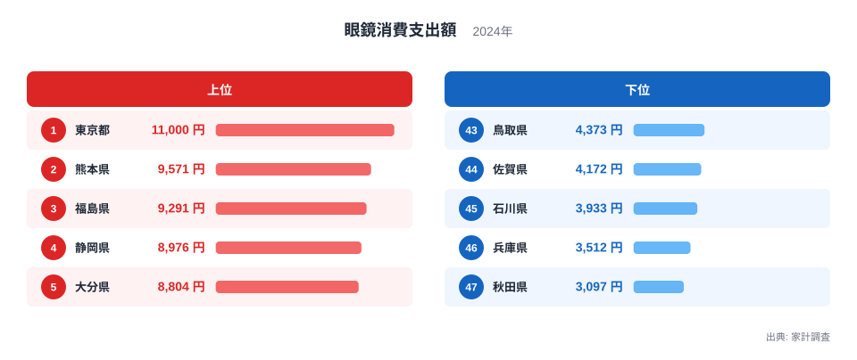
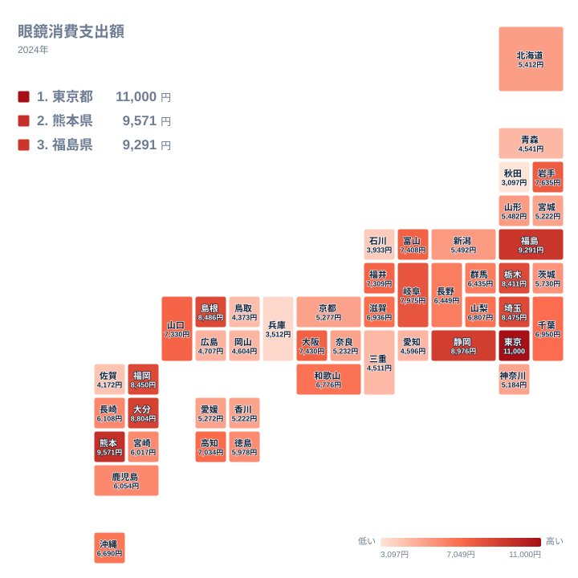

眼鏡は、視力を補う道具であると同時に、毎日身につけるファッションの一部でもあります。買い替えの頻度や価格帯は、年齢、仕事や運転の習慣、売り場の多さ、所得などによって変わると考えられます。では、都道府県ごとに見ると、眼鏡へ使うお金にはどれほどの差があるのでしょうか。

この記事では、2024年の家計調査をもとに、眼鏡への支出を都道府県別に比べます。最も多いのは東京都で11,000円、最も少ないのは秋田県で3,097円です。最大と最小の比は約3.6倍にあたります。地域の分布を確かめながら、読み解くときの注意点も整理します。

> [!NOTE]
> ここで扱う眼鏡への支出は、家計調査における世帯の支出額です(2024年、単位は円)。正式な統計名は「眼鏡消費支出額」です。眼鏡の購入にかかる支出を対象にした数値で、コンタクトレンズの費用などは別の品目として扱われるため、「目の健康にかけたお金」全体ではない点に注意してください。

## 眼鏡への支出の上位と下位

まず、上位5県と下位5県を図で確認します。

<source-link href="/ranking/eyeglasses-consumption-expenditure">眼鏡への支出ランキングをもっと見る</source-link>

図でまず目を引くのは、東京都の突出です。1位の東京都は11,000円で、2位の熊本県は9,571円です。2位から5位の大分県までは8,804円から9,571円の範囲に収まっており、東京都を除く上位は互いに近い水準で並んでいます。上位の中で飛び抜けているのは、東京都だけです。

下位の側は、上位より値の幅がやや広く見えます。47位の秋田県は3,097円、46位の兵庫県は3,512円で、最下位だけが他より一段低い位置にあります。一方で43位の鳥取県は4,373円と、下位5県の中でも上端と下端の間に1,000円を超える差があります。

上位には東京都のような大都市と、熊本県や福島県、大分県といった地方の県が混在しています。下位にも大都市を抱える兵庫県が入っています。人口の多い地域に高い値が偏るという単純な構図ではありません。

> [!WARNING]
> 家計調査は標本調査であり、都道府県別の値は調査に協力した世帯の購入状況に左右されます。眼鏡は毎年買うものではないため、たまたま購入した世帯が多く含まれた県では値が大きく出る可能性があります。順位の差が小さい県どうしを、そのまま実力差とは受け取らないでください。

## 東京都が1位になる背景を考える

東京都の11,000円は、47都道府県の中で唯一11,000円に届いた水準です。この背景には、いくつかの要因が重なっているのかもしれません。ただし、店舗数や価格帯のデータは今回の実データに含まれていないため、以下はあくまで仮説です。

一つの仮説は、店舗の選択肢の多さです。東京都にはさまざまな業態の眼鏡店が集まっていると想像できます。選べる幅が広ければ、デザイン性の高い製品や、用途別の買い足しに支出が向かいやすいのかもしれません。

もう一つの仮説は、仕事や暮らしの場面です。パソコン作業や電車での通勤など、目を使う機会が多い暮らしの中で、複数本を使い分ける習慣が根づいている可能性があります。いずれも統計から直接示されたものではなく、確かめるには別のデータが必要です。

東京都の他の統計は[東京都のデータ](/areas/13000)でも確認できます。

## 熊本県や福島県など、地方の上位県をどう読むか

東京都に次ぐ2位の熊本県は9,571円です。3位の福島県は9,291円、5位の大分県は8,804円です。熊本県と大分県は九州・沖縄、福島県は北海道・東北に属します。静岡県は中部で、4位の8,976円です。上位5県は、関東、九州・沖縄、北海道・東北、中部と、地方をまたいで並んでいます。

地方の県が上位に入る理由として、自動車での移動が多く視力矯正が欠かせない世帯が多いのではないか、という見方はありえます。ただし、これも今回のデータから裏づけられたものではありません。確かなのは、地方の県が大都市に劣らない水準にあるという事実です。

眼鏡の産地として知られる福井県は、この統計では15位で7,309円です。産地であることと、県内の世帯が眼鏡に多く支出することは、必ずしも一致しません。生産の規模と消費の額は、別の指標だからです。

熊本県の他の統計は[熊本県のデータ](/areas/43000)で見られます。

> [!TIP]
> 順位だけでなく、金額の近さにも注目してください。7位の埼玉県は8,475円、8位の福岡県は8,450円、9位の栃木県は8,411円と、ほぼ並んでいます。家計調査は標本調査のため、差が小さい順位は偶然で動きうる点を踏まえ、「上位グループにいるか」という大づかみな見方が有効です。

## 地理分布で見る眼鏡消費の地域差

次に、地理的な広がりを図で見てみます。

図を見ると、特定の地方だけが高い、または低いという構図にはなっていません。関東では東京都が1位、埼玉県が7位で8,475円、栃木県が9位で8,411円と上位に入ります。一方で、同じ関東でも神奈川県は37位で5,184円、茨城県は28位で5,730円と、中位から下位に位置します。

近畿でも差があります。大阪府は12位で7,430円ですが、京都府は32位で5,277円、奈良県は34位で5,232円、兵庫県は46位で3,512円です。同じ近畿でも、県によって大きく異なります。

中国では、島根県が6位で8,486円、山口県が14位で7,330円と高めです。これに対して広島県は38位で4,707円、岡山県は39位で4,604円、鳥取県は43位で4,373円と低めです。同じ地方の中でも、高い県と低い県が分かれています。

北海道・東北では、福島県が3位、岩手県が11位で7,635円と上位に入る一方、青森県は41位で4,541円、秋田県は47位です。隣り合う県でも、眼鏡への支出には大きな差があります。

## 関連品目との対比で考えたいこと

眼鏡への支出を読むときに、仮説として押さえておきたい点を二つに絞ります。いずれも今回のデータでは確かめられていません。

- コンタクトレンズとの使い分け: コンタクトを主に使う人が多い地域では、眼鏡への支出が小さくなるかもしれません。兵庫県のように大都市圏にありながら46位となる県は、こうした使い分けの影響も考えられます。
- 年齢構成: 年齢によって必要な眼鏡の種類が変わるため、地域の年齢構成が支出に影響する可能性があります。

これらは互いに重なり合うため、一つの要因だけで順位を説明することはできません。眼鏡と関連品目の支出を並べて見ることで、仮説の当たりをつけることはできます。他の品目との比較は、[同じカテゴリの統計一覧](/category/economy)から確認できます。

## データについて

この記事で使った数値は、家計調査の2024年の結果で、眼鏡消費支出額を都道府県別に比べたものです。単位は円で、全47都道府県の値を使用しています。本文中の順位は、この数値の大きい順に付けたものです。

なお、宮城県と香川県はどちらも5,222円で、同じ35位です。同額の県は同順位とし、次の順位は37位になります。順位の前後だけで優劣を論じることは避けてください。

## まとめ

2024年の眼鏡への支出は、東京都が11,000円で1位、熊本県が9,571円で2位、福島県が9,291円で3位でした。最下位は秋田県の3,097円で、東京都との差は約3.6倍です。

上位には大都市の東京都と地方の県が混在し、下位にも大都市圏の兵庫県が入るなど、都市の大きさだけでは説明できない分布でした。理由として店舗の選択肢やコンタクトレンズとの使い分けなどが考えられますが、いずれも仮説にとどまります。自分の住む県の順位を確かめたうえで、暮らしの習慣と重ねて眺めてみてください。
