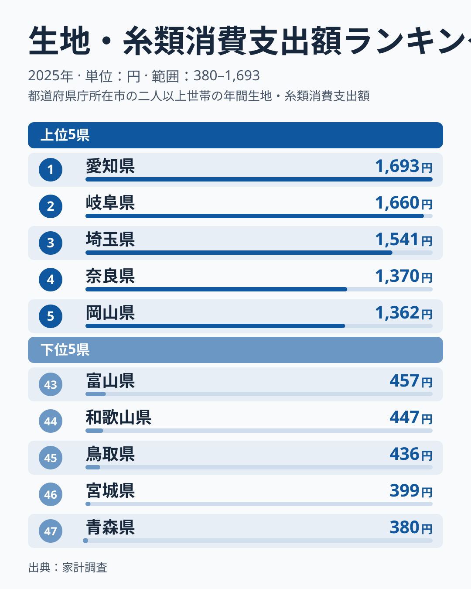
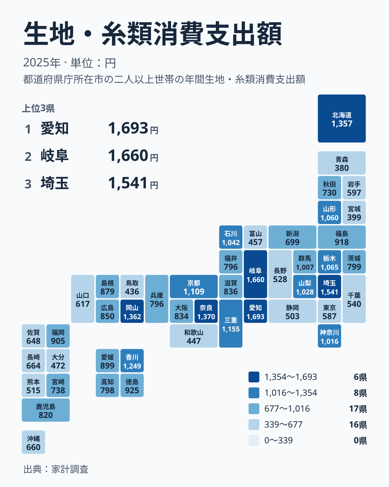

手芸や裁縫に使う生地や糸への支出は、衣料品の購入額と比べると小さな項目です。それでも都道府県別に並べると、はっきりした差が現れます。2025年の家計調査では、1位の愛知県が1,693円、47位の青森県が380円でした。この記事では、その差の大きさと分布の形を確かめたうえで、暮らしとの関係をどこまで言えるのかを考えます。

## 1位と最下位の差は何倍か

最も多い愛知県の1,693円と、最も少ない青森県の380円を比べると、約4.5倍の開きがあります。生地や糸という小さな支出でも、地域によって数倍の差が生じています。

> [!NOTE]
> ここでの「生地・糸類」は、家計調査の被服関連の支出の一項目です。既製の衣料品ではなく、自分で縫う、編む、繕うための材料にかかった費用を指します。金額は世帯あたりの年間支出の平均で、地域全体の販売額ではありません。店舗の数や人口の多さではなく、世帯ごとの買い方の違いを映した数字です。

1,000円を超えている県は、1位の愛知県から15位の群馬県までの15府県です。16位の徳島県は925円で、ここから先は1,000円に届きません。つまり、47都道府県のうち約3分の1が1,000円台、残りの32都道府県が1,000円未満という分かれ方をしています。

## 上位と下位の構造を読む

<source-link href="/ranking/fabrics-yarn-group-consumption-expenditure">生地・糸類への支出ランキングをもっと見る</source-link>

上位の特徴は、1位から3位までが1,500円を超えて固まっていることです。愛知県が1,693円、岐阜県が1,660円、埼玉県が1,541円で、1位と3位の差は152円にとどまります。ところが3位の埼玉県の1,541円から4位の奈良県の1,370円へは171円下がります。上位3県と4位以下の間に一段の段差があり、4位の奈良県と5位の岡山県は1,362円とほぼ並んでいます。

下位は逆に、400円前後に細かく積み重なっています。47位の青森県が380円、46位の宮城県が399円、45位の鳥取県が436円、44位の和歌山県が447円、43位の富山県が457円です。最下位から5県を見ても、金額の幅は100円に満たない範囲に収まっています。上位は少数の県が高い水準で抜け、下位は低い水準に多くの県が密集する形です。

[愛知県のデータ](/areas/23000)と[岐阜県のデータ](/areas/21000)は、ともに中部に属し、上位2県を占めています。一方で下位5県は、北海道・東北の青森県と宮城県、中国の鳥取県、近畿の和歌山県、中部の富山県と、地方がばらばらです。上位にも中部、関東、近畿、中国の県が混ざっているため、地方の単位で傾向をまとめるのは難しい指標です。

> [!WARNING]
> 家計調査は標本調査で、調べられる世帯の数に限りがあります。生地・糸類のように年間の支出額が小さい項目は、少数の世帯が大きな買い物をしただけで平均が動きやすくなります。順位の細かな差を、そのまま地域の気質や文化の違いと読むことはできません。

## 地理分布に見える偏り

地図で見ると、濃い色の県は中部から近畿、中国にかけて目立ちます。愛知県、岐阜県、三重県の1,155円、奈良県、京都府の1,109円、岡山県、そして四国の香川県の1,249円が、上位から中位の上のほうに並んでいます。

東北の中でも差があります。宮城県は399円で46位、青森県は380円で47位ですが、山形県は1,060円で11位、福島県は918円で17位です。同じ東北でも金額が大きく分かれているため、「寒い地域だから多い」「少ない」といった単純な説明は、このデータからは成り立ちません。北海道は1,357円で6位ですが、これだけで冬の室内での手作りが盛んだと結論づけることもできません。

関東も同様です。埼玉県は1,541円で3位、栃木県は1,065円で10位、神奈川県は1,016円で14位と上位に入る一方、東京都は587円で37位、千葉県は540円で38位です。同じ関東でも、1位から47位の幅の中で大きく散らばっています。

## 考えられる背景(仮説)

ここからは、データから確かめられない部分を、仮説として整理します。

一つ目は都市の買い物環境です。東京都の37位、大阪府の23位(834円)は、衣料品を店で買う機会が多い暮らしと関係している可能性があります。ただし、この記事にはアパレル店舗の数や、家庭での自作の頻度を示すデータはありません。そのため、実際にそうした背景が影響しているかどうかは、このデータからは確かめられません。

二つ目は地域の産業との関係です。愛知県や岐阜県は、繊維や縫製に関わる産業が知られた地域だといわれます。身近に生地や糸を扱う店や人が多く、材料を買う機会が増えている可能性は考えられます。しかしこの記事の数値は産業の集積と支出の関係を直接示すものではなく、あくまで推測にとどまります。

> [!TIP]
> 順位は金額差とあわせて読むのがコツです。この指標では、1位から3位が1,500円超で固まる一方、18位の福岡県は905円、23位の大阪府は834円で、5つ順位が違っても金額差は71円です。中位は順位が少し動くだけで金額がほとんど変わらないため、順位の上下より、1,000円台に入っているか、500円を下回っているかという大きな区分のほうが実態を表します。

## 暮らしへの含意

支出が多い県では、衣類を作ったり直したりするために材料を買う世帯が相対的に多い、という見方もできます。ただし、それが生活に根づいた習慣なのか、一部の世帯の大きな買い物なのかは、この数字だけでは分かりません。

支出が少ない県についても、既製品中心の暮らしだと言い切ることはできません。優劣ではなく、買い方の違いが現れたものとして受け止めるのが妥当です。

同じ分類の他の指標と合わせて見たい方は、[同じカテゴリの統計一覧](/category/economy)も参照してください。衣料品の購入額や被服全体の支出と重ねると、材料を買う支出が衣料の支出全体のなかでどのような位置にあるのか、より多面的に確かめられます。

## データについて

この記事で使った統計は、家計調査の生地・糸類消費支出額で、2025年の値を円で示したものです。1世帯あたりの年間支出額にあたります。記事中の「約4.5倍」は、実データの最大値である愛知県の1,693円と、最小値である青森県の380円の比です。

数値は標本調査に基づく推計のため、実際の地域全体の消費を正確に表すものではありません。特に金額の小さい項目は、年による変動や標本のばらつきの影響を受けやすい点に注意してください。
