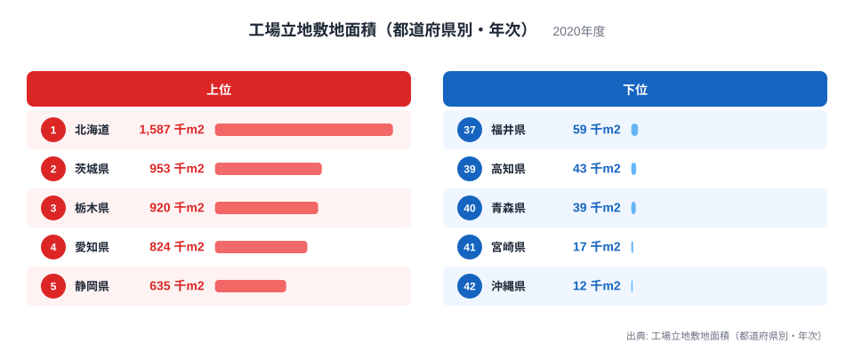
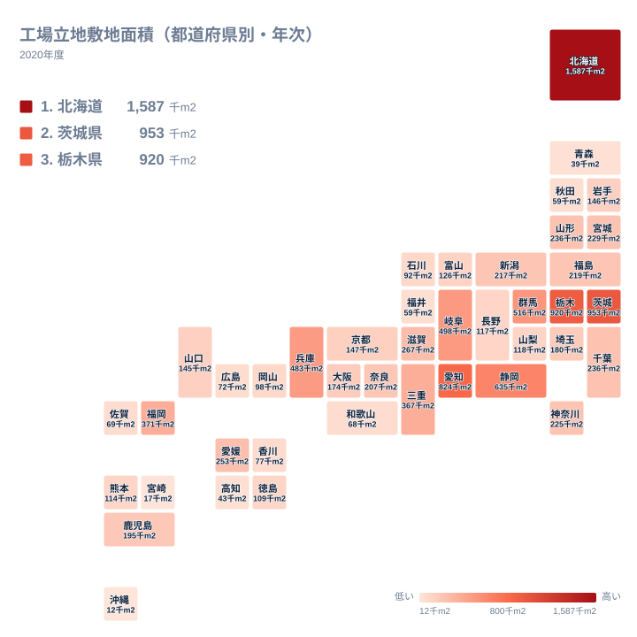

## 工場の敷地が最も広かったのは北海道

工場が集まる県といえば、愛知県や静岡県を思い浮かべる方が多いかもしれません。ところが2020年の工場立地敷地面積で1位になったのは、北海道の1,587千m2でした。2位の茨城県は953千m2、3位の栃木県は920千m2で、北海道との間には大きな開きがあります。

この指標は、その年に新しく工場用地として立地した敷地の面積を示すものです。すでにある工場の総数や出荷額ではなく、新規に動いた土地の広さを見ています。このため、製造業の「ストック」の大きさとは順位が一致しません。

この記事では、上位と下位がなぜその順番になるのかを、地理・産業構造・歴史の視点から考えます。ただし、使えるデータは順位と値だけです。理由の説明は、あくまで推測を含む仮説として読んでください。

> [!NOTE]
> 工場立地敷地面積は、ある年に新たに工場を建てるために取得・利用された敷地の面積を表します。既存工場の面積の合計ではありません。単位は千m2で、2020年の1年分の値です。

## 上位と下位の顔ぶれ

まずは上位と下位の並びを図で確かめます。

<source-link href="/ranking/factory-location-area-annual">工場立地敷地面積（都道府県別・年次）ランキングをもっと見る</source-link>

図の県名と値は読み取っていただくとして、ここでは図から一歩踏み込んだ整理をします。上位5県は、北海道、茨城県、栃木県、愛知県、静岡県です。このうち1位の北海道は、2位の茨城県の953千m2を大きく上回っています。一方で、4位の愛知県と5位の静岡県は、2位や3位と同じ水準には届きません。

実データにある最大と最小の比を取ると、1位の北海道の1,587千m2に対して、最下位の沖縄県は12千m2です。つまり、1位と最下位の間には100倍を超える開きがあります。工業力の差というより、1年の間にどれだけ大きな用地が動いたかというフローの差が、大きく効いていると考えられます。

もう一つ注目したいのは、上位の顔ぶれの多様さです。北海道は北海道・東北、茨城県と栃木県は関東、愛知県と静岡県は中部に属しています。上位5県が三つの地方にまたがっており、特定の地方だけに新規用地が集中していたわけではありません。

> [!TIP]
> この指標は単年の値です。大型の工場が1件立地するだけで、県の順位が大きく動くことがあります。1位や上位の県が「工業の強い県」とは限らず、その年に大型案件があった県かもしれないと考えて読むのがコツです。

## 上位はなぜ広いのか：土地の余裕と立地の仮説

上位に共通する背景として、まとまった平地を確保しやすいことが考えられます。北海道は一つの道で広大な土地を持つため、大規模な用地が取得しやすい可能性があります。ただし、これは地理的な推測です。どの業種の工場が立地したのかは、今回のデータからは分かりません。

茨城県と栃木県は、首都圏に近い関東の県です。東京都心から距離がある内陸や臨海の土地に、工業団地が整備されてきたと言われます。物流や大型の生産拠点にとって都合がよいことが、上位に入った一因かもしれません。群馬県も6位の516千m2で、北関東の3県がそろって上位に入っています。

愛知県の824千m2と静岡県の635千m2は、機械や輸送用機器などの製造業が厚い地域として知られます。既存の産業基盤が大きいことが、新規の用地の動きにつながっている可能性があります。岐阜県が7位の498千m2、三重県が10位の367千m2、滋賀県が11位の267千m2と、周辺の県にも一定の新規用地が見られます。

## 地理分布で見る：関東から近畿へ続く帯

次に、全国の分布を地図で見ます。

地図で目立つのは、関東の北部から中部、近畿へと続くまとまりです。茨城県、栃木県、群馬県、静岡県、愛知県、岐阜県、三重県、兵庫県と、順位の高い県が東西につながっています。大都市圏の周辺で、新規用地が多く動いた姿が読み取れます。

東北では、山形県が13位の236千m2、宮城県が15位の229千m2、福島県が17位の219千m2で、中位に並びます。岩手県は24位の146千m2、秋田県は37位の59千m2、青森県は40位の39千m2です。同じ東北でも、県によって順位に大きな幅があります。

九州・沖縄では、福岡県が9位の371千m2で最も高く、鹿児島県が20位の195千m2、熊本県が29位の114千m2、佐賀県が35位の69千m2と続きます。宮崎県は41位、沖縄県は42位です。ここでも福岡県との差が目立ちます。

> [!WARNING]
> この一覧には、東京都、長崎県、大分県、鳥取県、島根県の値が載っていません。全国の完全な順位表ではないため、掲載のない都県を「ゼロ」や「最下位」と読まないでください。

## 大都市圏の県は中位にとどまる

中位を見ると、大都市を抱える県の順位が意外に低いことに気づきます。神奈川県は16位の225千m2、埼玉県は21位の180千m2、大阪府は22位の174千m2、京都府は23位の147千m2です。

この背景として、市街地が広がっていて、新たに大きな敷地を確保しにくいという仮説が立てられます。早くから工場が集まった地域では、空いた土地が少ない可能性があります。ただし、これを裏付ける面積や土地利用のデータは、今回は使っていません。順位の違いの理由を断定することはできません。

山形県と千葉県は、どちらも236千m2で13位です。千葉県と山形県が同じ値で並んでいるのは、地域も産業も異なる県の新規用地が、偶然に近い水準で並んだ例といえます。続く宮城県は15位です。兵庫県は8位の483千m2で、大都市圏の県の中では高い位置にあります。

> [!NOTE]
> 敷地面積は、工場の「大きさ」を反映します。小さな工場が多数立地した県より、大規模な工場が少数立地した県のほうが、数字は大きくなりやすい点に注意してください。件数や従業者数とは別の指標です。

## 下位の県に見られる傾向

下位には、高知県の43千m2が39位、青森県の39千m2が40位、宮崎県の17千m2が41位、沖縄県の12千m2が42位として並びます。さらに、秋田県と福井県は、どちらも59千m2で37位です。この二県は同順位で、次の順位は39位に飛びます。

下位の地方を確認すると、四国の高知県、東北の青森県と秋田県、九州・沖縄の宮崎県と沖縄県、中部の福井県です。離れた地域にありながら、新規用地の動きは小さい水準にとどまっています。

理由については、市場から遠い、平地が限られる、製造業以外の産業の比重が大きい、といった可能性が考えられます。しかし、これは推測にすぎません。今回のデータで言えるのは、2020年の新規用地が小さかったという事実までです。

和歌山県は36位の68千m2、広島県は34位の72千m2、香川県は33位の77千m2です。製造業が弱いと結論づけることはできません。すでに用地が使われていて、その年の新規立地が小さかっただけという見方もできます。

## データについて

使用した値は、2020年の「工場立地敷地面積（都道府県別・年次）」で、単位は千m2です。年次の統計のため、1年だけの大型案件があると順位が大きく変わります。北海道の1位も、単年の大規模な立地が影響した可能性があるので、複数年で確かめるのが安全です。

> [!TIP]
> 同じ県でも、年によって順位は入れ替わると考えられます。ここで見た姿は2020年の一枚の断面です。地域の傾向をつかむ材料として使い、個別の県の評価は他の統計とあわせて判断してください。

地域ごとの数字は、各県のページでも確認できます。[北海道のデータ](/areas/01000)や[茨城県のデータ](/areas/08000)では、他の指標と並べて背景を調べられます。工場や建設に関する他の指標は、[同じカテゴリの統計一覧](/category/construction)からたどれます。

## まとめ：広さは単年のフローとして読む

2020年に新しい工場用地が最も広かったのは北海道で、茨城県、栃木県、愛知県、静岡県が続きました。上位は北海道・東北、関東、中部にまたがっており、新規用地の広さは、工業の集積の大きさとは別の動きを映しています。

大都市を抱える県が中位にとどまり、離れた県や離島の県が下位に並ぶ姿は、工業の強さと新規用地の広さが別物であることを示しています。順位を見るときは、単年の大型案件の影響を意識すると、数字の意味をより慎重に読み取れます。
