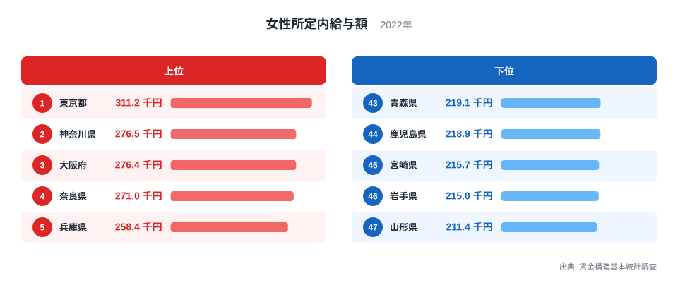
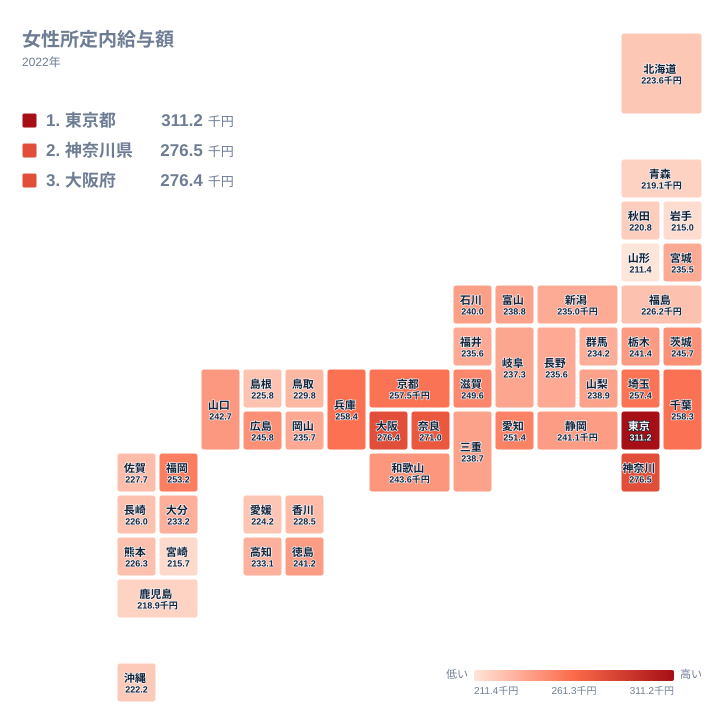

女性が毎月受け取る給与は、住む県によってどれほど違うのでしょうか。2022年の女性所定内給与額を見ると、1位の東京都は311.2千円、最下位の山形県は211.4千円です。同じ全国の女性労働者でも、県による開きは小さくありません。この記事では全47都道府県のデータをもとに、上位と下位がなぜその順になるのかを、地理・産業構造・歴史の視点から考えます。

ただし、本記事で使うのは都道府県別の総額だけで、業種別や企業規模別のデータはありません。そのため、理由についての記述は、あくまで可能性として示す仮説です。

女性所定内給与額が最も多い県はどこかという問いの答えは、東京都です。2位以下には、奈良県のように意外な顔ぶれも並びます。順に見ていきましょう。

## 女性所定内給与額の上位と下位

まず、上位5県と下位5県を図で確認します。

<source-link href="/ranking/female-scheduled-earnings">女性所定内給与額ランキングをもっと見る</source-link>

この図で注目したいのは、上位内の差と下位内の差の大きさの違いです。上位では、1位の東京都が311.2千円、2位の神奈川県が276.5千円で、両者の間に大きな段差があります。一方、2位の神奈川県と3位の大阪府は、276.5千円と276.4千円でほぼ並んでいます。5位の兵庫県は258.4千円で、東京都とは大きく離れています。

下位は対照的に、密集しています。43位の青森県は219.1千円、47位の山形県は211.4千円で、5県が狭い範囲に収まっています。つまり、上位は東京都だけが飛び抜け、下位は横並びに近い構図です。最上位の東京都と最下位の山形県を比べると、311.2千円と211.4千円で、約1.5倍の開きです。

東京都が突出する理由として、大都市に本社機能や賃金の高い業種が集中している可能性があります。ただし、本データは業種別の内訳を持たないため、この仮説は本データからは確認できません。

> [!NOTE]
> 「所定内給与額」は、残業代や休日出勤の手当、賞与などを除いた、毎月決まって支払われる給与です。長時間労働で稼いだ額ではなく、基本の給与水準を比べる指標です。単位は千円で、出典は賃金構造基本統計調査です。

## 大都市圏が上位に並ぶ背景

上位10位までを見ると、東京都、神奈川県、大阪府、奈良県、兵庫県、千葉県、京都府、埼玉県、福岡県、愛知県が並びます。このうち関東は東京都、神奈川県、千葉県、埼玉県の4都県、近畿は大阪府、奈良県、兵庫県、京都府の4府県です。残る福岡県は九州・沖縄、愛知県は中部に属します。

関東では、神奈川県が276.5千円で2位、千葉県が258.3千円で6位、埼玉県が257.4千円で8位です。東京都のすぐ周りの3県がそろって上位に入っており、大都市圏の経済力が及ぶ範囲で賃金が高い、という見方ができます。ただし、これらの県の内訳となる業種や企業規模は本データにないため、なぜ高いのかは仮説にとどまります。

近畿では、大阪府が276.4千円で3位、奈良県が271千円で4位です。奈良県の4位は、多くの人にとって意外な順位でしょう。大阪府に隣接している地理的な近さが関係している可能性はありますが、これも本データから確かめることはできません。

> [!WARNING]
> この指標は女性労働者どうしの平均であり、男女の賃金差を示すものではありません。男性との比較には、別の統計が必要です。また、集計は原則として事業所のある県が基準です。そのため、県内で働く人の賃金水準であり、その県に住む人の収入を直接表すものではありません。

## 地理分布で見る地域差

次に、47都道府県の分布を地図で確認します。

地図で見ると、高い水準は関東と近畿に集まっています。一方、下位5県のうち青森県、岩手県、山形県の3県は北海道・東北に属し、残る鹿児島県と宮崎県は九州・沖縄です。低い水準が、東北と南九州の両端に現れている形です。

北海道・東北の他の県を見ると、宮城県は235.5千円で27位、福島県は226.2千円で36位、北海道は223.6千円で40位、秋田県は220.8千円で42位です。宮城県は地方の中では相対的に高い位置ですが、全国で見ると中位です。

九州・沖縄では、福岡県が253.2千円で9位と大きく抜けています。一方で沖縄県は222.2千円で41位、鹿児島県は218.9千円で44位、宮崎県は215.7千円で45位です。同じ地方の中でも、福岡県と南部の県とでは大きな差があります。福岡県が高い背景として、九州の中心都市に支店や本社機能、サービス業が集まっている可能性がありますが、本データからは確認できません。

> [!TIP]
> 地図の色の濃淡だけで「この地方は高い」と決めつけないことが大切です。九州・沖縄のように、福岡県と宮崎県で順位が大きく離れる地方もあります。地方単位の印象より、県ごとの値と順位を見るほうが実態に近づけます。

## 低い県を読むときの視点

下位に並ぶ県の背景について、本データだけで言えることは限られています。東北や南九州の県が低位に集まっているという事実は確認できますが、その原因までは示せません。

考えられる仮説としては、農林水産業や小規模な事業所の比率が高いこと、中小企業が中心で平均が上がりにくいことなどがあります。歴史的には、高度経済成長期に製造業や本社機能が大都市に集まった経緯が、地方との差に影響している可能性もあります。いずれも一般的な見方であり、今回のデータで裏づけられたわけではありません。

また、額面の差がそのまま暮らし向きの差になるかどうかも、このデータからは判断できません。物価や住居費の情報は含まれていないためです。数字は、あくまで給与の額面の比較として受け止めてください。

## 中位の県を見ると見えること

中位の県も見ておきましょう。15位の山口県は242.7千円、16位の栃木県は241.4千円、20位の山梨県は238.9千円です。24位の岡山県は235.7千円、28位の新潟県は235千円、30位の大分県は233.2千円となっています。

中位は値の差が小さく、わずかな違いで順位が入れ替わります。たとえば福井県は235.6千円で25位、長野県も235.6千円で26位です。表示上の値が同じでも順位が分かれる場合があることがわかります。順位だけで優劣を判断せず、値の近さも合わせて見るのがよいでしょう。

また、茨城県は245.7千円で13位、広島県は245.8千円で12位と、ほぼ並んでいます。この2県のように、中位でも上寄りの県の間には、ごく小さな差しかありません。

詳しい他の指標は、[同じカテゴリの統計一覧](/category/laborwage)から確認できます。県ごとの詳細は、[東京都のデータ](/areas/13000)や[神奈川県のデータ](/areas/14000)で見られます。

## データについて

この記事の数値は、2022年の賃金構造基本統計調査による女性所定内給与額で、単位は千円です。47都道府県すべての値を使い、記事中の順位も同じデータに基づきます。

本記事で触れた背景は、産業構造や企業規模などについての一般的な見方にもとづく仮説であり、データだけから因果関係が確定するわけではありません。

## まとめ

2022年の女性所定内給与額は、1位の東京都が311.2千円、47位の山形県が211.4千円でした。上位には東京都、神奈川県、大阪府、奈良県、兵庫県が並び、下位には青森県、鹿児島県、宮崎県、岩手県、山形県が並びます。

上位は東京都だけが飛び抜け、下位は横並びに近いという構図が見えました。その背景として、本社機能の集中や企業規模、中核都市の有無などが関係している可能性はあります。ただし、本データだけでは確認できません。順位を読むときは、勤務地ベースの集計であること、残業代や賞与を含まないこと、男女差を示す指標ではないことに留意してください。
