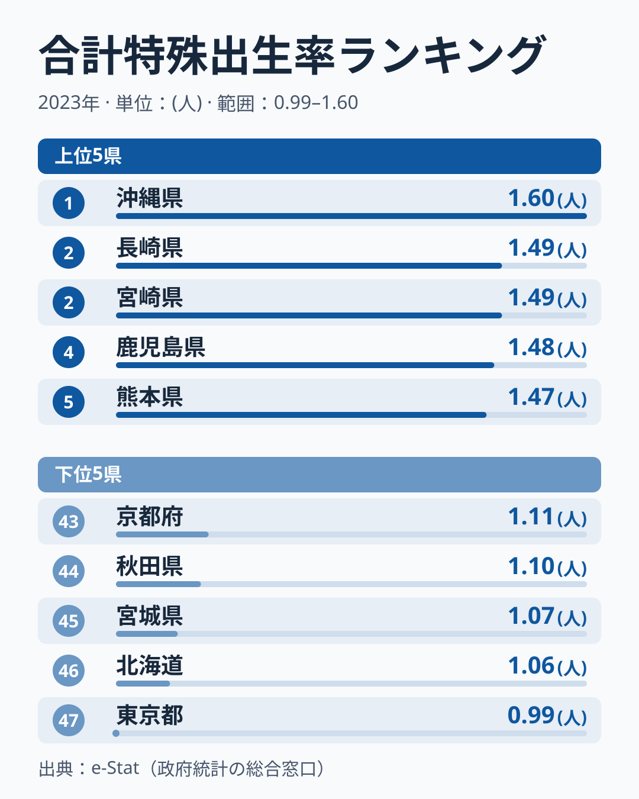
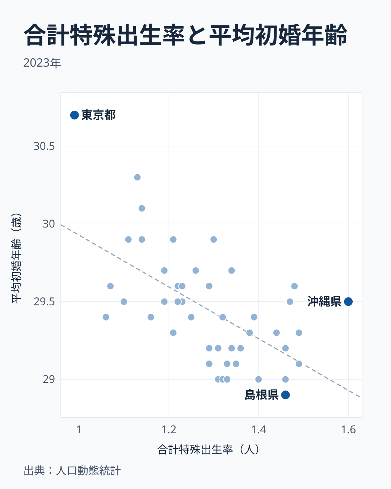

「少子化対策にはお金がかかる」という議論のまえに、都道府県別のデータを見ると気づくことがあります。2023年に合計特殊出生率が最も高いのは沖縄県で1.60、最も低いのは東京都で0.99です。この差と並んで動いているのが、**結婚する年齢**です。妻の平均初婚年齢は東京都が30.7歳で最も遅く、島根県が28.9歳で最も早い県です。初婚年齢が低い県ほど出生率が高い傾向が47都道府県のデータに表れています (相関係数は r = −0.60) が、1位の沖縄県は29.5歳と中ほどで、初婚年齢だけでは説明できない県もあります。

## 合計特殊出生率ランキング（2023年）──沖縄1.60、東京0.99

厚生労働省「人口動態統計」の2023年データで、47都道府県の出生率を比較します。

<source-link href="/ranking/total-fertility-rate">合計特殊出生率ランキング</source-link>

**合計特殊出生率が最も高いのは[沖縄県](/areas/47000)**で1.60です。このサイトに収録された1980年と1985〜2023年のすべての年で1位ですが、値は2015年の1.96から2023年の1.60まで下がりました。2位は長崎県と宮崎県で1.49 (同率)、4位は鹿児島県で1.48、5位は熊本県で1.47と、九州の県が上位に並びます。

一方、**最も低いのは[東京都](/areas/13000)**で0.99です。下位は東京都に続いて北海道が1.06、宮城県が1.07、秋田県が1.10、京都府が1.11で、首都・大都市を抱える府県と、東北・北海道が並んでいます。

> [!NOTE]
> 合計特殊出生率は、15〜49歳の女性の年齢別出生率をその年について合計した値で、「期間合計特殊出生率」と呼ばれます。実際に1人の女性が一生のあいだに産んだ子どもの数ではなく、その年の年齢別の出生の仕方が続いたと仮定した推計値です。出産の時期が遅くなる (晩産化) と、生涯に産む数が変わらなくてもその年の値は下がって見えます。

## 九州の上位の内訳──7県のうち5県が上位10位、福岡は28位

上位に九州が多いのは確かですが、九州のすべての県が高いわけではありません。九州7県を順位で並べると、長崎県と宮崎県が同率の2位、鹿児島県が4位、熊本県が5位、佐賀県が同率の6位で、5県が上位10位に入ります。大分県は1.39で12位です。

ところが、九州で人口が最も多い福岡県は1.26で28位と、47都道府県の中ほどにとどまります。「九州は出生率が高い」とひとくくりにすると、九州の人口の多くを占める福岡県が中位にいることを見落とします。九州の上位は、福岡県を除く6県のうち5県で占められている、と読むのが正確です。

上位10位の残りは福井県・島根県が佐賀県と同じ1.46で同率の6位、鳥取県が1.44で9位、山口県と香川県が1.40で同率の10位です。上位は九州・沖縄だけでなく、中国・四国と北陸の県にも広がっています。

## 東京0.99──都道府県で初めて1.0を下回った

東京都の0.99は、都道府県の合計特殊出生率として初めて1.0を下回った値です。このサイトに収録された年で見ると、東京都はこれまでも2001年・2003年・2005年に1.00まで下がったことがありますが、1.0を割ったのは2023年が初めてです。

東京都はこの40年分のどの年でも47位で、1980年の1.44、2015年の1.24から2023年の0.99へと下がりました。1位の沖縄県との差は、1980年の0.94ポイントから、2015年には0.72ポイント、2023年には0.61ポイントへ縮んでいます。差が縮んだのは東京都が上がったからではなく、沖縄県の下がり方が東京都より大きかったためです。

東京都は妻の平均初婚年齢も30.7歳で、47都道府県で最も遅い年齢です。出生率が最も低い県と、初婚年齢が最も遅い県が同じで、次の節の散布図では東京都が出生率の低い側・初婚年齢の高い側の端にある点になります。

あわせて見る: [平均初婚年齢（妻）ランキング](/ranking/average-age-of-first-marriage-wife)

## 婚姻年齢との相関──初婚年齢が低い県ほど出生率が高い

横軸に合計特殊出生率、縦軸に平均初婚年齢（妻）をとった散布図では、**相関係数は r = −0.60** です。初婚年齢が高い県ほど出生率は低い、中程度の負の相関です。

<source-link href="/ranking/average-age-of-first-marriage-wife">平均初婚年齢（妻）ランキング</source-link>

たとえば東京都は初婚年齢30.7歳で出生率0.99、島根県は28.9歳で1.46です。初婚年齢の差は1.8歳、出生率の差は0.47ポイントあります。

この相関は首都圏の4都県に支えられている部分があります。東京都を除いて計算し直すと r = −0.53、東京都・神奈川県・埼玉県・千葉県の4都県を除くと r = −0.44 まで弱まります。初婚年齢が遅く出生率も低い4都県が散布図の端に固まっているためで、首都圏を除いた43道府県の中では、初婚年齢の差と出生率の差の結びつきはもっと緩やかです。

ただし r = −0.60 は「中程度」で、初婚年齢だけで出生率が決まるわけではありません。沖縄県と北海道を比べると、初婚年齢は沖縄県が29.5歳、北海道が29.4歳とほぼ同じなのに、出生率は沖縄県が1.60、北海道が1.06で0.54ポイント開いています。秋田県も29.5歳で1.10です。逆に、結婚が遅くても出生率が保たれている県もあります。高知県は初婚年齢29.9歳で出生率1.30、長野県は29.7歳で1.34で、同じ29.9歳の京都府の1.11、奈良県の1.21を上回ります。同じ初婚年齢でも出生率が大きく違う県があるので、住まいの費用・働き方・家族の支え方など、この散布図に入っていない条件が差に関わっている可能性があります。この記事ではそれらの条件をデータで確かめていないため、要因として断定はしません。

> [!IMPORTANT]
> 初婚年齢と出生率の相関は「早く結婚すれば出生率が上がる」という因果を示すものではありません。住まいの費用や雇用の形が初婚年齢と出生率の両方に影響している可能性があり、散布図からはどちらが原因かを決められません。

## 40年の推移──47都道府県の中央値は1.82から1.30へ

全国の値ではなく、47都道府県の中央値 (真ん中の県の値) で推移を見ます。

1. **1980年**: 中央値1.82。沖縄県は2.38、東京都は1.44
2. **1990年**: 中央値1.60。沖縄県は1.95、東京都は1.23
3. **2005年**: 中央値1.37。東京都は1.00まで下がる
4. **2015年**: 中央値1.53まで戻る。沖縄県は1.96、東京都は1.24
5. **2023年**: 中央値1.30。沖縄県は1.60、東京都は0.99

2005年から2015年にかけていったん戻した値は、2015年から2023年の8年で中央値が0.23ポイント下がり、2005年の水準を下回りました。この8年の下がり幅は、1980年から1990年の10年間の0.22ポイントと同じくらいで、「ゆっくり下がっている」という見方は当てはまりません。

## まとめ──初婚年齢は大きな手がかりだが、それだけでは決まらない

- 2023年の合計特殊出生率は沖縄県が1.60で1位、東京都が0.99で47位。東京都は都道府県で初めて1.0を下回りました。
- 九州7県のうち5県が上位10位に入る一方、九州で人口が最も多い福岡県は28位です。
- 初婚年齢が低い県ほど出生率は高く (r = −0.60)、東京都は初婚年齢も最も遅い県です。
- ただし沖縄県と北海道のように初婚年齢がほぼ同じでも出生率が0.54ポイント違う県や、高知県・長野県のように結婚が遅くても出生率が保たれている県があり、初婚年齢だけでは差を説明できません。相関は首都圏の4都県を除くと r = −0.44 に弱まります。
- 47都道府県の中央値は2015年の1.53から2023年の1.30へ下がり、ここ8年の下がり方は1980年代と同じくらい速くなっています。
