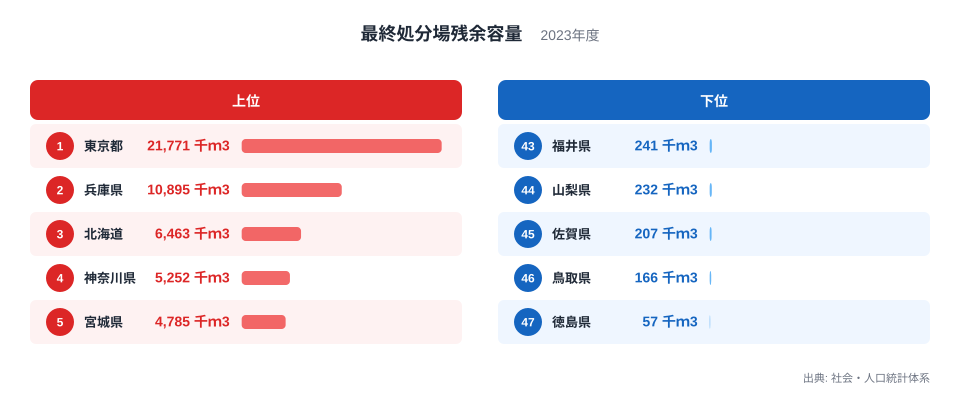
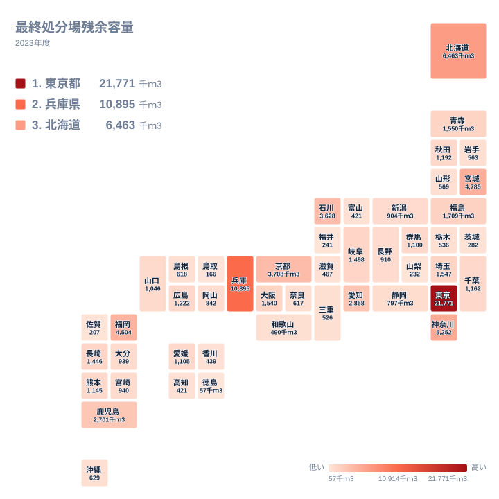

ごみは燃やしても灰が残り、資源化できないものは最終的に埋め立てるほかありません。その受け皿が最終処分場です。受け皿にあとどれだけ余裕があるかは、地域の暮らしや企業活動を静かに左右します。この記事では、2023年の都道府県別の残余容量を並べ、上位と下位がなぜその順になるのかを、地理・産業構造・歴史の面から考えます。ただし、手元にあるのは各県の値と順位だけです。理由に当たる部分は、実データから導いた結論ではなく、背景として考えられる仮説として書きます。

## 残余容量で並べると見えるもの

最終処分場の残余容量とは、すでにある処分場に、これから埋め立てられる量の目安です。単位は千ｍ3で、数字が大きいほど、今後も受け入れられる余地が大きいことを意味します。

<source-link href="/ranking/final-disposal-site-remaining-capacity">最終処分場残余容量ランキングをもっと見る</source-link>

図でまず目を引くのは、1位の突出ぶりです。東京都の21,771千ｍ3は、2位の兵庫県の10,895千ｍ3を大きく上回ります。上位五県の中でも、5位の宮城県は4,785千ｍ3で、1位とは桁の感覚が違います。上位の顔ぶれは、1位だけが飛び抜け、2位以下がなだらかに下がる形です。

下位側にも見方があります。下位五県の値は、最も多い福井県でも241千ｍ3です。これは上位五県の最小である宮城県の4,785千ｍ3に遠く及びません。つまり上位五県と下位五県は、値の範囲が重ならないほど離れています。さらに1位の東京都と最下位の徳島県の57千ｍ3を比べると、桁そのものが変わります。同じ全国の中で、受け皿の余裕がこれほど違うことが、この図から読み取れる最大の事実です。

残余容量が多いことは、必ずしもごみが少ないことを意味しません。上位には大都市圏の県が並びますが、これは大量に出る廃棄物を受け止める規模の施設を持っている結果かもしれません。逆に下位の県は、ごみが少ないからではなく、新しい処分場を確保しにくい事情や、県外の施設を使う仕組みが影響している可能性があります。ただし、これらもデータで確かめた事実ではなく、考え方の手がかりです。

> [!NOTE]
> この指標は、県内にある最終処分場の埋立可能量の合計という総量です。人口や排出量で割った数値ではないため、県の大きさや人口の違いは調整されていません。正式な統計名は「最終処分場残余容量」で、出典は社会・人口統計体系の2023年の値です。一般廃棄物と産業廃棄物のどちらを含むかなど、集計の範囲は統計の定義に従います。

## 東京都と兵庫県が上位に立つ背景として考えられること

東京都が1位に立つ背景には、海面を使った埋立処分場の存在があると考えられます。東京都は東京湾に面しており、湾内に埋立地を造成してきた歴史があります。内陸の県のように山あいの谷を埋める方法をとりにくいため、大規模な海面処分場に頼る構造になっている可能性があります。一か所あたりの容量が大きければ、県全体の残余容量も大きな値になるはずです。

もう一つ考えられるのは、人口と事業所が集中する首都圏の事情です。ごみの排出量が多い地域では、処分場を延命するために焼却や資源化を進める必要があります。残余容量が多いのは、余裕が無限にあるのではなく、大量の廃棄物を受け止める規模の施設を持っていることの裏返しかもしれません。

兵庫県が2位に入る理由としては、大阪湾の広域処分の仕組みが関わっている可能性があります。大阪湾では、近畿の複数の府県から出る廃棄物を海面の処分場で受け入れる広域の事業が行われてきたとされます。もしそうであれば、兵庫県の値には、県内のごみだけでなく、近畿圏の廃棄物を受け止める役割が反映されている可能性があります。

実データで確かめられるのは、同じ近畿の大阪府が14位で1,540千ｍ3にとどまることです。大阪府は人口も産業も大きい都市ですが、残余容量は兵庫県の10,895千ｍ3に遠く及びません。大阪湾の事業との関係は仮説の域を出ませんが、少なくとも、都市の規模だけでは順位が説明できないことは確かです。兵庫県の詳しい数字は[兵庫県のデータ](/areas/28000)、東京都は[東京都のデータ](/areas/13000)で確認できます。

> [!WARNING]
> 広域で共同利用される処分場は、所在地の県に数字が帰属すると考えられます。兵庫県の値が大きいからといって、兵庫県のごみだけで埋まるわけではない可能性があります。逆に、他県の施設を使っている県は、自県の残余容量が少なく見えても、廃棄物の行き先を確保していることがあります。この統計からは搬入元がわからないため、順位を県の努力や怠慢の評価として読むのは避けてください。

## 広い県や海に面した県はどう見えるか

3位の北海道は6,463千ｍ3です。北海道は面積が広く人口密度が低いことが、処分場に使える土地を確保しやすい一因かもしれません。ただし、面積や人口密度のデータはこの記事にないため、あくまで可能性の指摘です。

5位の宮城県は4,785千ｍ3です。北海道・東北の七県を全部並べると、北海道が3位、宮城県が5位、福島県が11位で1,709千ｍ3、青森県が12位で1,550千ｍ3、秋田県が18位で1,192千ｍ3、山形県が33位で569千ｍ3、岩手県が34位で563千ｍ3です。同じ地方でも、上位から30位台まで幅広く散らばっていることがわかります。

関東も同様です。東京都が1位、神奈川県が4位で5,252千ｍ3、埼玉県が13位で1,547千ｍ3、千葉県が19位で1,162千ｍ3、群馬県が22位で1,100千ｍ3、栃木県が35位で536千ｍ3、茨城県が42位で282千ｍ3です。東京湾に面する東京都と神奈川県が上位に入る点は、海面処分場の仮説と矛盾しません。一方で、同じく海に面する千葉県は19位です。海に面していることだけでは順位が決まらないこともわかります。

九州・沖縄では、福岡県が6位で4,504千ｍ3、鹿児島県が10位で2,701千ｍ3と上位に入ります。ところが佐賀県は45位で207千ｍ3です。同じ地方に、上位と下位の両方が存在します。

## 地図で見る地域差

次の図は、都道府県をタイルの形に並べ、残余容量の大きさを地図上で示したものです。

地図を見ると、色の濃い県は特定の地方に固まっているわけではなく、各地に点在しています。東京都と神奈川県は関東、兵庫県と京都府は近畿、北海道と宮城県は北海道・東北、石川県は中部、福岡県と鹿児島県は九州・沖縄にあります。京都府は7位で3,708千ｍ3、石川県は8位で3,628千ｍ3、愛知県は9位で2,858千ｍ3です。

つまり、残余容量の多さは地域ごとの単純な傾向ではなく、個々の県の施設の有無に左右されやすい指標なのかもしれません。大きな処分場が一つあるだけで県全体の数字が大きく変わる、という見方もできます。反対に、小さな処分場が分散している県は、合計しても上位には届きにくいと想像できます。

下位五県の所属を確かめると、徳島県は四国、鳥取県は中国、佐賀県は九州・沖縄、山梨県と福井県は中部です。下位五県は四つの地方にまたがっており、下位がひとつの地方に集中しているわけではありません。

> [!TIP]
> 残余容量を読むときは「残余年数」という指標が気になります。これは残余容量を年間の埋立量で割って、あと何年使えるかを見積もる考え方です。ただしこの記事には年間の埋立量の値がないため、その割り算はできません。順位が低い県が近々埋まるとも、順位が高い県が当分安心とも、ここからは言えません。

## 下位の県が抱える事情として考えられること

最下位の徳島県は57千ｍ3です。四国の他の三県は、愛媛県が21位で1,105千ｍ3、香川県が39位で439千ｍ3、高知県が41位で421千ｍ3です。四国の中でも徳島県の数字は特に小さく、1位の東京都の21,771千ｍ3とは桁が違います。

鳥取県は46位で166千ｍ3です。中国では、広島県が17位で1,222千ｍ3、山口県が23位で1,046千ｍ3、岡山県が28位で842千ｍ3、島根県が31位で618千ｍ3となっており、鳥取県だけが大きく下回っています。

山梨県の232千ｍ3や福井県の241千ｍ3も下位です。山あいの県などでは、処分場に適した土地が限られることが一因かもしれません。環境への配慮から地元の合意を得る難しさも、新設のハードルになっている可能性があります。そうなれば、既存施設を少しずつ延命しながら使うことになるでしょう。

処分場の残余容量が少ないことは、ただちに問題を意味するわけではありません。焼却や資源化で埋立量を減らす努力が実を結んでいる場合もあり得ます。順位は優劣ではなく、各地域の地理と産業構造、施設整備の歴史が積み重なった結果と見るのが妥当です。ほかの統計は[同じカテゴリの統計一覧](/category/energy)からも探せます。

## データについて

この記事で使った数値は、社会・人口統計体系に収録された「最終処分場残余容量」の2023年の値です。単位は千ｍ3で、47都道府県すべての値を対象にしています。順位は値の大きい順です。

記事内で触れた順位と数値は、すべてこの統計に掲載されたものです。広域処分の仕組みや地形、人口に関する説明は、順位の背景を考えるための仮説であり、統計の数値そのものから導いた結論ではありません。県ごとの詳しい施設の状況や年ごとの変化は、各県の公表資料もあわせて確認することをおすすめします。

## まとめ

最終処分場残余容量が最も多いのは東京都の21,771千ｍ3で、兵庫県の10,895千ｍ3、北海道の6,463千ｍ3、神奈川県の5,252千ｍ3、宮城県の4,785千ｍ3が続きます。最も少ないのは徳島県の57千ｍ3で、鳥取県の166千ｍ3、佐賀県の207千ｍ3、山梨県の232千ｍ3、福井県の241千ｍ3も小さな値でした。

上位の背景には、海面処分場や広域の仕組み、土地の広さがあるかもしれません。下位には、処分場の新設が難しい事情があるのかもしれません。いずれも仮説にとどまりますが、同じ地方の中でも順位が大きく割れていることは、実データではっきり確認できます。数字を見るときは、容量の大きさと使われ方の両方に目を向けることが大切です。
