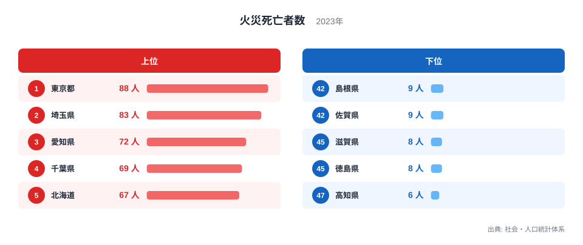
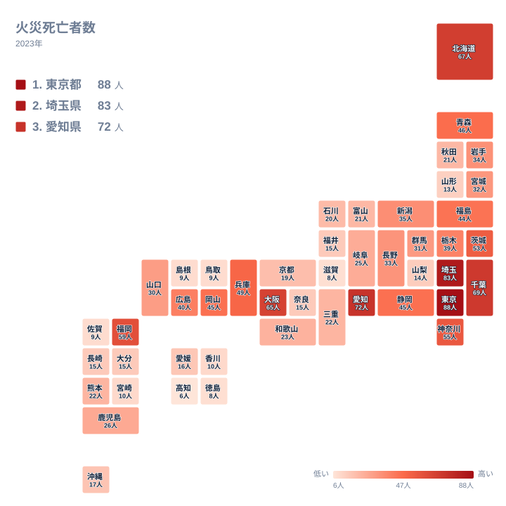

2023年の火災死亡者数で最も多かったのは東京都の88人で、最も少なかったのは高知県の6人でした。同じ日本の中でも、火災で亡くなる人の数にはこれだけの開きがあります。

この記事では、上位と下位の顔ぶれを地方ごとに確かめます。そのうえで、実データから言えることと、言えないことを分けて整理します。

## 上位と下位の顔ぶれ

まずは全体の姿を確認します。次の図は、火災死亡者数の上位5県と下位5県を並べたものです。

<source-link href="/ranking/fire-deaths-per-100k">火災死亡者数ランキングをもっと見る</source-link>

上位は、東京都が88人で1位、埼玉県が83人で2位、愛知県が72人で3位、千葉県が69人で4位、北海道が67人で5位です。北海道を除く4都県は、関東の東京都・埼玉県・千葉県と、中部の愛知県です。いずれも大きな都市圏を抱える地域です。6位にも大阪府が65人で入っており、大都市圏の府県が上位に多く並ぶ姿が見えます。

下位は、高知県が6人で47位、徳島県が8人で46位、滋賀県が8人で45位です。さらに佐賀県、島根県、鳥取県がいずれも9人で、44位、43位、42位に並びます。上位の顔ぶれと見比べると、大都市圏の府県が上に集まり、下位には地方の県が多く見られます。

ここで注意したいのは、この数字が人口あたりの割合ではなく、亡くなった人の実数だという点です。今回の実データには人口が含まれていません。そのため、上位と下位の差のうち、どこまでが人口の違いで説明できるのかは、この記事では示せません。

> [!NOTE]
> ここでの火災死亡者数は、2023年に火災で亡くなった人の実数です。人口や世帯数で割った値ではないため、「その県で火災に遭うと亡くなりやすいか」を示す数字ではありません。県どうしの危険度を比べるには、人口あたりの値など別の指標が必要です。

## 地理分布から見える偏り

次の図は、同じデータを地図の上に並べたものです。数字の大きい県と小さい県が、どこに集まっているかを確かめます。

関東では、東京都が88人、埼玉県が83人、千葉県が69人、神奈川県が55人、茨城県が53人です。栃木県の39人と群馬県の31人を含めても、関東の全県が21位以内に収まります。首都圏に数字の大きい県が固まっていることが、地図からはっきり読み取れます。

近畿では、大阪府が6位の65人、兵庫県が10位の49人です。一方で、同じ近畿でも滋賀県は45位の8人、奈良県は35位の15人、京都府は31位の19人にとどまります。中部では愛知県が3位の72人、静岡県が12位の45人ですが、福井県は34位の15人、山梨県は38位の14人です。

同じ地方の中でも、上位の県と下位の県がはっきり分かれています。この並びは、大都市圏の県が上位に多いという観察と合います。ただし、地理や産業構造、歴史がどう影響したのかは、実データだけでは断定できません。

## 地方の中での差と、説明しにくい県

地方ごとに順位を見ると、下位の県は特定の一地方に固まっているわけではありません。

- 四国では、徳島県が46位の8人、高知県が47位の6人です。一方、愛媛県は33位の16人、香川県は40位の10人です。
- 中国では、鳥取県が42位の9人、島根県が43位の9人です。一方、岡山県は13位の45人、広島県は15位の40人です。
- 九州・沖縄では、佐賀県が44位の9人です。一方、福岡県は7位の59人です。
- 近畿では、滋賀県が45位の8人で、大阪府の65人とは大きく離れています。

北海道・東北を見ると、大都市圏の有無だけでは読み解きにくい点もあります。北海道が5位の67人であるのは分かりやすい一方、青森県は11位の46人、福島県は14位の44人と、大都市圏の県に近い水準です。山形県は39位の13人にとどまり、同じ東北の中でも差があります。

この差の理由は、実データからは言えません。気候、住宅の形、高齢化の度合いなどが関わっている可能性はあります。しかし、今回のデータには産業構造や住宅、年齢に関する数値が含まれていません。そのため、これらを根拠にした説明は、ここでは行いません。

> [!WARNING]
> 火災死亡者数は、1件の火災で複数の方が亡くなると数字が大きく動く指標です。下位の6〜9人という水準では、数人の違いで順位が入れ替わります。たとえば9人の鳥取県と8人の滋賀県の差は1人分です。小さな値の差を、地域の防火力の違いとして読まないでください。

## 同じ人数の県の順位をどう読むか

このデータには、人数が同じ県が複数あります。9人の県は、鳥取県、島根県、佐賀県です。8人の県は、滋賀県と徳島県です。45人の県は、静岡県と岡山県です。

実データの順位は、こうした同じ人数の県にも一つずつ別の数字が振られています。たとえば45人の静岡県は12位、同じ45人の岡山県は13位です。9人の鳥取県、島根県、佐賀県も、42位、43位、44位と続きます。この記事では、データに載っている順位をそのまま使っています。

つまり、同じ人数の県の順位の前後には、実際の差がありません。順位の数字だけでなく、人数も合わせて見ることが大切です。人数が同じなら、順位の上下に意味のある差はないと考えてください。

> [!TIP]
> 上位と下位の差は、順位の数字よりも人数で読むと分かりやすくなります。たとえば東京都の88人と高知県の6人は、実数の差が大きく開いています。一方、40位前後は10人や9人が並び、数人の違いで順位が動く密集帯です。順位の差が小さいときは、人数も必ず確かめてください。

## 同じ分野の統計とあわせて読む

首都圏の数字は、[東京都のデータ](/areas/13000)や[埼玉県のデータ](/areas/11000)で、ほかの統計とあわせて確認できます。人口や世帯の構成と並べれば、火災死亡者数の背景をより具体的に考えられます。同じ分野の他の指標は、[同じカテゴリの統計一覧](/category/safetyenvironment)からたどれます。

この記事の範囲で言えるのは、大都市圏の県が上位に多いこと、同じ地方の中でも県ごとに大きな差があること、下位は数人の違いで順位が動くことです。産業構造や歴史といった背景は、今回の実データからは確かめられません。人口あたりの値や年齢構成などを加えた分析が、次の課題になります。

## データについて

この記事で使った火災死亡者数は、社会・人口統計体系の2023年の値で、単位は人です。都道府県ごとの実数であり、人口あたりに直した値ではありません。

順位は、実データに載っているものをそのまま使っています。人数が同じ県にも別々の順位が付いているため、たとえば9人の鳥取県、島根県、佐賀県は、42位、43位、44位と並んで掲載されていますが、人数は同じです。順位の違いを、実際の差の大きさとして読まないようにしてください。

## まとめ

2023年の火災死亡者数は、東京都が88人で最も多く、埼玉県が83人、愛知県が72人と続きました。最も少ないのは高知県の6人です。上位には大都市圏の県が多く並びました。

一方で、青森県のように大都市圏ではなくても上位に近い県もあります。実数の指標であることと、下位では数人の差で順位が動くことを意識して読むことが大切です。
