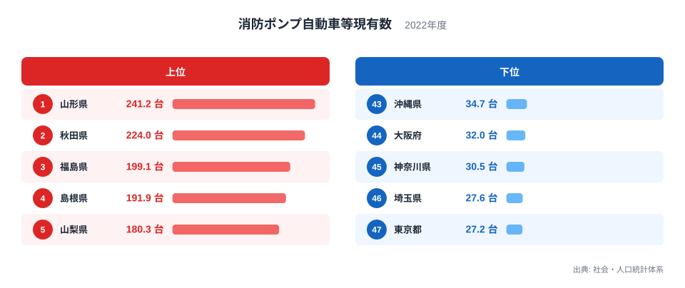
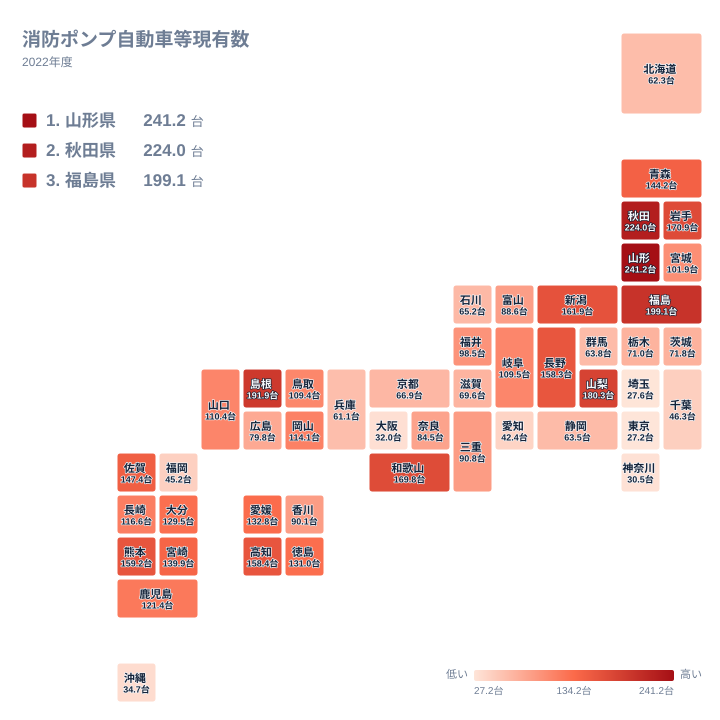

火事が起きたとき、現場に駆けつける消防ポンプ自動車は、地域の安全を支える基本装備です。2022年の消防ポンプ自動車等現有数を都道府県で比べると、1位の山形県は241.2台、最下位の東京都は27.2台でした。山形県は東京都の約9倍にあたります。人口が集中する都市部ほど多そうに思えますが、結果は逆でした。

この記事の問いは、題のとおり「東北に集中しているのか」です。上位と下位の顔ぶれ、東北各県の位置、東北以外の上位県を順に確かめ、最後に答えをまとめます。なぜそうなるのかについては、データだけでは確かめられないため、背景として考えられる仮説として慎重に書きます。

> [!NOTE]
> この記事で扱う消防ポンプ自動車等現有数は、社会・人口統計体系に収録された2022年の値で、単位は台です。人口あたりの値として掲載されており、総数ではありません。ただし、人口何人あたりに換算した値なのか、対象にどの種類の車両が含まれるのかといった細かな定義は、ここに示した情報からは確認できません。詳しい定義は元の統計で確かめてください。

## 上位と下位の顔ぶれ

まずは上位5県と下位5県を図で確認します。

<source-link href="/ranking/fire-department-pump-car-count-per-100-thousand-people">消防ポンプ自動車等現有数ランキングをもっと見る</source-link>

1位は山形県で241.2台、2位は秋田県で224台、3位は福島県で199.1台です。4位は島根県で191.9台、5位は山梨県で180.3台でした。下位は、43位の沖縄県が34.7台、44位の大阪府が32台、45位の神奈川県が30.5台、46位の埼玉県が27.6台、47位の東京都が27.2台です。

図で目を引くのは、上位と下位で分布の様子が違うことです。上位5県は180.3台から241.2台まで約61台の幅があり、1位と2位の間だけでも17.2台の差があります。一方、下位5県は27.2台から34.7台までの幅が約7台しかなく、ほぼ横一線です。上位は県ごとに値がばらつき、下位は低い水準にまとまっていることが分かります。

上位5県と下位5県のあいだには、200台近い差があります。ただし、下位5県のうち4県は東京圏と大阪府という大都市圏の都府県で、沖縄県だけが例外です。大都市圏で値が低いことは確かですが、その理由まではこのデータから断定できません。広い範囲を少ない車両でまかなう運用や、別種の車両が主力になっている可能性などが仮説として考えられます。

## 地理分布を地図で見る

次に、地理分布をタイルマップで確認します。

東北の6県の順位を整理します。

- 山形県は1位で241.2台
- 秋田県は2位で224台
- 福島県は3位で199.1台
- 岩手県は6位で170.9台
- 青森県は13位で144.2台
- 宮城県は24位で101.9台

東北は上位に4県が入り、青森県も13位と上位寄りです。しかし宮城県は24位で、全国のちょうど中位にあたります。つまり東北といっても一様ではなく、日本海側や内陸の県が高く、宮城県だけが中位という構図です。

地図で見ると、東北以外にも濃い色の県が散らばっています。島根県は4位、山梨県は5位、和歌山県は169.8台で7位、熊本県は159.2台で9位、高知県は158.4台で10位です。これらは山陰、甲信、近畿、九州、四国と地域がばらばらで、一つの地方にまとまってはいません。反対に、愛知県は42.4台で42位、福岡県は45.2台で41位、千葉県は46.3台で40位と、都市圏を抱える県は下位に寄っています。

> [!TIP]
> 地図は色の濃さで大まかな傾向をつかみ、気になる県は順位と値で確かめるのがコツです。中位は値が近接しているため、隣り合う順位の差を過大に読まないようにしてください。

## 背景として考えられる仮説

ここからは、データから直接は確かめられない仮説です。

一つ目は、人口密度や集落の分布です。人口が少なく、集落が点在する地域では、地区ごとに車両を置く必要があり、人口あたりの台数が大きくなるのかもしれません。反対に市街地が連続する都市圏では、少ない車両で多くの人口を受け持てるため、値が小さくなる可能性があります。

二つ目は、産業構造や暮らし方です。農山村では住宅が農地や山林の中に点在し、都市部では建物が密集しています。こうした違いが車両の置き方に関わっているかもしれません。

三つ目は、消防団など地域ごとの組織の成り立ちです。地区単位で車両を備える仕組みが厚い県では台数が増える、という見方もできます。ただし、消防団の数や分団ごとの車両数はこの記事のデータに含まれないため、どれも仮説の域を出ません。

> [!WARNING]
> 台数が多いことは、消防力が高いことと同じではありません。この数字には車両の性能、古さ、配備先の違いが反映されていません。また、人口あたりの値は人口の少ない県で少しの台数差が大きく動きやすい性質があります。順位は安全度の優劣ではなく、配備の厚みの目安として読んでください。

## 中位の県の姿

上位と下位だけでなく、中位も見ておきます。20位の岡山県は114.1台、21位の山口県は110.4台、22位の岐阜県は109.5台、23位の鳥取県は109.4台、24位の宮城県は101.9台でした。この付近は1位から47位までのなかでも値が密集しており、20位から24位までの5県は101.9台から114.1台の約12台の幅に収まっています。

さらに下って28位の富山県は88.6台、29位の奈良県は84.5台、30位の広島県は79.8台です。順位が下がるごとに値も下がり、ここでも隣り合う県の差は数台から5台ほどにとどまります。

北海道は62.3台で38位です。面積の広い道ですが、台数は上位に入っていません。広いことと人口あたりの台数が多いことは、必ずしも結びつかないことが分かります。その理由はこのデータからは分かりません。

## まとめ:東北に集中していると言えるか

題の問いへの答えは「東北は上位に多いが、集中とまでは言えない」です。

東北6県のうち、山形県、秋田県、福島県が1位から3位を占め、岩手県も6位に入りました。上位10県のなかで東北は4県を占めます。一方で、青森県は13位、宮城県は24位と幅があります。さらに、島根県、山梨県、和歌山県、熊本県、高知県といった東北以外の県も上位10位以内に入っています。上位10県の過半数は東北以外です。

したがって、東北に特に厚い傾向はあるものの、東北だけの現象ではありません。下位は東京都の27.2台、埼玉県の27.6台、神奈川県の30.5台など、大都市圏の都府県が目立ちます。

気になる県があれば、[山形県のデータ](/areas/06000)や[秋田県のデータ](/areas/05000)で、ほかの指標と合わせて確かめてみてください。ほかの安全・環境の統計は、[同じカテゴリの統計一覧](/category/safetyenvironment)から探せます。

## データについて

この記事の数値は、社会・人口統計体系の「消防ポンプ自動車等現有数」の2022年の値で、単位は台です。人口あたりの値として掲載されていますが、換算の基準となる人口や対象車両の範囲は、ここでは確認できていません。本文の数値は、すべて元の統計に載っている値をそのまま使っています。
