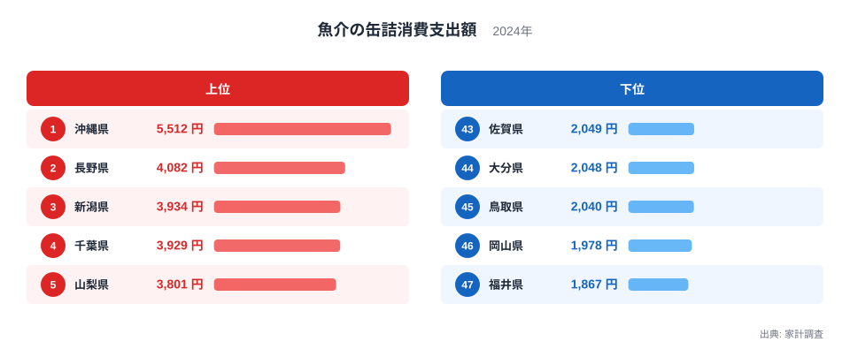
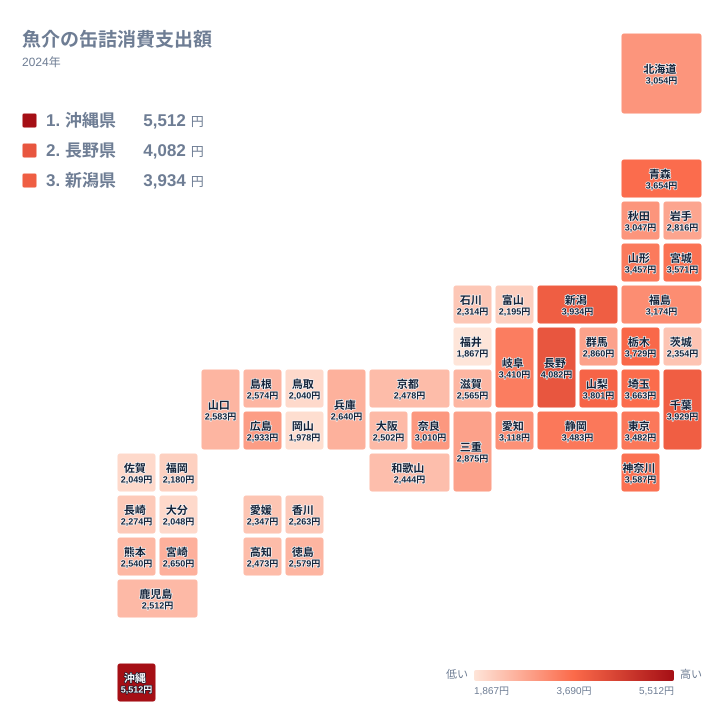

サバ缶、ツナ缶、イワシ缶。戸棚に一つはある魚介の缶詰ですが、1年間にいくら使うかは県によって大きく違います。2024年の家計調査では、最も多いのは沖縄県で5,512円でした。最も少ないのは福井県で1,867円です。最大と最小の比は約3倍で、同じ国内でもこれだけの開きがあります。

この記事では、魚介の缶詰への支出が多い県と少ない県を見比べ、食文化や気候、暮らし方との結びつきを考えます。海に近い県ほど缶詰を買うのかというと、必ずしもそうではありません。意外な結果が並んでいます。

## 上位と下位を並べると見えるもの

まず、上位5県と下位5県を図で確認します。

<source-link href="/ranking/fish-canned-consumption-expenditure">魚介の缶詰への支出ランキングをもっと見る</source-link>

1位は沖縄県で5,512円です。2位は長野県で4,082円、3位は新潟県で3,934円、4位は千葉県で3,929円、5位は山梨県で3,801円でした。1位と2位の差は1,430円で、2位から5位までが並ぶ間隔と比べるとはっきり大きな開きです。沖縄県は頭一つ抜けています。

下位を見ると、47位が福井県で1,867円、46位が岡山県で1,978円です。45位は鳥取県で2,040円、44位は大分県で2,048円、43位は佐賀県で2,049円でした。下位5県は2,000円前後に固まっていますが、5位の山梨県の3,801円と比べると、上位との差は大きいと言えます。

注目したいのは、上位に内陸県が混じっている点です。長野県と山梨県は海のない県ですが、どちらも5位以内に入っています。一方で、海に面した佐賀県や大分県、鳥取県は下位です。魚介が身近だから缶詰も多く買う、という単純な図式は成り立ちません。

> [!NOTE]
> この指標は、家計調査で調べた「魚介の缶詰」への支出額です。購入した個数や重さではなく金額なので、缶詰の種類や価格帯によって順位が動きます。高価な缶詰を選ぶ世帯が多い県は、同じ個数でも金額が大きくなります。

## 沖縄県はなぜ突出しているのか

沖縄県が1位である理由は、統計だけでは断定できません。ここで扱うのはあくまで魚介の缶詰で、ランチョンミートのような肉の缶詰は含まれません。そのうえで、ツナ缶などを炒め物やサラダ、おにぎりの具に使う食べ方が日常的に広がっている可能性はあります。

もう一つ考えられるのは気候と物流です。高温多湿の島では、常温で長く保存できる食品が重宝されます。台風で船が止まり、生鮮品の入荷が乱れる場面でも、缶詰は備蓄として頼りになります。島ならではの流通事情が支出を押し上げているのかもしれませんが、これも実データで裏づけられたものではなく、仮説の域を出ません。

詳しい数値は[沖縄県のデータ](/areas/47000)でも確認できます。

> [!TIP]
> この指標は金額ベースです。1缶あたりの価格が高いサバ缶やツナ缶を選ぶ世帯が多い県では、買った個数が同じでも支出額が大きくなります。逆に、安価な缶詰を数多く買う県は金額が伸びません。金額の高低を、そのまま「たくさん食べている」と読み替えないことがコツです。

## 内陸県が上位に入る理由

2位の長野県は4,082円、5位の山梨県は3,801円でした。どちらも中部の内陸県です。中部にはほかにも、3位の新潟県が3,934円で入っています。ただし新潟県は海に面しており、内陸県とは事情が異なります。

内陸県で缶詰が選ばれやすい理由として考えられるのは、魚介の入手経路です。海から遠い地域では、鮮魚の代わりに保存がきく加工品が魚を食べる手段になりやすいと言われます。買い置きできる缶詰は、鮮魚店が少ない地域でも使いやすい食材です。

長野県は冬の寒さが厳しい地域でもあります。買い物に出にくい季節に備えて、常備品を持つ習慣があるのかもしれません。長野県の詳しい数値は[長野県のデータ](/areas/20000)で見られます。

ここでも断定はできません。上位に内陸県が並ぶという事実は確かですが、その理由は統計だけでは説明しきれないからです。

> [!WARNING]
> 家計調査は、限られた世帯を抽出して調べる標本調査です。県庁所在市を中心とした調査のため、県全体の暮らしを正確に表しているとは限りません。また、数百円の差で順位が入れ替わる中位の県では、順位の違いを過大に読まないよう注意が必要です。

## 地図で見る地域の広がり

続いて、都道府県ごとの分布を地図で確認します。

大づかみに言うと、関東と北海道・東北は中位以上の県が多く、中国・四国・九州は下位に寄る県が目立ちます。関東では千葉県が4位、栃木県が6位、埼玉県が7位で、神奈川県の9位、東京都の12位と合わせて、すべて12位以内です。北海道・東北では青森県が8位、宮城県が10位、山形県が13位と、こちらも上位に並びます。

一方、中国・四国・九州では下位の県が多くなります。岡山県は46位で1,978円、鳥取県は45位で2,040円、香川県は40位で2,263円、福岡県は42位で2,180円でした。ただし例外もあり、広島県は20位で2,933円と中位です。九州・沖縄では、沖縄県だけが1位で、ほかの県は中位から下位に散らばります。

近畿は大阪府が32位、京都府が33位、和歌山県が35位と下位寄りですが、奈良県は19位で3,010円と中位に入っています。奈良県は海のない県であり、「海に近いほど缶詰が少ない」という説明では収まりません。西日本の一部の県で低いことは言えますが、その理由まではこのデータだけでは分かりません。

## 鮮魚との対比で考える

缶詰への支出が少ない県には、魚を鮮魚で食べる習慣が強い地域が含まれるのかもしれません。福井県は最下位の1,867円ですが、日本海の魚介が身近で、買ってすぐ調理する食べ方が中心だという見方もできます。同じく下位の石川県は38位で2,314円、富山県は41位で2,195円でした。

ただし、ここで示した理由は仮説です。実データには鮮魚の購入額が含まれていないため、缶詰の支出が少ない分だけ鮮魚を多く買っているとは、この記事では言い切れません。関連品目と見比べる際は、同じ家計調査で他の魚介類の支出も合わせて確認すると、より確かな理解につながります。

一方で、缶詰には価格が安定し、買い置きしやすいという性質があります。魚の価格は漁獲量などで変動しますが、缶詰は日持ちするため、買い方の自由度が高い食品です。

そのほか、[同じカテゴリの統計一覧](/category/economy)から、ほかの食品への支出も調べてみると、地域ごとの食の特徴がさらに立体的に見えてきます。

## 中位の県と、まとめ

中位には、静岡県が11位で3,483円、岐阜県が14位で3,410円、福島県が15位で3,174円、愛知県が16位で3,118円、北海道が17位で3,054円、秋田県が18位で3,047円と、3,000円台の県が続きます。その後は2,000円台に入り、40位台には2,000円前後の県が並びます。

分布をまとめると、1位の沖縄県が飛び抜けて高く、2位の長野県から上位の県が3,000円台後半から4,000円前後に並びます。中位は3,000円台から2,000円台後半へなだらかに下がり、下位は2,000円前後に固まります。極端に高いのは沖縄県だけです。

魚介の缶詰への支出は、海に近いかどうかだけでは説明できません。内陸県の長野県や山梨県が上位に入り、同じ内陸の奈良県も中位にいる一方、海に面した県にも下位が目立ちます。保存性の必要、流通事情、料理の習慣などが重なっている可能性がありますが、どれが効いているかはこのデータからは断定できません。

## データについて

この記事で使った統計は、家計調査の「魚介の缶詰消費支出額」です。2024年の支出額を、円単位で都道府県別に比較しています。順位は支出額の大きい順です。数値は調査対象世帯の標本から得られた値であり、わずかな差は誤差の範囲に入る可能性があります。
