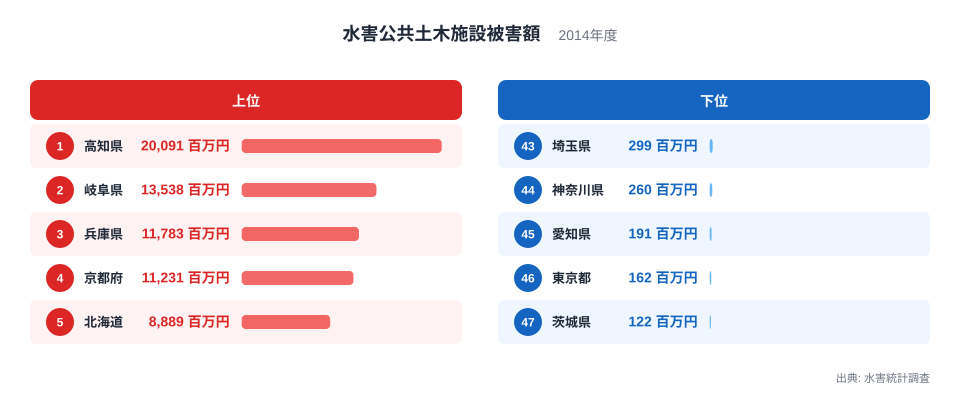
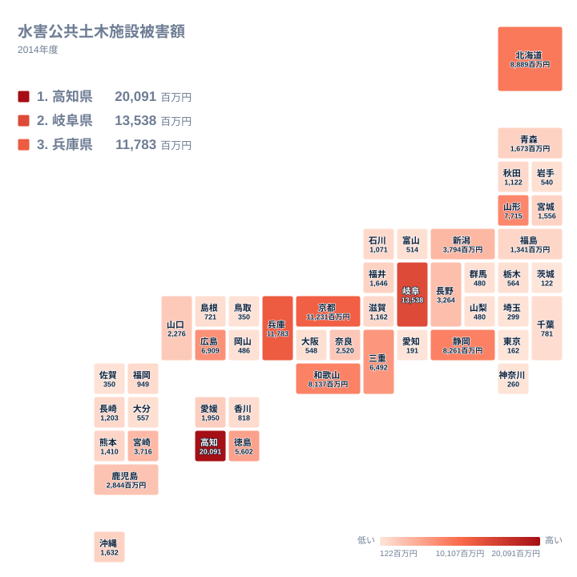

## 2014年の水害で、公共土木施設の被害が最も大きかった県は

水害と聞くと、浸水した家屋や流された田畑を思い浮かべる方が多いかもしれません。しかし、水害は道路、橋、河川の堤防、砂防施設といった公共の土木施設にも傷を残します。こうした施設は暮らしを支える基盤であり、壊れれば復旧に時間と予算が必要になります。

2014年の水害による公共土木施設の被害額で最も大きかったのは、高知県の20,091百万円でした。2位は岐阜県の13,538百万円、3位は兵庫県の11,783百万円、4位は京都府の11,231百万円、5位は北海道の8,889百万円です。一方、最も小さかったのは茨城県の122百万円で、東京都が162百万円、愛知県が191百万円で続きます。

この記事では、2014年の上位と下位を比べ、金額の差や地域の偏りを確認します。そのうえで、なぜこの順になったのかを、地形や気象、施設の量といった観点から仮説として考えます。ただし、この記事で使うのは被害額と順位だけです。降雨量や施設の延長、治水投資のデータは含まれていないため、理由の説明はあくまで可能性の話として読んでください。

## 上位5県と下位5県のランキング

<source-link href="/ranking/flood-damage-public-infrastructure">水害公共土木施設被害額ランキングをもっと見る</source-link>

まず金額の差を確かめます。1位の高知県は20,091百万円で、最下位の茨城県は122百万円です。20,091を122で割ると約165倍になります。同じ年の同じ水害統計でも、県によって桁が違う規模の差が生じていました。

上位5県の合計は、20,091、13,538、11,783、11,231、8,889の各百万円を足した65,532百万円です。下位5県は、埼玉県の299百万円、神奈川県の260百万円、愛知県の191百万円、東京都の162百万円、茨城県の122百万円で、合計は1,034百万円です。上位5県の合計は、下位5県の合計の約63倍にあたります。被害が一部の県に大きく偏った年だったことが、この比較から読み取れます。

顔ぶれを見ると、上位には四国の高知県、中部の岐阜県、近畿の兵庫県と京都府、そして北海道が並びます。下位は関東の4都県と東海の愛知県です。上位が西日本に多く、下位が関東に集まる点は目を引きますが、これだけで原因は断定できません。その年の雨がどこに降ったかが大きく影響した可能性があり、各県の水害リスクの恒常的な順位とは区別して読む必要があります。

> [!NOTE]
> この指標は、水害統計調査で集計された公共土木施設の被害額です。対象は河川、道路、橋、砂防施設、海岸などで、家屋や家財、農作物、企業設備の被害は含まれません。単位は百万円で、被害を受けた施設を復旧するための事業費として計上される点が、被害の「大きさ」を直接測るものとは異なる、この指標特有の性格です。

## 上位の県に何が起きていたのか

1位の高知県は、四国の太平洋側に位置します。山地が多い県であるため、斜面や谷沿いの道路、河川の施設が被災しやすかった可能性があります。ただし、2014年にどこで強い雨が降ったかを示すデータは手元にないため、地形が理由だと言い切ることはできません。詳しい数値は[高知県のデータ](/areas/39000)で確認できます。

2位の岐阜県は中部の内陸にあります。山間部と平野部の両方に河川があるため、複数の場所で被害が出て金額が積み上がった可能性は考えられます。他の指標とあわせて見たい方は[岐阜県のデータ](/areas/21000)も参照してください。

3位の兵庫県と4位の京都府は、金額が11,783百万円と11,231百万円で近い水準です。ただし、地理的な位置は異なります。京都府は日本海側から内陸にかけて広がり、兵庫県は日本海側と瀬戸内海側の両方に面しています。同じ近畿の府県でも被害の出方が似ていたのは興味深い点ですが、同じ雨域に入ったのか、別々の要因だったのかは、この数字だけでは判断できません。

5位の北海道は8,889百万円で、上位に入っています。北海道は面積が大きい地域ですが、面積のデータをこの記事では使っていないため、広さが金額に影響したかどうかは確認できません。面積が広くても下位に位置する県があるかどうかも、ここでは検証していません。続く6位の静岡県は8,261百万円、7位の和歌山県は8,137百万円、8位の山形県は7,715百万円で、上位の集団が連なっています。

> [!TIP]
> この指標を読むときは、順位とあわせて金額の「段差」を見ると状況をつかみやすくなります。たとえば10位の三重県は6,492百万円、11位の徳島県は5,602百万円ですが、12位の新潟県は3,794百万円まで下がります。順位が1つ違うだけでも金額差が大きい箇所があるため、順位だけでなく金額そのものも確認してください。

## 地理分布のタイルマップで見る偏り

タイルマップで全体を眺めると、被害額が大きい県は近畿から中国、四国にかけての西日本に多く見られます。中部では岐阜県と静岡県が上位に入っています。一方、関東は埼玉県、神奈川県、東京都、茨城県が下位に並び、全体に薄い色が目立ちます。

東北は一様ではありません。8位の山形県は7,715百万円と上位に入りますが、宮城県は22位で1,556百万円、福島県は24位で1,341百万円、岩手県は36位で540百万円です。同じ東北でも県ごとの差が大きく、地方単位でひとまとめに語るのは難しいと言えます。北海道は5位で、東北とは別の地域として扱うと、東日本でも上位に入った地域は限られていました。

西日本に偏って見える理由として、2014年に前線や台風の影響を受けた地域があった可能性は考えられます。ただし、気象データを使っていないため、この記事では事実としての偏りを示すにとどめます。

隣り合う県で順位が大きく異なる例もあります。和歌山県は7位で8,137百万円ですが、奈良県は16位で2,520百万円です。県境は行政上の線であり、雨が降った場所の違いが影響した可能性はありますが、それも本記事のデータからは確かめられません。

> [!WARNING]
> このランキングは2014年の一年分の数字です。復旧事業費として計上された金額なので、施設の規模や種類によって、同じ程度の被災でも金額が変わります。大きな橋や海岸施設が被災した県は、被災箇所の数が少なくても金額が大きくなる場合があります。単年の順位だけで、県の治水能力や防災の取り組みを評価することはできません。

## 下位の都県が小さい金額にとどまった理由を考える

下位には茨城県の122百万円、東京都の162百万円、愛知県の191百万円、神奈川県の260百万円、埼玉県の299百万円が並びます。これらは関東と東海の都県で、いずれも1,000百万円を大きく下回りました。

なぜ小さかったのかは、このデータだけでは説明できません。考えられる仮説として、その年に強い雨が降った地域から外れていた可能性があります。また、堤防や排水施設などの整備が進んでいて被害が抑えられた可能性も、仮説としては成り立ちます。ただし、治水投資の有無やその効果は、被害額と順位からは確認できません。

もう一つの仮説は、被災しやすい山間部の道路や河川の延長が相対的に少ない可能性です。ただしこれも、施設の延長データがないため検証できません。仮説の確かさを高めるには、降雨量や施設量など別の統計とあわせて見る必要があります。

なお、水害以外の安全・環境に関する指標も見たい場合は、[同じカテゴリの統計一覧](/category/safetyenvironment)から確認できます。他の指標と並べることで、この年の水害の位置づけを考える手がかりになります。

## データについて

この記事で扱った水害公共土木施設被害額は、水害統計調査にもとづく2014年の数値で、単位は百万円です。全47都道府県の値があり、1位は高知県の20,091百万円、最下位は茨城県の122百万円でした。

被害額は、被災した施設の復旧に必要な費用として集計されるため、被災した施設の数や人的被害とは別の尺度です。同じ金額でも、小さな施設が多数壊れた場合と、大きな施設が少数壊れた場合とでは、状況が異なります。

また、この数値は人口や面積で割った指標ではありません。県の規模や管理する施設の量が違うため、順位の高低は被害の深刻さそのものというより、規模の違いも含んだ結果として受け止めるのが適切です。
