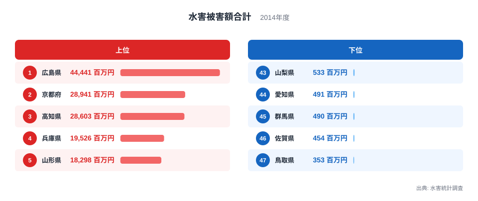
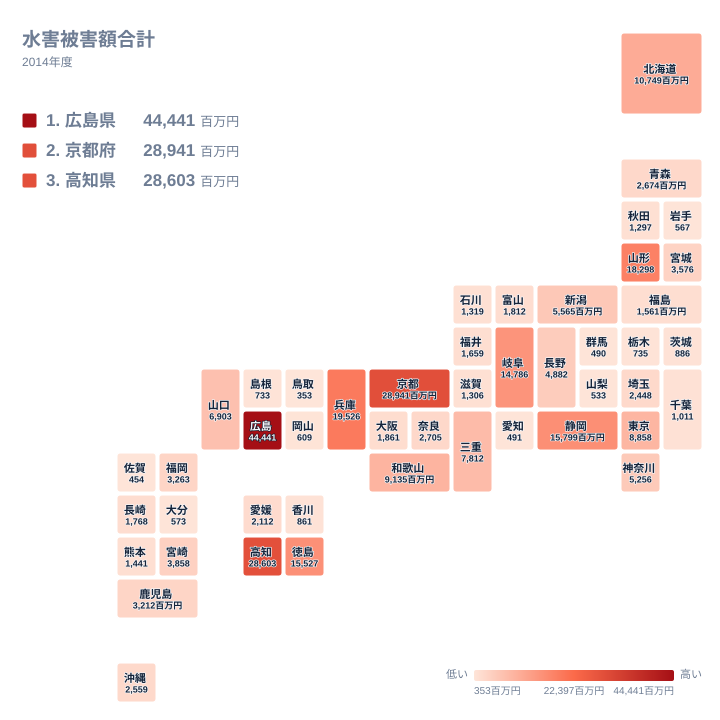

水害被害額が最も多い県はどこでしょうか。2014年の水害統計調査では、広島県が44,441百万円で1位でした。最下位の鳥取県は353百万円で、同じ年の被害額でも県によって大きな開きがあります。この記事では、上位と下位の顔ぶれを実際の値で確認し、順位の背景として考えられる要因を、確かめられる範囲と推測にとどまる範囲を分けながら整理します。

## 2014年の水害被害額は広島県が先頭

水害被害額は、洪水や内水氾濫、土砂災害などで生じた被害を金額に直した指標です。単位は百万円で、ここで扱うのは2014年の1年分の値です。

1位は広島県の44,441百万円でした。2位は京都府の28,941百万円、3位は高知県の28,603百万円です。2位と3位はほぼ並んでおり、この2府県の間に大きな断層はありません。一方で、1位の広島県と2位の京都府の間には、はっきりした差があります。広島県の被害額は、2位の京都府の1.5倍を超えています。

4位は兵庫県の19,526百万円、5位は山形県の18,298百万円です。上位5位までを見ると、3位までの先行集団と、4位・5位の追随集団に分かれているのがわかります。

> [!NOTE]
> この指標は、住宅や家財、公共土木施設、農作物などの被害を金額で評価して合計した値です。人口や面積で割った値ではありません。被害を受けた対象にどれだけ資産があるかが金額に反映されるため、被害の広がりが同じでも、都市部と農村部で金額が変わる場合があります。

## 上位と下位のランキング

まず、上位5県と下位5県を図で確認します。

<source-link href="/ranking/flood-damage-total">水害被害額合計ランキングをもっと見る</source-link>

上位5県を地方で分けると、中国が広島県、近畿が京都府と兵庫県、四国が高知県、東北が山形県です。5つの県が4つの地方にまたがっています。ただし、見られるのは上位5県だけなので、ここから地方ごとの傾向を断定することはできません。全体の分布は、次の節の地図で確かめます。

下位は、47位の鳥取県から、46位の佐賀県、45位の群馬県、44位の愛知県、43位の山梨県と続きます。この5県は、中国、九州、関東、中部、中部に分かれます。上位と同様に、特定の地方にまとまっているわけではありません。

1位の広島県と最下位の鳥取県を比べると、被害額には非常に大きな差があります。広島県の44,441百万円に対し、鳥取県は353百万円です。この差が、地形や雨の強さ、資産の量のうちどれによるものなのかは、この値だけでは切り分けられません。ここから先は、あくまで推測を含みます。

> [!WARNING]
> この記事の値は2014年の1年分だけです。上位だからといって、その県がいつも水害に弱いとは言えません。下位の県でも、別の年に大きな被害を受ける可能性があります。また、降水量や地質といったデータをこの記事は持っていないため、順位の理由を確定させることはできません。

## 地理分布で見る被害の広がり

次に、47都道府県を地図状のタイルに並べて、被害額の分布を見ます。

地図を眺めると、被害額の大きい県が一つの地域に固まっているわけではないことがわかります。中国では広島県が1位ですが、同じ中国の山口県は13位の6,903百万円、島根県は39位の733百万円、岡山県は40位の609百万円、鳥取県は47位の353百万円でした。同じ地方でも、順位は大きく分かれています。

近畿でも同じ傾向があります。京都府が2位、兵庫県が4位、和歌山県が10位の9,135百万円、三重県が12位の7,812百万円と、上位から中位に並びます。一方、奈良県は21位の2,705百万円、大阪府は26位の1,861百万円、滋賀県は33位の1,306百万円でした。近畿に属する7府県の中でも、順位は2位から33位まで幅があります。

四国では高知県が3位、徳島県が7位の15,527百万円と上位に入り、愛媛県は25位の2,112百万円、香川県は37位の861百万円でした。東北では山形県が5位ですが、宮城県は18位の3,576百万円、岩手県は42位の567百万円です。隣り合う県でも値が大きく違う例は多く、被害が県ごとにまとまって発生したわけではないことがうかがえます。

> [!TIP]
> 地図を見るときは、濃い色の県だけでなく、隣の県との値の違いにも目を向けてください。ただし、色の違いだけで原因は決められません。被害の大きさ、その場所の資産の量、県の広さが重なって金額になるため、地図は「どこで金額が大きかったか」を知るための道具として使うのが安全です。

## 上位の府県を個別に見る

広島県が1位になった理由は、この記事のデータだけでは確認できません。広島県は山地が多く、市街地が山すそに広がる地域がある県です。そのため、土砂災害が起きると住宅に被害が及びやすいと考えられます。2014年に県内で大きな土砂災害があったことが、この年の高い金額につながった可能性はありますが、本稿の実データからは裏付けられません。詳しい指標は[広島県のデータ](/areas/34000)で確認できます。

京都府は2位の28,941百万円でした。盆地と山地が入り組む地形で、河川沿いに市街地が広がる地域があります。そのため、河川の増水が住宅や施設に被害を与えると、金額が大きくなる場合があると考えられます。ただし、これは地形からの推測であり、2014年に実際にどの地域で被害が出たかは、この記事の数値からはわかりません。各種の指標は[京都府のデータ](/areas/26000)で確認できます。

高知県は3位の28,603百万円で、京都府とほぼ並ぶ規模でした。高知県は降水の多い県として知られていますが、この記事には降水量のデータがないため、2014年の雨量との関係は示せません。ここで言えるのは、被害額が全国で3番目に大きかったという事実までです。

4位の兵庫県と5位の山形県は、都市部を抱える県と、農林業の比重が比較的高い県という違いがあります。どちらが、どの種類の被害で金額を伸ばしたかは、この指標だけでは区別できません。被害の内訳を見るには、別の資料が必要です。

## 下位の県が示すこと

下位の鳥取県、佐賀県、群馬県、愛知県、山梨県は、2014年の被害額が小さい県でした。鳥取県は353百万円、佐賀県は454百万円、群馬県は490百万円、愛知県は491百万円、山梨県は533百万円です。下位5県の値は、いずれも600百万円に届かない範囲に収まっています。

下位に入った理由は、県ごとに違う可能性があります。大規模な災害が起きなかった県もあれば、被害を受ける対象が少ない県もあるかもしれません。ただし、それをこの値から区別することはできません。被害額が小さいのは被害が小さかったから、というのが、確実に言えるすべてです。

愛知県は人口や産業の集積が大きい県ですが、被害額は44位の491百万円でした。資産が多いことが、そのまま被害額の大きさに結びつくわけではないことを示す例です。被害額は、資産の量と、実際に浸水や土砂災害が起きた場所の組み合わせで決まる、と考えるのが自然です。

また、下位であることが、水害に強い県であることを意味するわけではありません。2014年にたまたま被害が小さかった年の記録として読むのが適切です。他の安全・環境の指標とあわせて見たい場合は、[同じカテゴリの統計一覧](/category/safetyenvironment)が参考になります。

## 上位と下位の差をどう読むか

上位の広島県と下位の鳥取県の差は大きいものの、中位の県もあわせて見ると、分布の形がわかります。10位の和歌山県は9,135百万円、11位の東京都は8,858百万円、12位の三重県は7,812百万円で、このあたりから値が一桁台の千百万円単位に入ります。20位の鹿児島県は3,212百万円、30位の福島県は1,561百万円でした。

つまり、順位が下がるにつれて、被害額は急に小さくなります。被害額の多い少数の県と、小さな値が並ぶ多数の県という構図です。この形は、水害が全国で均等に起きるのではなく、特定の県に集中して大きな金額をもたらすことを示しています。ただし、これも2014年の1年分の結果にすぎません。

九州・沖縄の県を見ると、宮崎県が17位の3,858百万円、福岡県が19位の3,263百万円、鹿児島県が20位の3,212百万円、沖縄県が23位の2,559百万円で、中位に固まっています。長崎県は28位、熊本県は31位、大分県は41位、佐賀県は46位と、さらに下へ散らばりました。

関東では東京都が11位、神奈川県が15位、埼玉県が24位の2,448百万円、千葉県が35位の1,011百万円、茨城県が36位の886百万円、栃木県が38位の735百万円、群馬県が45位です。同じ関東でも、順位は11位から45位まで広がっています。

## データについて

この記事の数値は、水害統計調査の2014年の値で、正式な統計名は水害被害額合計です。単位は百万円です。順位は被害額の大きい順に付けており、本文の数値はすべて調査結果の値です。

水害の被害額は、年ごとの気象条件で大きく変わると考えられます。ある1年の順位だけで県の水害リスクを語るのは難しく、数年分を並べて比べると、傾向がより見えやすくなります。この記事は、2014年という1年の記録を読み解くものとして活用してください。

## まとめ

2014年の水害被害額は、広島県が44,441百万円で1位、京都府が28,941百万円で2位、高知県が28,603百万円で3位でした。下位は、鳥取県の353百万円を最下位に、佐賀県、群馬県、愛知県、山梨県と続きます。

上位は4つの地方にまたがり、同じ地方の中でも順位が大きく分かれていました。順位の背景には、地形や雨の降り方、資産の量などが関わっている可能性がありますが、この記事のデータだけでは確かめられません。数値は、2014年にどの県で金額が大きかったかを示す記録として読み、原因の判断には別の資料を重ねるのが確かな進め方です。
