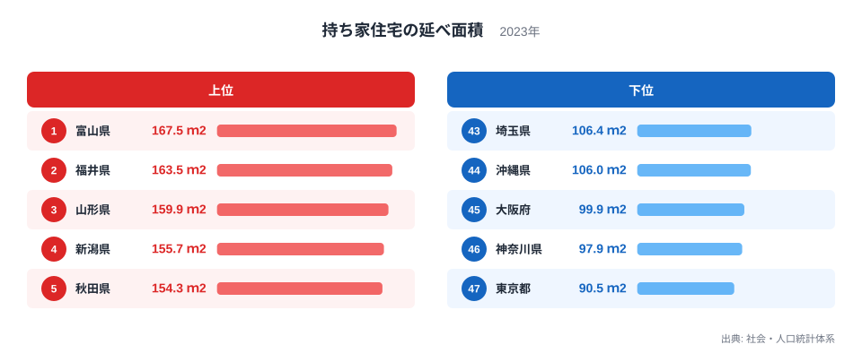
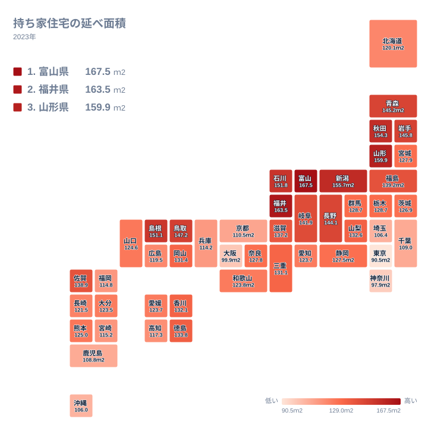

## 持ち家の広さは県でどれほど違うのか

住まいの広さは、暮らしの印象を大きく左右します。ここでは2023年の持ち家住宅の延べ面積を、都道府県ごとに比べます。順位と値から言える範囲を確かめたうえで、背景として考えられることは仮説として整理します。

最も広いのは富山県で167.5ｍ2です。最も狭いのは東京都で90.5ｍ2です。最大と最小の比は約1.85倍で、同じ持ち家でも地域によって平均の広さに大きな開きがあります。

上位10県を地方のくくりで見ると、中部の富山県、福井県、新潟県、石川県、東北の山形県、秋田県、岩手県、青森県、そして中国の島根県、鳥取県が並びます。北海道の道県は上位にありません。一方、下位5都府県は、関東の埼玉県、東京都、神奈川県、近畿の大阪府、九州・沖縄の沖縄県です。九州・沖縄でも佐賀県は14位、熊本県は27位で、地方全体が下位というわけではありません。

[富山県のデータ](/areas/16000)や[福井県のデータ](/areas/18000)を合わせて見ると、上位の県の様子がつかみやすくなります。[同じカテゴリの統計一覧](/category/construction)では、住宅や建設に関する他の指標も確認できます。

> [!NOTE]
> この指標は持ち家に住む世帯の住宅だけの値です。賃貸住宅は含まれません。そのため、ある県の「住まい全体の広さ」ではなく、「持ち家を選んだ世帯の家の広さ」を表していることに注意してください。

## 上位と下位の顔ぶれ

<source-link href="/ranking/floor-area-per-dwelling-owner">持ち家住宅の延べ面積ランキングをもっと見る</source-link>

図からまず読み取れるのは、上位と下位の間の距離です。上位5県は150ｍ2台の後半から160ｍ2台に並び、下位は100ｍ2前後か、それを下回る水準です。大阪府の99.9ｍ2、神奈川県の97.9ｍ2、東京都の90.5ｍ2は、いずれも100ｍ2を下回っています。

上位側は、1位から5位までを中部と東北が占めています。顔ぶれが特定の地方に偏っていることは、家の広さが全国一様に決まるのではなく、地域のまとまりと関係している可能性を示します。ただし、その理由はこのデータだけでは確かめられません。

下位側には、人口が集中する大都市圏が目立ちます。仮説として、土地が高く敷地が限られることや、持ち家でも分譲マンションの割合が高いことが、平均を押し下げている可能性があります。この記事のデータには地価や住宅の種類は含まれていないため、あくまで考えられる説明にとどまります。

> [!TIP]
> 順位だけでなく値も見比べてください。たとえば栃木県と群馬県は、どちらも128.7ｍ2で、順位は21位と22位に分かれています。順位が隣り合っていても面積の差がほとんどない場合があるため、順位より水準そのものに注目すると読み違えを防げます。

## 地図で見る地理分布

地図で眺めると、広い県は中部から東北にかけて集まり、東京都、神奈川県、大阪府といった大都市圏は狭い側に位置します。ただし、地方の内部にも大きなばらつきがあります。

関東は、その幅が最も目立つ地方です。栃木県は21位、群馬県は22位、茨城県は26位と中位に入る一方で、千葉県は41位、埼玉県は43位、神奈川県は46位、東京都は47位です。同じ関東で21位から47位まで開いています。関東というくくりだけでは、家の広さを説明できないことが分かります。

近畿にも幅があります。滋賀県は15位、三重県は20位で、全国の中でも上位から中位に入ります。これに対し、京都府は40位、大阪府は45位です。近畿のなかで、順位が離れた県が同居しています。

九州・沖縄も同様です。佐賀県は14位で、北海道・東北や中部の県に近い水準ですが、沖縄県は44位です。地方別に平均して語ると、こうした県ごとの違いが見えにくくなります。

## 上位に並ぶ県をどう読むか

上位10県が中部、東北、中国に集まっていることは、データから確かに言えます。その背景として、考えられる仮説はいくつかあります。たとえば、三世代で同居する世帯が多ければ部屋数が増え、家は大きくなりやすいでしょう。雪の多い地域では、敷地や建物にゆとりを持たせる事情もあるかもしれません。

ただし、これらはいずれも仮説です。同居の割合や積雪、世帯の収入といった数値は、この記事の実データには含まれていません。そのため、どの要因がどれだけ効いているかを、ここで断定することはできません。

確かに言えるのは、上位が連続して並ぶという事実です。1位の富山県が167.5ｍ2、2位の福井県が163.5ｍ2、3位の山形県が159.9ｍ2という並びは、北陸を含む中部と東北に、広い持ち家が多い地域があることを示しています。県ごとの個別の事情は、各県のデータページで確かめるのが近道です。

> [!WARNING]
> この指標は1戸あたりの平均です。世帯人数が分からないため、一人あたりの広さは別の結果になる可能性があります。また、持ち家の広さは、その県で家を建てる人が選んだ住宅の結果であり、住宅の質や暮らしの満足度を直接示すものではありません。

## 大都市圏の位置づけと読み解きの注意

東京都、神奈川県、大阪府の3都府県は、いずれも100ｍ2を下回り、全国の最下位側にまとまっています。埼玉県は43位、千葉県は41位で、東京都に隣り合う県も下位に入っています。大都市圏の持ち家は、全体として小さめの水準にあるといえます。

ただし、大都市圏の内部でも差があります。大阪府は45位ですが、兵庫県は39位、京都府は40位です。距離や地価との関係はデータにないため、大阪府に近いほど小さいといった説明はできません。順位が並ぶことと、原因があることは別の話です。

もう一つ注意したいのは、同じ値の県です。愛知県と愛媛県は、どちらも123.7ｍ2で並んでいます。このように値が同じでも、順位の表示は別々になる場合があります。順位の違いを過度に意味づけず、面積の水準を重ねて見ることをお勧めします。

この指標から、地方が豊かで都会が貧しいと結論づけることはできません。都市部は家が小さめでも、交通や仕事の選択肢が多いという面があるかもしれません。広さをどう評価するかは、暮らし方によって変わります。

## データについて

この記事で使った持ち家住宅の延べ面積は、社会・人口統計体系による2023年の値です。単位はｍ2で、都道府県別に示されています。本文の倍率は、最大の富山県と最小の東京都の値を比べたものです。

## まとめ

持ち家の広さは、1位の富山県が167.5ｍ2、47位の東京都が90.5ｍ2と、約1.85倍の差があります。上位には中部、東北、中国の県が並び、下位には関東と近畿の大都市圏と沖縄県が入ります。

一方で、関東の21位から47位、近畿の15位から45位といったように、地方の内部にも大きな幅があります。背景として土地や住宅の種類、暮らし方などが考えられますが、確かめるには別のデータが必要です。他の県の様子は、[同じカテゴリの統計一覧](/category/construction)から確かめてください。
