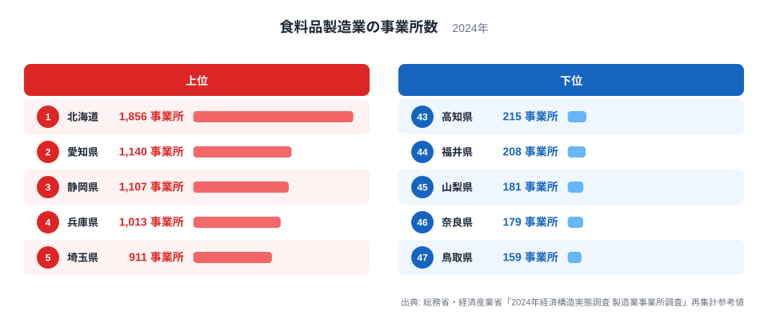
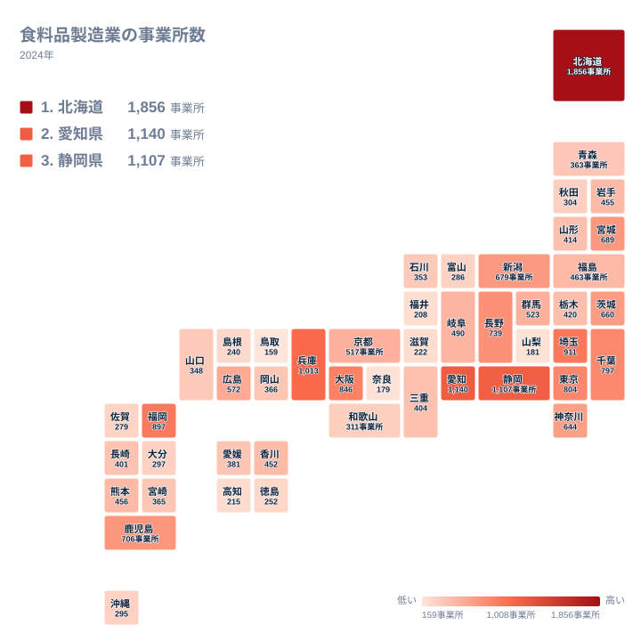

食卓に並ぶパン、乳製品、水産加工品、漬物、菓子など、私たちが口にする加工食品は、全国各地の工場でつくられています。ところが、その工場がどの県にどれだけあるかを見ると、地域によって大きな差があります。

この記事では、2024年の食料品製造業の事業所数を都道府県別に見て、上位と下位がなぜその順になるのかを、地理・産業構造・歴史の面から考えます。実データで確かめられるのは事業所数と順位だけですので、理由の部分は仮説として読んでください。

## 食料品製造業の事業所数は北海道が1位

まず、上位5県と下位5県を図で確認します。

<source-link href="/ranking/food-manufacturing-establishments">食料品製造業の事業所数ランキングをもっと見る</source-link>

注目したいのは、1位の北海道と2位の愛知県の差です。北海道は1,856事業所、愛知県は1,140事業所で、2位以下の県と比べても頭ひとつ抜けています。2位から5位までは愛知県の1,140事業所、静岡県の1,107事業所、兵庫県の1,013事業所、埼玉県の911事業所と、約100事業所刻みで緩やかに続いており、北海道だけが別の水準にあることが図から読み取れます。

下位側は、47位の鳥取県が159事業所、46位の奈良県が179事業所、45位の山梨県が181事業所、44位の福井県が208事業所、43位の高知県が215事業所です。最多の北海道1,856事業所と最少の鳥取県159事業所を比べると、その開きは約11.7倍にもなります。下位5県は159事業所から215事業所の間に収まっており、上位5県の911事業所から1,856事業所という幅と比べると、下位は互いに近い水準にかたまっています。

上位5県の顔ぶれを地方でまとめると、北海道が1県、中部が2県(愛知県と静岡県)、近畿が1県(兵庫県)、関東が1県(埼玉県)です。大都市圏の県だけが並ぶわけではなく、農水産物の産地として知られる北海道が最上位に来ている点が、この指標の特徴です。

> [!NOTE]
> ここでいう食料品製造業の事業所数は、食料品をつくる工場や作業場の数を数えたものです。企業の数ではありません。1つの企業が複数の工場を持てば、その分だけ事業所として数えられます。また、事業所の大小は区別されないため、数が多いことは生産額が大きいことと同じ意味ではありません。

## 北海道が突出する背景に考えられること

北海道が1位になる理由として、まず考えられるのは、食品の原料が道内で広くそろうことです。酪農による生乳、畑でつくられる野菜や豆類、麦、周辺の海でとれる水産物など、原料の種類が多い地域です。食品加工は傷みやすい原料を産地の近くで処理するほど効率が良いとされるため、産地のそばに加工場が散らばる形になっているのではないか、という仮説が立てられます。

北海道は面積が広く、原料の産地が各地に分かれています。港の近くには水産加工、内陸の酪農地帯には乳製品工場というように、地域ごとに小さな加工拠点ができやすい条件があるのかもしれません。事業所が一か所に集中せず道内に広がっていれば、全体では1,856事業所という大きな数字になっても不思議ではありません。ただし、道内の市町村別の分布はこの記事のデータにはなく、確かめることはできません。

また、北海道は開拓の時代から農業と漁業が産業の柱であり、それを加工して本州へ送る流れがあったと考えられます。北海道の他の統計は[北海道のデータ](/areas/01000)で確認できます。

> [!TIP]
> 事業所数は、小さな加工場が各地に点在する県でも、大きな工場に生産が集まる県でも、数え方の上では同じ一事業所です。順位を読むときは、県全体の規模だけでなく、事業所が一か所に集まっているのか、広く散らばっているのかも想像してみてください。順位の理由を考える手がかりになります。

## 愛知県・静岡県・兵庫県が続く産業構造の背景

2位の愛知県は1,140事業所、3位の静岡県は1,107事業所で、その差はわずか33事業所です。どちらも中部に属しますが、上位に入る理由が同じとは限りません。

愛知県については、名古屋を中心とする大きな消費地を抱え、製造業全体の集積が厚いことが背景にあるのではないか、と考えられます。消費地の近くで食品をつくる立地の強みが、事業所数に表れている可能性があります。愛知県の他の統計は[愛知県のデータ](/areas/23000)から見られます。

静岡県は、茶の産地であり、港を持つ水産加工の拠点でもあります。地域の農水産物と結びついた食品づくりが根づいていることが、3位という順位に関わっている可能性があります。東京と大阪という二つの大消費地の間に位置することも、立地の面で有利に働いたかもしれません。

4位の兵庫県は1,013事業所で、近畿の中で最も多い県です。酒づくりで知られる地域を含み、古くから醸造や食品加工が発達してきたことや、大阪に近い立地が影響していると考えられます。いずれも実データから証明できるものではなく、あくまで有力な見方のひとつです。

> [!WARNING]
> この数字は2024年の経済構造実態調査をもとにした再集計の参考値です。調査の対象や集計の方法によって、他の統計の事業所数と一致しない場合があります。また、本記事は事業所の数だけを扱っており、従業者数や出荷額は含みません。事業所数の順位だけで、その県の食品産業の規模を判断することはできません。

## 地理分布で見る食品づくりの地域差

次に、47都道府県全体の分布を地図で確認します。

地図で見ると、上位5県には北海道、中部、近畿、関東が含まれ、中国と四国の県は下位寄りに多く見られます。上位の県が特定の一地方に偏っているわけではなく、複数の地方にまたがっていることがわかります。

関東では、埼玉県が5位で911事業所、東京都が8位で804事業所、千葉県が9位で797事業所です。この三つはいずれも首都圏に位置し、消費地のそばで食品をつくる立地が関わっている可能性があります。一方で、関東の中でも神奈川県は15位で644事業所、茨城県は14位で660事業所と、順位には幅があります。

九州・沖縄では、福岡県が6位で897事業所、鹿児島県が11位で706事業所です。福岡県は大きな消費地を抱え、鹿児島県は農産物や畜産、水産物の産地として知られます。同じ地方でも、上位に入る背景は異なるのかもしれません。

東北では、宮城県が12位で689事業所と、東北の中で最も上位にあります。中部では、長野県が10位で739事業所、新潟県が13位で679事業所です。このように、上位から中位にかけては、大消費地を抱える県と、原料の産地を抱える県の両方が混ざっています。

## 下位の県に見られる傾向と、数字の読み方

下位に目を向けると、鳥取県の159事業所、奈良県の179事業所、山梨県の181事業所が並びます。この三県は、地方で見ると中国、近畿、中部とばらばらです。地方という切り口では共通点を見つけにくい顔ぶれです。

仮説として、山梨県と奈良県は海に面していないため、水産物を使う加工が成り立ちにくいことが考えられます。鳥取県は海に面していますが、国内の大消費地から離れていることが影響しているかもしれません。ただし、これらは傾向の見立てであり、実データで裏付けられるものではありません。

福井県は208事業所で44位、高知県は215事業所で43位です。高知県は水産物や農産物に恵まれた県として知られますが、事業所の数としては下位に入っています。原料の産地であることが、そのまま事業所数の多さにつながるとは限らないことを示しています。産地で一次加工だけを行って出荷する場合や、少数の大きな工場に生産が集まっている場合は、事業所の数は少なく見えるでしょう。

読み方のまとめとして、次の点を押さえておくと、数字を読み違えにくくなります。

- 事業所数は工場の数であり、生産の大きさそのものではありません。
- 上位の県には、消費地に近い県と産地を抱える県が混ざっていると考えられます。
- 下位の県の理由は一つに決まらず、海の有無や消費地との距離などが関わる可能性はあるものの、例外もあります。

製造業や鉱工業の他の指標は、[同じカテゴリの統計一覧](/category/miningindustry)からたどれます。食料品以外の産業と並べて見ると、各県の産業の特色がさらにはっきりします。

## データについて

この記事で使ったのは、総務省・経済産業省が実施した「2024年経済構造実態調査 製造業事業所調査」の再集計参考値です。正式な統計名は「食料品製造業の事業所数」で、単位は事業所、対象年は2024年です。

都道府県の順位は、事業所数の多い順に並べたものです。記事中の数値は、すべてこの統計に載っている値をそのまま使っています。人口や面積で調整した数値ではないため、県の大きさの違いを考慮した比較にはなっていない点に注意してください。

食料品製造業は、地域の農業や漁業、そして人々の暮らしと深く結びついた産業です。事業所数の差は、その県が何を原料とし、どこへ食品を届けているのかという、地域の成り立ちを映している可能性があります。ランキングを入り口にして、気になる県の産業や歴史を調べてみてください。
