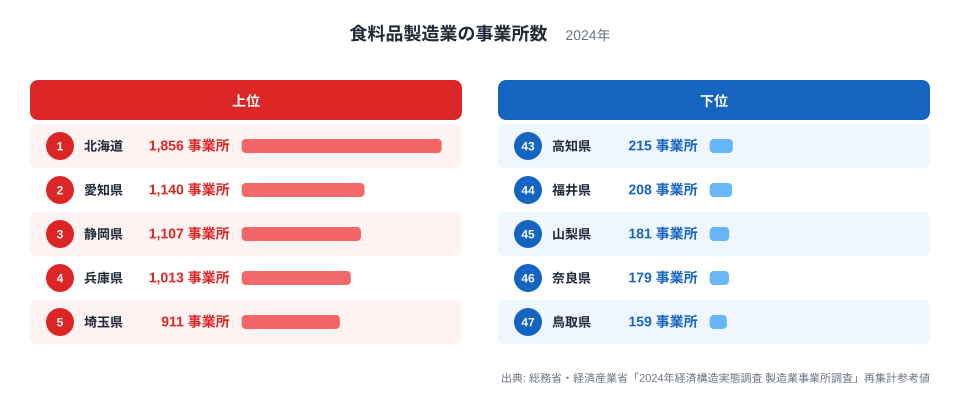
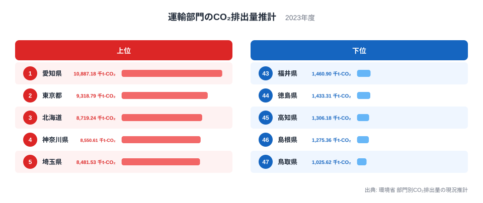
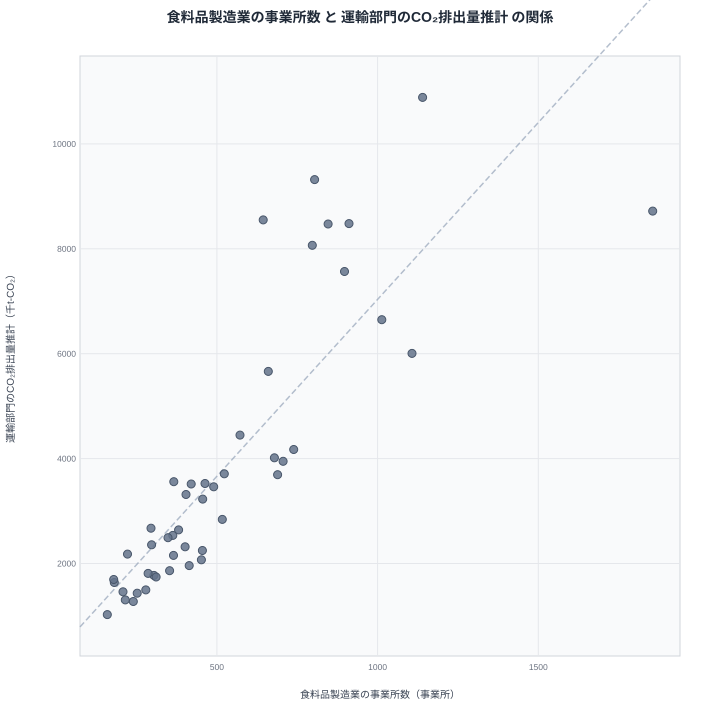

食料品の工場が多い県では、道路を走るトラックや自動車も多く、運輸部門のCO₂排出量も多くなる。そう考えたくなるほど、2つの指標は都道府県ごとに同じ向きに並びます。ただ、この並びをそのまま「工場が排出を生んでいる」と読んでよいのでしょうか。この記事では、食料品製造業の事業所数と運輸部門のCO₂排出量推計を並べ、見かけの相関の可能性と、読み解くときの注意点を考えます。

## まず食料品製造業の事業所数を見る

2024年の食料品製造業の事業所数で最も多いのは、北海道の1,856事業所です。2位は愛知県の1,140事業所、3位は静岡県の1,107事業所、4位は兵庫県の1,013事業所、5位は埼玉県の911事業所と続きます。

<source-link href="/ranking/food-manufacturing-establishments">食料品製造業の事業所数ランキングをもっと見る</source-link>

上位5県の顔ぶれを見ると、北海道のように農業や水産業の盛んな産地型の県と、愛知県・兵庫県・埼玉県のように大きな消費地や工業地帯を抱える県が混ざっていると考えられます。ただし、これは一般的な見方であり、本記事のデータで確かめたものではありません。同じ「食料品製造業が多い」でも、背景はひとつではない可能性があります。

下位は鳥取県が159事業所で47位です。最多の北海道と比べると1,856事業所と159事業所で、大きな開きがあります。後で見るとおり、鳥取県は運輸部門のCO₂排出量推計でも47位です。

東京都は8位で804事業所、大阪府は7位で846事業所です。人口が多いと思われる都府でも、1位の北海道には大きく及びません。事業所数の多さは、都市の大きさだけでは決まらないことがうかがえます。

> [!NOTE]
> ここでの事業所数は、「2024年経済構造実態調査 製造業事業所調査」をもとにした再集計参考値です。大きな工場も小さな製造所も、1事業所として同じ1つに数えます。したがって事業所数が多いことは、生産額や従業者数が大きいことを意味するとは限りません。

## 運輸部門のCO₂排出量推計を見る

次に、環境省が推計した2023年の運輸部門のCO₂排出量を見ます。1位は愛知県で10,887.175千t-CO₂です。2位は東京都の9,318.792千t-CO₂、3位は北海道の8,719.235千t-CO₂、4位は神奈川県の8,550.611千t-CO₂、5位は埼玉県の8,481.533千t-CO₂となっています。

事業所数の上位5県と見比べると、愛知県、北海道、埼玉県は両方の上位5県に入っています。一方、静岡県と兵庫県は事業所数では3位と4位ですが、排出量では静岡県が10位で6,006.797千t-CO₂、兵庫県が9位で6,649.396千t-CO₂です。東京都は排出量で2位ですが事業所数では8位、神奈川県は排出量で4位ですが事業所数では15位です。

下位では、鳥取県が1,025.617千t-CO₂で47位です。事業所数でも47位なので、鳥取県は両方の最下位に並びます。最大の愛知県と最小の鳥取県を比べると、10,887.175千t-CO₂と1,025.617千t-CO₂という差があります。

[運輸部門のCO₂排出量推計ランキング](/ranking/regional-transport-co2-emissions-estimate)では、47都道府県すべての順位を確認できます。

> [!WARNING]
> 運輸部門のCO₂排出量は、自動車や鉄道、船舶、航空など、あらゆる運輸活動に由来する量の推計値です。食料品を運ぶトラックだけの排出ではありません。また推計の年は2023年で、事業所数の2024年とは1年ずれています。

## 散布図で見る相関

2つの指標を1つの図に重ねると、次のようになります。横軸が食料品製造業の事業所数、縦軸が運輸部門のCO₂排出量推計です。

47都道府県で計算したピアソンの相関係数は0.84でした。点は右上がりに並んでおり、事業所数が多い県ほど排出量も多い傾向が、かなりはっきり出ています。

ただし、この0.84という値は「2つが同じ方向に動く傾向の強さ」を示すだけです。食料品製造業が排出量の何割を説明するのか、あるいは工場を1つ増やすと排出量がどれだけ増えるのか、といった因果の大きさを教えてくれる数字ではありません。

傾向からのずれは、順位の差で読むと具体的になります。

- 北海道は事業所数が1位、排出量が3位で、排出量のほうが2つ低い順位です
- 東京都は事業所数が8位、排出量が2位で、排出量のほうが6つ高い順位です
- 神奈川県は事業所数が15位、排出量が4位で、排出量のほうが11高い順位です
- 静岡県は事業所数が3位、排出量が10位で、排出量のほうが7つ低い順位です

食料品の事業所数だけでは説明しにくい県が、どちらの向きにもあることがわかります。

> [!TIP]
> 散布図は、傾向線の近くにある県よりも、離れた県から読むのがコツです。事業所数の順位より排出量の順位が大きく高い東京都や神奈川県では、食料品以外の要因が関わっている可能性があります。人口や都市の規模などが候補ですが、本記事のデータでは検証できません。

## 見かけの相関をどう考えるか

では、なぜ2つは一緒に動くのでしょうか。食料品の工場が排出を生む、という直接の因果も、まったくないとは言い切れません。原料や製品を運ぶ車両が増えることは考えられます。しかし、それだけで説明できるかは、このデータからは判断できません。

もう一つの見方は、第三の要因が両方を押し上げているというものです。たとえば人口や経済の規模といった共通要因が働いている可能性があります。その場合、食料品製造業と運輸の排出量は互いに原因ではなく、共通の背景によって同じ方向に動いているだけになります。これが「見かけの相関」です。

ただし、人口や面積は本記事の実データに含まれていません。そのため、この仮説が当たっているかどうか、どの要因がどの程度効いているかは、本記事のデータでは検証できません。確かなのは、相関係数が0.84で同方向の関係が見られることと、その理由には複数の可能性が残ることです。

県をいくつか取り上げて、地方ごとの位置も確かめます。関東では埼玉県が事業所数5位・排出量5位と順位がそろい、東京都は事業所数8位・排出量2位、神奈川県は事業所数15位・排出量4位です。中部では愛知県が事業所数2位・排出量1位、静岡県が事業所数3位・排出量10位です。近畿では兵庫県が事業所数4位・排出量9位、大阪府が事業所数7位・排出量6位です。同じ地方でも、2つの順位の関係は県ごとに異なります。

## 数字を読むときの注意

この結果から言えるのは、「食料品製造業の事業所が多い県は、運輸部門のCO₂排出量も多い傾向がある」ところまでです。「食料品工場を増やせば排出量が増える」「排出量を減らすには工場を減らせばよい」とまでは言えません。相関は因果ではないからです。

また、47都道府県という単位は大きな括りです。同じ県の中にも、工場が集まる地域と、そうでない地域があるかもしれません。県の合計値は、その内側のちがいを平らにならしてしまいます。

人口あたりや面積あたりの値と比べれば、別の姿が見えてくる可能性もありますが、それは今回のデータの範囲外です。事業所数が1位の北海道と、排出量が1位の愛知県の特徴は、[北海道のデータ](/areas/01000)と[愛知県のデータ](/areas/23000)で確かめられます。

他の産業の統計も合わせて見たい場合は、[同じカテゴリの統計一覧](/category/miningindustry)が役に立ちます。複数の指標を重ねて見ることで、今回のような見かけの相関を疑う目が養われます。

## データについて

食料品製造業の事業所数は、総務省・経済産業省「2024年経済構造実態調査 製造業事業所調査」の再集計参考値で、単位は事業所、年は2024年です。運輸部門のCO₂排出量推計は、環境省の部門別CO₂排出量の現況推計で、単位は千t-CO₂、年は2023年です。

相関係数はピアソンの値で、47都道府県を対象に計算した結果が0.84です。この値は2つの指標の同方向への動きの強さを示すもので、因果の大きさや説明できる割合を示すものではありません。

## まとめ

食料品製造業の事業所数と運輸部門のCO₂排出量推計は、相関係数0.84と同じ向きに動いています。愛知県、北海道、埼玉県のように両方の上位に入る県があり、鳥取県のように両方の最下位に並ぶ県もあります。

しかし、これは「工場が排出を生む」という証拠ではありません。人口や規模といった共通要因が働いている可能性はありますが、本記事のデータでは検証できません。東京都や神奈川県のように、事業所数の順位より排出量の順位が高い県が示すとおり、2つの指標のずれにこそ、地域の個性が表れていると考えられます。
