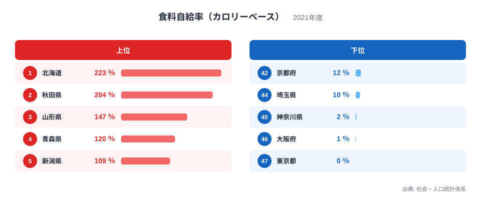
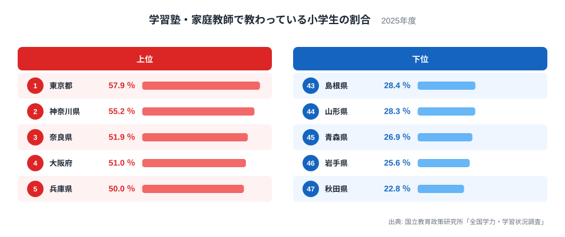
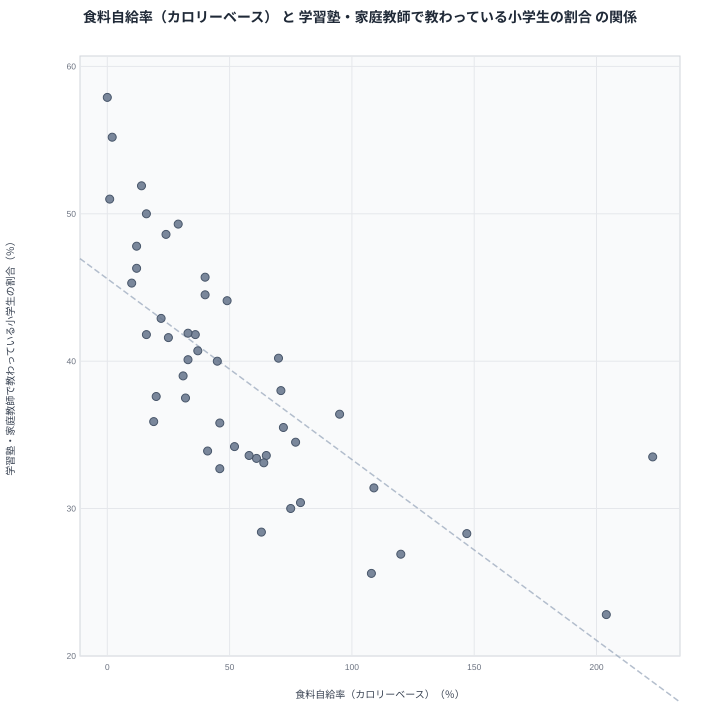

食料自給率が高い県では、学習塾に通う小学生が少ない傾向があります。一見すると奇妙な組み合わせです。田畑の広さと放課後の教室に、直接のつながりがあるとは考えにくいからです。

この記事では、2021年の食料自給率（カロリーベース）と、2025年の学習塾・家庭教師で教わっている小学生の割合を並べます。目的は、数字の上で見える関係を確認したうえで、その背景に何があり得るかを仮説として考えることです。先に述べておくと、この記事で確かめられるのは「2つの数字が一緒に動く傾向」までです。なぜそうなるのかは、今回のデータだけでは断定できません。

## 自給率の分布は、上位が急に細くなる形

まず食料自給率の分布を確認します。

<source-link href="/ranking/food-self-sufficiency-rate-calorie">食料自給率（カロリーベース）ランキングをもっと見る</source-link>

この分布で目を引くのは、上位の細さと下位の厚さです。100％を超えるのは北海道の223％、秋田県の204％、山形県の147％、青森県の120％、新潟県の109％の5道県だけです。6位の岩手県は108％で、7位の佐賀県は95％まで下がります。さらに10位の福島県は75％、20位の滋賀県は49％と、順位が進むにつれて値は急に小さくなります。

下位には大都市圏が集まります。東京都は0％、大阪府は1％、神奈川県は2％で、埼玉県は10％です。1桁にとどまる都府県が3つあります。上位は寒冷地の穀倉地帯、下位は人口の多い都市圏という二極の構図です。

この指標は農業の優劣を示すものではありません。自給率は県内の生産熱量を県内の消費熱量で割るため、農業の強さに加えて、分母にあたる消費量、つまり人口規模の影響を受けます。この点が、あとで相関を読むときに効いてきます。

> [!NOTE]
> 100％を超える値は、県外へ出荷している量をそのまま示すものではありません。あくまで県内の生産熱量と県内の消費熱量の比です。また、カロリーベースのため、熱量の小さい野菜や果物の生産が多い県は低めに出ます。

## 学習塾の利用は、東京と東北で2倍以上の開き

次に、学習塾・家庭教師で教わっている小学生の割合を見ます。

こちらは自給率と違い、上位の突出が小さく、値がなだらかに並ぶ分布です。1位の東京都は57.9％、47位の秋田県は22.8％で、2倍を超える開きがあります。

中位の詰まり方には注意が必要です。25位の福岡県は37.6％、26位の沖縄県は37.5％、27位の佐賀県は36.4％で、20位の茨城県は40.2％、36位の北海道は33.5％で、この間の17道県が約7ポイントの幅に収まっています。この帯の中では、1ポイント足らずの差で順位が大きく入れ替わります。中位の県どうしを順位だけで比べても、意味のある差とは言いにくいということです。

差がはっきり出るのは両端です。上位は東京都、神奈川県、奈良県、大阪府、兵庫県と、首都圏と近畿圏が中心です。下位は秋田県、岩手県、青森県、山形県と、東北勢が並びます。この下位の4県は、食料自給率の上位でもあります。この重なりが、2つの指標の間に負の関係があるように見える出発点です。

詳しい順位は[学習塾・家庭教師で教わっている小学生の割合ランキング](/ranking/national-assessment-elementary-tutoring-rate)でも確認できます。

> [!WARNING]
> この割合は、全国学力・学習状況調査の質問紙への回答から集計されたもので、児童の自己申告にもとづきます。通塾の頻度や費用、通信教育などの学び方の違いは読み取れません。

## 2つの指標を重ねると右下がりの傾向が見える

2つの指標を1枚の図に重ねます。

全体の傾向は右下がりです。自給率が低い側には、塾の利用割合が高い県が集まります。東京都は自給率0％で塾の利用が57.9％、神奈川県は自給率2％で55.2％、大阪府は自給率1％で51％です。反対側には、秋田県の204％と22.8％、山形県の147％と28.3％、青森県の120％と26.9％、岩手県の108％と25.6％が並びます。

ただし、きれいな直線ではありません。自給率が低い側の散らばりが大きいのです。山梨県は自給率19％で塾の利用は35.9％、福岡県は自給率20％で37.6％、沖縄県は自給率32％で37.5％と、自給率が低くても塾の利用が中位にとどまる県が複数あります。自給率が低い側では、塾の利用割合が30％台後半から50％台後半まで広く散らばっています。

自給率が高い側にも例外があります。北海道は自給率が全国最高の223％ですが、塾の利用は33.5％で36位です。佐賀県は自給率95％で、塾の利用は36.4％の27位です。

傾向の強さを言葉にすると、両端の県でははっきり分かれるものの、中間では自給率から塾の利用を言い当てられない、という程度です。自給率が高いことは塾の利用が少ないことの目安にはなりますが、それだけで塾の利用が決まるわけではありません。

## 見かけの相関と、背景の仮説を分ける

ここで確認したいのは、相関は因果ではないということです。食料自給率が高いから塾が少なくなる、あるいは塾が少ないから自給率が高くなる、と読むことはできません。

では、なぜ2つの数字が一緒に動くのでしょうか。1つの仮説は、都市化の度合いが共通の背景にあるというものです。人口が集中した地域では、農地が限られ、消費量が大きいので、自給率は低くなりやすいと推測されます。同じ地域には塾や家庭教師の選択肢が多く、中学受験をめざす家庭も多いかもしれません。そうであれば、自給率と塾の利用が逆向きに動くことは説明できます。

ただし、これはあくまで仮説です。今回のデータには、人口密度や都市化を直接示す指標が含まれていません。そのため、都市化がどの程度効いているのか、他の要因が絡んでいないのかは、この記事では確かめられません。家庭の所得、学校の教育方針、通学の距離、私立中学の数といった要因も、塾の利用に関わるかもしれません。

北海道と秋田県の比較も、この慎重さを支える材料の1つです。どちらも自給率が200％を超える道県ですが、塾の利用は北海道が33.5％、秋田県が22.8％で、10.7ポイントの差があります。自給率の高い道県の間でも、塾の利用には差があるということです。これは全体の傾向を否定するものではありませんが、自給率以外の要因も効いている可能性を示しています。差が出る理由は、今回のデータからは特定できません。

同じカテゴリの[統計一覧](/category/agriculture)には、農業に関連する他の指標があります。[北海道のデータ](/areas/01000)や[秋田県のデータ](/areas/05000)とあわせて見ると、農業県の中の違いを別の角度から確かめられます。

## この関係の読み方

自給率が低い都市圏で塾の利用が高く、自給率が高い東北で塾の利用が低い、という傾向は数字に表れています。ただし、塾の利用割合が低い県を、学びの機会が乏しい県と決めつけることはできません。この指標は塾と家庭教師に限った割合で、学校での指導や家庭での学びは含まれません。東京都と秋田県の35.1ポイントの差も、教育環境の良し悪しを直接示すものではありません。

## データについて

食料自給率（カロリーベース）は、社会・人口統計体系にもとづく2021年の値で、単位は％です。学習塾・家庭教師で教わっている小学生の割合は、国立教育政策研究所「全国学力・学習状況調査」にもとづく2025年の値で、単位は％です。

2つの指標は年が4年異なります。同じ年の比較ではない点には注意が必要です。また、ここで扱った関係は47都道府県を単位とした集計上の傾向で、個々の家庭や市町村の状況を示すものではありません。
