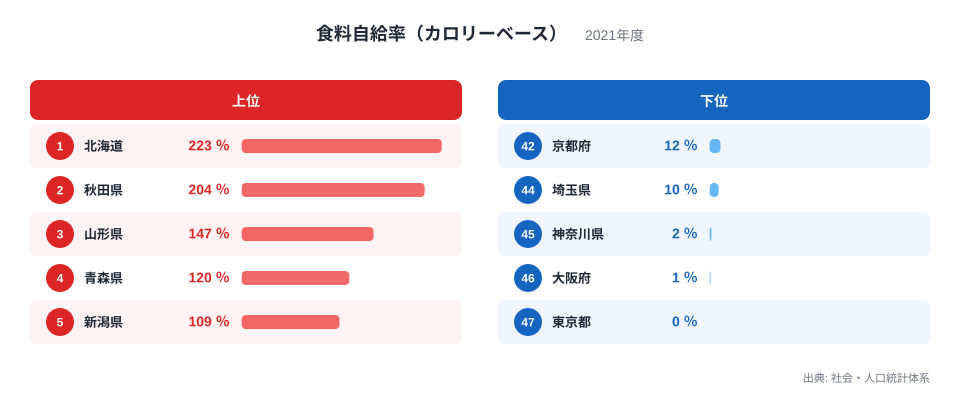
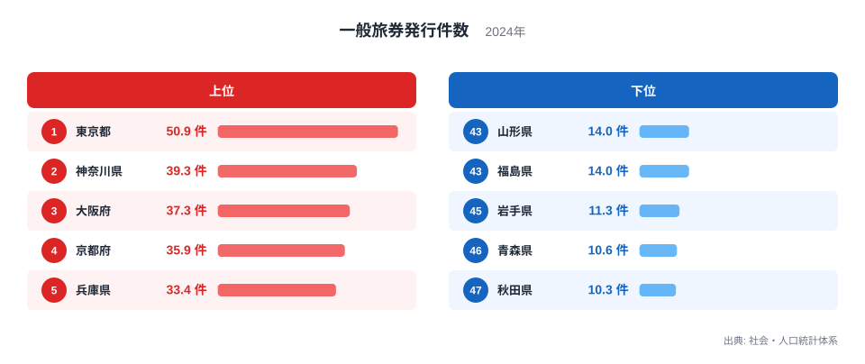
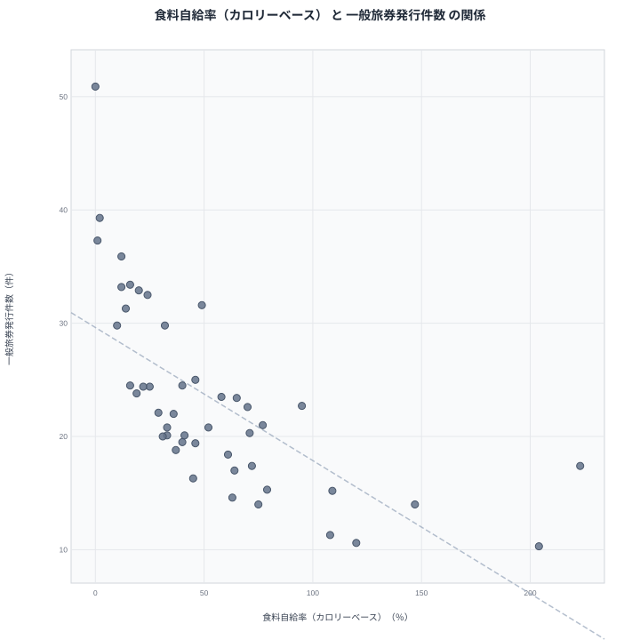

## 食料の自給と海外渡航は結びつくのか

農業が盛んで食料を余るほど生産する県では、海外へ出る人も少ない。そんな印象を持つ方は少なくないかもしれません。逆に、食料のほとんどを他の地域に頼る大都市の住民は、海外旅行や出張に出かける機会が多そうです。

この印象が数字に表れているかを確かめるため、2021年の食料自給率（カロリーベース）と、2024年の一般旅券発行件数を47都道府県で並べてみました。ピアソンの相関係数は-0.67で、自給率が高い県ほど旅券の発行件数が少ない傾向がはっきり出ています。

ただし、相関があることと、一方が他方の原因であることは別の話です。食料の自給が人の海外渡航を減らしているとは考えにくく、背後に別の要因があるはずです。この記事では、見かけの相関と真因を切り分けながら読み進めます。

## 食料自給率の上位と下位

まず食料自給率（カロリーベース）から見ていきます。

<source-link href="/ranking/food-self-sufficiency-rate-calorie">食料自給率（カロリーベース）ランキングをもっと見る</source-link>

1位は北海道の223％、2位は秋田県の204％です。続いて山形県が147％で3位、青森県が120％で4位、新潟県が109％で5位となっています。上位は北海道と東北、北陸の米どころや大規模農業地帯で占められており、県内で消費する量をはるかに上回る食料を生産している県が並びます。詳しくは[北海道のデータ](/areas/01000)もあわせてご覧ください。

一方の下位は、東京都が0％で47位、大阪府が1％で46位、神奈川県が2％で45位です。さらに埼玉県が10％で44位、京都府が12％で43位と続きます。人口が多く農地が限られる大都市圏がそろって下位に並んでいます。

この指標は、県内の食料生産量を県民の消費量で割る形で成り立っています。そのため農業の強さだけでなく、人口の多さにも左右されます。自給率の低さは必ずしも農業が弱いことを意味せず、人口が集中していることの裏返しでもあります。

> [!NOTE]
> 食料自給率（カロリーベース）は、県民が消費する食料のカロリーのうち、県内の生産でどれだけまかなえるかを示す指標です。単位は％で、2021年の値を使っています。県内で消費する以上に生産していれば、値は大きくなります。同じカテゴリの指標は[同じカテゴリの統計一覧](/category/agriculture)から確認できます。

## 旅券発行件数の上位と下位

次に、一般旅券発行件数を見ます。

1位は東京都の50.9件、2位は神奈川県の39.3件、3位は大阪府の37.3件です。続いて京都府が35.9件で4位、兵庫県が33.4件で5位となっています。上位には大都市圏と、その周辺の府県が集まっています。

下位を見ると、47位は秋田県の10.3件、46位は青森県の10.6件、45位は岩手県の11.3件です。44位の福島県と43位の山形県は、ともに14件でした。上位は都市部、下位は東北に偏っており、地域の構図は自給率のランキングとほぼ裏返しです。[秋田県のデータ](/areas/05000)を見ると、自給率で2位、旅券で最下位という対照的な位置にあることがわかります。

全体の並びは[一般旅券発行件数ランキング](/ranking/passport-issuance-count-per-thousand)で確認できます。

> [!WARNING]
> 旅券発行件数は、パスポートを取得した人の数であり、実際に海外へ出かけた人の数ではありません。有効期間中は繰り返し使えるため、ある年の発行件数が少なくても、保有者が多い県はありえます。また、自給率は2021年、旅券は2024年と年が異なります。人口規模をそろえた値とみられますが、集計の単位は元の統計表で確かめてください。

## 散布図で見る二つの関係

二つの指標を一枚にまとめたのが次の散布図です。

相関係数は-0.67、計算に使った都道府県は47です。点の並びは、自給率が高い県では旅券が少ない側に、低い県では多い側に寄っています。負の相関がはっきり見える一方で、点はきれいな直線上には並びません。

この数字は、傾向があることを示すだけです。相関係数は、因果の大きさや、一方で他方をどれだけ説明できるかを表す値ではありません。-0.67という値から、自給率を上げれば旅券が減るとも、旅券を増やせば自給率が下がるとも言えません。

傾向から外れる県を見ると、関係の限界がよくわかります。沖縄県は自給率が32％で31位と低い側ですが、旅券は29.8件で12位と多い側です。滋賀県も自給率は49％で20位と中位ですが、旅券は31.6件で9位に入っています。逆に北海道は自給率が1位なのに、旅券は17.4件で36位と中位より下です。

## 見かけの相関と真因を分ける

では、なぜこの負の相関が生まれるのでしょうか。自給率と旅券のあいだに直接の関係を想定するより、背後で両方に効く共通の要因を考えるほうが自然です。たとえば次のような候補が挙げられます。

- 人口の集中度: 人口が集まる県は消費量が大きいので自給率が低く出ます。一方で、企業や空港、国際交流の機会も集中し、旅券の需要が高まります。
- 産業構造と暮らし方: 農業や一次産業の比重が高い地域では、長期の海外渡航につながる仕事や旅行の機会が相対的に少ないと考えられます。
- 空港や交通の利便性: 国際線が発着する空港に近い地域ほど、海外へ出やすくなります。これは農業の強さとは無関係に、旅券の取りやすさに関わります。

この見方を支えるのが、傾向から外れる県の存在です。沖縄県は農業地帯ではないものの、自給率が低くても旅券は多い側に入ります。観光や空路の便など、別の事情が働いているのでしょう。反対に、佐賀県は自給率が95％で7位と高い側ですが、旅券は22.7件で21位と中位です。自給率が高いからといって旅券が少なくなるとは限りません。

つまり、この相関の大部分は、都市と農村という地域構造の違いが二つの指標に同時に映り込んだ結果だと考えるのが妥当です。ただし、これも仮説であり、統計だけで因果を確定することはできません。

> [!TIP]
> 相関を読むときは、全体の傾向だけでなく、傾向から外れた県を探すのがコツです。沖縄県や北海道のように、予想と違う位置にある県は、背後の要因を考えるヒントになります。順位と値の両方を見て、差が大きいのか小さいのかも確かめてください。

## データについて

食料自給率（カロリーベース）は2021年、一般旅券発行件数は2024年の値で、どちらも社会・人口統計体系を出典としています。相関係数は、47都道府県の値を使って計算したピアソンの相関係数で、散布図と同じデータに基づきます。

## まとめ

食料自給率が高い県ほど旅券の発行件数が少ない傾向は、相関係数-0.67という形で確かに現れています。ただし、これは食料の自給と海外渡航が直接結びついている証拠ではなく、人口の集中や産業構造、交通の便といった地域の違いが背後にあるためと考えられます。数字の関係を見つけたときほど、その裏にある別の要因を疑う姿勢が大切です。
