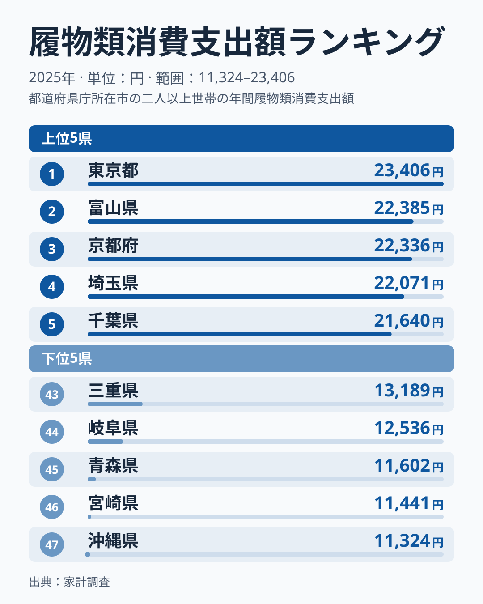
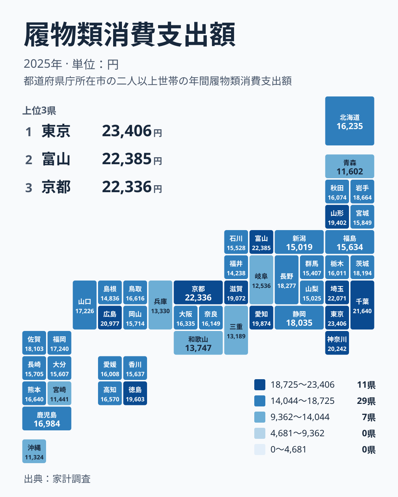

毎日の外出に欠かせない靴やサンダルに、年間でいくら使っているでしょうか。2025年の家計調査では、履物への支出が最も多いのは東京都で23,406円でした。最も少ないのは沖縄県で11,324円です。実データにある最大と最小を比べると、東京都は沖縄県の2倍を超えています。

この記事では、都道府県ごとの履物への支出を順位と分布から整理します。使えるのは履物の都道府県別の金額だけなので、原因を言い切ることはしません。データから読み取れること、そこから浮かぶ仮説、家計の目安としての使い方に分けて考えます。

> [!NOTE]
> 家計調査の「履物類」は、靴やサンダルなどの購入に支払った金額です。数字は世帯あたりの年間支出で、1人あたりではありません。世帯の人数が多い地域では、それだけで金額が大きくなる点に注意してください。

## 上位は東京都から千葉県まで、約1,800円の範囲に集中

1位は東京都で23,406円です。2位は富山県で22,385円、3位は京都府で22,336円、4位は埼玉県で22,071円、5位は千葉県で21,640円となりました。1位から5位までの差は約1,800円の範囲に収まっており、東京都はやや高いものの、突出しているとまでは言えません。

2位の富山県との差も約1,000円です。上位は東京都が独走する形ではなく、5県がほぼ横並びで競り合っています。

6位は広島県で20,977円、7位は神奈川県で20,242円、8位は愛知県で19,874円、9位は徳島県で19,603円、10位は山形県で19,402円です。上位10位の中に、中国の広島県、四国の徳島県、北海道・東北の山形県も入っています。首都圏の大きさだけでは説明しきれない顔ぶれです。

## 上位5と下位5を並べると見えること

<source-link href="/ranking/footwear-group-consumption-expenditure">履物類への支出ランキングをもっと見る</source-link>

図を見て気づくのは、両端がそれぞれ固まっていることです。上位5県は21,640円から23,406円まで、下位5県は11,324円から13,189円までに収まります。どちらも幅は2,000円足らずで、群の内側の差は小さく、群と群のあいだに大きな隔たりがあります。

下位は47位の沖縄県が11,324円、46位の宮崎県が11,441円、45位の青森県が11,602円です。この3県の差は300円に満たず、ほとんど並んでいます。次の44位は岐阜県で12,536円と、そこから1,000円近く上がります。43位は三重県で13,189円です。

下位5県の所属を見ると、九州・沖縄が沖縄県と宮崎県、北海道・東北が青森県、中部が岐阜県、近畿が三重県です。特定の地方にまとまっているわけではありません。気候や地域性のどれか一つで決まる指標ではない、というのが図から言える範囲です。

> [!TIP]
> 隣り合う順位の差は小さいことが多いので、順位よりも金額の水準で読むのがコツです。たとえば2位の富山県と3位の京都府は、22,385円と22,336円でほぼ同じです。上位群、中位群、下位群という塊で捉えると、傾向をつかみやすくなります。

## 地図で見ると関東は高いが、近畿は割れている

タイルマップで全体を眺めると、関東に金額の高い県が集まっています。東京都が1位、埼玉県が4位、千葉県が5位、神奈川県が7位で、四つとも上位8位以内に入っています。

ただし関東の中でも一様ではありません。茨城県は14位で18,194円、栃木県は27位で16,011円、群馬県は36位で15,407円です。東京都に近い県ほど高く、離れると下がるようにも見えますが、確かめられるのは3県の並びだけです。距離との関係は、この記事のデータでは示せません。あくまで「そう見える」という仮説にとどまります。

近畿はさらに割れています。京都府は3位で22,336円と高い一方、大阪府は23位で16,335円、和歌山県は41位で13,747円、兵庫県は42位で13,330円、三重県は43位で13,189円です。近畿の七つの府県のうち、上位に入るのは京都府だけです。大都市があるから多い、という単純な話ではないことがわかります。

中部では、富山県が2位で22,385円、愛知県が8位で19,874円と高い一方、岐阜県は44位です。同じ地方の中でも、順位が30以上離れる例があります。

## 地域差の背景を考える:言えること、言えないこと

履物の支出に地域差が出る背景として、いくつかの可能性が考えられます。ただし、この記事で使えるのは履物の都道府県別データだけです。気候、年齢構成、通勤の歩行量などの数字は持っていないため、どれが効いているかは検証できません。ここでは仮説として挙げます。

一つ目は都市規模です。商業施設が多く外出の機会が多い地域では、靴にかける金額が増える可能性があります。東京都、埼玉県、千葉県、神奈川県の高さは、この見方と矛盾しません。ただし大阪府が23位であることは、都市規模だけでは説明が足りないことを示しています。

二つ目は気候です。寒い地域では冬用の靴が必要になり、支出を押し上げる可能性があります。しかし北海道は24位で16,235円、青森県は45位で11,602円と、寒冷地でも順位が大きく分かれます。山形県は10位で19,402円、富山県は2位です。気候が影響しているとしても、それだけでは決まらないと考えるのが妥当です。

三つ目は買い物の習慣や世代ごとの好みです。靴を安く多く買うか、高いものを少数買うかで、同じ金額でも中身は変わります。富山県や京都府のように、最大の都市圏ではなくても高い県があることは、こうした要素が関わっている可能性を示唆しますが、データからは確認できません。

> [!WARNING]
> 履物類の金額だけでは、購入した足数が多いのか、1足あたりの単価が高いのかを判別できません。高い県が「よく買う」とは限らず、低い県が「買わない」とも限りません。また、家計調査は標本調査のため、順位が近い県どうしの差は、実態の差というより調査のぶれである可能性もあります。

## 暮らしへの含意:家計の目安としてどう使うか

この結果は、履物の支出が地域の暮らし方を映している可能性を示しています。ただし、支出が多い地域を無駄遣いと見る根拠も、少ない地域を節約上手と見る根拠もありません。同じ近畿でも、京都府は3位、兵庫県は42位と大きく離れており、地域という枠だけでは暮らしぶりを決めつけられないからです。

家計の見直しに使うなら、全国の順位よりも、自分の県の金額と近隣県との位置関係を見るのが現実的です。たとえば25位の奈良県は16,149円、26位の秋田県は16,074円で、全国のちょうど真ん中あたりの水準です。この金額を一つの目安にすれば、自分の世帯の靴代が多いのか少ないのかを、おおまかに把握できます。

他の支出項目との比較は、[同じカテゴリの統計一覧](/category/economy)から確認できます。県ごとの詳しいデータは、[東京都のデータ](/areas/13000)や[富山県のデータ](/areas/16000)のページで見られます。履物以外の項目と組み合わせることで、その地域の消費の特徴がより立体的に見えてきます。

## データについて

この記事で使った統計は、家計調査の履物類消費支出額です。2025年の数値で、単位は円、順位は47都道府県の金額の大きい順です。本文で触れた地方の区分は、北海道・東北、関東、中部、近畿、中国、四国、九州・沖縄の七つです。

この記事が答えられるのは、どの県がどの水準にあるかまでです。なぜその差が生まれるのかは、気候や年齢構成など別の統計と突き合わせないと確かめられません。本文の背景の話は、あくまで読み解きの手がかりとして受け取ってください。
