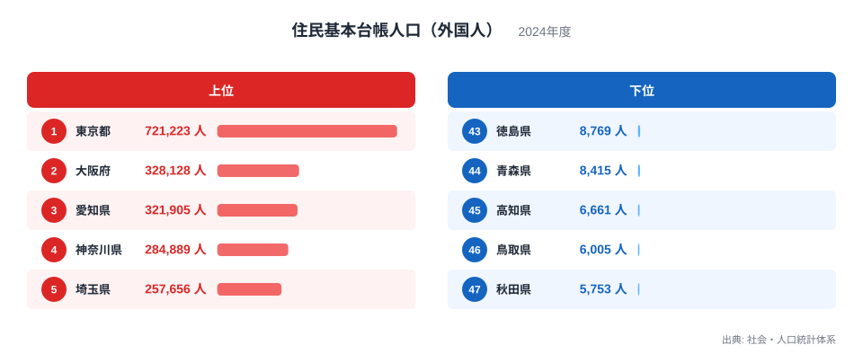
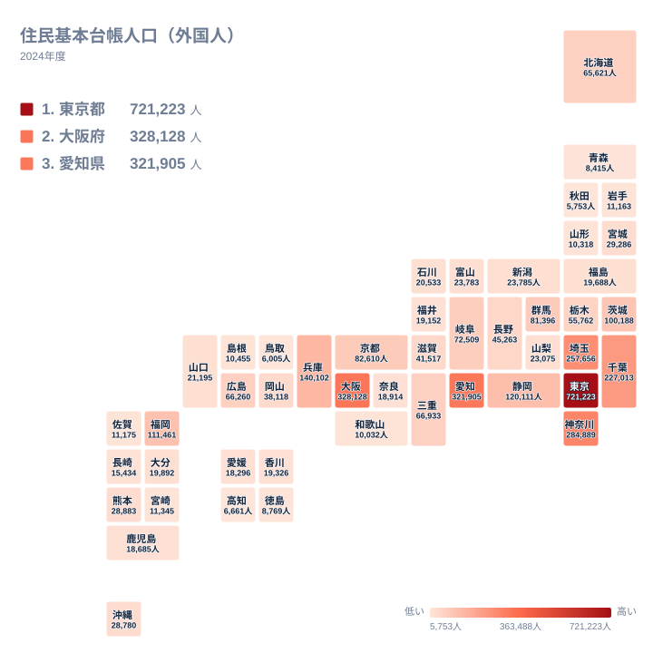

住んでいる外国人の数は、都道府県によって驚くほど違います。最も多い東京都は721,223人で、最も少ない秋田県は5,753人です。同じ日本の中で、これほど大きな開きが生まれるのはなぜでしょうか。

この記事では、2024年の住民基本台帳に載っている外国人住民の数を使います。上位と下位がその順になる背景を、地理、産業構造、歴史の三つの面から考えます。

## 上位と下位の顔ぶれ

まず、上位5県と下位5県を図で確認します。

<source-link href="/ranking/foreign-resident-population">住民基本台帳人口（外国人）ランキングをもっと見る</source-link>

1位は東京都の721,223人です。2位は大阪府で328,128人、3位は愛知県で321,905人と続きます。4位は神奈川県の284,889人、5位は埼玉県の257,656人です。東京都は2位の大阪府の2倍を超える水準にあり、突出していることが図から読み取れます。

下位に目を向けると、47位は秋田県の5,753人です。46位は鳥取県の6,005人、45位は高知県の6,661人、44位は青森県の8,415人、43位は徳島県の8,769人です。下位5県は、いずれも1万人に届いていません。

上位に並ぶのは、大都市圏と、その周辺の工業地帯を抱える県です。下位に並ぶのは、東北、中国、四国の人口規模が小さい県です。外国人住民の数は、その県の経済の厚みや人の流れを映していると考えられます。

> [!NOTE]
> この指標は住民基本台帳に記録された外国人住民の人数です。観光などの短期滞在者は含まれません。数えているのは、中長期にわたって住所を届け出ている人です。

## 東京都と首都圏に集まる理由

東京都が1位なのは、仕事、学校、企業の本社が集中しているためです。大学や日本語学校が多く、留学生が集まりやすい環境があります。外資系企業や専門職の働き口も多く、技術や知識を生かして働く人が暮らす街でもあります。

東京都の周りを見ると、神奈川県が4位、埼玉県が5位、千葉県が6位です。いずれも関東で、東京都へ通勤や通学がしやすい県です。家賃が東京都より抑えられるため、都心で働きながら周辺に住む人が多いと考えられます。関東では、茨城県が10位の100,188人、群馬県が12位の81,396人、栃木県が17位の55,762人です。首都圏の外側にも、工場や農業の働き口が外国人住民を引きつけています。

東京都の数字は、全国の中でも特別な位置にあります。一方で、東京都の統計だけを見ても、外国人住民の暮らしの全体像は見えません。詳しくは[東京都のデータ](/areas/13000)で、他の指標と並べて確認してみてください。

> [!WARNING]
> ここで示すのは人数であり、人口に占める割合ではありません。人口が多い県ほど、外国人住民の数も大きくなりやすい傾向があります。県の「外国人の多さ」を比べるときは、総人口との関係も合わせて見る必要があります。

## 大阪府と愛知県を支える歴史と産業

2位の大阪府は、関西の経済の中心です。商業や貿易の長い歴史があり、古くから多様な出身の人が暮らしてきた地域です。戦前からの歴史的な経緯を持つ在日の人々が多い地域でもあり、その蓄積が今の数字にも表れていると考えられます。近畿では、兵庫県が7位の140,102人、京都府が11位の82,610人、三重県が14位の66,933人、滋賀県が19位の41,517人です。大阪府の周辺に、広がりを持った分布が見えます。詳しくは[大阪府のデータ](/areas/27000)も参考になります。

3位の愛知県は、自動車を中心とする製造業の集積が背景にあります。工場で働く人の受け入れが進み、日系の人々を含む外国人住民が地域に根づいてきました。中部では、静岡県が8位の120,111人、岐阜県が13位の72,509人、長野県が18位の45,263人です。ものづくりの盛んな県が、順位の上のほうに並んでいます。

製造業の拠点は、ほかの地方にも見られます。群馬県は先ほど触れたとおり12位ですし、広島県は15位の66,260人です。福岡県は9位の111,461人で、九州の中では際立って多くなっています。大都市と工業地帯が、順位を押し上げる二つの柱になっているわけです。

> [!TIP]
> 順位表を読むときは、1位から順に見るだけでなく、県同士の差にも注目してください。6位の千葉県は227,013人で、7位の兵庫県は140,102人です。このあたりで大きな段差があり、首都圏とそれ以外の差が見えてきます。

## 地図で見る分布

次に、地理的な広がりをタイルマップで確かめます。

地図では、関東、中部、近畿の太平洋側に濃い色が連なります。東京都から愛知県、大阪府にかけての帯状の地域に、外国人住民が集まっている様子が分かります。これは日本の人口と産業が集中する地域とほぼ重なります。

一方で、東北や中国、四国は全体に淡い色です。北海道は16位の65,621人と、地方としては比較的多い位置にあります。広い面積を持ち、観光業や農業、水産加工などの働き口があることが、一因だと考えられます。九州・沖縄では、福岡県が9位、熊本県が22位の28,883人、沖縄県が23位の28,780人です。熊本県と沖縄県は、数字が近い位置に並んでいます。

東北では、宮城県が21位の29,286人で、地方の中心都市を持つ県として最も上に来ています。福島県は30位の19,688人、岩手県は39位の11,163人、山形県は41位の10,318人、青森県は44位、秋田県は47位です。宮城県と他の東北の県との間には、はっきりした差があります。仙台のような大きな都市が、外国人住民の受け皿になっていると考えられます。

## 下位の県に共通すること

下位に並ぶ県の特徴は、大都市圏から離れていることと、人口規模が小さいことです。秋田県、鳥取県、高知県、青森県、徳島県は、東北、中国、四国に位置します。いずれも大企業の工場や大学が集まる地域からは距離があり、外国人が就職や進学で集まる機会が限られがちです。

ただし、数が少ないことは、受け入れが進んでいないことを意味するわけではありません。人口の少ない県では、数百人の増減が地域の暮らしや働き手の確保に大きく響きます。農業や介護、水産加工などの現場で、外国人住民が欠かせない存在になっている地域もあると考えられます。

中位の県にも目を向けると、新潟県が24位の23,785人、富山県が25位の23,783人で、わずか2人の差です。山口県は27位の21,195人、石川県は28位の20,533人、福井県は32位の19,152人です。この辺りの県は、順位が一つ動いても人数の差は小さく、順位の印象ほど実態に差があるとは限りません。

> [!WARNING]
> 住民基本台帳は、住所を届け出た人の記録です。技能実習や留学などで短期間に入れ替わる人が多い県では、年の途中の増減が数字に反映されにくいことがあります。数字は、あくまである時点の姿を示すものです。

## 数字を読み解くヒント

最後に、この統計を読むときの視点を整理します。

- 大都市圏には、仕事、学校、生活の利便性が集まっているため、外国人住民も多くなります。
- 工業地帯のある県は、人口規模が大きくなくても上位に入ることがあります。
- 地方の中心都市を持つ県は、同じ地方の中で目立って多くなります。
- 下位の県は、少ない人数でも地域の働き手として重い役割を持つことがあります。

こうした視点を持つと、順位の背景がより立体的に見えてきます。ほかの人口関連の統計もあわせて見たい方は、[同じカテゴリの統計一覧](/category/population)をご覧ください。総人口や年齢構成と組み合わせることで、外国人住民の数が持つ意味がさらに深く理解できます。

## データについて

この記事で使ったのは、社会・人口統計体系に収録されている「住民基本台帳人口（外国人）」の2024年の値です。単位は人で、47都道府県すべての数値を対象にしています。記事中の順位は、この値を多い順に並べたものです。
