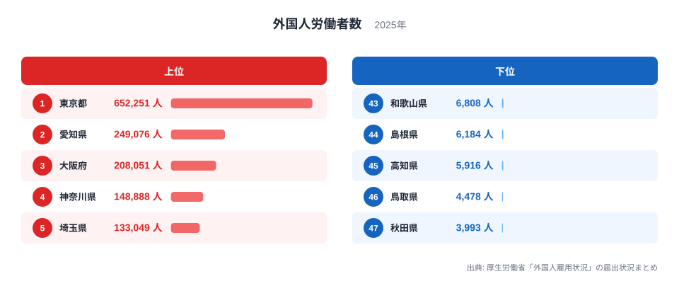
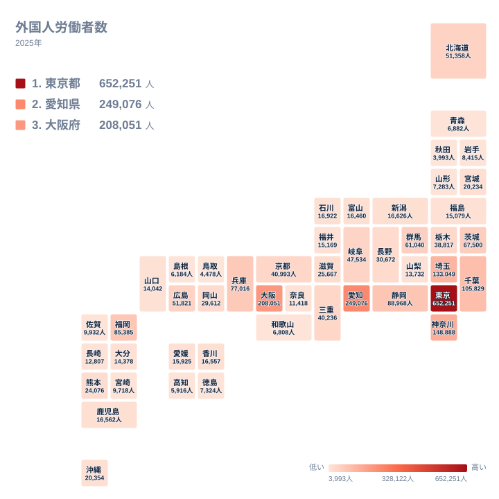

外国人労働者の数は、都道府県のあいだで大きく偏っています。2025年の届出状況では、1位の東京都が652,251人、47位の秋田県が3,993人でした。同じ国内で働く外国人の数が、これほど違います。

この記事では、上位と下位がどのような順になっているかを図で確かめ、地理と産業の面から考えられる背景を仮説として整理します。手元にあるのは県別の人数と順位だけです。そのため、理由として書くことは、確定した事実ではなく「そう考えると説明しやすい」という見方にとどまります。

> [!NOTE]
> この記事の「外国人労働者数」は、厚生労働省「外国人雇用状況」の届出状況まとめにある、事業主が届け出た外国人労働者の人数です。単位は人で、2025年の値を使っています。集計は住んでいる場所ではなく、届出をした事業所の所在地を単位としています。そのため、居住地ごとの外国人人口とは別の数字です。

## 上位と下位の顔ぶれ

まず、上位5県と下位5県を図で確認します。

<source-link href="/ranking/foreign-worker-count">外国人労働者数ランキングをもっと見る</source-link>

図でまず目に入るのは、1位の東京都の棒の長さです。東京都は652,251人で、2位の愛知県の249,076人の2倍を大きく超えています。上位は「東京都と愛知県の2県が並んで突出している」形ではなく、東京都だけが抜けている形です。2位の愛知県と3位の大阪府の208,051人との差は、1位と2位の差に比べるとずっと小さくなっています。

下位側では、棒の長さが近いことが特徴です。47位の秋田県は3,993人、43位の和歌山県は6,808人で、下位5県は3,993人から6,808人の狭い幅に収まっています。上位の差が大きいのに対し、下位は小さな差の中で順位が入れ替わっている状態です。

下位の顔ぶれは、東北、中国、四国、近畿に散らばっていて、特定の地方に固まってはいません。秋田県は東北、鳥取県と島根県は中国、高知県は四国、和歌山県は近畿です。実データにある最大と最小の比は、東京都の652,251人と秋田県の3,993人の間にあり、この両端の開きが全体の偏りの大きさを示しています。

## 上位に大都市圏が並ぶ背景

上位を地方でまとめると、関東の都県が目立ちます。東京都が1位、神奈川県が4位で148,888人、埼玉県が5位で133,049人、千葉県が6位で105,829人です。関東の4都県が上位6位のうち4つを占めています。

首都圏は一体の労働市場を作っていると言われます。飲食、小売、物流、建設、介護など人手を必要とする業種が多く、外国人材の就労先も広いと考えられます。ただし、業種別の内訳は手元のデータにないため、これは地理から立てた仮説です。

東京都については、読み方に注意が必要です。届出は事業所ごとに集計されるため、本社が複数の事業所の外国人労働者をまとめて届け出ている場合、東京都の値に含まれる可能性があります。東京都の652,251人のすべてが東京都内で働いているとは限りません。

近畿では、3位の大阪府が208,051人、9位の兵庫県が77,016人、15位の京都府が40,993人です。大阪府は近畿の中で突出しており、同じ近畿でも県によって人数の水準が大きく異なります。三重県は16位で40,236人、滋賀県は20位で25,667人、奈良県は36位で11,418人、和歌山県は43位で6,808人です。

> [!TIP]
> この統計では、届出の仕組みに由来する読み違いが起きやすくなります。東京都や大阪府のように本社が集まる都府では、他県の事業所の分が含まれうるため、順位は「その県で働く人の数」ではなく「その県の事業所が届け出た数」と考えると誤読を避けられます。

## 製造業の集積と重なるように見える地域

2位の愛知県は249,076人です。愛知県は自動車関連をはじめ製造業の集積で知られており、外国人労働者の多さと重なるように見えます。ただし、手元にあるのは人数と順位だけで、産業別の内訳はありません。製造業が原因だと言い切ることはできず、背景にあると考えられる、という段階です。

愛知県の周辺では、静岡県が7位で88,968人、岐阜県が14位で47,534人、三重県が16位で40,236人です。いずれも上位から中位に位置します。製造業の盛んな地域として知られる県が、愛知県の周辺で上位に並ぶ点は、産業構造との関連をうかがわせます。

関東でも、茨城県が10位で67,500人、群馬県が11位で61,040人、栃木県が17位で38,817人です。首都圏に隣接する北関東の3県が、上位から中位に連なっています。これらの県でも工業の拠点があることは知られていますが、人数との関係を示す産業データは手元にないため、同様に仮説として読んでください。

次の図は、こうした分布を地図の形で示したものです。

地図で見ると、人数の多い県は、東京都を中心とする関東、愛知県を中心とする中部、大阪府を中心とする近畿に集まっています。三大都市圏の周辺に濃い色が連なり、そこから離れるほど薄くなる配置です。

その外側では、福岡県が8位で85,385人、広島県が12位で51,821人、北海道が13位で51,358人です。いずれも地方の中心となる道県で、大都市圏の外でも、地方の拠点に人数が集まる傾向が読み取れます。なお、愛知県の詳しい数字は[愛知県のデータ](/areas/23000)、東京都は[東京都のデータ](/areas/13000)で確認できます。

> [!WARNING]
> この指標は2025年の1時点の値です。前年との比較はできないため、増えているのか減っているのかは、この記事からは分かりません。また、届出の対象外となる在留資格の人や、届出がされていない就労は含まれません。人材派遣や請負で働く場合は、派遣元の所在地に数えられることがあり、実際の就労先と統計上の県がずれる可能性があります。

## 下位の県に見られる特徴

下位に並ぶ県は、東北、中国、四国に多く見られます。東北では、岩手県が39位で8,415人、山形県が41位で7,283人、青森県が42位で6,882人、秋田県が47位で3,993人でした。宮城県は23位の20,234人で、東北の中では人数が多く、他県と水準が離れています。

中国と四国でも同様の傾向があります。鳥取県は46位で4,478人、島根県は44位で6,184人です。四国では高知県が45位で5,916人、徳島県が40位で7,324人でした。これに対して、岡山県は19位の29,612人、広島県は12位の51,821人です。同じ中国地方でも、県によって人数の水準が大きく違います。

下位の県には人口の少ない県が多いとみられますが、人口データは手元にないため、人口との関係は確かめられません。大都市圏から離れていることや、産業の構成が違うことも考えられますが、いずれも本記事のデータでは裏付けられない仮説です。

人数が少ないことは、外国人労働者が重要でないことを意味するとは限りません。少数でも、地域の働き手不足を支えている場合があります。順位の低さを、そのまま需要の小ささと読み替えるのは避けてください。

## 中位の県に見る人数の近さ

中位には、人数が1万人台から3万人前後の県が並びます。長野県は18位で30,672人、岡山県は19位で29,612人、滋賀県は20位で25,667人、熊本県は21位で24,076人、沖縄県は22位で20,354人です。

北陸と呼ばれる県をひとまとめにはせず、実データで見ると、石川県が24位で16,922人、新潟県が25位で16,626人、富山県が28位で16,460人、福井県が30位で15,169人です。順位は離れていても人数の差は小さく、中位では小さな人数差で順位が入れ替わりやすいことが分かります。

香川県は27位で16,557人、鹿児島県は26位で16,562人です。この2県の差はわずかで、順位が1つ違うだけの県同士を「多い」「少ない」と分けて読むのは適切ではありません。中位の順位は、人数の水準が近い県の並びとして読むのが妥当です。

関連する雇用や賃金の指標は、[同じカテゴリの統計一覧](/category/laborwage)にまとまっています。人数と合わせて見ることで、地域の労働市場の別の側面が見えてきます。

## データについて

ここで使った値は、厚生労働省「外国人雇用状況」の届出状況まとめにある、2025年の外国人労働者数です。単位は人で、全47都道府県の値を使っています。

この記事で述べた背景は、地理や産業についての一般的な見方に基づく仮説です。人口、産業別の内訳、前年の値は手元になく、因果関係を確かめることはできません。

整理すると、確かに言えるのは次の三点です。

- 東京都は652,251人で、2位の愛知県の249,076人を大きく上回っています
- 下位5県は3,993人から6,808人の狭い幅に集まっています
- 人数の多い県は、関東、中部、近畿の都市圏に集まって見えます

外国人労働者の分布は、地域の産業の姿と関わっていると考えられますが、それを確かめるには産業別のデータが必要です。この記事の数字は、その出発点として読んでください。
