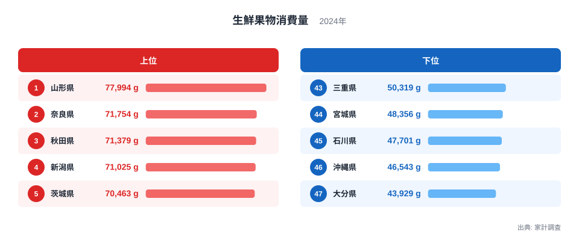
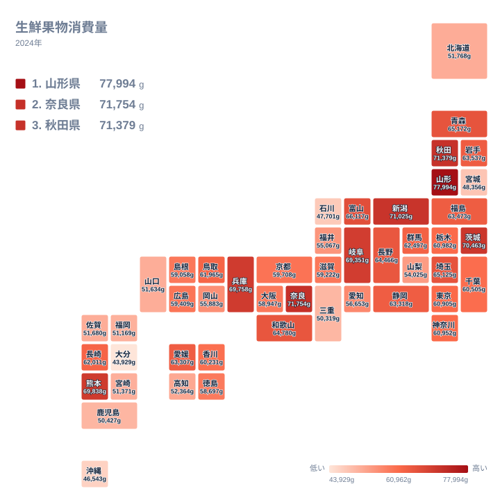

## 果物の消費量で首位に立ったのは山形県

果物をいちばん多く買っている県はどこでしょうか。2024年の家計調査で、生鮮果物の購入量が最も多かったのは山形県で、77,994gでした。2位は奈良県で71,754g、3位は秋田県で71,379gです。上位には東北、近畿、北陸、関東の県が混ざっていて、特定の地方だけに偏っているわけではありません。

一方で、最も少なかったのは大分県の43,929gです。46位の沖縄県は46,543g、45位の石川県は47,701gでした。1位と47位の間には、30,000g を超える開きがあります。

この記事では、山形県と奈良県を軸に、順位と値の並び方から、産地と消費量の関係をどこまで言えるのかを整理します。ここでの生鮮果物は、果汁やジャム、缶詰などの加工品ではなく、そのまま食べる果物を指します。

> [!NOTE]
> 生鮮果物消費量は、家計調査で世帯が購入した生鮮果物の数量です。贈答品や自宅の庭でとれた果物、実家から届いた果物は、購入として記録されない場合があります。「県民が食べた量」そのものではなく、「家計が買った量」を表す指標だと理解してください。

## 上位と下位を並べて見る

まず、上位5県と下位5県をまとめて見ます。

<source-link href="/ranking/fresh-fruit-consumption-quantity">生鮮果物消費量ランキングをもっと見る</source-link>

上位には山形県、奈良県、秋田県、新潟県、茨城県が並びます。4位の新潟県は71,025g、5位の茨城県は70,463gで、上位5県はいずれも7万g台です。首位の山形県と2位の奈良県の差は6,240gあり、2位から5位までは1,291gの範囲に収まっています。

下位は大分県、沖縄県、石川県、宮城県、三重県です。44位の宮城県は48,356g、43位の三重県は50,319gでした。上位5県の最小である70,463gと、下位5県の最大である50,319gの間には、20,000g を超える断層があります。

順位の途中には、値がほとんど変わらない区間もあります。20位の鳥取県は61,965g、21位の栃木県は60,982g、22位の神奈川県は60,952gです。21位と22位の差は30gしかありません。中位では、順位が一つ違っても値の差はごく小さいことがわかります。

> [!TIP]
> ランキングを読むときは、順位だけでなく隣り合う県の値の間隔も確認してください。21位の栃木県と22位の神奈川県のように差が小さい区間では、順位の違いに大きな意味はありません。上位と下位の「かたまり」で捉えるのが安全です。

## 産地の県は、多く買っているとは限らない

山形県は、さくらんぼやぶどうなどで知られる果物の産地です。首位という結果は産地のイメージと重なります。詳しい数値は[山形県のデータ](/areas/06000)でも確認できます。ただし、この記事のデータだけでは、産地であることが首位の理由だと示すことはできません。

実際、産地の県が必ず上位に入るわけではありません。りんごで知られる青森県は10位で65,172g、長野県は13位で64,466gです。みかんの産地である和歌山県は12位で64,780g、愛媛県は17位で63,307gでした。熊本県は6位で69,838gと健闘しています。

一方、ぶどうやももで知られる山梨県は35位で54,025gにとどまります。果樹の産地というイメージと、家計の購入量は、そのまま一致しません。産地の多寡だけでは、消費量の差は説明しにくいといえます。

では、なぜ産地でも順位に差が出るのでしょうか。データから確かめられるわけではありませんが、次のような仮説が考えられます。

- 産地では、規格外品や贈答品が家庭に回り、購入として数えられない分が多いのかもしれません。
- 果物の種類によって、1回に買う重さが大きく違うのかもしれません。

この仮説に従えば、山縣県のように購入量そのものが多い県は、産地の果物を日常的に店頭で買う場面が多いのかもしれません。ただし、これも推測にとどまります。

> [!WARNING]
> 数量はグラム単位の重さで集計されます。すいかやメロンのように重い果物を多く買う県は、数字が大きく出やすくなります。軽い果物を好む県は、同じだけ食べても重さでは小さく見えることがあります。金額や食べた個数とは一致しない点に注意してください。

## 地図で見る消費量の分布

次に、47都道府県の分布を地図で見ます。

地図からは、東北の日本海側から北陸にかけて、消費量の多い県が連なっているのが読み取れます。山形県は1位、秋田県は3位、新潟県は4位、富山県は9位で66,117gです。関東では茨城県が5位、埼玉県が11位で65,125g、群馬県が18位で62,497gでした。

一方、九州と沖縄には、順位の低い県が目立ちます。大分県が47位、沖縄県が46位で、福岡県は41位の51,169g、鹿児島県は42位の50,427gです。宮崎県は40位の51,371g、佐賀県は38位の51,680gでした。熊本県の6位は、その中では例外的な存在です。

東北でも宮城県は44位の48,356gと低く、北海道は37位の51,768gでした。同じ地方でも県ごとにかなりばらつくため、地方単位で性格を決めつけることはできません。気候や雪の多さが関係している可能性はありますが、このデータだけでは確かめられません。

## 奈良県が2位に入る意味

首位の山形県と並んで目を引くのが、2位の奈良県です。奈良県は71,754gで、近畿では突出しています。同じ近畿でも、兵庫県は7位で69,758g、和歌山県は12位、滋賀県は28位の59,222g、京都府は26位の59,708g、大阪府は30位の58,947gでした。近畿の中でも、これだけ大きなばらつきがあります。

奈良県から大阪府までの差は、11,000g を超えています。隣り合う府県でこれほど違うのは興味深い点です。その背景として、世帯の構成や年齢層、買い物の場所などが関わっているのかもしれませんが、本記事のデータからは判断できません。詳しい値は[奈良県のデータ](/areas/29000)も参考にしてください。

首都圏を見ると、東京都は23位の60,905g、神奈川県は22位の60,952g、千葉県は24位の60,505gで、中位に集まっています。埼玉県だけが11位で65,125gと上位に入りました。都市部の中でも、県によって位置が分かれています。

## 産地と消費量のずれが示すこと

ここまでの結果をまとめると、産地の知名度と消費量の順位は、必ずしも重なりません。青森県や長野県、和歌山県、愛媛県は上位にありますが、首位ではありません。山梨県は35位でした。

その一方で、秋田県や新潟県、茨城県のように、全国的な果物産地というイメージが強くない県も上位に入っています。「産地だから多く買う」という見方は、このデータでは裏づけられません。

食料品全体の動きと見比べたいときは、[同じカテゴリの統計一覧](/category/economy)から関連する指標を探してみてください。品目別の数量を調べれば、どの果物が差を生んでいるのかを確かめられる可能性があります。

## まとめ：山形が首位でも、産地と消費量は別の話

2024年の生鮮果物消費量では、山形県が77,994gで1位、奈良県が71,754gで2位、秋田県が71,379gで3位でした。下位は大分県の43,929g、沖縄県の46,543g、石川県の47,701gです。

読み取れることを整理すると、次の通りです。

- 産地の県が必ず上位に入るとは限りません。
- 東北の日本海側から北陸にかけて、順位の高い県が連なっています。
- 九州と沖縄には、順位の低い県が目立ちます。
- 中位の県は値が近く、順位の差が小さい区間が長く続きます。

産地の多寡だけでは、消費量の差は説明しにくいというのが、このデータから言える範囲です。暮らし方や食習慣が関わっている可能性はありますが、それは仮説であり、別の統計で確かめる必要があります。

## データについて

この記事で扱う生鮮果物消費量は、家計調査にもとづく2024年の都道府県別の値で、単位はgです。購入された数量を重さで表した値であり、贈答や自家消費で得た果物は含まれない場合があります。
