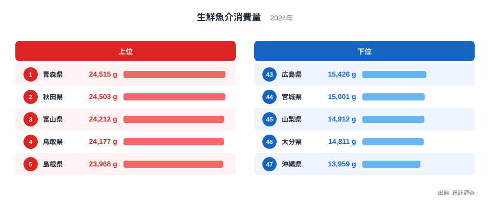
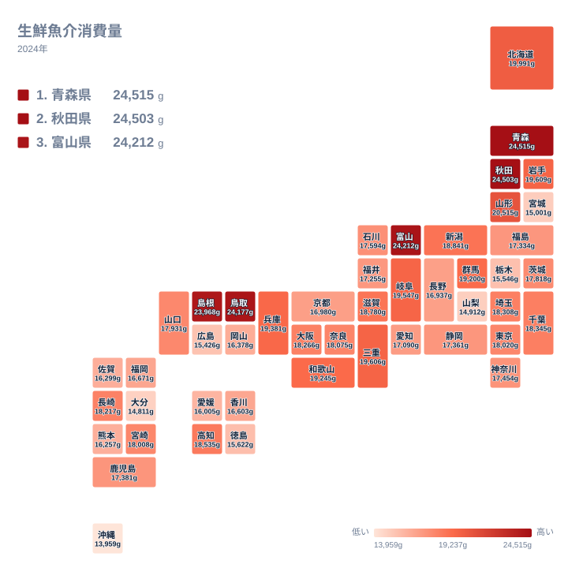

## 生鮮魚介を最も食べる県は青森県

生鮮魚介の消費量が最も多い県はどこでしょうか。漁獲量の多い北海道や、寿司のイメージが強い東京を思い浮かべる方も多いかもしれません。2024年の家計調査で1位だったのは、青森県の24,515gです。2位は秋田県で24,503g、3位は富山県で24,212gでした。

4位は鳥取県で24,177g、5位は島根県で23,968gです。上位5県を地方で分けると、東北が青森県と秋田県の2県、北陸が富山県の1県、山陰が鳥取県と島根県の2県になります。題に「東北だけなのか」と置いたのは、上位が東北に限られないことを確かめたいからです。一方、最下位の沖縄県は13,959gでした。

この記事では、まず上位5県の顔ぶれと順位の間隔を図で確かめます。そのうえで、食文化や気候、産地との関わりを、データで言えることと仮説にとどまることに分けて整理します。

<source-link href="/ranking/fresh-seafood-consumption-quantity">生鮮魚介消費量ランキングをもっと見る</source-link>

図でまず目に入るのは、上位5県の値がほとんど横並びであることです。青森県の24,515gから島根県の23,968gまで、5県は1つのかたまりを作っています。この中の順位は、読み取れる意味がごく薄いと考えたほうが安全です。

もう一つ注目したいのは、5位と6位の間の段差です。5位の島根県は23,968gですが、6位の山形県は20,515gまで下がります。しかも6位から10位までを並べると、山形県が20,515g、北海道が19,991g、岩手県が19,609g、三重県が19,606g、岐阜県が19,547gです。6位から10位は、上位5県の内側と同じく、互いにほとんど差がありません。

つまり、この指標の上位は「5位まで」と「6位から先」の間に境目があり、境目の前後ではそれぞれ値が詰まっています。1位と2位の順位を競うより、5県が1つの群を作っているという見方のほうが、図に合っています。

> [!NOTE]
> この統計は、家計が1年間に購入した生鮮の魚介類の量をグラムで示したものです。漁獲量や水産業の規模とは別の指標です。刺身の盛り合わせや総菜として買った魚の扱いは品目の分類で変わり得るため、「魚を食べた総量」と同じ意味ではありません。

## 上位5県は東北だけではない

上位5県を見渡すと、東北の2県、北陸の1県、山陰の2県が並びます。いずれも本州の日本海側に位置する県です。ただし、ここから「日本海側だから多い」と結論づけることはできません。同じ日本海側でも、新潟県は14位の18,841g、石川県は26位の17,594g、福井県は31位の17,255gと、順位にばらつきがあるからです。

家計の購入量が多くなる背景として、いくつかの仮説は立てられます。たとえば、地元で水揚げされた魚が身近に流通していて、家庭で買いやすい可能性があります。冬の寒さが厳しい地域では、鍋や煮物に魚を使う食習慣があるのかもしれません。ただし、この記事で使うデータは購入量だけです。価格や料理の頻度、流通の経路は含まれていないため、これらは検証できていない見立てにすぎません。

東北に限っても、一様ではありません。青森県は1位、秋田県は2位ですが、山形県は6位の20,515g、岩手県は8位の19,609g、福島県は30位の17,334g、宮城県は44位の15,001gです。同じ東北でも、上位から下位寄りまで大きな幅があります。「東北は魚をよく食べる」という印象は、北東北の数字に支えられている部分が大きいといえます。

> [!TIP]
> 地方名でまとめて読むと、県ごとの違いが隠れます。東北や山陰という呼び方は話の入口として便利ですが、数字を確かめるときは県ごとの順位と値に戻ってください。同じ地方の中に、上位の県と下位の県が混ざっていることがよくあります。

## 地理分布で見る海沿いと内陸

タイルマップで全国を眺めると、東北北部から日本海側にかけて、値の大きい県が連なっています。ただし、色の濃い県は東北だけではなく、北陸や山陰にも散らばっています。一方で、太平洋側や西日本には、値が小さめの県が目立ちます。

意外なのは、海のない内陸県にも健闘する県があることです。岐阜県は10位の19,547g、群馬県は13位の19,200g、滋賀県は15位の18,780gでした。海に近いかどうかだけでは、順位を説明しきれないことがわかります。内陸でも魚が日常的に買われている背景には、流通の発達や、川や湖の魚を食べる習慣があるのかもしれませんが、このデータからは断定できません。

反対に、水産業が盛んな印象のある県が下位に入る例もあります。宮城県は44位の15,001g、広島県は43位の15,426gです。水産県であることと、家庭で買う生鮮魚介の量が多いことは、別の話だと考えられます。水揚げされた魚が加工や出荷に回り、地元の家庭の購入量に結びつかない場合もありそうです。

大都市圏は中位に位置しています。東京都は22位の18,020g、大阪府は19位の18,266g、愛知県は32位の17,090gです。外食の機会が多い地域では、家庭での購入量が相対的に小さくなる可能性があります。ただし、これも外食のデータを重ねないと確かめられません。

> [!WARNING]
> 家計調査は、都道府県庁所在市などの世帯を対象にした標本調査です。県全体の暮らしを厳密に代表するものではありません。標本の規模も限られるため、順位が近い県どうしの差は、誤差の範囲に収まる可能性があります。わずかな順位の違いを過大に解釈しないでください。

## 関連する食品との対比で見える食文化

生鮮魚介の消費量は、肉類や加工品、外食の動向とあわせて読むと意味がはっきりします。たとえば、最下位の沖縄県の13,959gは、魚を食べないという意味ではありません。家庭で買う食材の中心が別の品目にあるのかもしれない、という手がかりになる程度です。肉類や加工魚介の消費量と並べて初めて、選び分けの実態が見えてきます。

大分県は46位の14,811gで、下位に入りました。関あじや関さばのような名産を持つ県ですが、名産地であることと家庭の購入量が多いことは、一致しない場合があります。高級品として県外へ出荷される分が多ければ、地元の家計の購入量には響きにくいという見方もできます。これも仮説であり、出荷量のデータなしには確かめられません。

内陸の山梨県は45位の14,912g、栃木県は42位の15,546gです。海から離れた県では、肉や乾物、加工品が日常の食卓で比重を持ってきた可能性があります。とはいえ、同じ内陸の岐阜県や群馬県が上位に入っていることを考えると、「内陸だから少ない」とは言い切れません。内陸県の中でも結果が割れているのが、この指標の面白いところです。

関連品目との対比という視点では、生鮮魚介だけでなく、肉類や加工品の消費量も合わせて見ることをおすすめします。同じ県が複数の品目でどの位置にあるかを見ると、食の好みの違いが、数字の裏側から立ち上がってきます。経済や暮らしに関する他の統計は、[同じカテゴリの統計一覧](/category/economy)から探せます。

## 順位の意味が薄い領域を読む

1位の青森県と2位の秋田県は、24,515gと24,503gで、ほとんど同じ水準です。この程度の違いは、調査の標本が少し入れ替わるだけで逆転しても不思議ではありません。このため、青森県が秋田県より魚を食べていると言い切ることはできず、2県を1つの群として読むのが適切です。3位の富山県の24,212g、4位の鳥取県の24,177gも同様です。

中位でも同じことが言えます。三重県は9位の19,606g、岐阜県は10位の19,547g、兵庫県は11位の19,381g、和歌山県は12位の19,245gで、順位が1つ違っても値はほとんど動きません。関東では千葉県が17位の18,345g、埼玉県が18位の18,308g、神奈川県は27位の17,454gです。順位だけを見ると10位ほど離れて見えますが、値の幅は、5位と6位の段差ほど大きくありません。

この指標で意味のある違いは、上位5県と6位以降の段差、そして中位から下位に向かうなだらかな下り坂のほうです。順位表を上から順に読むより、いくつかの群に分けて読むと、地域差の輪郭がつかみやすくなります。詳しい県の様子は、[青森県のデータ](/areas/02000)と[秋田県のデータ](/areas/05000)で、他の統計と並べて確認できます。

> [!TIP]
> 順位が近い県は、値の差も小さいことが多くあります。順位そのものではなくグラムの値を見て、「上位の群」「中位の群」「下位の群」のどこに入るかで読むと、読み違えが減ります。

## データについて

この記事で使った数値は、家計調査の生鮮魚介消費量(2024年)です。単位はグラムで、47都道府県の値を並べて比較しています。家計が購入した生鮮の魚介類の量を示す統計で、漁獲量や水揚げ量とは意味が異なります。

調査の対象は主に都道府県庁所在市などの世帯で、県全体の傾向を完全に代表するわけではありません。また、1年分の結果である以上、その年の水揚げ状況や価格、天候の影響を受ける可能性があります。単年の順位だけで、地域の食文化を断定することは避けたほうがよいでしょう。

それでも、青森県、秋田県、富山県、鳥取県、島根県の上位5県が、6位以降と一線を画している点は、この年のデータから確かに読み取れます。その背景には、海の近さや気候、産地との距離、食習慣などが関わっている可能性がありますが、それを確かめるには価格や料理の頻度など別のデータが必要です。
