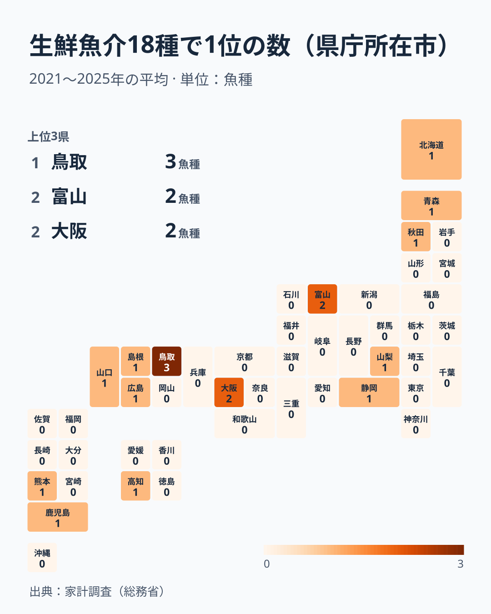
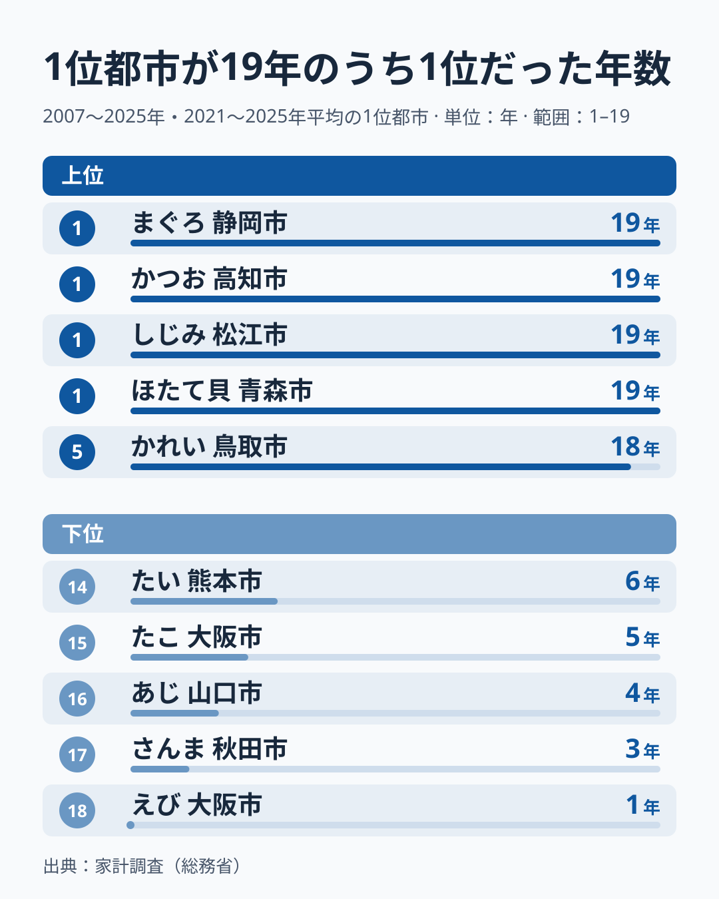
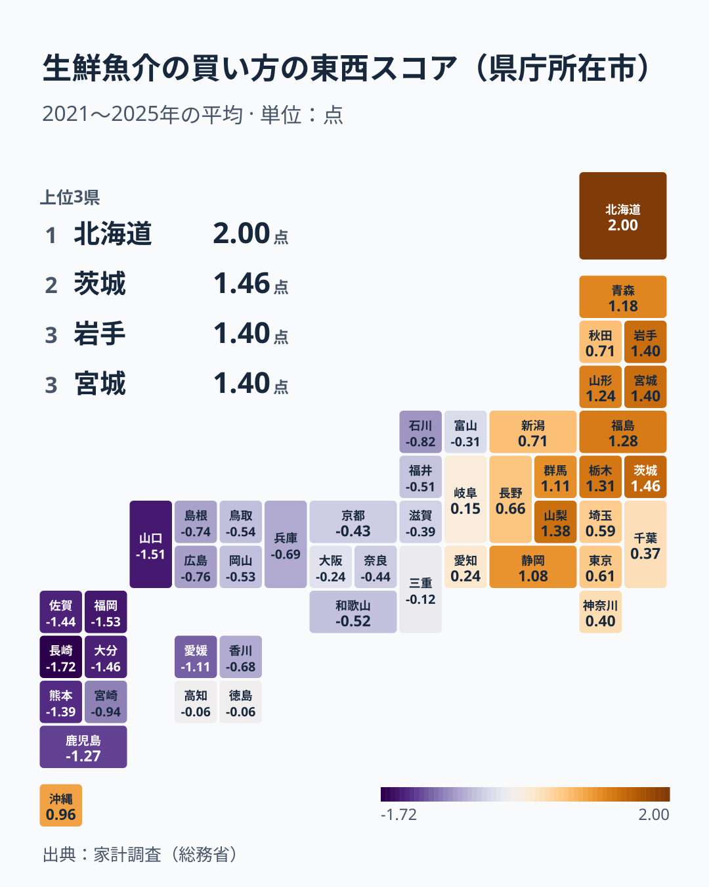
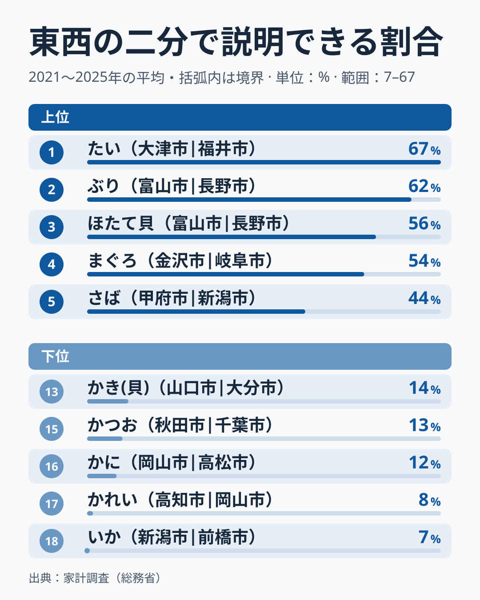
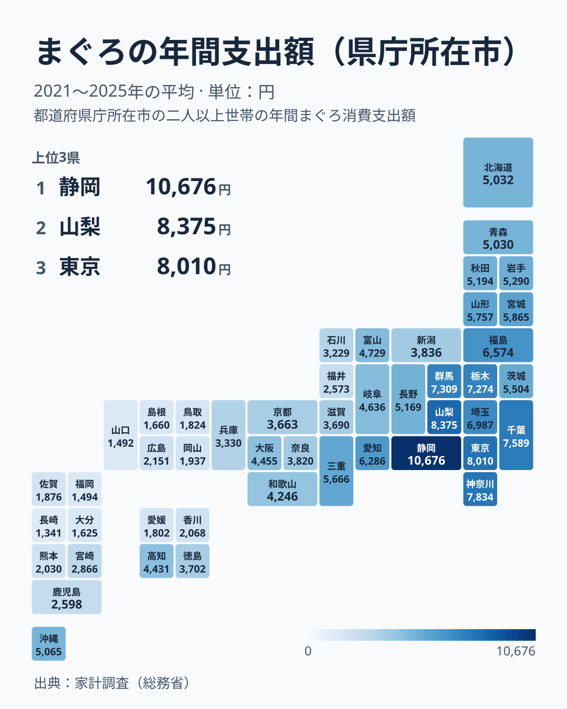
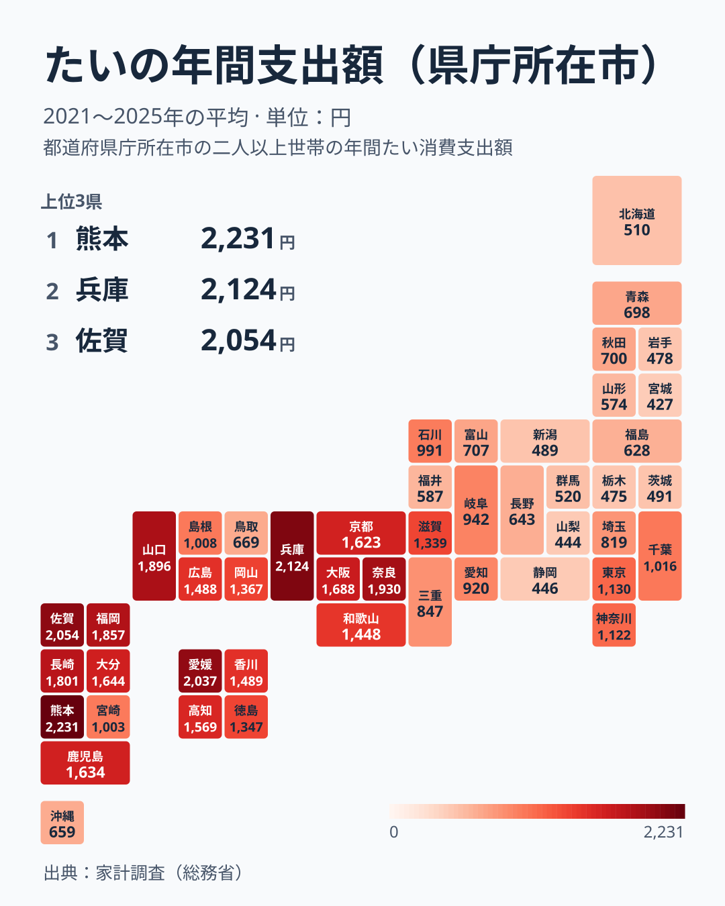
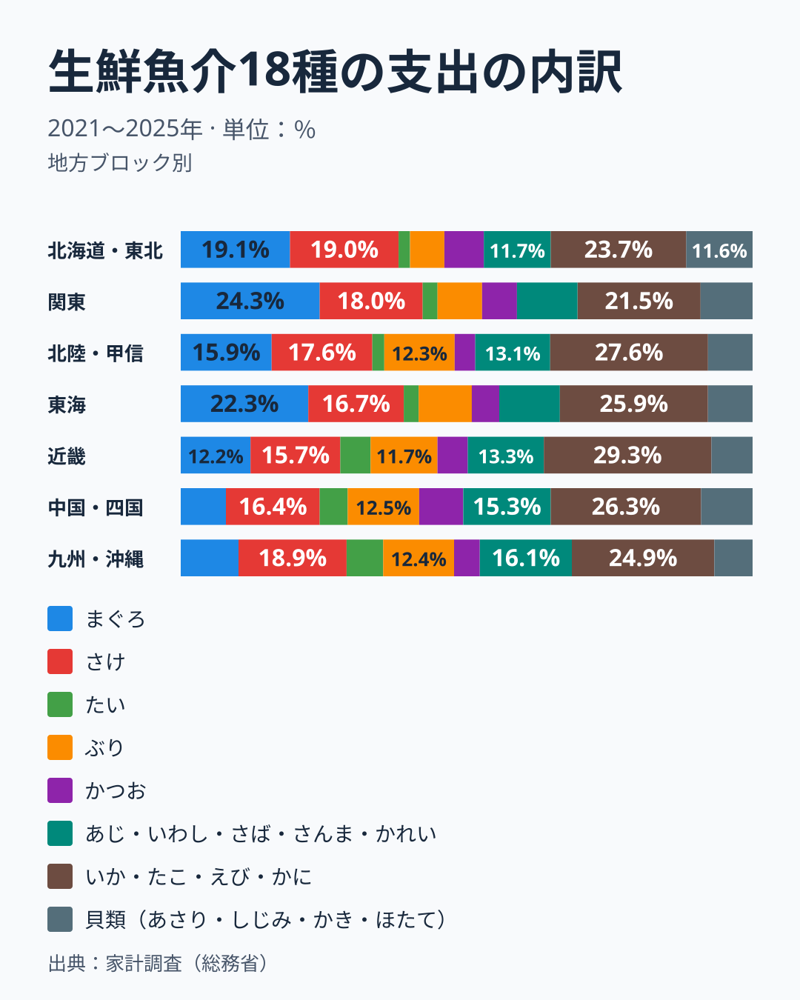
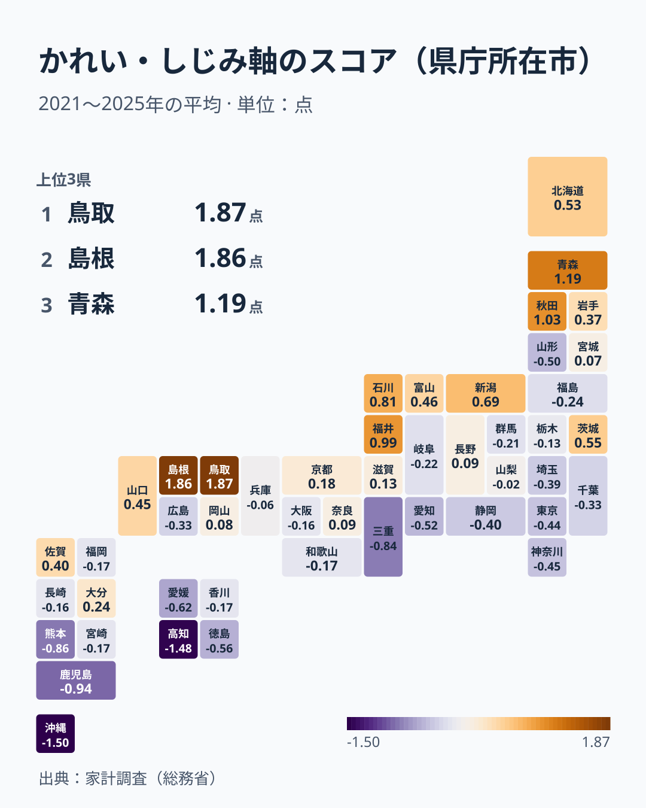

生鮮魚介の好みは、日本のどこで東西に分かれるのでしょうか。家計調査の県庁所在市の支出を、まぐろ、あじ、いわし、かつお、かれい、さけ、さば、さんま、たい、ぶり、いか、たこ、えび、かに、あさり、しじみ、かき、ほたて貝の18種で、2021年から2025年の平均で比べました。答えは、東西で分かれる魚と分かれない魚が混ざっていて、境目は1本ではない、です。18種をまとめた買い方で見ると、境目は日本海側では新潟市と富山市の間、東海から近畿にかけては名古屋市・岐阜市と津市・大津市の間にあります。

18種の買い方の違いを1つの軸にまとめると、いちばん強い軸は県庁所在市の経度と並ぶ東西の軸で、都市の間の違いの40.9%を占めます。軸の得点と経度の相関は0.82で、軸の得点の約3分の2(決定係数0.67)は経度で説明できます。2番目の軸はかれいとしじみで決まる別の軸で、19.8%です。2つを合わせても60.7%で、残りの約4割は、東西でも別の軸でもない魚ごとの違いと、標本の揺れを含みます。魚種ごとに東西の二分でどれだけ説明できるかを見ると、たいは西が東の2.3倍、まぐろは東が西の2.4倍とはっきり割れる一方、かれい、いか、かにはほとんど割れません。

1位の都市も、魚種ごとに離れています。18種の1位は14の都市に分かれ、東日本にあるのは、さけの札幌市、ほたて貝の青森市、さんまの秋田市、あさりの甲府市、まぐろの静岡市の5種だけです。この記事は、東西の境界がどこにあるか、どの魚が東西で割れ、どの魚が割れないのかを、年を変えても、購入量で見ても同じ結果になるかを確かめながら見ていきます。

## 比べているもの、見えないもの

使うのは、家計調査の県庁所在市の二人以上の世帯の、1世帯あたり年間支出額(円)です。東京都は区部の値で、県全体の値ではありません。地図は県庁所在市の値を県のタイルに色づけしていて、右上の「上位3県」に出る名前も、その県の県庁所在市の値です。支出額は購入量に価格をかけた値なので、同じ量でも高い魚を買う都市は大きくなります。単年の順位は標本の小ささで動きやすいため、主に2021年から2025年の5年の平均を使い、2009年から2013年、2015年から2019年にも同じ分析をして確かめます。

魚種の違いを比べるため、魚種ごとに47市の平均で割った指数にして、その対数をとります。これで、支出額の大きい魚種(まぐろの年間4,417円)が小さい魚種(あさりの414円)を押し流すことを防ぎます。さらに、都市ごとに18種の指数の平均を引いて、魚介全体の買い方の水準の違いを除きます。魚介全体の支出が少ない都市は、すべての魚種の指数が低くなり、「どの魚を選ぶか」の違いに見えてしまうためです。水準が最も低いのは那覇市で、18種の指数の幾何平均が0.45と、2番目に低い熊本市の0.76を大きく下回ります。水準を除いた指数を、主成分分析で軸にまとめ、都市ごとのスコアを出します。経度は、県庁所在地の位置の概数を、都市を東西に並べ替えるためにだけ使い、値としては本文に書きません。

> [!NOTE]
> 18種は、家計調査の品目分類で生鮮魚介に入るもののうち、魚種名のつくもの(鮮魚の14種と貝類の4種)です。「他の鮮魚」「他の貝」「さしみ盛合わせ」は魚種が決まらないので除きました。ここでの「好み」は、世帯が実際に使った金額の違いで、食べたい魚の希望ではありません。飲食店で食べる魚、もらい物、自家消費は含まれません。

## 1位の都市を地図にすると、18種は14の都市に散らばる

18種の1位の都市(2021年から2025年の平均で1位)を数えて、都市ごとに地図にしました。

もっとも多いのは鳥取市の3種で、いわし、かれい、かにが1位です。富山市がぶりといか、大阪市がたことえびで2種ずつ、残りの11都市は1種ずつです。北日本はさけの札幌市、ほたて貝の青森市、さんまの秋田市、関東・甲信・東海ではあさりの甲府市、まぐろの静岡市が1位で、北陸以西は、ぶりといかの富山市、いわしとかれいとかにの鳥取市、しじみの松江市、たことえびの大阪市、かきの広島市、あじの山口市、かつおの高知市、たいの熊本市、さばの鹿児島市です。東日本に1位の都市があるのは5種で、残り13種は北陸以西です。

1位の都市は、毎年同じとは限りません。2025年の1位と2021年から2025年の平均の1位が違う魚種が6つあります。あじは長崎市と山口市、さんまは仙台市と秋田市、たいは佐賀市と熊本市、たこは奈良市と大阪市、えびは和歌山市と大阪市、かには和歌山市と鳥取市です。単年の1位は動きやすいので、以降は5年の平均で見ます。

## 1位は毎年同じか、毎年入れ替わるか

5年平均の1位の都市が、2007年から2025年の19年のうち、単年の支出額でも1位だった年数を数えました。

19年すべてで1位なのは、ほたて貝の青森市、しじみの松江市、かつおの高知市、まぐろの静岡市の4つです。かれいの鳥取市、ぶりの富山市、かきの広島市が18年で続きます。反対に、えびの大阪市は19年のうち1年だけ、さんまの秋田市は3年、あじの山口市は4年、たこの大阪市は5年、たいの熊本市は6年です。えびでは、19年のうち和歌山市が8年、富山市、奈良市、津市が2年ずつ1位で、毎年のように入れ替わっています。

1位が安定する魚種と入れ替わる魚種の違いは、1位と2位の差の大きさとほぼ対応します。5年平均で1位の都市の支出額を2位の都市で割ると、かつおは2.58倍、しじみは2.09倍、かきは1.40倍、かれいは1.36倍で、ぶりとほたて貝は1.32倍です。これらはどれも18年以上、または19年1位を保っています。一方、えびは1.02倍、あじとたこは1.03倍、たいは1.05倍、さんまは1.09倍と、1位と2位がほとんど並んでいて、1位はその年の標本しだいです。18魚種の1位と2位の比と1位の年数の順位相関は0.89です。

つまり、「魚種ごとの1位の都市」を地図に描いても、地図の意味は魚種で違います。かつおの高知市やしじみの松江市は、ほかの都市を大きく引き離した本物の特色です。えびの大阪市やたいの熊本市は、近隣の都市と並ぶ集団の先頭にすぎません。東西の境界を探すなら、1位の都市ではなく、47市の全体の並びを使う必要があります。

## 18種を1つの軸にまとめると、東西の軸が出てくる

18種の47市の並びを、主成分分析で1つの軸にまとめます。もっとも強い軸の得点を地図にしました。

この軸は、2021年から2025年の都市の間の違いの40.9%を占めます。2015年から2019年は43.4%、2009年から2013年は45.6%で、少しずつ下がっています。この軸と県庁所在市の経度の相関は0.82、0.84、0.82と、3つの期間でほぼ同じです。緯度との相関も0.59あり、経度と緯度の並びは完全には分けられません。得点そのものも3つの期間で高く並び、2015年から2019年との相関が0.99、2009年から2013年との相関が0.98です。この軸の読み方は年を変えても変わりません。

得点が大きいのは、まぐろの比重が高く、たい、あじ、ぶり、いわしの比重が低い買い方です。この軸の重みはまぐろが+0.50、たいが-0.41、あじが-0.40、ぶりが-0.29、いわしが-0.28で、東の側ではまぐろが、西の側ではたい、あじ、ぶり、いわしが買われます。得点が高い都市は、札幌市の2.00、水戸市の1.46、盛岡市と仙台市の1.40、甲府市の1.38、宇都宮市の1.31です。低い都市は、長崎市の-1.72、福岡市の-1.53、山口市の-1.51、大分市の-1.46、佐賀市の-1.44で、九州北部から山口市に集まります。

境界は、地図の色が変わる場所です。経度の順に並べて符号を見ると、日本海側では新潟市の0.71が東型、富山市の-0.31、金沢市の-0.82、福井市の-0.51が西型で、境目は新潟市と富山市の間にあります。東海から近畿にかけては、静岡市の1.08が東型で、名古屋市の0.24と岐阜市の0.15は0に近い東型、津市の-0.12と大津市の-0.39が西型で、境目は名古屋市・岐阜市と津市・大津市の間です。経度の順に2群に分けて、第1の軸の得点の分散のうち2群の違いで説明できる割合が最大の70%になる位置を探すと、富山市と長野市の間で、名古屋市と岐阜市は西側の群に入ります。この2市の得点は0.24と0.15と0に近いので、境目は岐阜市・名古屋市から長野市までの幅の中にあると読むのが正確です。

境界付近は連続的に変わります。高知市と徳島市の-0.06、津市の-0.12、岐阜市の0.15、名古屋市の0.24、大阪市の-0.24、富山市の-0.31は、東型でも西型でもない中間の都市です。この軸は、2つの型に二分するより、西から東へ連続して変わる傾きとして読むのが正確です。

例外は、札幌市と那覇市です。札幌市は得点が2.00で、ほたて貝が47市の平均の2.4倍、さけが1.5倍、さんまが1.5倍と、北の魚を多く買い、あじが0.19倍、ぶりが0.39倍と少なくしか買いません。経度では最も西にある那覇市は、水準を除いた得点が0.96と東型です。魚介全体の水準が最も低い那覇市でも、まぐろは平均の1.15倍、さけは0.97倍、さばは0.96倍と平均に近く、あじの0.23倍、かれいの0.16倍、かにの0.21倍が小さいことが、東型の得点につながっています。この2市を除くと、第1の軸の説明率は40.9%で変わらず、経度との相関は0.82から0.93に上がります。

## 東西で割れる魚、割れない魚

魚種ごとに、東西の二分でどれだけ説明できるかを調べます。県庁所在市を経度の順に並べて、前から8番目から39番目までの位置で2群に分け、魚種の指数の分散のうち2群の違いで説明できる割合の最大値を求めました。

もっとも強いのは、たいの67%です。ぶりが62%、ほたて貝が56%、まぐろが54%、さばが44%と続きます。偶然でどこまで出るかの目安として、47市の値をランダムに入れ替えて同じ計算をする試行を4,000回行うと、最大値の中央値が6%、95番目の百分位が16%、99番目の百分位が22%でした。22%を超えるのは、さんまとあじの41%、いわしの33%、えびの32%、しじみの27%、あさりの24%を含む11種で、たこの19%は偶然との境にあります。さけの14%、かきの14%、かつおの13%、かにの12%、かれいの8%、いかの7%は偶然の範囲です。18種のうち、東西の二分ではっきり説明できるのは11種で、6種は東西の二分では説明できません。

「東が西の2.3倍」のような倍率は、魚種ごとに最適な位置で2群に分けたときの、魚介全体の水準を除いた指数の幾何平均の比です。たいは東が西の0.44倍、つまり西が東の2.3倍で、まぐろは東が西の2.4倍です。ぶりは東が西の0.58倍、ほたて貝は東が西の1.7倍です。

魚種ごとの境界の位置も、一定ではありません。強く割れる11種のうち8種(たい、ぶり、ほたて貝、まぐろ、さば、しじみ、えび、あさり)は、境目が近畿の東端から北陸、東海、甲信、新潟の都市の間にきます。たいは大津市と福井市の間、まぐろは金沢市と岐阜市の間、ぶりとほたて貝とあさりは富山市と長野市の間、しじみは長野市と静岡市の間、さばは甲府市と新潟市の間、えびは新潟市と前橋市の間です。残る3種のうち、あじといわしの境目は松江市と高知市の間、さんまは東京都区部と宇都宮市の間にあります。

年を変えても境界の位置が変わらない魚種は、8種です。2009年から2013年、2015年から2019年、2021年から2025年の3つの期間で最適な境界が同じなのは、たい(大津市と福井市の間)、ぶりとほたて貝(富山市と長野市の間)、まぐろ(金沢市と岐阜市の間)、さば(甲府市と新潟市の間)、しじみ(長野市と静岡市の間)、いわし(松江市と高知市の間)、さんま(東京都区部と宇都宮市の間)です。8種のうち6種の境目は近畿の東端から甲信までの間にあり、いわしとさんまは帯の外にあります。なお、長野市と静岡市の間や新潟市と前橋市の間のように、概数の経度が近い隣り合う2市の間の境目は、並べ方の僅かな違いで入れ替わりうるので、「この2市の間」と言い切れる精度ではありません。強く割れる魚の境目は、期間を変えても動かない傾向があります。

さけは、東西で割れる魚から割れない魚へ変わりました。説明率は2009年から2013年の46%から、2015年から2019年の34%、2021年から2025年の14%へ下がり、境界の位置も富山市と長野市の間、同じ間、金沢市と岐阜市の間と動いています。どちらも5年平均の1回ずつの結果なので、変化の理由は分かりません。

## 西のたい、東のまぐろ

東西の軸の両端にある、たいとまぐろの支出額を地図で比べます。

まぐろの47市の平均は年間4,417円で、1位は静岡市の10,676円で平均の2.4倍、2位は甲府市の8,375円で1.9倍です。この2.4倍は平均との比で、東西の二分での比とは別の量です。静岡市は19年のすべてで1位でした。東北の太平洋側から関東、東海の都市が高い側に並び、近畿以西は低い側に多くなりますが、大阪市の4,455円、高知市の4,431円、那覇市の5,065円は平均を上回り、西の都市がすべて低いわけではありません。

<source-link href="/ranking/tuna-consumption-expenditure">まぐろの支出額を県庁所在市で比べる</source-link>

たいの47市の平均は年間1,117円で、1位は熊本市の2,231円、2位は神戸市の2,124円です。九州、四国、中国、近畿の都市が高い側に並び、東日本は低い側に多くなりますが、東京都区部の1,130円と横浜市の1,122円は平均をわずかに上回ります。東西の二分では、西が東の2.3倍です。たいと同じく、あじ(東は西の0.50倍)、いわし(0.61倍)、ぶり(0.58倍)が西の側に寄ります。

<source-link href="/ranking/sea-bream-consumption-expenditure">たいの支出額を県庁所在市で比べる</source-link>

地方ブロックごとに、18種の支出の内訳を見ると、東西の違いが形になります。ここでの内訳は、各都市の18種の支出に占める割合を、ブロック内の都市で平均したもので、これまでの指数とは別の量です。

まぐろの割合は、関東が24.3%、東海が22.3%、北海道・東北が19.1%と東に高く、近畿が12.2%、九州・沖縄が10.1%、中国・四国が7.9%と西に低くなります。ただし、九州・沖縄が中国・四国より高く、西に向かって一様に下がるわけではありません。たいは反対で、北海道・東北が2.0%、関東が2.6%に対し、近畿が5.3%、中国・四国が4.9%、九州・沖縄が6.4%です。ぶりは北海道・東北の6.0%から、北陸・甲信が12.3%、中国・四国が12.5%、九州・沖縄が12.4%に増えます。

一方、さけは近畿の15.7%から北海道・東北の19.0%まで、どのブロックでも16%前後から19%に収まり、地方ブロックの違いが小さい魚種です。さけの東西の二分での説明率も14%と低く、同じ向きの結果です。ただし、札幌市、青森市、新潟市の支出が大きいことは、ブロックの平均では見えにくい違いです。

## 東西とは別に、かれいとしじみで決まる軸がある

2番目に強い軸は、都市の間の違いの19.8%を占めます。2015年から2019年は19.1%、2009年から2013年は18.0%でした。この軸と経度の相関は0.23と低く、緯度との相関は0.52です。

この軸は、かれいの重み0.59、しじみの0.50に支えられ、まぐろ(-0.30)、たい(-0.29)、かつお(-0.26)が反対側に重みを持ちます。得点が高いのは、鳥取市の1.87、松江市の1.86、青森市の1.19、秋田市の1.03、福井市の0.99、金沢市の0.81、新潟市の0.69で、日本海側の都市が多く並びます。低いのは那覇市の-1.50、高知市の-1.48、鹿児島市の-0.94、熊本市の-0.86、津市の-0.84で、南の都市が目立ちます。ただし、水戸市の0.55のように日本海側ではない都市も高く、しじみの2位が水戸市であるように、この軸は日本海側と完全には一致しません。得点そのものも3つの期間の相関が0.94と0.92で、年を変えても読み方は変わりません。

かれいとしじみは、東西の二分での説明率が8%と27%と低いのに、この軸ではもっとも大きな重みを持ちます(かには重みの上位に入りますが、7番目の0.19です)。東西の軸だけを見ていると、鳥取市と松江市が全国の1位になる魚の存在が見えなくなります。ただし、東西で説明できない魚がすべてこの軸に属するわけではなく、いか、さけ、かきの重みは小さく、東西にも、この軸にも収まりません。

## 購入量で見ても、魚種を1つ外しても、同じ軸が出る

ここまでの東西の軸が、分析の選び方で生まれたものではないかを、3つの方法で確かめます。

1つ目は、支出額ではなく購入量(g)で同じ分析をすることです。支出額は価格の違いを含むので、購入量で見ても同じ並びになるかを調べました。第1の軸の説明率は37.1%、第2の軸は23.6%で、支出額のときの40.9%と19.8%に近い値です。第1の軸の得点は、支出額の軸との相関が0.99、第2の軸が0.92で、第1の軸と経度の相関は支出額と同じ0.82です。東西の軸は、価格の違いで作られたものではありません。

2つ目は、魚種を1つずつ外して第1の軸を作り直すことです。18通りのどれでも、元の軸の得点との相関は0.949以上で、もっとも下がるのはまぐろを外したときの0.949、次がたいを外したときの0.975、しじみを外したときの0.985です。この3種は軸への寄与が大きい魚種ですが、1魚種を外しても軸の形は変わりません。

3つ目は、主成分ではなく、都市を2つの群に分ける方法(k平均法)で東西を決め直すことです。主分析と同じ、魚介全体の水準を除いた指数を入力にして、初期値を300回変えて最もまとまりの良い分け方を採ると、東の群が21市、西の群が26市になります。東の群は、札幌市から新潟市までの東日本の都市と、甲府市、長野市、岐阜市、静岡市、名古屋市で、那覇市も入ります。西の群は、富山市、金沢市、福井市、津市、大津市と近畿、中国、四国、九州の都市です。第1の軸の符号と一致するのは47市すべてです。

境目の位置は、符号とk平均法の2つの方法で、日本海側は新潟市と富山市の間、東海から近畿にかけては名古屋市・岐阜市と津市の間で一致します。購入量で見る分析と魚種を1つ外す分析は、軸の得点の相関を確かめただけで、境目の位置は計算していません。魚種を外すと境目付近の都市の符号が動く可能性があり、津市、岐阜市、名古屋市のような0に近い都市は、どちらの側とも言い切れません。経度では最も西にある那覇市は、地理では西でも、買い方が東の群に入る例外です。

## この結果から言えること、言えないこと

確かに言えるのは、東西の軸が、18種の買い方の違いを説明するもっとも強い単一の軸だということです。その占める割合は、2009年から2025年の3つの期間で40.9%から45.6%で、軸の読み方は年を変えて同じです。購入量で見ても魚種を1つ外しても、軸の得点はほとんど変わりません。境界は、日本海側が新潟市と富山市の間、東海から近畿にかけては名古屋市・岐阜市と津市・大津市の間にあります。たいとまぐろ、ぶり、ほたて貝のように、東西の傾きがはっきりしている魚種があります。

ある程度言えるのは、強く東西に割れる魚種の境目が、近畿の東端から北陸、東海、甲信、新潟の都市の間に集まることです。11種のうち8種の境目がこの帯の中にあり、3つの期間で位置が変わらない8種のうち6種がこの帯の中にありました。一方で、かれい、いか、かには東西で割れず、さけは東西の二分での説明率が46%から14%へ下がりました。東西の傾きは、魚種ごとに強さも、位置も違います。

言えないのは、なぜその位置に境目があるのかです。[仮説] 海流や漁場、港からの流通の経路、食文化の違いが重なって、都市の買い方が決まっている可能性がありますが、この記事は支出の並びを調べただけで、原因は調べていません。検証には、魚種ごとの水揚げ港や出荷先、価格、調理の仕方を調べた別の統計が要ります。

また、県庁所在市の標本は小さく、飲食店で食べる魚やもらい物、自家消費は含まれません。支出額は購入量と価格の積で、購入量でも同じ軸が出ることを確かめましたが、魚種ごとの差が量の違いか価格の違いかは、この記事では分けていません。主成分分析は、並びの特徴をまとめる記述の道具で、東西の境界が自然の境目として存在することを証明するものではありません。経度の値は概数で、並べ替えにしか使っていません。

## まとめ

- 生鮮魚介18種の買い方の違いのうち、東西の軸が40.9%を占め、軸の得点は経度と0.82の相関で並びます。かれいとしじみで決まる別の軸は19.8%で、2つで60.7%です。
- 東西の境界は、日本海側が新潟市と富山市の間、東海から近畿にかけては名古屋市・岐阜市と津市・大津市の間にあり、その近くの都市は東型でも西型でもありません。
- たいは西が東の2.3倍、まぐろは東が西の2.4倍です。東西の二分ではっきり説明できるのは18種のうち11種で、かれい、いか、かには偶然の範囲です。
- 18種の1位は14の都市に分かれ、東日本の1位はさけ、ほたて貝、さんま、あさり、まぐろの5種だけです。1位と2位の差が小さい魚種は、1位の都市が毎年入れ替わります。
- 強く割れる11種のうち8種の境目は近畿の東端から新潟までの都市の間にあり、3つの期間で位置が同じなのは8種です。さけは、説明率が46%から14%へ下がりました。

東西の違いを納豆で見た記事は[納豆を食べる県・食べない県の境界はどこかの記事](/blog/natto-consumption-east-west-divide)に、かつおとかきの2品目の地図は[かつお太平洋・かき瀬戸内の記事](/blog/bonito-vs-oyster-fish-map)に、魚を食べる量は[魚を食べる量の上位は東北だけなのかの記事](/blog/fresh-seafood-consumption-quantity-prefecture-gap)にあります。魚介の指標は[水産業・海のテーマ](/themes/fishery-marine)と、[家計・食費のテーマ](/themes/household-food-spending)で見られます。
