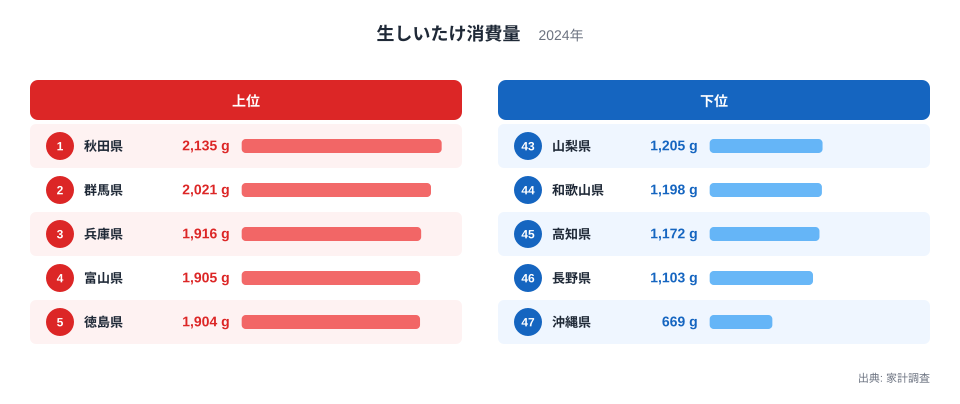
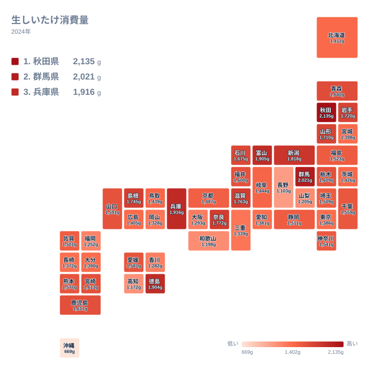

## 生しいたけの購入量で首位に立つのは秋田県

鍋、煮物、炒め物、天ぷら。生しいたけは日常の食卓に欠かせないきのこですが、家庭が1年間に買う量は都道府県でかなり違います。2024年の家計調査で最も多かったのは秋田県で、2,135gでした。2位は群馬県の2,021g、3位は兵庫県の1,916gと続きます。

4位は富山県の1,905g、5位は徳島県の1,904gです。この2県の差はわずかで、上位5県は東北、関東、近畿、中部、四国にそれぞれ1県ずつ並ぶ顔ぶれになりました。特定の一地域に偏らず、全国に散らばっている点が目を引きます。

一方、最下位の沖縄県は669gにとどまりました。1位の秋田県と並べると、1位は最下位の3倍を超える水準です。同じ国内で、同じ食材を買っていても、これだけ量に開きが出ます。この記事では、その差を食文化や産地といった観点から、データで言える範囲と推測にとどまる範囲を分けて整理します。

> [!NOTE]
> ここでの消費量は、家計調査で集計された1世帯あたりの年間購入量で、単位はgです。1人あたりの摂取量ではないため、世帯人員が多い県ほど数字が大きくなりやすい面があります。外食や給食で食べた分は含まれません。また、干ししいたけや加工品は別の品目で、このデータは生のしいたけだけが対象です。

## 上位と下位の顔ぶれを並べて見る

次の図は、上位5県と下位5県を並べたものです。

<source-link href="/ranking/fresh-shiitake-consumption-quantity">生しいたけ消費量ランキングをもっと見る</source-link>

上位は秋田県、群馬県、兵庫県、富山県、徳島県の順で、いずれも1,900gを超えています。下位は、最下位の沖縄県の669gに続き、46位の長野県が1,103g、45位の高知県が1,172g、44位の和歌山県が1,198g、43位の山梨県が1,205gです。

上位は接戦です。1位の秋田県と2位の群馬県の差は114gで、2位の群馬県から5位の徳島県までの幅は117gです。1位と2位の開きは、2位から5位までの幅とほぼ同じで、秋田県が一頭抜けているというより、上位は僅差で並んでいると読むのが適切です。年が変われば順位が入れ替わっても不思議ではない水準です。

下位では様子が違います。43位から46位までは1,100g台から1,200g台に収まっていますが、沖縄県の669gはそこからさらに大きく下に離れています。下位グループ全体が低いというより、沖縄県だけが独立して低い構図です。

> [!WARNING]
> 家計調査は、限られた世帯を対象にした標本調査です。調査対象は都道府県庁所在市などの家計で、県全体の実態とずれる場合があります。順位が近い県どうしの差は、誤差の範囲かもしれません。

## 東北は6県中4県が上位、北関東は県ごとに差がある

東北を見ると、1位の秋田県に加えて、岩手県が10位で1,720g、山形県が11位で1,710g、青森県が13位で1,640gと、6県中4県が上位15位以内に入りました。ただし、福島県は23位の1,523g、宮城県は33位の1,398gで、残る2県は中位から中位より下です。東北全体が高いわけではなく、日本海側か太平洋側かといった単純な線引きも、このデータだけでは根拠を示せません。

寒冷な地域では冬に野菜の選択肢が限られ、きのこが鍋物や汁物に使われやすいのではないか、という見方はあります。秋田県のきりたんぽ鍋のように、きのこを具にする料理が定着していることも一因かもしれません。ただし、これは仮説にとどまります。同じ寒冷な北海道は31位の1,411g、宮城県は33位の1,398gで中位より下にあり、寒さだけでは説明がつきません。

関東では、群馬県が2位の2,021g、栃木県が16位の1,609gですが、茨城県は30位の1,426gです。北関東の3県でも順位は大きく分かれています。一方、東京都は35位の1,386g、神奈川県は22位の1,541g、埼玉県は25位の1,509gです。

[群馬県のデータ](/areas/10000)や[秋田県のデータ](/areas/05000)から、ほかの項目と並べて見ると、食の傾向がより立体的に見えてきます。

> [!TIP]
> 購入量は世帯人員や外食の多さに左右されます。世帯の人数が多い県は購入量が増えやすく、外食や中食が多い県は家庭での購入量が減りやすくなります。この数字は「その県の人が食べた量」ではなく「家庭が買った量」だと意識して読むと、順位の見え方が変わります。

## 地図で見る、地域ごとの色合い

次の図は、都道府県ごとの消費量を地図状のタイルで示したものです。

地図から読み取れる点は、大きく二つあります。一つ目は、高い県が特定の地方にまとまらず、東北、関東、中部、近畿、中国、四国に点在していることです。上位10位までを見ても、東北の秋田県と岩手県、関東の群馬県、中部の富山県と新潟県、近畿の兵庫県、奈良県、滋賀県、中国の島根県、四国の徳島県と、ほぼ全域にまたがります。

二つ目は、同じ地方の中でも県ごとの差が大きいことです。近畿では、3位の兵庫県1,916gに対し、44位の和歌山県は1,198gです。四国でも、5位の徳島県1,904gに対し、45位の高知県は1,172gと、大きく割れています。地方単位で「どこが多い」と語るより、県単位で見るほうが実態に近い指標といえます。

九州・沖縄では、鹿児島県が14位の1,617g、宮崎県が15位の1,613gと、南九州の県は中位以上に入っています。同じ温暖な地域でも沖縄県だけが最下位で、福岡県も42位の1,252gです。

## 沖縄県が少ない理由は、このデータだけでは言い切れない

沖縄県が最下位になった理由として、島野菜や豚肉、豆腐を使う料理が中心で、しいたけを使う鍋や煮物の位置づけが本州と異なる、といった食文化の違いが関係している可能性があります。ただし、これは推測であって、このデータが裏付けているわけではありません。温暖な気候が理由だとすると、同じく温暖な南九州の鹿児島県が14位、宮崎県が15位であることと食い違います。気候だけでは説明できない、と見るのが妥当です。

産地との関係では、長野県の例が目を引きます。きのこの産地として広く知られていますが、消費量は46位の1,103gでした。長野県の例は、産地と家庭の購入量が必ずしも一致しないことを示唆します。ほかのきのこが日常の食卓で選ばれている可能性や、地元で採れた物を直売所や自家消費で入手し、購入量に表れにくい可能性も考えられますが、いずれもこのデータからは確かめられません。

生しいたけをほかの品目と比べる視点も大切です。干ししいたけは出汁や煮物に使う保存食で、使われ方が違います。えのきやしめじは年間を通して手に入りやすい定番のきのこです。県ごとの「きのこの好み」は品目ごとに分かれる可能性があるため、生しいたけの順位だけで県全体のきのこ消費を語ることはできません。

> [!WARNING]
> 長野県は46位の1,103gですが、これは家計調査に表れた購入量の話です。生産量のデータはこの記事にないため、生産の多さと消費の少なさを直接比べることはできません。

## 中位の県と、順位の読み方

全国の真ん中あたりには、千葉県が21位の1,559g、静岡県が24位の1,511g、佐賀県が26位の1,501gといった県が並びます。このあたりは上位との差も下位との差も大きくなく、順位が1つ2つ動いても量としては小さな違いです。

都市部については、東京都が35位、愛知県が36位、大阪府が40位と下位寄りに入る一方、神奈川県は22位、埼玉県は25位です。都市部だから少ない、と一括りにはできません。

こうした差を知っておくと、地域の鍋料理や郷土料理を見る目が変わります。同じカテゴリの他の統計と並べたいときは、[同じカテゴリの統計一覧](/category/economy)から探せます。

## データについて

この記事の数値は、家計調査の生しいたけ消費量で、2024年の1世帯あたり年間購入量をgで示したものです。順位は、実データに記載された47都道府県の値の大きい順です。

購入量は、価格の変動や世帯の人数、世帯の構成、調理の習慣に左右されます。また、年によって順位が入れ替わる県もあるため、1年分の結果だけで固定的な「しいたけ好きの県」と断定するのは避けるべきです。傾向をつかむ材料として、複数の年のデータと合わせて見ることをおすすめします。

## まとめ

2024年の生しいたけ消費量は、1位の秋田県が2,135g、2位の群馬県が2,021g、3位の兵庫県が1,916gでした。最下位の沖縄県は669gで、1位とは大きく離れています。上位は僅差で、特定の地方に偏らず散らばっています。

東北は6県中4県が上位に入る一方、福島県と宮城県は中位以下で、近畿や四国でも県ごとの差が目立ちます。長野県の例は、産地と購入量が必ずしも一致しないことを示唆します。数字の背景には、料理の習慣、流通、家計の買い方が重なっている可能性があります。県ごとの順位を手がかりに、食卓の違いを想像してみてください。
