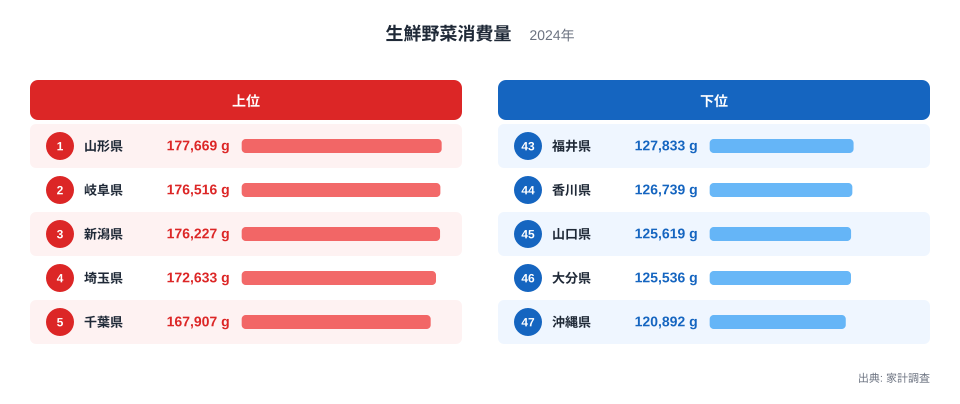
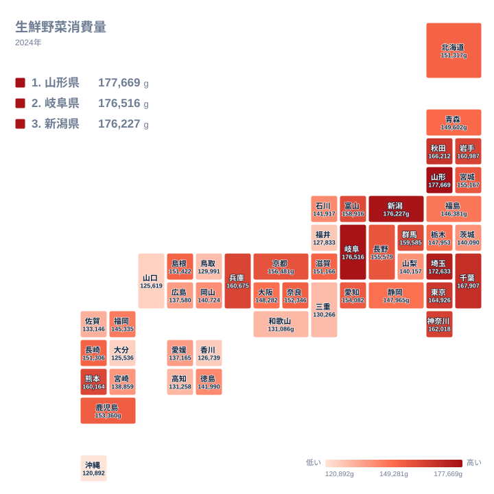

## 野菜の消費量は県によってどれだけ違うのか

毎日の食卓に欠かせない野菜ですが、1年間に家庭で買う量は、住んでいる県によって大きく変わります。2024年の家計調査で生鮮野菜の購入量が最も多かったのは山形県で、177,669gでした。最も少なかったのは沖縄県で、120,892gです。同じ国の中で、これだけの開きがあります。

野菜は健康の面でも話題になりやすい食品です。ただ、消費量の差は単純な健康意識の違いだけでは説明できません。漬物や汁物の文化、冬の寒さ、地元で採れる野菜の種類、スーパーや直売所の使い方など、いくつもの要因が重なっています。この記事では、上位と下位の県を並べながら、産地や食文化との結びつきを探ります。

あわせて、同じ家計の食料支出の中でも、生鮮野菜が他の品目とどう違う性格を持つのかを考えます。他の統計と並べて読みたい方は、[同じカテゴリの統計一覧](/category/economy)も参考にしてください。

> [!NOTE]
> ここでの生鮮野菜消費量は、家計調査で得られる1世帯あたりの年間購入量で、単位はgです。冷凍野菜や漬物、缶詰などの加工品は含まれず、外食で食べた分も入りません。「家庭で買った生の野菜の量」と理解してください。

## 上位と下位の顔ぶれ

まず、上位5県と下位5県を図で確認します。

<source-link href="/ranking/fresh-vegetables-consumption-quantity">生鮮野菜消費量ランキングをもっと見る</source-link>

上位は、1位の山形県が177,669g、2位の岐阜県が176,516g、3位の新潟県が176,227gと、上位3県がほぼ並んでいます。続いて4位の埼玉県が172,633g、5位の千葉県が167,907gです。1位から3位までの差はごくわずかで、順位の入れ替わりは調査の年によって十分に起こり得ると考えられます。

下位は、47位の沖縄県が120,892g、46位の大分県が125,536g、45位の山口県が125,619g、44位の香川県が126,739g、43位の福井県が127,833gです。45位と46位の差は小さく、ここでも僅差の争いになっています。

上位に東北、中部、関東の県が並び、下位には九州・沖縄、中国、四国、中部の県が混ざる点が目を引きます。下位の福井県は中部、山口県は中国、香川県は四国、大分県と沖縄県は九州・沖縄です。つまり下位は特定の地方に固まっているわけではなく、複数の地方に散らばっています。

> [!WARNING]
> 家計調査は、限られた数の世帯を調べた結果です。県によって調査世帯数が少ないため、順位が近い県同士の差は偶然のぶれである可能性があります。1位と2位のような僅差を「本当に多い」と断定するのは避けてください。

## 山形県と岐阜県、新潟県が上位に入る理由

首位の山形県は、野菜を日常的に使う食文化が根づいた県です。秋に川原で作る芋煮のように、野菜をたっぷり入れる鍋料理があり、冬には漬物を自家製で用意する家庭も多い土地柄です。野菜が身近にあることが、購入量の多さにつながっていると考えられます。詳しい数値は[山形県のデータ](/areas/06000)でも確認できます。

2位の岐阜県は、山間部から平野部まで多様な地形を持ち、季節ごとの野菜が手に入りやすい県です。[岐阜県のデータ](/areas/21000)を見ると、地域の特徴をほかの指標と合わせて読めます。漬物や煮物など、野菜を主役にした家庭料理が定着していることも、上位に入る背景として考えられます。

3位の新潟県は、全国有数の米どころです。ごはんの食卓には、副菜や漬物など野菜のおかずがよく合います。雪の多い冬には、保存の利く野菜や漬物を活用する習慣も育ってきました。米の産地であることと、野菜をよく食べることは、食卓の組み立て方という点でつながっているように見えます。

こうして見ると、上位の県は「米や発酵食品を中心に、野菜の副菜を多く並べる食事」という共通した姿を持っています。ただし、これは食文化からの推測であり、家計調査の数字だけで因果関係を証明できるわけではありません。

## 地理分布で見る地方ごとの傾向

次は、47都道府県の消費量を地図上に配置した図です。

北海道・東北では、山形県が1位、秋田県が6位の166,212g、岩手県が9位の160,987gと、上位に入る県が目立ちます。宮城県は16位の155,167g、北海道は21位の151,317g、青森県は24位の149,602g、福島県は28位の146,381gです。寒冷な地域では、冬の保存食として野菜を漬ける文化が強く、消費量が高めになる傾向がうかがえます。

関東では、埼玉県が4位、千葉県が5位、東京都が7位の164,926g、神奈川県が8位の162,018g、群馬県が12位の159,585gと、多くの県が上位に集まっています。大消費地の近くには野菜の産地が広がっており、新鮮な野菜が店頭に並びやすいことが影響しているのかもしれません。一方、栃木県は27位の147,953g、茨城県は34位の140,090gで、同じ関東でも差があります。

近畿では、兵庫県が10位の160,675g、京都府が14位の156,481gと上位に近い位置にあります。一方で、和歌山県は40位の131,086g、三重県は41位の130,266gで、同じ地方の中でも二極化しています。

> [!TIP]
> 地図を読むときは、色の濃い県だけでなく、隣り合う県との差に注目してください。同じ地方でも順位が大きく離れているなら、気候だけでなく、流通や食習慣といった県ごとの事情が効いていると考えられます。

## 下位の県に共通する背景を考える

最下位の沖縄県は、独自の食文化を持っています。豚肉や豆腐、海藻、島野菜などを使う料理が多く、本土の家庭で消費される葉物野菜や漬物とは、食卓の構成が異なります。温暖な気候で、冬の保存食として野菜を大量に漬ける必要が小さいことも、購入量の少なさに関わっている可能性があります。

大分県は46位、山口県は45位です。両県とも海に面しており、魚介類を食べる機会が多いことが、野菜の購入量に影響しているかもしれません。ただ、これは仮説にとどまります。香川県は44位で、うどんを中心とした食生活が定着している県です。主食に麺類が多い食習慣は、野菜の副菜を多く並べるスタイルとは違う形になりやすいと考えられます。

福井県は43位の127,833gでした。中部の県でありながら、新潟県の3位、岐阜県の2位とは大きく異なる位置にいます。同じ地方の中でも、順位の幅はこれほど広がります。「雪国だから野菜をよく食べる」といった単純な説明が当てはまらないことが、ここから分かります。

九州では、熊本県が11位の160,164g、鹿児島県が18位の153,360gと上位寄りの一方、大分県は46位、沖縄県は47位です。九州・沖縄という大きなくくりでは、県ごとの差が大きい地方といえます。中国では島根県が20位の151,422g、岡山県が32位、広島県が36位、鳥取県が42位、山口県が45位です。四国では徳島県が30位、愛媛県が37位、高知県が39位、香川県が44位でした。

## 生鮮野菜と他の食品を並べて考える

生鮮野菜の消費量は、同じ食料のなかでも性格が少し異なります。肉類や魚介類は、好みや価格で選ぶ余地が大きい品目です。これに対して野菜は、ほぼ毎日の食事で少しずつ使われる、土台のような品目です。そのため、極端に少ない県や極端に多い県が生まれにくく、順位の差は大きな格差というより、食卓の組み立て方の違いとして現れます。

ただし、最大の山形県と最小の沖縄県の間には、177,669gと120,892gという開きがあります。これは無視できない差で、日常の食事の中身が地域によって変わっていることを示しています。

もう一つ見落としたくないのは、産地と消費の関係です。野菜の産地が近い県ほど、鮮度のよい野菜を手頃な値段で買いやすく、家庭での購入量も増えやすいと考えられます。一方で、都市部の東京都や神奈川県も上位に入っており、産地の近さだけでは説明がつきません。共働き世帯の多さや、家庭でサラダなどを用意する習慣など、都市部ならではの事情もありそうです。

このように、消費量の差は一つの理由では語れません。気候、産地、主食、食の好み、買い物の仕方が、県ごとに異なる組み合わせで作用しているのです。

## データについて

このデータは、家計調査における生鮮野菜の年間購入量を、県庁所在地などの調査結果をもとにまとめたものです。年は2024年、単位はgです。調査は世帯単位で行われるため、世帯人数の違いによって、1人あたりの量とは異なる結果になる場合があります。

> [!NOTE]
> 世帯人数が多い県では、1世帯あたりの購入量が増えやすくなります。この記事の数値は1世帯あたりの量であり、個人が食べた野菜の量そのものではありません。順位を読むときは、世帯の規模の違いも頭に置いてください。

## まとめ

2024年の生鮮野菜消費量は、山形県が1位、岐阜県が2位、新潟県が3位でした。最下位は沖縄県で、43位の福井県から47位まで、中部、四国、中国、九州・沖縄の県が並んでいます。上位には東北、関東、中部の県が多く、野菜を漬けたり煮たりする食文化と、産地や市場の近さが重なっていると考えられます。

ただし、順位は僅差の場合が多く、調査の特性上、わずかな差を過大に読むことは避けるべきです。大切なのは、順位そのものよりも、その背後にある食卓の違いに目を向けることです。

気になる県があれば、ほかの統計と合わせて読むことで、その土地の暮らしがより立体的に見えてきます。[山形県のデータ](/areas/06000)や[岐阜県のデータ](/areas/21000)から、ぜひ見比べてみてください。
