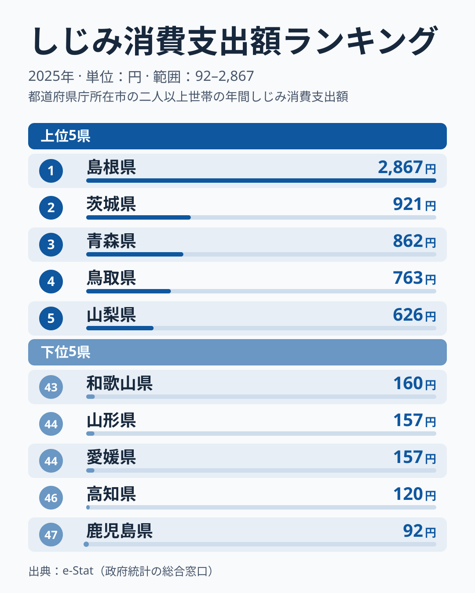
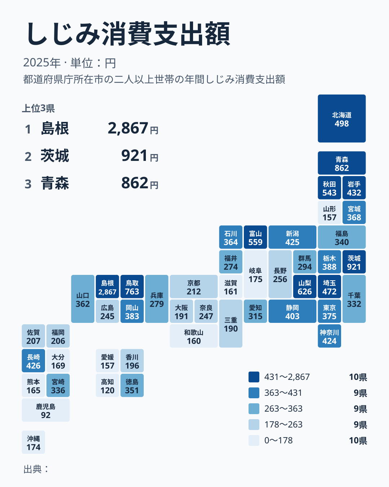

しじみは「二日酔いの朝はしじみ汁」というイメージが定着した食材ですが、実は消費量に大きな地域差があります。総務省家計調査によると、2025年の都道府県庁所在市（二人以上世帯）のしじみ消費支出額は、1位の島根県が2,867円で、最下位の鹿児島県は92円で、その実に31.2倍にのぼります。

この記事では、しじみ消費支出額の47都道府県ランキングを見ながら、なぜ島根が突出して1位なのか、そしてしじみの消費が地理的にどう分布しているのかを掘り下げます。結論から言うと、上位県には共通点があります。ヤマトシジミが育つ「汽水湖」を抱えているかどうかです。

> [!NOTE]
> 本データは総務省「家計調査（品目別）」に基づく、都道府県庁所在市および政令指定都市の二人以上世帯における年間しじみ消費支出額（2025年）です。実際の購入量ではなく金額ベースの調査であり、地域の物価差も反映されます。

## 上位と下位

しじみ消費支出額の上位5県・下位5県を見ると、地理的な偏りがはっきり表れます。

<source-link href="/ranking/freshwater-clam-consumption-expenditure">しじみ消費支出額ランキングをもっと見る</source-link>

1位は島根県で2,867円。2位の茨城県は921円で、島根県は2位を大きく引き離しており、単独首位というより「圧勝」に近い水準です。3位以下も青森県が862円、鳥取県が763円、山梨県が626円と続き、青森県など東北の県と、島根県・鳥取県の中国地方の県が目立ちます。

島根1位の背景には、宍道湖の存在があります。宍道湖はヤマトシジミの漁獲量で全国トップクラスの産地であり、県庁所在地である松江市はまさにその湖畔に位置します。地元でしじみが日常的に流通し、食卓に上る頻度が他県とは根本的に異なると考えられます。3位の青森県も、十三湖という汽水湖を抱える産地県で、同様の構造が見て取れます。[島根県の統計データ](/areas/32000)を見ても、水産業が地域経済の重要な位置を占めていることがわかります。

一方、上位に2位の茨城県が入っているのは一見意外に映るかもしれません。しかし茨城県には涸沼という汽水湖があり、ここもヤマトシジミの主要産地の一つです。つまり上位5県のうち島根・青森・茨城の3県は、いずれも「シジミが獲れる汽水湖を県内に持つ」という共通点で説明できます。

## 最下位グループ

下位5県は、鹿児島県が92円、高知県が120円、愛媛県と山形県が157円、和歌山県が160円で、九州・四国・近畿に東北の山形が加わる顔ぶれです。最下位の鹿児島県は92円で、1位島根の31分の1という水準にとどまります。福岡県は206円で34位、沖縄県は174円で39位と、こちらも下位寄りです。

> [!WARNING]
> 本調査は都道府県庁所在市（政令指定都市含む）のみの調査であり、県内全域の消費実態を代表するものではありません。産地に近い地方都市ほど消費が多い可能性があり、県庁所在地のデータだけでは県全体の傾向を過小・過大評価するリスクがあります。

下位グループには、県内にヤマトシジミの著名な産地となる汽水湖を持たない地域が多く見られます。[仮説] 九州・四国は温暖な気候で他の魚介類（かつお、貝類など）の消費文化が発達している一方、しじみのような冷涼な水域を好む貝は地元産の供給が乏しく、食文化として定着しにくかった可能性があります。近畿圏でも大阪府は191円で36位、滋賀県は161円で42位と著名なシジミの産地が少なく、消費が伸び悩んでいます。ただし山形県のように東北でも下位に入る県があり、家計調査の市別の値は単年のぶれが大きいため、2025年1年分の順位だけで構造を断定することはできません。

## 発見：なぜ「二日酔いにしじみ」が全国区にならないのか

地図にすると、しじみ消費が「点在する産地」に強く結びついていることが分かります。突出して濃い島根（宍道湖）を筆頭に、青森（十三湖）・茨城（涸沼）といった汽水湖を持つ県が上位に入り、秋田・鳥取のほか、山梨・富山も濃く浮かび上がります。一方、九州・近畿・四国は長崎など一部を除いて薄い状態です。山梨は汽水湖がなく、単年のぶれの可能性もあるため、産地との関係で説明しきれない例外として残ります。さばやみかんのような「西高東低」といった連続した帯ではなく、汽水湖という特定の地形資源の有無で色が決まりやすい点が、しじみ消費地図の大きな特徴です。

しじみは「オルニチンが豊富で肝臓に良い」として全国的な健康効果イメージが広く知られている食材です。にもかかわらず、消費支出額には31倍という大きな地域差が存在します。これは、健康イメージだけでは消費行動を均一化できず、**地元での入手しやすさ（産地との近さ）が消費量を左右する大きな要因**であることを示唆しています。

[仮説] 産地県の島根・青森・茨城では、しじみが「特別な健康食品」ではなく「日常の食材」として定着しているため、価格が手頃で購入頻度が高い可能性があります。一方、非産地県では輸送コストや流通の関係で割高になりやすく、健康効果を意識した「たまの購入」にとどまりやすいと考えられます。この点は今回のデータだけでは検証できず、価格差データとの突合が必要です。

もう一つの発見は、東北勢（青森3位・秋田7位・岩手10位）が上位10県のうち3県を占めている点です。ただし山形県は157円で44位と下位で、東北全体が一様に高いわけではありません。東北は宍道湖ほど有名な単一の産地こそありませんが、十三湖（青森）をはじめ汽水域の多い地形が、地域としてしじみを身近な食材にしている可能性があります。

> [!TIP]
> 魚介類の消費は「産地に近いほど多い」という傾向が、しじみ以外の水産物でも見られます。かつおや牡蠣の消費地図を比較すると、それぞれの産地が異なる県に集中していることがわかります。詳しくは[かつお・牡蠣の消費量マップ](/blog/bonito-vs-oyster-fish-map)で解説しています。

しじみのような家計調査の品目別データは、他の食材でも都道府県ごとに大きな差が出ることが多く、[経済カテゴリのランキング一覧](/category/economy)では家計消費に関する統計を横断的に確認できます。

## まとめ

- **1位は島根県で2,867円**。宍道湖という全国屈指のヤマトシジミ産地を抱え、2位の茨城県（921円）を大きく引き離して独走
- **最下位は鹿児島県で92円**。1位との差は31.2倍
- **上位は産地県に集中**：島根・青森・茨城はいずれも県内に著名な汽水湖（宍道湖・十三湖・涸沼）を持つ
- **下位は九州・四国・近畿に多い**：温暖な地域や著名な汽水湖を持たない地域で消費が伸び悩む（山形のような例外もあり、単年の順位は [仮説] として読む）
- **健康イメージだけでは均一化しない**：「二日酔いにしじみ」という全国共通の認知があっても、地元での入手しやすさが消費量を左右する
