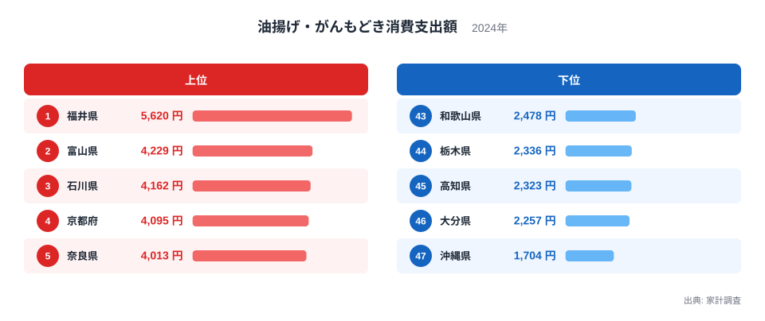
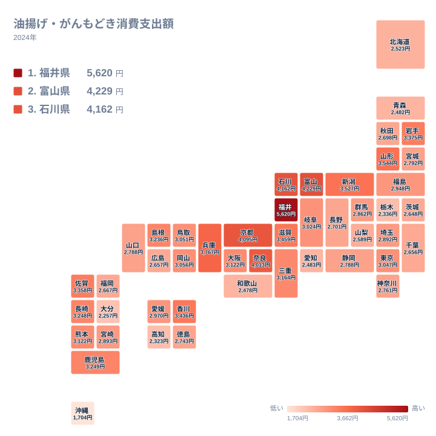

## 油揚げへの支出が最も多いのは福井県

油揚げやがんもどきは、味噌汁の具、煮物、きつねうどん、いなりずしなど、日常の食卓に幅広く登場する食材です。どの家庭でも見かけるものですが、1世帯が1年間に使う金額を県ごとに比べると、意外なほど大きな差があります。

2024年の家計調査で、油揚げ・がんもどきへの支出が最も多かったのは福井県です。金額は5,620円でした。2位は富山県の4,229円、3位は石川県の4,162円で、上位3つを北陸の県が占めています。一方、最下位の47位は沖縄県の1,704円です。福井県は沖縄県の3倍を超える水準にあります。

この記事では、まず上位と下位の顔ぶれを確認し、次に地図で地域のまとまりを見ます。そのうえで、食文化や気候、関連する食品との対比から、この差がなぜ生まれるのかを考えます。ただし、家計調査の数字から言えるのは「どこで支出が多いか」までです。理由については、あくまで一般に語られる説明を仮説として紹介します。

> [!NOTE]
> ここでの「油揚げ・がんもどきへの支出」は、家計調査における世帯の年間支出額(単位は円)です。買った量や重さ(グラム)ではなく、購入にかけた金額です。そのため、福井県の5,620円は「たくさん食べている」ことの証拠とは限りません。厚くて大きい商品を選ぶ、単価の高い豆腐店の品を買うといった違いでも金額は膨らみ、量との区別はこのデータだけではつきません。

## 上位5県と下位5県を比べる

まずは、上位5県と下位5県を並べた図を見てください。

<source-link href="/ranking/fried-tofu-consumption-expenditure">油揚げ・がんもどきへの支出ランキングをもっと見る</source-link>

この図で注目したいのは、上位の中でも1位の福井県が頭一つ抜けていることです。福井県は2位の富山県より1,391円多く、2位から5位までは4,000円台で接近しています。つまり「上位5県」とひとまとめにされがちですが、実際には福井県だけが別格で、富山県以下は僅差の集団です。

下位側では、46位の大分県と47位の沖縄県の間に553円の開きがあります。43位から46位までは2,000円台で比較的固まっており、沖縄県だけが下に大きく離れています。1位から47位までの幅を決めているのは、福井県の突出と沖縄県の落ち込みという両端の2県だといえます。

地方別に見ると、上位には北陸3県と近畿の京都府、奈良県が入っています。下位には近畿の和歌山県、関東の栃木県、四国の高知県、九州の大分県、沖縄県が並びます。同じ地方の中でも差があり、単純な「東高西低」や「西高東低」では説明できません。福井県のデータは[福井県のページ](/areas/18000)、富山県のデータは[富山県のページ](/areas/16000)でも確認できます。

> [!WARNING]
> 家計調査は標本調査で、調べられる世帯数が限られます。順位が近い県同士の差は、誤差の範囲かもしれません。たとえば大阪府と熊本県はどちらも3,122円で、同額に並んでいます。1位から5位までを大づかみに見ることは有効ですが、数百円差の順位の入れ替わりを重く見すぎないでください。

## 地図で見ると北陸から近畿へ連なる

次に、47都道府県の分布をタイルマップで見ます。

地図で目立つのは、福井県、富山県、石川県の北陸3県と、隣り合う新潟県の連なりです。新潟県は3,527円で8位に入っており、この4県がすべて10位以内です。そこから西へ、滋賀県が9位、京都府が4位、奈良県が5位、兵庫県が6位と、近畿の中北部に高い値が続きます。一方で、同じ近畿の和歌山県は43位にとどまり、近畿の中でも一様ではありません。

東北では、山形県が3,544円で7位、岩手県が3,375円で11位です。一方、青森県は2,482円で42位、秋田県は2,698円で34位と低く、東北全体が高いわけではありません。北陸の周辺だけでは説明できない高さの県が、東北にも点在していることがわかります。

首都圏を見ると、東京都は3,047円で21位、埼玉県は2,892円で26位、神奈川県は2,761円で31位、千葉県は2,656円で37位です。東京都は中位の入り口あたりで、埼玉県、神奈川県、千葉県は順に中位から下位寄りへ下がります。人口の多い大都市圏ほど支出が多いという図式は、この指標では成り立ちません。

> [!TIP]
> 地図は色の濃淡で読み、まず「どの地方がまとまって濃いか」を見るのがコツです。一つの県だけが飛び抜けているのか、隣の県も同じ傾向なのかを区別すると、地域に広がる傾向と個別の事情を切り分けやすくなります。

## 北陸と近畿に支出が集まる背景

ここからは、数字を裏づけるデータがない領域です。一般に語られている説明を、仮説として紹介します。

北陸については、精進料理や報恩講の文化がよく挙げられます。一説には、北陸は浄土真宗の信仰が厚い地域で、肉や魚を使わない料理を食べる機会があり、その中で厚い油揚げや大きながんもどきが重宝されてきたと言われます。福井県では厚く大きな油揚げが家庭の定番として知られるともいわれ、首位という結果と合う話ではあります。ただし、これを裏づける世帯別のデータは今回ありません。

気候も、しばしば理由に挙げられます。雪の多い冬には、保存のきく加工食品が食卓を支えてきたという見方があります。大豆製品は煮物や汁物に入れて満足感を高められる食材なので、そうした事情が影響している可能性はあります。ただ、この説明は新潟県のような雪国には当てはまっても、山形県や岩手県の高さ、あるいは同じ雪国である青森県や秋田県の低さまでは説明できません。

近畿の京都府と奈良県については、寺社が多く精進料理の文化が続いてきたことが背景にあるのではないか、と言われます。出汁を含ませて煮る調理法やきつねうどんなど、油揚げを使う料理が根づいていることも、可能性のひとつです。一方、兵庫県や滋賀県の高さは、寺院文化だけでは説明しにくく、別の要因もあると考えるのが自然です。

結局のところ、宗教や気候の説明は、上位の一部の県にしかうまく当てはまりません。家計調査の数字だけで因果関係を証明することはできず、ここで挙げた理由はどれも「そうかもしれない」という域を出ません。

## 関連品目との対比で見える特徴

油揚げ・がんもどきは、豆腐や納豆と並ぶ大豆加工品の一つです。今回は豆腐や納豆の都道府県別データを扱っていないため、他の大豆製品との数値の比較はできません。ここでは、油揚げ・がんもどきの内部の違いに目を向けます。

油揚げは、調味料や出汁と組み合わせて使う「脇役」の側面と、煮物などで主役になる「主役」の側面を併せ持ちます。上位の県で、厚揚げやがんもどきが主役として使われている可能性はありますが、このデータからは確かめられません。沖縄県の1,704円の低さも、豆腐を別の形で食べる文化が関係しているのかもしれないという推測にとどまります。

九州では、佐賀県が3,358円で12位、鹿児島県が3,249円で13位、長崎県が3,248円で14位と中位から上位に入る県が目立つ一方、大分県は2,257円で46位です。同じ九州でも差が大きく、地方単位では語りきれない多様さがあります。四国でも香川県は3,436円で10位ですが、高知県は2,323円で45位と対照的です。

こうして見ると、油揚げ・がんもどきへの支出は、地方ごとの大づかみな傾向と、県ごとの個別の事情が重なって決まる指標だと考えられます。

## 数字を暮らしに引き寄せて読む

最後に、全国の中での位置づけを整理します。中位の目安として、23位の愛媛県は2,970円、24位の福島県は2,948円です。1位の福井県の5,620円は、23位の愛媛県より2,650円多い金額です。支出額で見る限り、福井県は全国の中位の県を大きく上回っています。

一方で、下位の県の支出が少ないことは、好まれていないことを意味しません。別の食材や料理で同じ役割を果たしている可能性があります。支出額の差は、食卓の優先順位や料理の種類の違いの結果かもしれず、優劣ではありません。

この記事で使った指標は、[同じカテゴリの統計一覧](/category/economy)にも関連する家計の項目が並んでいます。ほかの食品と見比べると、地域ごとの食の個性がさらに浮かび上がります。

## データについて

この記事のデータは、家計調査の2024年の結果です。正式な統計名は「油揚げ・がんもどき消費支出額」で、単位は円です。全国47都道府県の値が公表されており、1位は福井県の5,620円、47位は沖縄県の1,704円です。金額は世帯による年間の支出額で、物価や購入先、食べ方の違いが反映されます。順位の近い県同士を比べる場合は、調査の標本誤差を念頭に置いてください。
