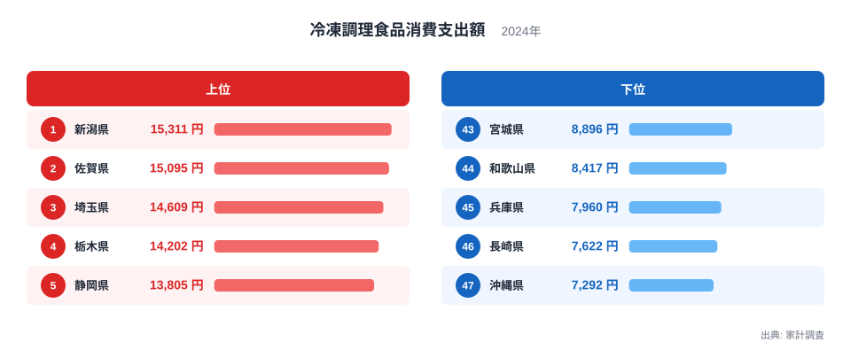
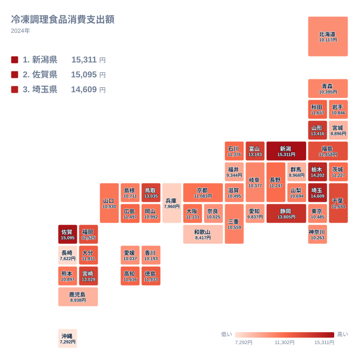

冷凍餃子、冷凍コロッケ、冷凍ピラフ、冷凍のお好み焼きやグラタン。冷凍調理食品は、多くの家庭の冷凍庫に並ぶ身近な食品です。ところが、その購入額は都道府県でかなり違います。2024年の家計調査で最も支出が多かったのは新潟県の15,311円、最も少なかったのは沖縄県の7,292円でした。

この記事では、47都道府県の数字を並べ、どの県で冷凍調理食品への支出が多いのかを確認します。そのうえで、食文化や気候、産地といった切り口から、差の背景を仮説として考えます。ただし、この記事で使うのは支出額の順位と金額だけです。要因を検証するデータは持っていないため、理由に触れる部分はすべて推測であることを先にお断りしておきます。

## 上位と下位の顔ぶれ

まずは上位5県と下位5県を見てみましょう。

<source-link href="/ranking/frozen-food-consumption-expenditure">冷凍調理食品への支出ランキングをもっと見る</source-link>

図で注目したいのは、上位5県の並び方です。新潟県、佐賀県、埼玉県、栃木県、静岡県と、所在する地方がばらばらです。新潟県は甲信越、佐賀県は九州、埼玉県と栃木県は関東、静岡県は東海に区分されます。「この地方だけが高い」という単純な構図ではないことが、この顔ぶれから読み取れます。

下位も同じ傾向です。宮城県、和歌山県、兵庫県、長崎県、沖縄県が並び、東北、近畿、九州、沖縄に分かれています。上位にも下位にも九州の県が入っている点は、地方単位の平均では実態を見誤りやすいことを示しています。

もう一つ、図から分かるのは差の大きさです。新潟県は沖縄県の2倍を超えています。日常的な食品の支出で、これほど開く例は多くありません。一方で、1位の新潟県と2位の佐賀県は接戦で、トップ層は2県が並んで先頭を走る形です。

> [!NOTE]
> この数値は家計調査(2024年)の「冷凍調理食品消費支出額」で、1世帯が1年間に冷凍調理食品へ支出した金額(円)です。食べた量や個数ではないため、単価の高い商品を選ぶ地域や、内容量の大きい商品が多い地域では、同じ量でも支出額は大きくなります。また、冷凍の野菜や魚介のような素材そのままの品は含まれず、餃子やコロッケのように調理済みの冷凍品が対象である点にも注意してください。

## 地理分布で見る散らばり

次に、47都道府県を地図に近い配置で見てみます。

地図で眺めると、関東では埼玉県が3位、栃木県が4位、千葉県が10位と上位に入っています。ところが東京都は31位、神奈川県は34位です。同じ首都圏でも、上位の県と中位の都県が隣り合っており、大都市の中心部ほど高いという関係は見られません。

東北と日本海側の県を、県名で並べてみます。山形県は6位、富山県は7位、福島県は12位、秋田県は15位、石川県は18位です。上位から中位にかけて分布しており、新潟県を含めて、雪の多い県に比較的高い順位が目立つという見方もできます。ただし、青森県は32位、宮城県は43位と下位寄りで、この見方に当てはまらない県もあります。冬の買い物の事情が影響する可能性はありますが、データからは検証できません。

九州は順位が大きく割れています。佐賀県が2位、宮崎県が9位、福岡県が11位、大分県が14位と高めです。一方、熊本県は25位、鹿児島県は42位、長崎県は46位でした。九州として一括りにはできないことが、この地図からもよく分かります。

> [!TIP]
> 順位は金額の差とあわせて読んでください。たとえば11位の福岡県は12,525円、31位の東京都は10,485円で、20位ぶんの差は2,040円です。これに対し、1位から5位までは1,506円の差があり、上位5県の中だけで中位20位ぶんに近い開きが生じています。順位の並びは一様な間隔ではなく、上位の1つの順位差のほうが中位より重いと考えられます。

## 差の背景をどう仮説立てるか

ここからは、実データにない要因を扱います。いずれも仮説であり、今回の数字から確かめることはできません。

一つ目は暮らし方です。調理にかけられる時間が短い世帯ほど冷凍調理食品を使いやすい、という考え方があります。ただし世帯の働き方や通勤時間の統計は使っていないため、上位の県がそうした傾向を持つかどうかは分かりません。

二つ目は食文化と産地です。餃子やコロッケなど、家で一から作るより買ったほうが楽な料理が多く含まれるため、そうした料理を日常的に食べる土地では支出が増えるかもしれません。新潟県や佐賀県は米どころで食品加工も盛んですが、地元の冷凍食品が購入額を押し上げているかどうかは、品目別の内訳がないため判断できません。

三つ目は大都市の食環境です。東京都、神奈川県、愛知県は、それぞれ31位、34位、39位です。総菜店や外食、宅配など冷凍食品以外の選択肢が多い可能性はありますが、これも仮説にとどまります。なお、同じ首都圏でも埼玉県や千葉県は上位であり、大都市圏全体に当てはまる話ではなく、この3都県に限った見え方です。

## 支出の置き換えという見方

冷凍調理食品の支出が多いことは、食費全体が多いことを意味するとは限りません。むしろ、ほかの食べ方との置き換えを映している可能性があります。自分で調理する家庭、店の総菜を買う家庭、冷凍食品で済ませる家庭では、同じ夕食でも支出の行き先が異なります。

ただし、この記事は冷凍食品以外の品目の支出を扱っていません。総菜や外食の支出と比べて置き換えが起きているかを確かめるには、別の統計を並べる必要があります。ここでは、そうした比較をすれば見えてくるかもしれない論点がある、という指摘にとどめます。

サイト内の[同じカテゴリの統計一覧](/category/economy)で他の家計関連の指標を見ると、冷凍調理食品の順位が他の支出とどう並ぶのかを自分で確かめられます。新潟県の詳しい数字は[新潟県のデータ](/areas/15000)、佐賀県は[佐賀県のデータ](/areas/41000)で確認できます。

> [!WARNING]
> 家計調査の都道府県別の値は、県庁所在地(東京都は特別区、政令指定都市を含む)の世帯を対象にした結果で、県全体の暮らしを代表するとは限りません。また、冷凍調理食品は調査上の品目分類にもとづく集計なので、お弁当用の冷凍おかずや冷凍麺類などがどこまで含まれるかは、一般的な印象と異なる場合があります。1年分の値だけでは、地域の傾向と断定できません。

## 結果の読み方と結び

今回の結果から確実に言えるのは、2024年の冷凍調理食品への支出に、県ごとの大きな開きがあったという点です。上位は新潟県、佐賀県、埼玉県、栃木県、静岡県、下位は沖縄県、長崎県、兵庫県、和歌山県、宮城県でした。地方ごとの括りでは説明しにくい並びであり、同じ地方の中でも順位が大きく割れています。

暮らし方、気候、食文化、産地といった要因が関わっている可能性はありますが、今回のデータからは裏付けられません。どの要因がどれだけ効いているのかは、世帯構成や品目別の支出といった別の統計で確かめる課題として残ります。

自分の住む県の順位が意外に高い、あるいは低いと感じたら、スーパーの品ぞろえや家族の人数、普段の食卓を思い浮かべながら、数字との距離を考えてみてください。順位はあくまで1年分の目安です。

## データについて

この記事の数値は、家計調査(総務省統計局)の2024年のデータで、統計名は「冷凍調理食品消費支出額」です。単位は円で、1世帯あたりの年間支出額を指します。全47都道府県の値を比較しており、本文中の金額と順位はすべてこのデータに基づいています。
