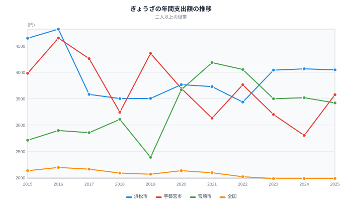
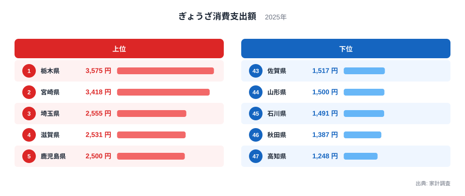
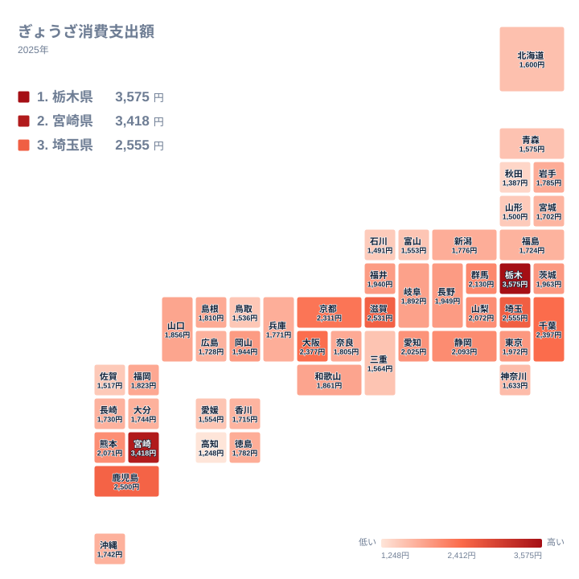

「餃子日本一はどの街か」──ニュースが毎年のように取り上げる問いです。家計調査の**ぎょうざ支出額**(都道府県庁所在市・二人以上世帯の年間支出)で47都道府県を並べると、2025年の1位は[栃木県](https://stats47.jp/areas/09000)の宇都宮市で、1世帯あたり**3,575円**でした。2位は[宮崎県](https://stats47.jp/areas/45000)の3,418円です。県庁所在市だけの首位は、2015年から2020年が宇都宮市、2021年から2024年が宮崎市で、2025年に宇都宮市が5年ぶりに取り戻しました。最下位は[高知県](https://stats47.jp/areas/39000)の1,248円で、1位とは**2.86倍**の開きがあります。

ところが餃子の街として並び称される浜松市は、静岡県の県庁所在市ではないため、この47都道府県の順位には入りません。県庁所在市と政令指定都市の52市で並べ直すと、2025年は浜松市が4,046円で首位です。52市の年ごとの首位を2015年から2025年まで調べると、浜松市が7回、宇都宮市と宮崎市が2回ずつで、他の市が首位に立った年はありません。「宇都宮と浜松のどちらが日本一か」は、どの範囲で、どの年を見るかで答えが変わる問いです。この記事では、年ごとの推移、2025年の47都道府県、52市の定義の違いの順に読み解きます。

> [!NOTE]
> この数字は個数や重さの消費量ではなく、**支出額**です。家計調査の「ぎょうざ」には購入数量の表がなく、量での比較はできません。単価の高い商品を買う世帯が多い地域は、実際の量が同程度でも支出額は高く出ます。対象は各都道府県の**県庁所在市の二人以上世帯**の年間平均値で、県全体ではありません。総務省の家計調査 品目分類(2025年改定)では、品目「ぎょうざ」は「他の調理食品」の一品目で、定義は「生も含む」です。冷凍品は別の品目「冷凍調理食品」、外食のぎょうざは「中華食」に分かれるため含まれません(出典: 総務省統計局「家計調査 品目分類」2025年改定。数値は2025年までの家計調査)。

## 2015〜2025年の推移──県庁所在市の首位は宇都宮と宮崎の間を動いてきた

まず時間軸で見ます。e-Statの年次の値から、浜松市・宇都宮市・宮崎市と全国の二人以上世帯の推移を描きました。

e-Statから52市すべての年次の値を取り、年ごとの首位を調べました。2015年から2025年の11年のうち、浜松市が7回(2015年・2016年・2018年・2020年・2023年・2024年・2025年)、宇都宮市が2回(2017年は4,259円、2019年は4,358円)、宮崎市が2回(2021年は4,184円、2022年は4,053円)で、この3市以外が首位に立った年はありません。浜松市は宇都宮市と比べても、11年のうち8回上回っています。宇都宮市が上回ったのは2017年・2019年・2022年の3回です。

浜松市など県庁所在市ではない政令指定都市を除いた、47の県庁所在市だけで見ると景色が変わります。首位は2015年から2020年が宇都宮市、2021年から2024年が宮崎市、2025年が再び宇都宮市で、入れ替わりは2回です。2017年と2019年の2番手は宮崎市ではなく京都市で、3,041円と2,787円でした。差が小さい年も目立ちます。2020年は宇都宮市の3,694円に宮崎市の3,669円で25円差、2018年は3,241円と3,106円で135円差、2025年は3,575円と3,418円で157円差です。一方、2021年は宮崎市の4,184円に宇都宮市の3,129円で1,055円差と、はっきり開いた年もありました。

変化は3市で同じ向きではありません。2021年から2025年の4年間で、宮崎市は4,184円から3,418円へ766円減り、宇都宮市は3,129円から3,575円へ446円増え、浜松市は3,728円から4,046円へ318円増えました。全国の二人以上世帯の平均は2,093円から1,985円へ108円減っています。宇都宮市の2024年の2,801円は11年間で最も低い値で、2025年の3,575円はそこからの戻りでもあります。首位は関東の宇都宮市、九州の宮崎市、東海の浜松市の間を動いてきましたが、家計調査の支出額だけでは、なぜその街でその年に増減したのかは分かりません。本記事では理由を断定しません。

全国の平均は2015年の2,132円から2025年の1,985円まで、ほぼ2,000円前後で動いています。これに対して3市は2,385円から4,819円の範囲で大きく揺れました。2023年から2025年の3年平均で全国の1,984円と比べると、浜松市は約2.0倍、宮崎市は約1.8倍、宇都宮市は約1.6倍です。単年の順位を競うより、この3市が全国平均を大きく上回る水準で競り合っていると読むほうが実態に近いでしょう。なお全国の値は全国の二人以上世帯の平均で、県庁所在市だけの値ではない点に注意してください。

> [!WARNING]
> 家計調査は標本調査で、市ごとの標本世帯は限られます。年ごとの値には標本の偏りによる振れが含まれ、百円前後の差で順位が入れ替わる年があります。単年の順位だけで「この街が日本一」「この県は餃子を買わない」と断定せず、複数年の水準で読んでください。

## 2025年の47都道府県──上位5県・下位5県

2025年の上位5県と下位5県の支出額を並べたチャートです。

<source-link href="/ranking/gyoza-frozen-consumption-expenditure">ぎょうざ消費支出額ランキングをもっと見る</source-link>

目を引くのは上位2県の抜け方です。栃木県の3,575円と宮崎県の3,418円の差は157円しかなく、3位の埼玉県の2,555円とは863円も離れています。3位から10位は2,555円から2,093円の範囲に密集しており、栃木県と宮崎県が飛び抜け、その後ろに団子状の集団が続く構図です。ただし栃木県と宮崎県の157円差は、推移で見た2018年の135円差や2020年の25円差と同じ程度の大きさで、標本調査の振れで入れ替わりうる差です。2位との順位の違いより、2県がそろって別格だという点を読み取ってください。栃木県の値は宇都宮市、宮崎県の値は宮崎市そのものなので、この2県の勝負は「宇都宮市対宮崎市」です。

上位10県を地域で数えると、関東から栃木県・埼玉県・千葉県・群馬県の4県、近畿から滋賀県・大阪府・京都府の3府県、九州から宮崎県・鹿児島県の2県、東海から静岡県が入っています。4位の滋賀県は2,531円、5位の鹿児島県は2,500円、6位の千葉県は2,397円で、2位の宮崎県と並べると上位2県だけが別格だと分かります。静岡県は10位で2,093円ですが、この値は静岡市の家計であり、浜松市の家計は含まれません。下位5県は、43位の佐賀県が1,517円、44位の山形県が1,500円、45位の石川県が1,491円、46位の秋田県が1,387円、最下位の高知県が1,248円で、最下位の高知県は1位の栃木県の約3分の1にとどまります。

## 定義を読む──「餃子日本一」が47都道府県の順位と食い違う理由

ニュースで語られる「餃子日本一」は、総務省が公表する県庁所在市と政令指定都市の52市を並べた比較で、単年ではなく3年平均で示されることが多いものです。一方、この記事の図や地図は都道府県別のランキングなので、1県につき県庁所在市の1市しか入りません。県庁所在市ではない政令指定都市は浜松市・川崎市・相模原市・堺市・北九州市の5市で、52市は47の県庁所在市とこの5市の合計です。この5市は都道府県別のランキングに入りません。

分かれ目になるのが浜松市です。静岡県の県庁所在市は静岡市なので、静岡県の値に浜松市の家計は入りません。浜松市が入るのは52市の比較だけで、そこでは2025年に4,046円で首位です。2位は宇都宮市の3,575円、3位は宮崎市の3,418円、4位はさいたま市の2,555円、5位は大津市の2,531円でした。

同じ52市を2023年から2025年の3年平均に直すと、順序が少し変わります。1位は浜松市の4,051円、2位は宮崎市の3,478円、3位は宇都宮市の3,192円で、4位は大津市の2,455円、5位はさいたま市の2,412円です。この3年平均は、e-Stat(家計調査、統計表ID 0004023605)の年次の値を本記事で単純平均して四捨五入したものです。同じ方法で2022年から2024年を計算すると、浜松市3,847円、宮崎市3,689円、宇都宮市3,254円になり、[静岡県企画部統計活用課「家計調査から見る、静岡県の食の特徴」](https://toukei.pref.shizuoka.jp/toukeikikakuhan/documents/tokushu202504.pdf)が示す令和4〜6年の平均と一致します。本記事の3年平均は、この資料と同じ計算方法です。

整理すると、県庁所在市の2025年の単年なら宇都宮市が1位です。52市で見れば、2025年の単年でも3年平均でも浜松市が1位になります。52市の比較では、上位3市は浜松市・宇都宮市・宮崎市の顔ぶれで変わらず、入れ替わるのは2位と3位の順序だけです。「日本一」を名乗る根拠は、対象の範囲と年の取り方をそろえて初めて比べられます。

## 地図で見る地域の偏り──上位は関東・近畿・九州南部、東北と四国は下位寄り

地図で色の濃い県は、関東・近畿・九州南部にまとまっています。ただし、どの地域も一様ではありません。関東でも栃木県・埼玉県・千葉県・群馬県は上位10県に入る一方、茨城県は15位で1,963円、東京都は14位で1,972円、神奈川県は36位で1,633円です。近畿でも滋賀県が4位、大阪府が7位、京都府が8位と上位に並びますが、和歌山県は20位で1,861円、奈良県は24位で1,805円、兵庫県は28位で1,771円と中位にとどまります。九州も同じで、宮崎県が2位、鹿児島県が5位、熊本県が12位で2,071円と高い一方、福岡県は22位で1,823円、大分県は29位で1,744円、長崎県は31位で1,730円、佐賀県は43位で1,517円です。**九州だから高い、近畿だから高いという単純な括りは成り立ちません。**

薄い色が目立つのは東北と四国です。東北6県は岩手県の25位、福島県の33位、宮城県の35位、青森県の38位、山形県の44位、秋田県の46位と、すべて25位以下に並びます。四国4県も徳島県の26位、香川県の34位、愛媛県の40位、高知県の47位と、すべて26位以下です。ただし岩手県と徳島県は47県の中央付近で、「下位に固まる」ではなく「下位寄りに並ぶ」が正確です。

[仮説] 東北や四国で支出額が低いのは、家庭で生のぎょうざを買う頻度が低いことのほか、外食や惣菜、冷凍品(別の品目)など、この指標に含まれない形で食べる割合が高いことが一因かもしれません。高い側の理由も含め、家計調査の支出額だけでは理由を特定できません。購入先別・購入形態別の統計と突き合わせて初めて検証できる仮説です。

## まとめ

- 「どっちが日本一か」への答えは、見る範囲で変わります。県庁所在市だけなら2025年は宇都宮市が3,575円で、5年ぶりの首位です。政令指定都市を含む52市なら、2025年も3年平均も浜松市が首位です。
- 浜松市は3年平均で宮崎市と573円、宇都宮市と859円の差があり、2015年から2025年の11年では宇都宮市を8回上回りました。
- 52市の年ごとの首位は、2015年から2025年で浜松市が7回、宇都宮市と宮崎市が2回ずつで、他の市は一度もありません。
- 2025年の47都道府県は、1位が栃木県の3,575円、2位が宮崎県の3,418円で、最下位の高知県の1,248円とは2.86倍の差です。栃木県と宮崎県の157円差は、標本調査の振れで入れ替わりうる大きさです。
- 浜松市は静岡県の県庁所在市ではないため、47都道府県の順位には入りません。静岡県は静岡市の値で10位の2,093円です。
- 地域では上位に関東・近畿・九州南部が並び、東北6県はすべて25位以下、四国4県はすべて26位以下です。

## データについて

総務省統計局「家計調査」(品目別都道府県庁所在市及び政令指定都市ランキング、2025年)。e-Stat経由で整備したデータをもとに、都道府県庁所在市の二人以上世帯の年間ぎょうざ支出額を集計しました。品目「ぎょうざ」の範囲は、総務省統計局「家計調査 品目分類」(2025年改定)に従っています。この指標の内部キー名には「frozen」が付いていますが、対象は冷凍品ではありません。推移の図、52市の金額、年ごとの首位は、e-Stat「家計調査 品目分類(2025年改定)」の年次の金額(統計表ID 0004023605)から取得した値で、図には浜松市・宇都宮市・宮崎市・全国を描いています。3年平均は2023〜2025年の単純平均を四捨五入しており、2022〜2024年に同じ計算をすると静岡県企画部統計活用課の資料と一致します。経済・家計の他の品目は[経済・家計カテゴリ](https://stats47.jp/category/economy)で確認できます。
