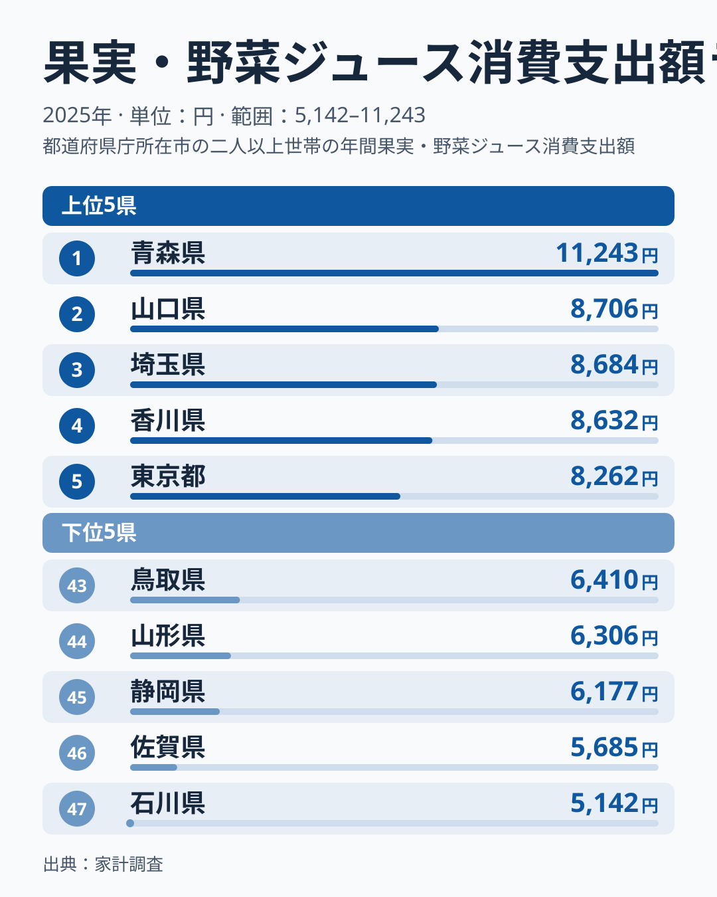
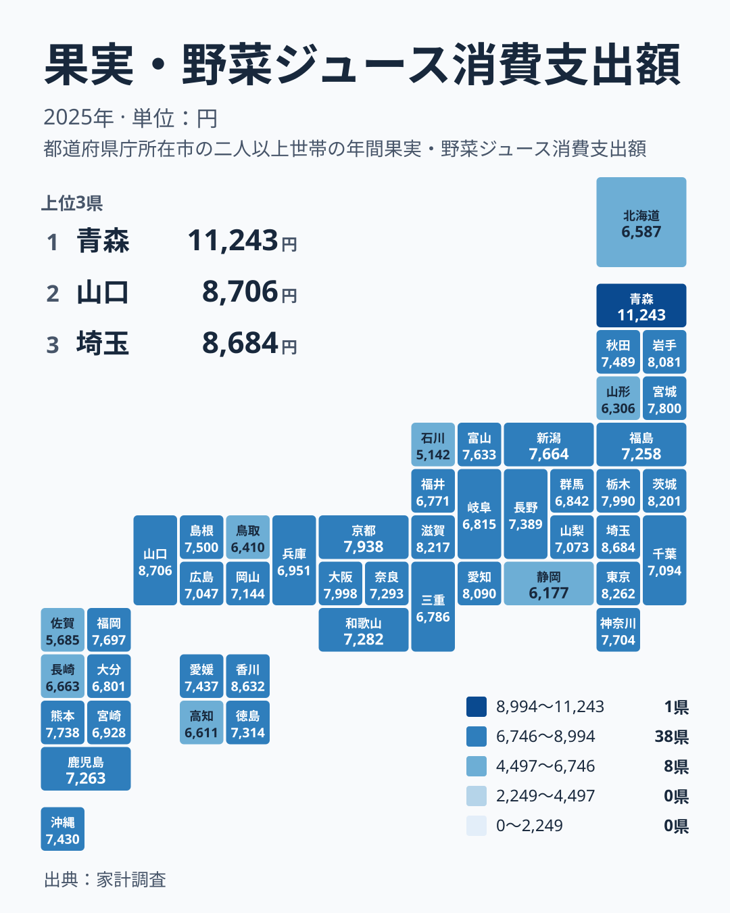

朝食の食卓や冷蔵庫の定番として、果実・野菜ジュースを思い浮かべる方は多いはずです。ところが、年間でどれだけお金をかけているかを都道府県別に見ると、意外なほどはっきりした差があります。2025年の家計調査では、首位の青森県が11,243円、最下位の石川県が5,142円でした。最大と最小の比は約2.2倍です。

この記事では、支出が多い県と少ない県を並べ、差の大きさと、産地のイメージとの食い違いを確認します。ジュースは果物や野菜そのものとは別の買い物です。そのため、産地の県が必ず上位に来るとは限りません。

## 上位と下位を並べると見えるもの

まず、支出額の上位5県と下位5県を図で確認します。

<source-link href="/ranking/fruit-vegetable-juice-consumption-expenditure">果実・野菜ジュースへの支出ランキングをもっと見る</source-link>

首位は青森県で11,243円です。2位の山口県は8,706円で、首位との間には2,537円の開きがあります。一方、2位の山口県から5位の東京都の8,262円までは、444円の範囲に収まっています。3位の埼玉県は8,684円、4位の香川県は8,632円で、2位から4位はわずか74円差です。つまり青森県は、上位集団から大きく離れた存在です。

下位は、石川県が5,142円で47位、佐賀県が5,685円で46位、静岡県が6,177円で45位、山形県が6,306円で44位、鳥取県が6,410円で43位です。下位5県の幅は、5,142円から6,410円までの1,268円です。青森県と2位の差である2,537円は、この下位5県全体の幅の約2倍にあたります。首位の突出は、下位5県が横一列に並ぶ幅よりも大きいということです。

下位の中でも、最下位の石川県と46位の佐賀県の間には543円の開きがあり、石川県の低さが際立ちます。また、上位5県の最低額である東京都の8,262円と、下位5県の最高額である鳥取県の6,410円を比べても、1,852円の段差があります。

> [!NOTE]
> この指標は、家計調査で調べた果実・野菜ジュースへの年間の支出額で、単位は円です。購入した量や本数ではありません。単価の高い商品を選ぶ地域は、同じ本数でも支出額が大きくなります。支出の多さを「よく飲む」と同じ意味で読まないことが大切です。

## 青森県の突出と産地イメージの食い違い

青森県はりんごの全国的な産地として知られています。りんごジュースのように、地元の産品が身近な飲み物になる土壌があるのかもしれません。ただし、これは背景についての想像であり、今回の統計から確かめられる事実ではありません。詳しい数字は[青森県のデータ](/areas/02000)でも確認できます。

東北6県で見ると、動きは一様ではありません。青森県は1位、岩手県は8,081円で9位、宮城県は7,800円で13位、秋田県は7,489円で20位、福島県は7,258円で28位、山形県は6,306円で44位です。果樹の産地として名高い山形県が下位5県に入っている点は、産地であることとジュースへの支出が多いことが別の話だと教えてくれます。

北海道・東北の7道県のうち、北海道は6,587円で42位でした。同じ地方の中に1位の青森県と44位の山形県が並び、金額では11,243円と6,306円という大きな開きがあります。

> [!WARNING]
> この数字は世帯が購入したジュースへの支出額で、手作りの絞り汁や、贈答でもらった分は含まれません。産地では家庭内で果実を絞ったり、もらい物で済ませたりする場面があるかもしれませんが、これは仮説であり、今回のデータで裏付けられたものではありません。産地の県で額が伸びない理由として、あくまで可能性の一つにとどまります。

## 地理分布のタイルマップで見る全体像

次に、47都道府県の分布を地図で見てみましょう。

地図から読み取れるのは、特定の地方がまとまって高い、あるいは低いという単純な構図ではないことです。上位5県は、北海道・東北の青森県、中国の山口県、関東の埼玉県と東京都、四国の香川県と、4つの地方にまたがって散らばっています。

地方ごとの幅も見ておきます。本稿では地方を、三重県は近畿、静岡県は中部として扱います。関東では、3位の埼玉県が8,684円、35位の群馬県が6,842円です。近畿では、6位の滋賀県が8,217円、38位の三重県が6,786円です。中国では、2位の山口県が8,706円、43位の鳥取県が6,410円です。九州・沖縄では、14位の熊本県が7,738円、46位の佐賀県が5,685円です。

順位の開きで見ると、東北の1位青森県と44位山形県の43が最も大きく、中国の41、関東と九州・沖縄の32、近畿の32が続きます。どの地方でも同じ地方の中に大きな開きがあり、[山口県のデータ](/areas/35000)のように、地方の枠を超えて上位に入る県もあります。

> [!TIP]
> 地方単位で「高い地方」「低い地方」と決めつけず、同じ地方の中の最大と最小を見比べてみてください。今回は、地方間の差だけでなく、地方内にも大きな開きが見られます。自分の県の隣県と並べるだけでも、読み取れることが増えます。

## 大都市圏と中位の県をどう見るか

東京都が5位、埼玉県が3位、大阪府が10位、愛知県が8位と、大都市圏の都府県が上位10位以内に多く並びます。一方で、神奈川県は7,704円で15位、福岡県は7,697円で16位と中位にとどまります。都市であれば必ず高いわけではありません。

四国では、香川県が4位で、愛媛県が21位、徳島県が24位、高知県が41位です。沖縄県は温暖な気候で、トロピカルな果物の産地でもありますが、順位は7,430円で22位でした。気候や産地のイメージから、順位を予想することは難しいと分かります。

## 関連品目を探すには

果実・野菜ジュースは、お茶やコーヒー、炭酸飲料のような嗜好品とは性格が違い、健康や栄養補給の意識とも結びつきやすい飲料です。生鮮の果物や野菜の消費とは別の動きをする場合があります。関連する他の統計と見比べたいときは、[同じカテゴリの統計一覧](/category/economy)から、食料品や飲料の支出を探してみてください。

## まとめ

この記事で確かめられたのは、次の点です。

- 首位は青森県の11,243円で、最下位は石川県の5,142円です。最大と最小の比は約2.2倍でした。
- 青森県と2位山口県の差は2,537円で、下位5県の幅1,268円の約2倍です。
- 山形県は44位、北海道は42位、沖縄県は22位で、産地や気候のイメージとは必ずしも一致しません。
- 同じ地方の中でも、順位が大きく開く例が多くあります。

支出額の差の理由は、この統計だけでは断定できません。差の大きさと、産地イメージとの食い違いを確かめたうえで、ほかの統計と併せて読むことが大切です。

## データについて

使用した統計は、家計調査の果実・野菜ジュース消費支出額で、2025年の値です。単位は円で、全47都道府県の順位を掲載しています。記事中の順位と金額は、この統計の値に基づいています。
