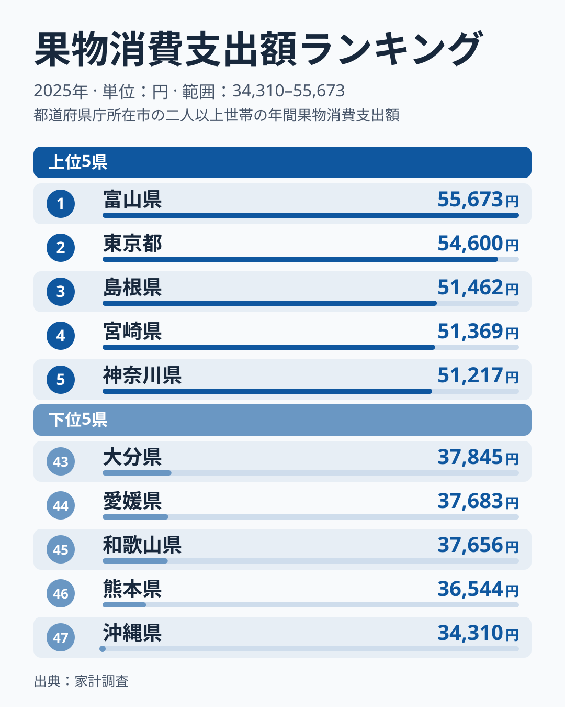
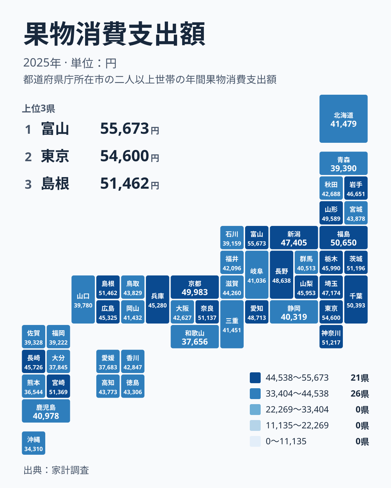

果物と聞くと、みかんの和歌山県や愛媛県、りんごの青森県など、産地のイメージが先に浮かびます。では、家計が果物にいちばんお金を使っているのはどこでしょうか。2025年の家計調査をみると、首位は富山県で55,673円、2位は東京都で54,600円でした。産地の名前が並ぶ予想とは、少し違う景色が見えてきます。

この記事では、果物への支出の地域差を、食文化・気候・産地・流通の面から読み解きます。

## 上位と下位の顔ぶれ

まず、上位と下位を並べた図を見てください。

<source-link href="/ranking/fruits-group-consumption-expenditure">果物への支出ランキングをもっと見る</source-link>

上位は、1位が富山県、2位が東京都、3位が島根県で51,462円、4位が宮崎県で51,369円、5位が神奈川県で51,217円です。地方でみると、中部が1県、関東が2県、中国が1県、九州・沖縄が1県です。大都市圏だけが上位を占めるわけではなく、首都圏と地方の県が入り混じっています。

下位は、47位の沖縄県が34,310円、46位の熊本県が36,544円、45位の和歌山県が37,656円、44位の愛媛県が37,683円、43位の大分県が37,845円です。九州・沖縄の3県と、近畿の和歌山県、四国の愛媛県が並びます。1位の富山県と最下位の沖縄県の間には、年間で21,000円を超える開きがあります。同じ日本で暮らしていても、果物にかける金額には、はっきりした地域差があります。

> [!NOTE]
> ここでの金額は、家計調査で集計された果物への年間支出額です。対象は二人以上の世帯が購入した金額で、生鮮果物のほか、果物の加工品も区分によっては含まれます。1世帯あたりの金額なので、県全体の消費量や産地の生産量を示すものではありません。

## 「産地=たくさん食べる」とは限らない

驚くのは、有名な産地の県が下位に目立つことです。みかんで知られる和歌山県は45位、愛媛県は44位です。熊本県も46位で、柑橘やすいかの産地でありながら、支出額は少ない側にいます。りんごの青森県も39位で、39,390円にとどまります。

理由として考えられるのは、産地では果物を買わずに手に入れる機会が多いことです。農家からの頂きもの、親戚や近所とのやり取り、直売所での安価な購入、自家用に作った果物などは、家計調査の支出額には現れにくくなります。食べる量が少ないのではなく、お金を払う場面が少ない可能性があります。ここは統計だけでは断定できず、あくまで読み方の一つです。

一方で、産地でありながら上位に入る県もあります。宮崎県は4位で、マンゴーなどの高級果実のイメージがあります。山形県は11位の49,589円で、さくらんぼやぶどうなど贈答向けの果物でも知られます。福島県は8位の50,650円で、ももの産地として有名です。長野県は13位で48,638円です。産地の中でも、地元で買って食べる文化や、贈答に使う習慣が強い県では、支出が伸びやすいと考えられます。

> [!WARNING]
> 家計調査は、都道府県庁所在市と政令指定都市の世帯を中心とした調査です。県全体の平均ではなく、都市部の家計の姿が強く出ます。標本の数も限られるため、順位が近い県どうしの差は、年ごとのぶれの範囲に収まる場合があります。

## 都市の暮らしと果物

次に、地理的な分布を図で確認します。

分布を見ると、関東の支出が高めにそろっています。東京都は2位、神奈川県は5位、茨城県は6位で51,196円、千葉県は9位で50,393円です。埼玉県は15位で47,174円、栃木県は17位で45,990円、群馬県は36位で40,513円と、県ごとに差もあります。関東の中でも、東京湾岸の都市部ほど支出が高い傾向が読み取れます。

都市部で支出が高い理由には、百貨店や専門店で高価な果物が手に入りやすいこと、贈答や手土産の習慣が根づいていること、世帯の所得が比較的高いことが挙げられます。東京都の詳しい数字は[東京都のデータ](/areas/13000)で確認できます。

近畿に目を向けると、奈良県が7位で51,137円、京都府が10位で49,983円と上位に入る一方、大阪府は29位で42,627円、和歌山県は45位です。同じ地方の中でも、順位が大きく割れています。「関西は果物をよく食べる」といった一括りの言い方はできません。

> [!TIP]
> 順位表を読むときは、1位か最下位かだけで判断せず、同じ地方の県どうしを見比べてください。近畿のように、同じ地方の中で上位と下位が分かれるときは、気候よりも都市化の度合いや贈答の習慣、買い方の違いが効いている可能性があります。

## 首位の富山県をどう読むか

首位の富山県は、果物の大産地として知られているわけではありません。それでも全国で最も支出が多いという結果でした。県の詳しい数値は[富山県のデータ](/areas/16000)にまとまっています。

背景として思い浮かぶのは、食卓や贈答での果物の位置づけです。北陸は、季節の果物を買って楽しむ習慣や、来客・仏事での果物の贈答が盛んだという見方があります。ただし、これは統計から直接確かめられる話ではありません。この記事で確かなのは、2025年の調査で富山県が55,673円と最も高かった、という事実までです。

中部全体を見ても、足並みはそろっていません。新潟県は14位で47,405円、長野県は13位、山梨県は18位で45,953円、愛知県は12位で48,713円です。一方、石川県は42位で39,159円、岐阜県は34位で41,036円、静岡県は37位で40,319円です。中部は上位から下位まで幅広く散らばっています。静岡県はみかんなどの産地ですが、支出は下位寄りです。産地であることと支出の多さが結びつかない例が、ここでも見られます。

## 九州・沖縄と中国・四国のばらつき

九州・沖縄は、最も差の大きい地方の一つです。宮崎県が4位で51,369円と高い一方、長崎県は19位で45,726円、鹿児島県は35位で40,978円、佐賀県は40位で39,328円、福岡県は41位で39,222円です。さらに大分県が43位、熊本県が46位、沖縄県が47位と、下位に集中しています。

沖縄県が最下位なのは、パイナップルやマンゴー、シークヮーサーなど、地元の果物が日常的に手に入ることや、食生活の違い、物価や所得の水準が背景にある可能性があります。ただし、ここでも因果は統計だけでは確かめられません。

中国・四国にも差があります。島根県は3位で51,462円、広島県は20位で45,325円、鳥取県は24位で43,829円、岡山県は33位で41,432円、山口県は38位で39,780円です。島根県の高さは、全国でも目立ちます。四国は高知県が25位で43,773円、徳島県が26位で43,306円、香川県が27位で42,847円と中位に固まり、愛媛県だけが44位に沈んでいます。

## 果物と、ほかの食品との違い

肉や魚、米のような主食は、日々の食卓に欠かせず、世帯の人数や生活様式によって量がある程度決まります。それに対して果物は、食べなくても困らない「嗜好」の性格が強い食品です。所得や贈答の習慣、店の品ぞろえ、産地との距離といった条件に左右されやすく、そのぶん地域差が表れやすくなります。

とくに果物は、ほかの食品と違って、頂きものや自家消費が多い点に注意が必要です。産地では購入せずに手に入る機会が多く、都市部では買う機会が多くなります。この構造が、「産地が下位、都市と一部の地方が上位」という並びを生む一因と考えられます。

ほかの品目の動きとあわせて見ると、地域差の理由をさらに掘り下げられます。[同じカテゴリの統計一覧](/category/economy)から、関連する家計の指標もあわせて確認してください。

## データについて

使用した指標は、家計調査の「果物消費支出額」で、2025年の1世帯あたり年間支出額を円単位で示しています。順位は金額の高い順です。記事内の「上位」「下位」は、この順位にもとづいています。県の所属地方は、北海道・東北、関東、中部、近畿、中国、四国、九州・沖縄の7区分で整理しました。

家計調査の結果は標本調査にもとづくため、順位が近い県どうしの優劣には慎重な読み方が必要です。数字の差を理由に、「どちらが果物好きか」を断定することはできません。ただ、上位と下位の間にある大きな開きは、地域の食文化や暮らし方の違いを考えるきっかけになります。

首位の富山県と2位の東京都、そして最下位の沖縄県。この三つを手がかりに、自分の暮らす県の位置を確かめてみてください。
