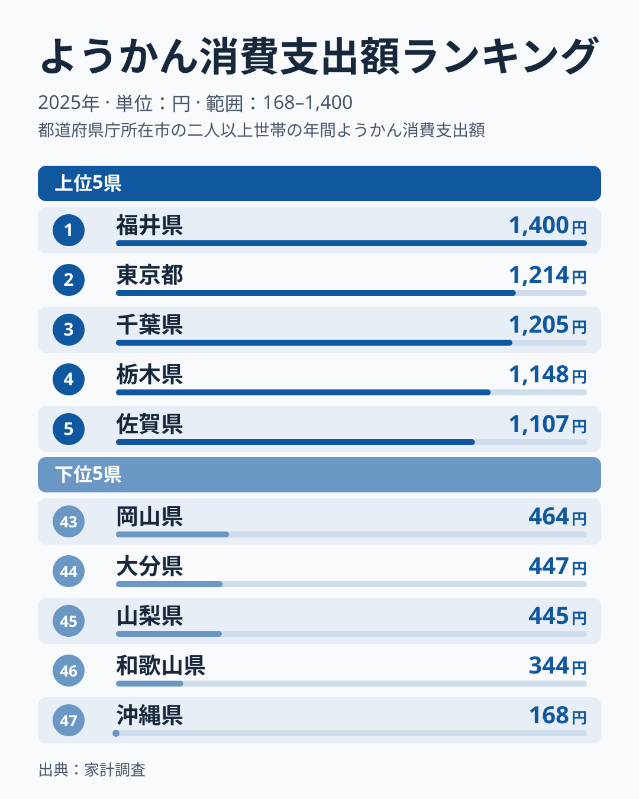
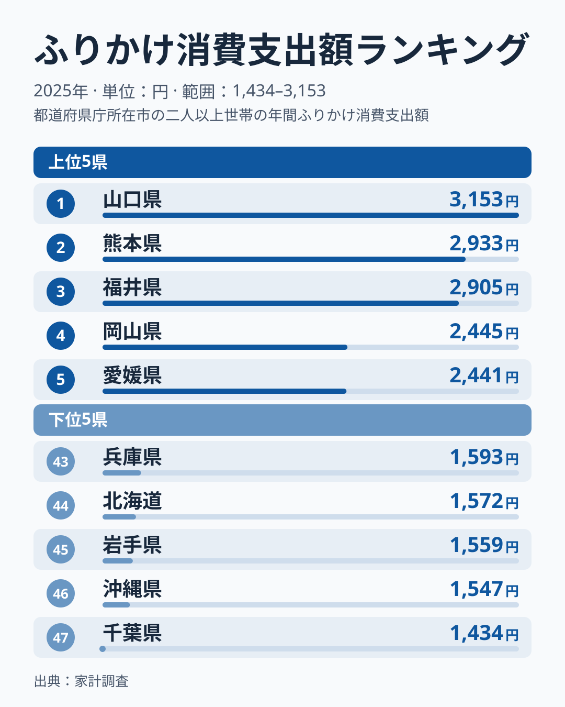
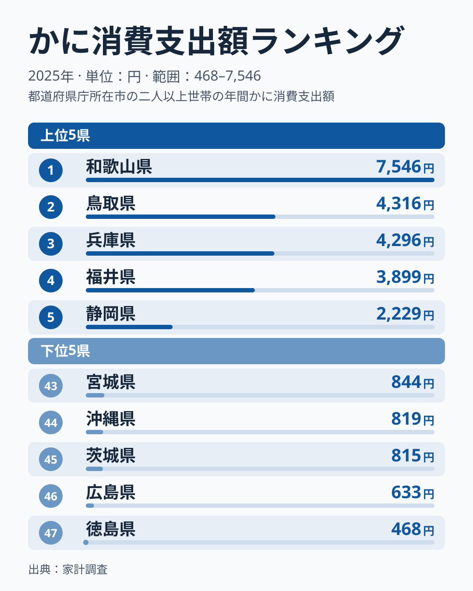
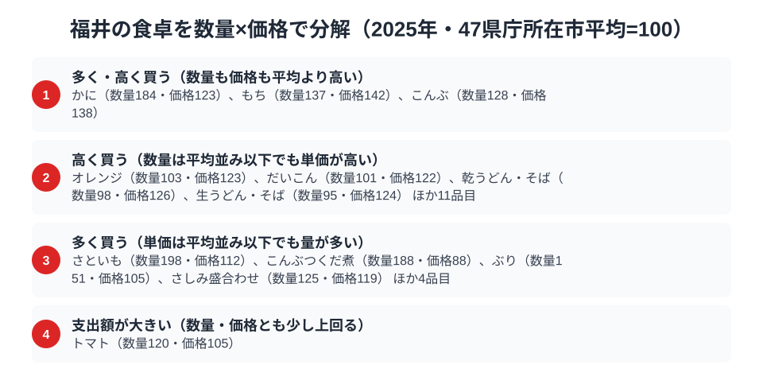

福井県の食卓には、ちょっと意外な全国1位があります。総務省の家計調査（品目別）で福井市の二人以上世帯を見ると、ようかんの消費支出額は1,400円で全国1位です。さらに、ごはんのお供のふりかけも2,905円で全国3位に入り、甘味の羊羹とごはんのお供というまったく性格の異なる2品目がそろって上位に並びます。

冬の味覚として知られる越前がにの地元でも、かにの消費支出額は3,899円で全国4位。この記事では、ようかん・ふりかけ・かにという3つの品目を横断しながら、「ごはんと甘味」を大切にする福井市の食卓を読み解きます。

> [!NOTE]
> 家計調査は県庁所在市（福井県は福井市）の二人以上世帯の値で、県全体ではありません。また、ようかんの1,400円が「たくさん買っている」結果なのか「単価の高いものを買っている」結果なのかは、この記事の分解表では分かりません。ようかんには数量と価格の指数がなく、支出額と順位だけが根拠です。

## ようかん — 全国1位1,400円

<source-link href="/ranking/yokan-consumption-expenditure">ようかん消費支出額ランキングをもっと見る</source-link>

福井県のようかん消費支出額は1,400円で全国1位です。2位の東京都は1,214円で、福井市との差は186円あります。3位は千葉県の1,205円、4位は栃木県の1,148円、5位は佐賀県の1,107円で、上位は関東の県が目立ちつつ、福井県と佐賀県も入っています。最下位の沖縄県は168円で、1位との間には8倍以上の開きがあります。

福井には、多くの地域が夏に食べる水羊羹を冬にこたつで食べる習慣があるといわれます。この冬の水羊羹文化が支出額を押し上げている可能性があるというのが[仮説]ですが、水羊羹は品目「ようかん」の一部にすぎず、冬に食べる習慣と支出額の関係はこのデータからは確認できません。家計調査の市別の値は単年のぶれが大きいため、1年の順位だけで断定せず、複数年で1位が続くかを見るのが確認の方法です。

## ふりかけ — 全国3位2,905円

<source-link href="/ranking/furikake-consumption-expenditure">ふりかけ消費支出額ランキングをもっと見る</source-link>

ふりかけの消費支出額は福井県が2,905円で全国3位です。1位は山口県の3,153円、2位は熊本県の2,933円で、福井市は2位の熊本県と28円差で並んでいます。上位3県の差は小さく、4位の岡山県は2,445円と、3位との間に460円の段差があります。首位の山口県3,153円と最下位の千葉県1,434円とでは2.2倍の開きがあります。

福井は米どころとして知られ、ごはんを大切にする食文化が根づいており、ふりかけはごはんのお供の代表格です。米の消費が多い土地ほどふりかけの需要も高まるというのが[仮説]ですが、この記事のデータで米の購入量とふりかけの支出額を直接つなぐことはできません。上位3県が中部・九州・中国に分かれているため、特定の地方に偏った現象とも言えない点には注意が必要です。

ようかんという甘味とふりかけというごはんのお供、その両方で上位に入る点に、「ごはんと甘いもの」が並ぶ福井市の家計の特徴が映し出されています。ふりかけは年ごとに順位が入れ替わりやすい品目です。順位の動きは[ふりかけ消費支出の記事](/blog/furikake-expenditure-ranking)で詳しく取り上げています。

## かに — 全国4位3,899円

<source-link href="/ranking/crab-consumption-expenditure">かに消費支出額ランキングをもっと見る</source-link>

かにの消費支出額は福井県が3,899円で全国4位です。首位は和歌山県の7,546円で、2位は鳥取県の4,316円、3位は兵庫県の4,296円と続き、福井市はそのすぐ後ろにつけています。5位の静岡県は2,229円で、4位までと5位以下の間に大きな段差があるのが、この順位表の特徴です。首位の和歌山県7,546円と最下位の徳島県468円とでは16倍以上の開きです。

首位の和歌山県は福井市の倍近い額で、4位の福井市は、上位4県だけが突出して高い集団に入っているともいえます。年末年始にかにを家庭で楽しむ習慣が支出額を支えている可能性もありますが、習慣の有無はデータでは確認できないため、あくまで[仮説]です。家計調査の市別の値は単年のぶれも大きいため、順位の細かな差は構造として読み込みすぎないほうが安全です。

> [!WARNING]
> かにのように単価の高い食材は、購入頻度が少なくても支出額が大きく出やすくなります。福井市のかにが「量」と「単価」のどちらで押し上げられているかは、次の分解節で確認できます。

## 福井の食卓を貫くもの

福井市の家計で目立つのは、「ごはんと甘味」を軸にした食卓です。ふりかけとようかんが上位に並び、かにが冬の味覚として全国4位に入っています。日常の食（ごはん・ふりかけ）、ハレの食（かに）、甘味（ようかん）がそろって上位にあるのが、今回のデータから見える福井市の姿です。

富山の「富山湾の多冠型」、宮崎の「南九州の飲みもの文化」と並べると、福井は「米どころの堅実＋冬の味覚型」と整理できます。隣り合う富山県と福井県でも、ふりかけは富山県が7位、福井県が3位と近い位置にありますが、ようかんは富山県が6位、福井県が1位と順位が分かれます。

## 数量×価格で分解する福井市の食卓

<source-link href="/ranking/crab-consumption-quantity">かに消費量ランキングをもっと見る</source-link>

支出額の順位だけを見ていると、「たくさん食べている」のか「高いものを買っている」のかは区別がつきません。家計調査の品目には支出額（金額）と消費量（数量）の両方が公表されているものがあり、47都道府県庁所在市の平均を100とした指数に直すと、福井の食卓を「量」と「単価の高さ」に分けて読むことができます。かにの数量指数は184で、47市平均の1.8倍あまりを購入していることになり、価格指数も123と平均より高めです。量も単価も平均を上回っている点は、支出額ランキングで全国4位という結果と整合します。同じ「量も単価も平均を上回る」品目には、もち（数量137・価格142）とこんぶ（数量128・価格138）が並びます。

量の面が目立つのは、さといもです。数量指数が198と平均のほぼ2倍に達し、価格指数は112と平均に近い水準です。こんぶつくだ煮（数量188・価格88）、ぶり（数量151・価格105）も、単価は平均並みかやや安いのに購入量が平均を上回っています。米どころとしての食生活や魚介の消費が「たくさん食べる」量の面に表れている可能性がありますが、これは[仮説]で、市別の値は単年のぶれが大きいため複数年での確認が要ります。

一方で、だいこん（数量101・価格122）、乾うどん・そば（数量98・価格126）、生うどん・そば（数量95・価格124）、オレンジ（数量103・価格123）は、購入量が平均並みなのに価格指数だけが120を超えています。単価が高い理由は、このデータだけでは分かりません。「多く買う」品目と「高く買う」品目を分けて見ると、支出額の順位の裏側にある違いが見えてきます。

> [!TIP]
> かにのように数量も価格も平均を上回る品目もあれば、だいこんのように数量は平均並みでも単価の高さが目立つ品目もあります。ようかんにはこの数量・価格の指数がないため、1位の中身が量なのか単価なのかは今回は読み分けられません。

ここでの指数は家計調査の全国値ではなく、47都道府県庁所在市（福井県は福井市）の単純平均を100とした相対値です。価格指数は支出額÷数量から算出した相対的な単価であり、購入している品種やブランドの違いも含むため、純粋な物価水準そのものではありません。対象は二人以上世帯の年間支出額（2025年）です。

## まとめ

- ようかん消費支出額は福井県が全国1位（1,400円）。冬の水羊羹文化との関係は[仮説]にとどまる
- ふりかけは全国3位（2,905円）。首位の山口県、2位の熊本県との差は小さい
- かには全国4位（3,899円）。数量指数184・価格指数123で、量も単価も平均を上回る
- ごはん・甘味・冬の味覚がそろって上位に入る、福井市の食卓

福井県の他の統計は[福井県の地域プロフィール](/areas/18000)、食品・家計消費の地域差は[経済カテゴリ一覧](/category/economy)からご覧いただけます。
