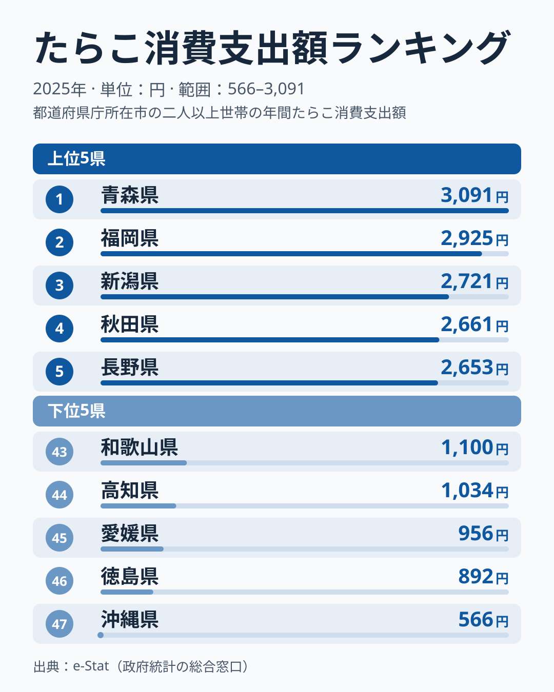
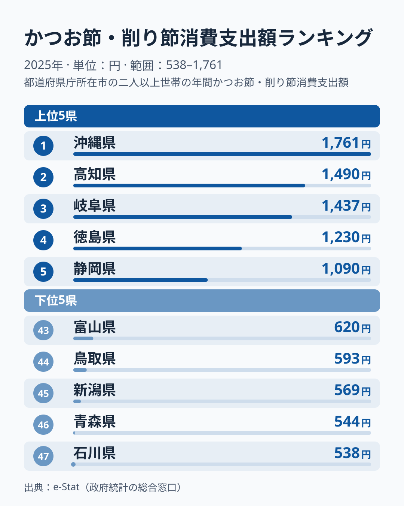
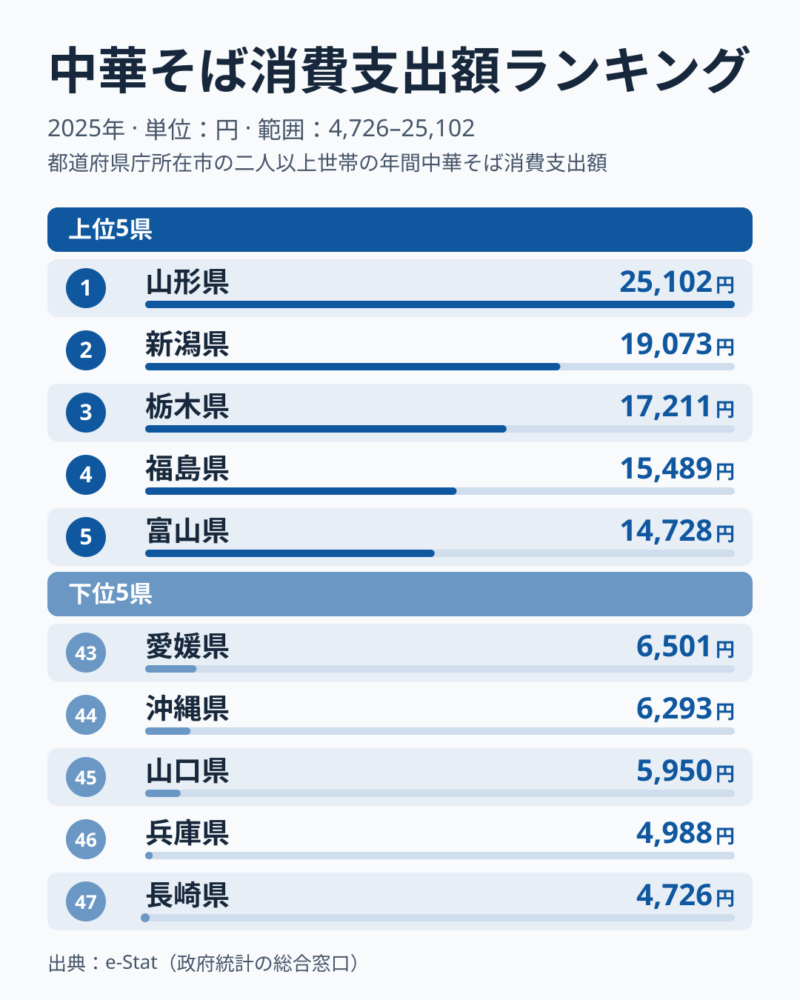
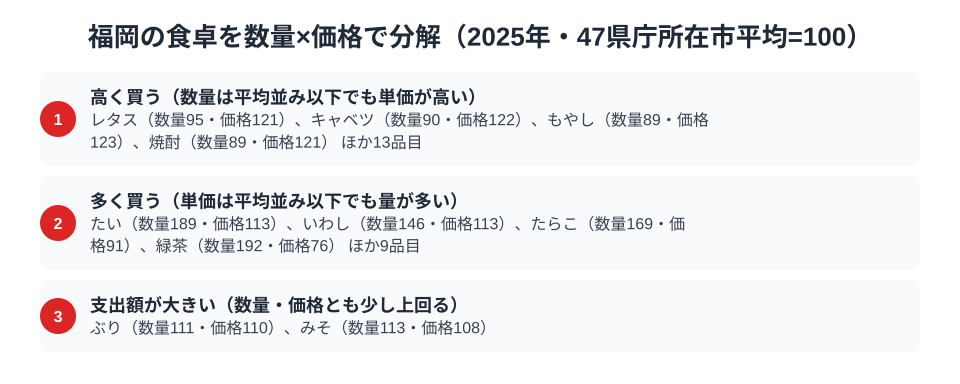

福岡県といえば「明太子の本場」というイメージが定着しています。実際、総務省の家計調査（品目別）で福岡市の二人以上世帯を見ると、たらこ（明太子の主原料）の消費支出額は2007年から2024年まで18年連続で全国1位でした。ところが2025年は2,925円で全国2位となり、首位は青森県の3,091円に入れ替わっています。明太子の街の「日本一」は、なぜ途切れたのでしょうか。

ほかの品目も確かめると、かつお節・削り節は865円で全国23位、外食の中華そば（ラーメン店等での飲食）は8,116円で全国31位でした。首位の山形県25,102円と比べると、福岡の外食ラーメン支出は3分の1ほどです。この記事では、たらこ・かつお節・中華そばという3つの品目を横断しながら、「名産地のイメージ」と「家計に表れる支出」がどこまで一致するのかを読み解きます。

> [!NOTE]
> 家計調査の都道府県データは、県庁所在市（福岡県は福岡市）の二人以上世帯を対象にした年間支出額です。県全体ではなく福岡市在住世帯の家計簿から見た傾向であり、支出「金額」であって消費「量」そのものではない点にご注意ください。

## たらこ（明太子） — 全国2位2,925円、首位は青森県に交代

<source-link href="/ranking/cod-roe-consumption-expenditure">たらこ消費支出額ランキングをもっと見る</source-link>

福岡県のたらこ消費支出額は2,925円で全国2位です。首位との差は166円で、その首位は青森県の3,091円です。3位の新潟県2,721円、4位の秋田県2,661円がすぐ後ろに続きます。最下位の沖縄県566円と比べると、福岡は5.2倍、首位の青森県は5.5倍の開きがあります。福岡は辛子明太子の本場で、たらこはその主原料にあたるため、2位でも全国屈指の「明太子の街」であることに変わりはありません。

ただし、このランキングの時系列を見ると、福岡は2007年から2024年まで18年連続の1位で、2024年は4,870円でした。2025年の2,925円はそこから約4割低く、首位との差はわずかです。家計調査の市別の値は1市の標本に基づくため、年ごとのぶれが大きいことで知られます。[仮説] 福岡の首位陥落は、明太子離れという構造変化というより、2025年に購入量が減った単年のぶれが主因かもしれません。検証には、2026年以降の値で福岡が首位に戻るかを確かめる必要があります。

福岡市には明太子の専門店・製造元が集積し、贈答用だけでなく家庭用の切れ子（訳あり品）が手頃な価格で手に入りやすい土地柄です。「家で食べる明太子」が生活に溶け込んでいることが、たらこ消費支出額を全国上位に押し上げていると考えられます。

## かつお節・削り節 — 全国23位865円、首位の沖縄県は福岡の約2倍

<source-link href="/ranking/katsuobushi-consumption-expenditure">かつお節・削り節消費支出額ランキングをもっと見る</source-link>

かつお節・削り節の消費支出額で、福岡県は865円で全国23位でした。首位は沖縄県の1,761円で、福岡はその約半分です。2位は高知県1,490円、3位は岐阜県1,437円と続き、上位は沖縄・四国・東海が占めています。47都市の中ほどに位置する福岡は、かつお節で目立つ地域とは言えません。

九州ではあごだし（トビウオでとる出汁）が有名で、福岡の出汁文化はかつお節だけでは測れない面があります。[仮説] 福岡の家庭ではかつお節の代わりにあごだしやだしパックが使われ、かつお節・削り節の支出が伸びていない可能性があります。ただしあごだしは本調査のかつお節とは別品目の扱いになり得るため、この仮説の確認には出汁類の支出を別途見る必要があります。

> [!WARNING]
> 家計調査は支出金額の調査であり、消費量そのものではありません。物価や単価の違いも金額に影響します。また「あごだし」のように、かつお節とは別品目として個別集計されていない郷土の出汁文化がある点にもご注意ください。

## 中華そば（ラーメン外食） — 全国31位8,116円、豚骨の本場でも中位以下

<source-link href="/ranking/ramen-dining-consumption-expenditure">中華そば消費支出額ランキングをもっと見る</source-link>

福岡といえば豚骨ラーメンの聖地というイメージが強いものの、外食の中華そば消費支出額は8,116円で全国31位です。首位の山形県は25,102円、2位の新潟県は19,073円で、福岡は首位の3割強にとどまります。一方で最下位は47位の長崎県4,726円で、福岡はその約1.7倍です。福岡は上位ではなく、47都市の中では下側の中位に位置しています。

首位が山形県、2位が新潟県と、東北・北陸の都市がラーメン外食の上位を占めています。[仮説] 福岡の豚骨ラーメンは庶民的な価格帯で提供する店が多く、「サッと食べてサッと出る」スタイルの1回あたりの単価が低いため、同じ回数食べても支出額が積み上がりにくいのかもしれません。この場合、福岡の順位が示すのは「ラーメンを食べていない」ことではなく、「1回あたりの支出が小さい」という価格構造の可能性です。実際の外食回数（消費量）は別の調査でしか確認できず、本データからは支出額の水準しか読み取れません。

## 福岡の食卓を貫くもの

福岡の食卓を3品目で並べると、「明太子は引き続き全国トップクラスだが、かつお節は中位、外食ラーメンは中位以下」という姿になります。名産品のたらこは、2025年は首位の座を明け渡したものの、全国2位の水準を保っています。一方、かつお節と外食ラーメンは、全国でも平均的な位置です。名産地・本場という看板が、そのまま家計の支出ランキングの上位に表れるとは限りません。

福井の「米どころの堅実＋冬の味覚型」、宮崎の「南九州の飲みもの文化」と並べると、福岡は「地元名産の家庭内消費が強く、それ以外は平均的な型」と言えます。ただし家計調査の市別の値は単年のぶれが大きいため、この型は2025年の姿であり、毎年同じ順位になるとは限りません。

> [!TIP]
> 「本場」「名産地」のイメージと家計調査の順位が食い違ったときは、順位そのものより、複数年で同じ傾向が続くかを確かめるのが近道です。福岡のたらこのように、18年続いた首位が単年で入れ替わることもあります。

## 数量×価格で分解する福岡市の食卓

<source-link href="/ranking/cod-roe-consumption-quantity">たらこ消費量ランキングをもっと見る</source-link>

福岡市の支出額が高い理由は「単価が高い」からなのか、それとも「たくさん買う」からなのかを分解してみます。家計調査には支出額だけでなく数量のデータもあり、47都道府県庁所在市の平均を100とした指数に置き換えると、たらこ消費量は900gで数量指数は169.2（47都市中2位）、価格指数は90.5です。消費量は47都市平均の1.7倍近い一方、価格指数は平均を下回っており、単価が高いわけではありません。支出指数153.2は、数量指数169.2と価格指数90.5を掛け合わせた水準にほぼ一致しており、たらこの支出額が2位になっている主因は、単価の高さではなく購入量の多さだと数値の構造から読み取れます。

> [!NOTE]
> ここでの指数は47都道府県庁所在市（二人以上世帯）の年間データを単純平均し、100とした相対値です。総務省が公表する全国平均そのものではなく、価格指数も「支出額÷数量」から算出した単価の相対値のため、品種やブランドの違いによる価格差を含んでいます。

かつお節・削り節は逆の構図です。数量指数は76.4で、47都市の中での消費量順位は33位にとどまる一方、価格指数は128.6と平均を大きく上回っています。支出指数98.2は数量指数76.4と価格指数128.6を掛け合わせた水準にほぼ一致しており、量が少ないのに単価が高いため、支出額が平均並みの23位に収まっています。[仮説] 福岡では、かつお節を少量だけ、やや割高な品質のものを選んで買う傾向があるかもしれません。ただし品質や購入頻度までは本データからは確認できません。

> [!TIP]
> たらこのように「数量指数は高いが価格指数は平均を下回る」品目は、単価ではなく購入量の多さが支出額を押し上げているサインです。逆に価格指数だけが平均を上回る品目（レタス、キャベツ、もやしなど）は、量は平均並みでも単価の高さが支出額に表れています。

## まとめ

- たらこ（明太子の原料）消費支出額は福岡県が2,925円で全国2位。2007〜2024年の18年連続1位から、2025年は首位が青森県の3,091円に交代した
- かつお節・削り節は865円で全国23位。首位の沖縄県は1,761円で、福岡はその約半分。あごだしの存在が一因という仮説は未検証
- 中華そば（ラーメン外食）は8,116円で全国31位。首位の山形県は25,102円で福岡はその3割強、最下位の長崎県は4,726円で福岡はその約1.7倍
- 福岡の食卓は「名産品の家庭内消費が強く、他の品目は平均的」という姿だが、市別の値は単年のぶれが大きく、順位は毎年入れ替わりうる

福岡県の他の統計は[福岡県の地域プロフィール](/areas/40000)、食品・家計消費の地域差は[経済カテゴリ一覧](/category/economy)から、隣県の食文化は[福井の食卓](/blog/fukui-food-culture)からもご覧いただけます。

## データについて

総務省統計局「家計調査（品目別）」2025年、都道府県庁所在市 二人以上世帯のデータを使用。e-Stat（政府統計の総合窓口）経由で取得・集計しています。たらこの年別の順位（2007〜2024年は福岡が1位）は、公開ランキングの時系列値によります。
