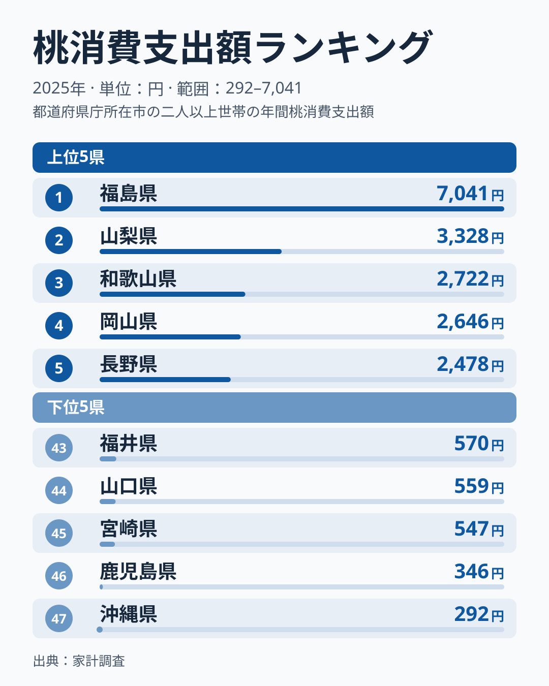
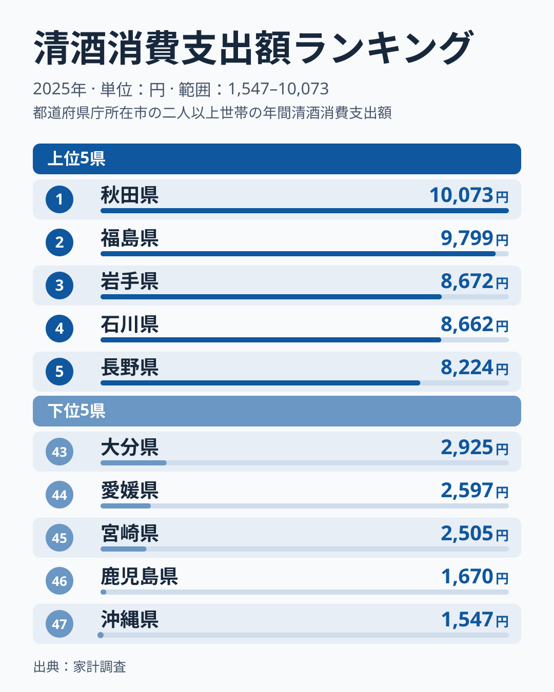
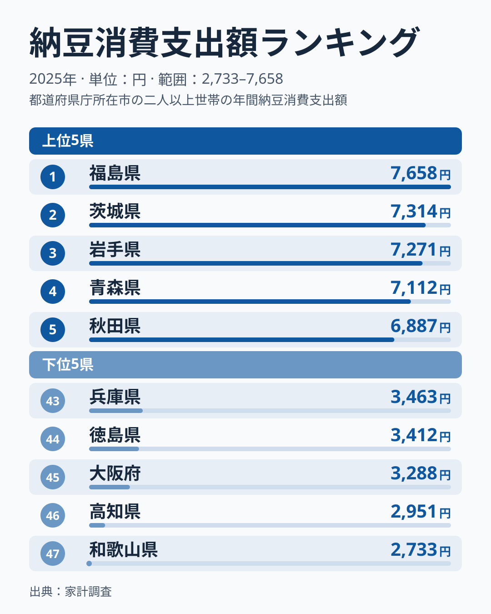
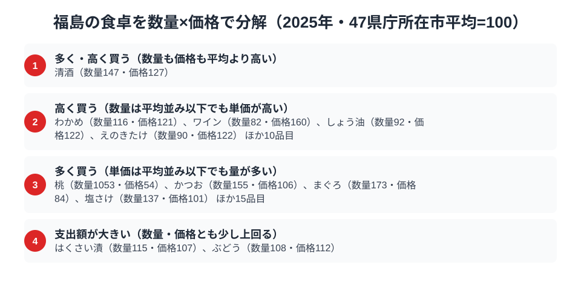

福島県は、果樹・酒・発酵食という異なる3つの分野で全国トップ級に立つ、食の実力県です。総務省の家計調査（品目別）で福島市の二人以上世帯を見ると、2025年は桃と納豆で福島が全国1位、日本酒でも全国2位に入っています。ただし3品目の強さは同じではなく、桃は長年首位を保つ一方、納豆と日本酒は年によって順位が入れ替わります。

この記事では、これら3つの上位品目を横断しながら、福島県民の食卓を読み解きます。後半では、支出額を数量と価格に分けて、「たくさん買っているのか、高いものを買っているのか」も確かめます。

> [!NOTE]
> 家計調査の都道府県データは、県庁所在市（福島県は福島市）の二人以上世帯を対象にした2025年の年間支出額です。県全体ではなく福島市在住世帯の家計簿から見た傾向です。前半の3つのランキングの値は支出額であり、購入量ではありません。数量は品目により別に公表されており、後半の節で使います。

## 桃 — 全国1位7,041円、果樹王国のシンボル

<source-link href="/ranking/peach-consumption-expenditure">桃消費支出額ランキングをもっと見る</source-link>

福島県の桃消費支出額は7,041円で全国1位です。2位の山梨県3,328円の2.1倍、47都道府県庁所在市の平均1,233円の5.7倍、最下位の沖縄県292円の24倍にあたり、2位以下を大きく引き離しています。福島市周辺は「フルーツライン」と呼ばれる果樹地帯で、桃をはじめ、なし・りんご・ぶどうなど多彩な果物が栽培される果樹王国です。

桃の首位は2025年だけの現象ではありません。2007年から2025年の19年間で、福島は16回が1位で、残りは2位が2回、3位が1回です。単年の入れ替わりが大きい家計調査の中では、桃は福島の強みとして最も安定しています。

ただし、産地であることだけでは福島の突出は説明しきれません。2位の山梨県をはじめ、桃の産地は他にもあるのに、福島の購入額は2位の2倍を超えています。数量と価格に分けると、福島市の桃は数量指数が1053、価格指数が54で、単価が高いのではなく購入量が桁違いに多いことがわかります（[桃消費支出の記事](/blog/peach-expenditure-ranking)で産地と消費の関係を詳述）。[仮説] 直売所や果樹園での購入、贈答用の購入が家計に表れている可能性がありますが、家計調査は購入先や用途を区別しないため、確かめるには別の統計が必要です。もも狩りや自家消費で入手した分は購入額に含まれません。

あわせて見る: [桃消費量ランキング](/ranking/peach-consumption-quantity)

## 日本酒 — 全国2位9,799円、東北と北信越が上位

<source-link href="/ranking/sake-consumption-expenditure">日本酒消費支出額ランキングをもっと見る</source-link>

日本酒（清酒）の消費支出額は福島県が9,799円で、全国2位です。首位は秋田県の10,073円で、差は274円（約3%）にとどまります。続いて岩手県が8,672円、石川県が8,662円、長野県が8,224円で、上位7位までを東北の5県と石川・長野が占めています。清酒は寒冷な米どころで支出が多いという傾向は、福島に限らず東北と北信越に広がっています。

福島の順位は年によって大きく動きます。前年の2024年は福島が11,811円で首位でしたが、2023年は11位で6,488円でした。清酒は福島の「強み」として毎年安定しているわけではなく、2025年の2位は、近い水準の県が並ぶ中での位置と読むのが安全です。会津をはじめ県内に多くの酒蔵があることが、地元の酒を身近にしている可能性はありますが、これは[仮説]であり、酒蔵の数や地酒の購入比率などの別の統計と突き合わせて確かめる必要があります。

## 納豆 — 全国1位7,658円、東北・北関東で多い

<source-link href="/ranking/natto-consumption-expenditure">納豆消費支出額ランキングをもっと見る</source-link>

納豆の消費支出額は福島県が7,658円で全国1位です。2位は茨城県の7,314円で、差は344円（約5%）です。続いて岩手県が7,271円、青森県が7,112円、秋田県が6,887円と、上位5県は東北4県と北関東の茨城県で占められ、納豆の支出が東北・北関東で多いことがわかります。

首位の座は固定ではありません。福島は2023年に9位で5,817円、首位は岩手県の6,810円でした。2025年の福島の1位は僅差の結果です。東北・北関東の県が上位に多く並ぶ点は年をまたいで確かな傾向ですが、その中での福島自身の順位は年により前後します。[仮説] 朝食やごはんのお供として納豆が日常的に買われている可能性がありますが、食べる頻度や時間帯は家計調査からはわかりません。

> [!WARNING]
> 福島名産の喜多方ラーメンや会津の郷土料理の一部は、家計調査の主要品目として個別に集計されないため、順位だけでは福島の食文化の全体像は測れません。

## 福島の食卓を貫くもの

3品目をあわせて見ると、桃は長期で安定した強み、納豆と日本酒は東北・北関東や北信越の上位グループの一員という構図です。果物・嗜好品・日常食という異なる分野で上位に並ぶこと自体が福島の特徴ですが、年ごとの順位の入れ替わりが大きいため、「全国一」と言い切れるのは桃だけです。

同じ東北の山形は、2025年にこんにゃく（2,642円）とたけのこ（1,127円）の支出額が全国1位でした。上位に立つ品目の顔ぶれは県ごとに違います。あわせて見る: [こんにゃく消費支出額ランキング](/ranking/konnyaku-consumption-expenditure) / [たけのこ消費支出額ランキング](/ranking/bamboo-shoot-consumption-expenditure)

> [!TIP]
> この記事の3品目は、福島が上位に入った品目を選んで取り上げたものです。福島の食卓全体の平均像を示すものではなく、他の品目では福島が下位の場合もあります。

## 数量×価格で分解する福島市の食卓

<source-link href="/ranking/sake-consumption-quantity">清酒消費量ランキングをもっと見る</source-link>

ここまで見てきた桃・日本酒・納豆は、いずれも支出額で全国1位か2位の品目です。しかし支出額の大きさだけでは、「たくさん買っているのか」「単価の高いものを買っているのか」を区別できません。家計調査には数量と支出額の両方が公表されている品目があり、支出額を数量で割ると単価が見えてきます。品目ごとに47都道府県庁所在市の平均を100とした指数に直すと、桃は数量指数が1053に達する一方、価格指数は54にとどまります。桃の支出額の大きさは、単価の高さではなく圧倒的な購入量の多さから生まれていることがわかります。

一方で、量と単価の両方が平均を上回る品目もあります。清酒は数量指数が147、価格指数も127と、どちらも平均より高い水準です。福島市の家庭は他の県庁所在市よりも多くの清酒を買い、しかも単価の高いものを選んでいることになります。[仮説] 地元の蔵元の酒を、等級や銘柄にこだわって選んでいる可能性がありますが、購入先や銘柄までは家計調査の集計単位からはわからないため、追加のデータ確認が必要な仮説にとどめておきます。

逆に、単価だけが高い品目もあります。ワインは数量指数が82と平均より低いのに、価格指数は160まで上がります。しょう油は数量指数92・価格指数122、えのきたけは数量指数90・価格指数122で、数量は平均並みで単価が高めの型です。家計調査は1市の標本が小さく、数量の1割前後の差は誤差の範囲に入りやすい点には注意が必要です。[仮説] 品種や産地、ブランドにこだわった購入が背景にあるかもしれませんが、家計調査だけでは購入先や品種までは特定できません。

支出額ランキングの1位を見たとき、「数量が多いのか、単価が高いのか」を分けて考えると読み方が変わります。桃のように数量が突出しているタイプは「量の文化」、清酒のように数量も単価も高いタイプは「量と質の両方にこだわる文化」と整理できます。

> [!NOTE]
> この指数は家計調査の全国値ではなく、47都道府県庁所在市（東京都区部を含む）の単純平均を100とした相対値です。価格指数は支出額を数量で割った単価を比較したものなので、購入している品種やブランドの違いも含んでおり、純粋な物価水準ではありません。対象は二人以上世帯の年間値で、納豆のように支出額しか公表されておらず数量データが無い品目は、この分解の対象には含まれていません。

## まとめ

- 桃消費支出額は福島県が全国1位で7,041円。19年のうち16回が1位で、福島の最も安定した強み
- 日本酒は全国2位で9,799円。首位は秋田県で、2023年は11位と年による変動が大きい
- 納豆は全国1位で7,658円。2位の茨城県とは344円差で、東北・北関東で多い
- 桃は購入量が桁違いに多く、清酒は量も単価も平均を上回る

福島県の他の統計は[福島県の地域プロフィール](/areas/07000)、食品・家計消費の地域差は[経済カテゴリ一覧](/category/economy)からご覧いただけます。
