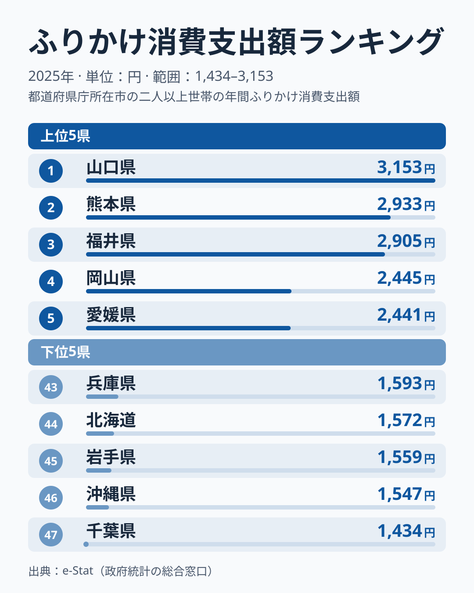
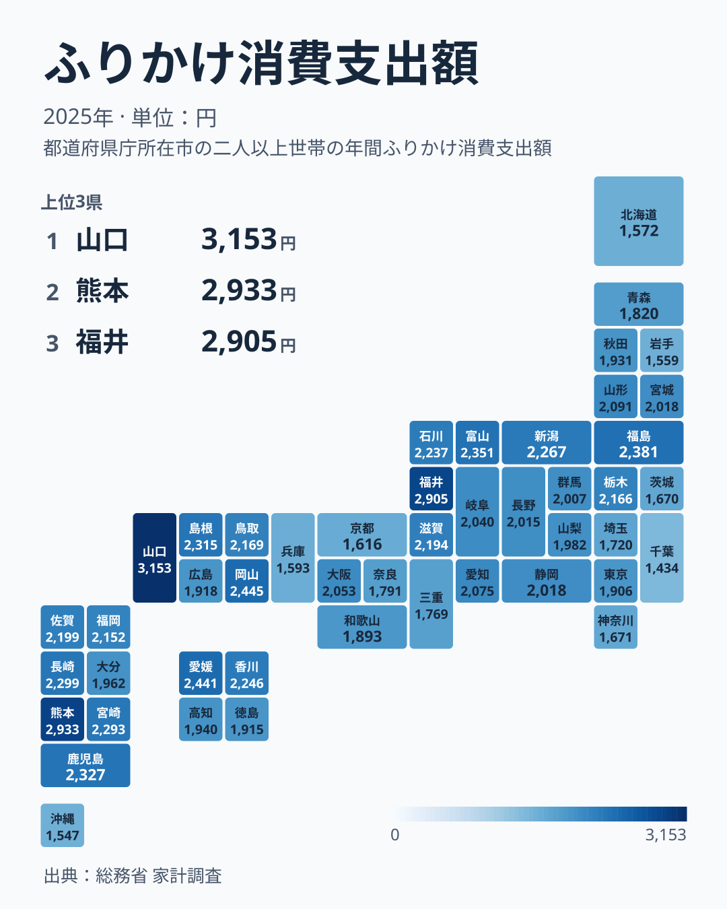

ごはんのお供として食卓に並ぶふりかけ。実は1世帯あたりの年間支出額には、都道府県で最大2.2倍もの差があります。総務省「家計調査」の2025年データによると、支出額1位は山口県の3,153円。最下位は千葉県の1,434円でした。

前年の2024年に首位だったのは福井県で、2025年は3位に下がりました。ふりかけの首位は、年によって入れ替わるのでしょうか。2位の熊本県には、ふりかけの歴史に関わるとされる商品を作る企業があります。47都道府県のデータから、ふりかけ支出の地域差とその背景を見ていきます。

> [!NOTE]
> この記事の数値は総務省「家計調査」の1世帯あたり年間支出額（2025年、二人以上の世帯）です。金額は購入量そのものではなく、価格や商品の選び方によっても変わります。また2.2倍という差は最上位と最下位の1組を比べたもので、中位の県どうしの金額は近い水準にあります。

## 上位と下位

<source-link href="/ranking/furikake-consumption-expenditure">ふりかけ消費支出額ランキングをもっと見る</source-link>

上位は山口県3,153円、熊本県2,933円、福井県2,905円、岡山県2,445円、愛媛県2,441円と続きます。1位の山口県と2位の熊本県の差は220円ですが、3位の福井県と4位の岡山県の差は460円で、上位3県が4位以下より一段高い水準にあります。ただし単年の値なので、この段差が毎年続く構造なのかは、このデータだけでは分かりません。

上位10県を地方別に見ると、中国の山口・岡山・島根、九州の熊本・鹿児島・長崎、四国の愛媛、東北の福島、中部の福井・富山で、10県すべてが入ります。中国・九州・四国の県が多く並んでいます。

2位の[熊本県](/areas/43000)には、ふりかけの歴史に関わるとされる「御飯の友」を製造するフタバ株式会社があります。地元での認知度や愛着が支出の高さの一因かもしれませんが、このデータでは検証できません。熊本県は前年の2024年も2位で、2025年も2位と続けて上位にあり、1年限りの上振れとは言いにくい県です。

3位の福井県は2024年に首位だった県です。2025年は2,905円で、首位の山口県の3,153円に及ばず、3位となりました。順位の入れ替わりを読むときは、金額の水準と順位の変化を分けて見る必要があります。

## なぜ千葉や沖縄、北海道は低いのか

千葉県は1,434円で全国最下位です。次いで沖縄県が1,547円で46位、岩手県が1,559円で45位、北海道が1,572円で44位、兵庫県が1,593円で43位と、下位5県は1,600円に届かない近い水準に並びます。

沖縄県は2024年に最下位でしたが、2025年は46位で、最下位は千葉県に代わりました。[仮説] 沖縄は豚肉や野菜炒めなど独自の食文化を持ち、北海道は海鮮や乳製品の消費が多い地域であることから、ごはんに添える調味料としてのふりかけが、他地域ほど食卓の定番になっていない可能性があります。

> [!WARNING]
> 家計調査は県庁所在市の二人以上の世帯を対象としたサンプル調査です。県全体の傾向や、単身世帯の消費行動までは反映されていない点に留意してください。

下位5県は北海道・東北、関東、近畿、九州・沖縄にまたがっており、共通する地理的な特徴は見出しにくい状況です。単年の順位だけで県の食習慣を断定するのは避けたほうがよさそうで、2025年の低さには、その年の調査対象のぶれと各県の食文化が重なっている[仮説]も考えられます。

## 発見: 中国・九州に支出の高い県が集まる

47都道府県マップで色の濃淡を見ると、中国地方から九州にかけて濃い色（支出額が高い）の県が多く、関東の都県には淡い色（支出額が低い）が目立つことが分かります。1位の山口県に加え、岡山県が4位、島根県が9位、九州では熊本県が2位、鹿児島県が8位、長崎県が10位、宮崎県が11位です。中部では福井県が3位、富山県が7位、新潟県が12位、石川県が14位と、同じ地方でも順位に幅があります。

関東では、東京都が34位、埼玉県が39位、神奈川県が40位、茨城県が41位、千葉県が47位と、関東7都県のうち5都県がいずれも34位以下です。一方で栃木県は18位、群馬県は27位と、同じ関東でも位置が異なります。[仮説] 都市部では外食やパン食の比率が高く、家庭でごはんにふりかけをかける機会自体が地方より少ない可能性があります。ただし大阪府は22位、兵庫県は43位と大都市圏の中でも位置がそろっていません。都市化とふりかけ消費の関係については、外食率や朝食の主食構成など別の家計調査項目と突き合わせる検証が必要です。

山口県は2025年に首位に立ちましたが、前年の首位は福井県でした。家計調査の都道府県別の値は標本調査に基づくため、単年のぶれが首位の入れ替わりに影響している可能性があります。ただし、このデータだけではぶれの大きさは示せず、山口県と福井県の差が誤差の範囲かどうかも確認できていません。複数年の平均で見比べ、続く年のデータでも山口県が上位にとどまるかが一つの確認点です。

> [!TIP]
> ふりかけと似た「ごはんのお供」系の品目、たとえば[しょう油消費支出額ランキング](/ranking/soy-sauce-consumption-expenditure)と比較すると、地域の食文化がより立体的に見えてきます。1位の[山口県のページ](/areas/35000)では、ふりかけ以外の統計指標もあわせて確認できます。

## まとめ

- ふりかけ消費支出額1位は山口県3,153円、最下位は千葉県1,434円で2.2倍の差
- 2位は熊本県2,933円。ふりかけの歴史に関わるとされる「御飯の友」のフタバの本拠地だが、支出との関係はこのデータでは検証できず、2024年も2位
- 前年に首位だった福井県は2,905円で3位。首位は山口県に移った
- 上位10県は中国・九州・四国が中心で、中部からは福井・富山、東北からは福島が入る
- 関東では東京・埼玉・神奈川・茨城・千葉の5都県がいずれも34位以下。ただし単年のぶれの可能性があり、構造の断定には複数年での確認が必要

家計消費に関する他の指標は[家計・消費カテゴリ](/category/economy)でまとめて確認できます。

## データについて

総務省統計局「家計調査」（2025年、二人以上の世帯）を基に作成。e-Stat（政府統計の総合窓口）経由で取得したデータを集計しています。
