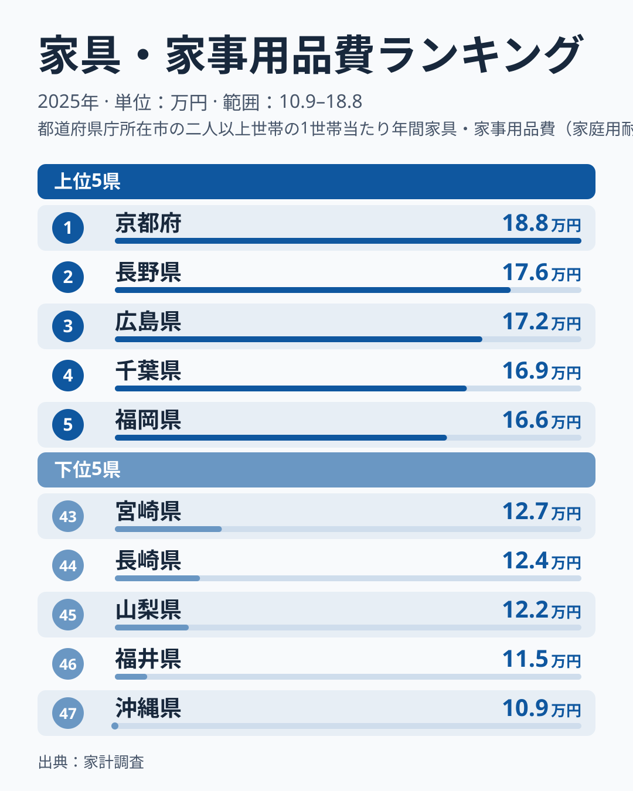
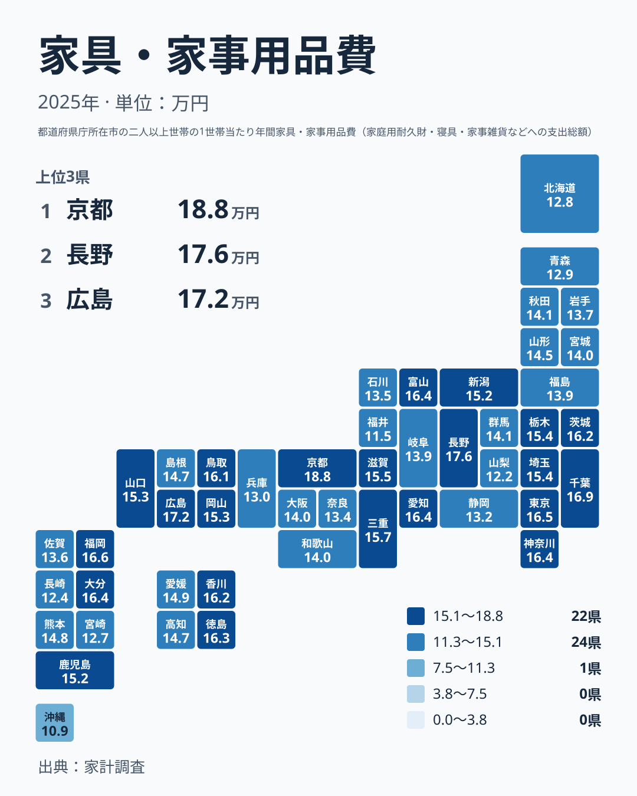

家具や寝具、家電、日用品といった家の中のものに、1年でいくら使っているのか。2025年の家計調査では、1位の京都府が188,364円、最下位の沖縄県が109,087円でした。最大と最小の比は1.73倍です。

この記事では、上位と下位の顔ぶれだけでなく、順位表の「どこが詰まっていて、どこが離れているか」に注目します。そのうえで、数字を暮らしに引き寄せて読むときの注意点を整理します。支出が多いか少ないかは、豊かさの優劣を意味するものではありません。

## 上位5県と下位5県の顔ぶれ

まず、上位と下位を並べた図を見てください。

<source-link href="/ranking/furniture-household-expenditure-total">家具・家事用品費ランキングをもっと見る</source-link>

上位5県は、京都府、長野県、広島県、千葉県、福岡県の順です。注目したいのは、1位の京都府が188,364円なのに対し、2位の長野県は176,346円と、先頭だけが少し離れていることです。2位から5位までの金額は176,346円、171,524円、168,889円、165,517円と、なだらかに下っていきます。1位は「上位グループの一員」というより、独走に近い位置にいます。

下位側は、47位の沖縄県が109,087円、46位の福井県が114,584円、45位の山梨県が121,642円です。沖縄県と福井県の差は5,497円ですが、福井県と山梨県の差は7,058円と、さらに大きく開いています。つまり下位側は、最下位の沖縄県だけが突き出しているのではなく、沖縄県と福井県の2県がまとまって下に離れた形です。44位の長崎県は123,549円、43位の宮崎県は127,258円でした。

つまり、1.73倍という最大の比は、全体がなだらかに広がった結果ではありません。上位では京都府が先頭で外に出て、下位では沖縄県と福井県の2県が下に離れていることで、大きく見えている面があります。

> [!NOTE]
> 家計調査の「家具・家事用品」には、家具、冷蔵庫や洗濯機などの家庭用耐久財、室内装飾品、寝具、家事雑貨、家事用消耗品が含まれます。調査の対象は、都道府県庁所在市などに住む世帯の家計です。県の数字は、県庁所在市の暮らしを中心に映した値です。山間部や離島を含む県全体の平均とは限らないので、「その県の人はこうだ」と広げて読まないでください。

## 京都と沖縄の差を、分布の中に置いてみる

題にした「京都と沖縄の差」は、全国の分布の中に置くと意味が見えてきます。

最大と最小の比は1.73倍ですが、47県の真ん中あたりでは、これほど開いていません。28位の群馬県は141,388円、29位の秋田県は140,877円、30位の和歌山県は140,422円、31位の大阪府は140,142円、32位の宮城県は140,049円、33位の岐阜県は139,070円、34位の福島県は139,031円です。1位から最下位までの大きな幅の途中に、14万円前後で細かく並ぶ帯があります。この帯の中では、順位が数個動いても金額はほとんど変わりません。

一方、15位の三重県は156,991円、23位の愛媛県は149,143円です。15位から23位までの順位9つぶんで、金額は156,991円から149,143円へ動きます。この区間も比較的なだらかです。大きく動くのは、上位の最初の数県と下位の最後の数県だけです。

京都府の188,364円は、15位の三重県の156,991円よりも、さらに上にあります。沖縄県の109,087円は、42位の北海道の128,078円よりも、ずっと下です。両端は、全国のほとんどの県が収まる範囲から外れた場所にいます。「京都と沖縄で1.73倍」という数字は、全国の標準的な差ではなく、分布の両端どうしの差だと理解してください。

## 地方別に見ると、差は地方の内側にある

地理的な広がりを見ます。

地図から読み取れる核は二つあります。一つ目は、近畿の中に大きな差があることです。京都府は1位の188,364円ですが、同じ近畿の兵庫県は40位の129,911円です。一つの地方の中に、1位と40位が同居しています。県ごとの違いは、地方という大きなくくりの違いよりも、地方の内側に現れやすいといえます。

二つ目は、上位10県が複数の地方にまたがっていることです。京都府、長野県、広島県、千葉県、福岡県、東京都、神奈川県、大分県、富山県、愛知県の10県は、近畿、中部、中国、関東、九州・沖縄の5地方に分かれます。「西日本が多い」「東日本が少ない」といった東西の単純な線引きでは、この並びを説明できません。

> [!TIP]
> 地図や順位表を見るときは、順位の数字そのものより、隣り合う順位の金額の開きに注目してください。14万円前後の帯のように金額が詰まっている区間では、順位の違いはほとんど意味を持ちません。逆に、京都府と長野県の間や、福井県と山梨県の間のように金額が離れている箇所は、はっきりした違いとして読めます。

## 考えられる背景(仮説)

なぜこれだけ開くのか。この統計だけでは、原因を特定できません。ここでは、あくまで仮説として、考え方の候補を挙げます。

ひとつ目は、大きな買い物の重なり方です。家具・家事用品費には、毎月の消耗品に加えて、冷蔵庫や洗濯機、寝具のような単価の大きな品目も含まれます。調査対象の世帯の中で、その年に買い替えが重なった世帯が多い県では、平均が押し上げられるかもしれません。

ふたつ目は、住まいの広さや形です。部屋数が多いほど、そろえる家具や寝具、カーテンも増えるという考え方があります。ただし、この統計に住居形態別の内訳はありません。上位に長野県や富山県、徳島県が入っていることを、住まいの条件と結びつけて断定することはできません。

みっつ目は、家計全体の中での配分です。外食や旅行など、家の外に向かう支出が多い地域では、家の中のものに回る金額が相対的に小さくなる可能性があります。ただし、他の費目の金額はこの記事のデータにありません。この点は確かめられていません。

これらは、いずれも検証できていない見立てです。同じ指標で複数年を比べたり、費目の内訳を確認したりしない限り、原因を断定することはできません。

> [!WARNING]
> 家計調査は、都道府県庁所在市などの限られた世帯を対象にした標本調査です。大型家電を買った世帯が少数あるだけでも、平均は動きます。この記事の数字は2025年の1年分で、家具、家電、消耗品の内訳もありません。順位が小さく入れ替わっても、実際の暮らしの違いとは言い切れません。

## 生活にどう引き寄せて読むか

この数字が示すのは、「どの県が浪費しているか」ではありません。調査対象の世帯が1年間に、家の中のものへどれだけ支出したかという金額です。

自分の暮らしに引き寄せるなら、家具・家事用品は支出の波が大きい費目だと理解しておくことが役立ちます。毎月の消耗品の支出は安定していても、引っ越しや家電の寿命が重なる年には、一気に膨らむことがあります。年間の予算を立てるときは、消耗品の月額と、数年に一度の大型の買い物を分けて見積もると、無理のない計画になります。

また、自分の県が全国のどのあたりにいるのかを、帯で捉えることも大切です。たとえば、中位の帯にいる県で、隣の県より数千円少なかったとしても、それは誤差の範囲かもしれません。一方で、京都府や長野県のように上に離れた県、沖縄県や福井県のように下に離れた県は、全国の標準から外れた水準にいます。自分の地域がどちらに近いのかを確認する際の目安にしてください。

京都府と長野県の詳しい数字は、[京都府のデータ](/areas/26000)と[長野県のデータ](/areas/20000)で確認できます。家具・家事用品費だけが高いのか、家計全体が高いのかを知りたいときは、[同じカテゴリの統計一覧](/category/economy)から別の指標を並べて見てください。

## データについて

この記事の数値は、家計調査の「家具・家事用品費」の2025年の値で、単位は円です。47都道府県の値を同じ基準で並べています。最大と最小の比は、1位の京都府188,364円を最下位の沖縄県109,087円で割って求めました。地方のくくりは、北海道・東北、関東、中部、近畿、中国、四国、九州・沖縄の7区分で、三重県は近畿に含めています。
